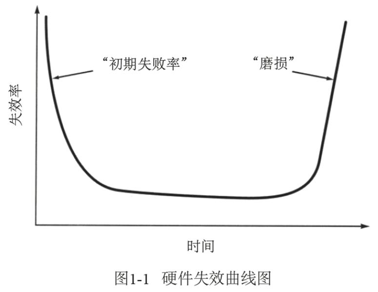
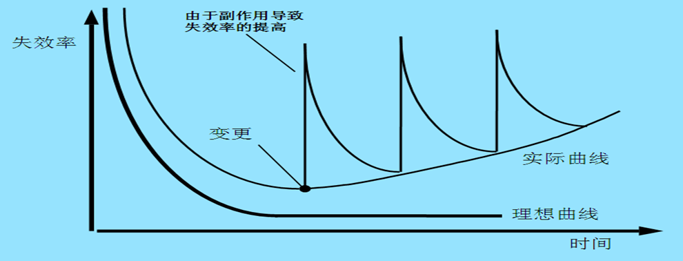
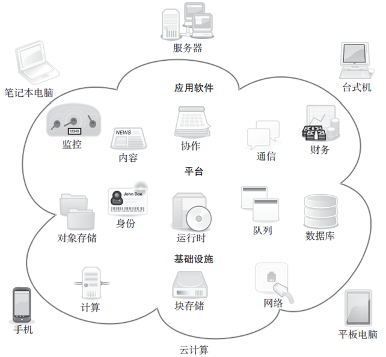
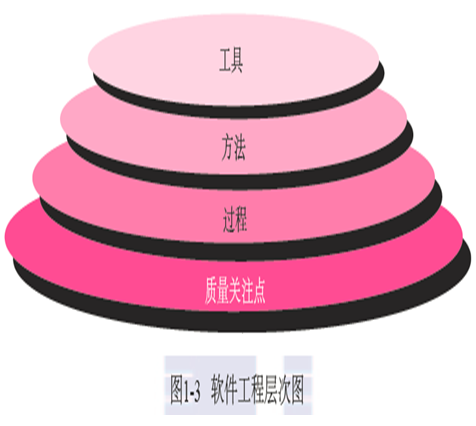

# 第 01 章 软件与软件工程

页码沿用 PPT 页脚。复习时先掌握软件的组成和退化原因（第 8–14 页）、软件工程定义与层次（第 30–32 页）、过程框架与普适性活动（第 34–40 页）。 **第01章.ppt**

## 1.1 软件的本质

### 软件的组成与双重角色（第 5–8 页）

**软件是程序、文档和数据的集合。**

| 组成 | 含义 | 选课系统示例 |
| --- | --- | --- |
| 程序 | 实现所需功能并达到相应性能要求的指令或代码 | 检查选课条件、提交选课结果的代码 |
| 文档 | 开发、使用和维护程序所需的图文资料 | 需求规格说明书、使用手册、维护说明 |
| 数据 | 支撑程序正确处理信息的数据结构及相关数据 | 课程数据库、系统配置文件 |

- **作为产品**，软件产生、管理、查询、修改、显示或传递信息，例如选课系统处理学生的选课信息。
- **作为生产产品的载体**，软件为计算机控制、信息通信和应用开发提供基础，例如操作系统、网络软件和开发工具。

现代软件开发由多个专业角色协作完成，仍要处理开发周期长、成本高、交付前难以发现全部缺陷、维护耗时以及过程难以度量等问题（第 6 页）。

### 软件的工程特性和失效曲线（第 9–14 页）

1. **软件靠设计和开发形成**（第 9 页）。成本主要集中在设计开发。硬件批量生产仍有较高成本，制造阶段也可能引入缺陷。
2. **软件不会发生物理磨损**（第 10–13 页）。软件故障通常要追溯到设计或实现中的缺陷。**不断变更是软件退化的根本原因**。变更新增功能或修复旧问题时，可能引入新的错误并使后续维护变难。
3. **基于构件的构造**（第 14 页）。构件是具有明确功能和接口、可组合与复用的软件单元。课件用图形窗口、下拉菜单等说明可复用构件可以封装数据及其处理。采用现有构件可减少重复开发。

横轴为**时间**，纵轴为**失效率**。比较第 10–12 页的曲线时，既要会描述形状，也要能说明每一段变化的原因。

| 曲线 | 走势与原因 |
| --- | --- |
| **硬件浴缸曲线**（第 10–11 页） | 早期因设计或生产缺陷而处于较高失效率，缺陷纠正后下降。中期保持低位。后期受材料损耗及灰尘、震动、温度等环境因素影响，失效率因磨损再度升高。 |
| **软件理想曲线**（第 12 页） | 初期发现并修正缺陷后，失效率下降，在较低水平趋于稳定。 |
| **软件实际曲线**（第 12 页） | 变更引入的副作用会使失效率突升，修复后再回落。多次变更的影响累积时，回落后的失效率可能逐步抬高。 |

*课件第 10 页　硬件失效的浴缸曲线*

*课件第 12 页　软件的理想与实际失效曲线*

画软件实际曲线时，在每个突升处标出**变更**，并画出其后的回落。软件工程方法力求控制变更的副作用，使实际曲线接近理想曲线。

### 软件应用领域（第 15–22 页）

| 类型 | 按主要用途判断 | 课件页码 |
| --- | --- | --- |
| 系统软件 | 为其他程序提供服务，如编译器、操作系统和驱动程序。常涉及硬件交互、多用户、资源共享、调度、进程同步以及复杂的接口和数据结构。 | 第 15 页 |
| 应用软件 | 服务于特定业务，如销售点交易处理、制造过程实时控制。 | 第 16 页 |
| 工程／科学软件 | 以数值计算为典型特征，如应力分析、航天器轨道计算。 | 第 17 页 |
| 嵌入式软件 | 嵌在设备或系统中，执行该产品的控制功能，如微波炉按键控制、汽车燃油与制动控制。 | 第 18 页 |
| 产品线软件 | 面向多个用户提供一组特定功能，覆盖库存控制等专业市场或文字处理等大众市场。 | 第 19 页 |
| Web 应用软件 | 以网络为中心，规模从超链接网页到网游、网络社区等复杂应用。 | 第 20 页 |
| 人工智能软件 | 处理直接计算与分析难以解决的问题。课件以非数值算法为典型特征，列举专家系统、模式识别、人工神经网络、定理证明和博弈等。 | 第 21 页 |

第 22 页还提到**开放计算**和**开源软件**。前者关注不同设备与企业应用通过网络通信，涉及普适计算、分布式计算和云计算。后者以开放源代码为特征。

### 遗留软件及其演化（第 23–24 页）

**遗留软件**是开发较早、至今仍在使用的软件，可能经过多次修改，也可能仍在支撑核心业务。典型维护困难包括设计难以扩展、代码难懂、文档缺失或混乱、变更管理混乱以及测试记录未归档。满足需求并可靠运行时，以稳定运行为优先。确需变更时，先评估对核心业务的影响。

需要演化的情形包括**适应新的计算环境或技术、满足新的业务需求、与现代系统或数据库协作、适应多样化的网络环境**。

### 课件补充的四种软件形态（第 25–27 页）

- **WebApp**（第 25 页）通过浏览器访问 Web 内容，移动设备也可通过面向移动端的浏览器访问。
- **移动 App**（第 25 页）可直接利用设备的硬件能力，如 GPS 定位，并提供本地处理和存储能力。
- **云计算**（第 26 页）通过网络向多种设备提供资源和服务。图中从底向上分为基础设施（计算、块存储、网络）、平台（运行时、队列、数据库等）、应用软件（协作、通信、财务等）。

  

  *课件第 26 页　云计算的三层结构*

- **产品线软件**（第 27 页）采用共同的底层应用软件和数据体系结构，并在整个产品线中复用一组软件构件。

## 1.2 软件工程的定义与层次（第 29–32 页）

**软件工程（Software Engineering，SE）**是将**系统化、规范化、可量化**的方法应用于软件的**开发、运行和维护**，并研究这些方法。IEEE 的定义同时包含**工程方法的应用**和**对这些方法的研究**（第 30 页）。

**Bauer 的定义**强调建立并使用合理的工程原则，以经济的方式获得可靠且能在实际机器上高效运行的软件（第 30 页）。题干出现「经济地获得可靠、高效的软件」时，识别为这一表述。

软件工程是一种**层次化技术**。第 31–32 页的图从底到顶依次为**质量关注点 → 过程 → 方法 → 工具**。

*课件第 31 页　软件工程的四个层次*

| 层次 | 作用 | 第 32 页的示例 |
| --- | --- | --- |
| 质量关注点 | 是整个层次的基础，引导过程、方法和工具的选择。 | 开发时间、可靠性 |
| 过程 | 提供组织开发工作的框架，规定有哪些活动及其组织方式。 | 瀑布 |
| 方法 | 提供具体的技术做法，包括需求分析、设计建模、编程、测试等。 | 关键路径法 |
| 工具 | 为过程和方法提供自动化或半自动化支持。 | Project 项目管理软件 |

## 1.3 软件过程（第 34–40 页）

**软件过程**是开发软件时遵循的一系列可以预期的活动和步骤，有助于按时交付高质量的软件（第 34 页）。**过程模型**是对软件过程的抽象描述，用来说明活动怎样组织、衔接和推进。第 32 页以瀑布模型为例。

### 过程框架的粒度（第 35 页）

**过程框架 → 框架活动 → 动作 → 任务**。框架规定基本活动，每项活动包含若干动作，每个动作由若干相互关联、可考核的任务组成。例如，建模是一项活动，设计数据模型是其中的动作，确定课程实体的主键可以作为一项具体任务。

### 五个通用框架活动（第 36–37 页）

| 活动 | 主要任务 | 选课系统示例 |
| --- | --- | --- |
| **沟通** | 与客户和其他利益相关者协作，理解项目目标，收集需求以明确特性与功能。 | 和教务老师确认选课、退课及容量限制。 |
| **策划** | 确定技术任务、风险、资源需求、工作产品与进度计划。 | 安排人员、迭代工期和里程碑。 |
| **建模** | 建立模型来理解软件需求，并完成满足需求的软件设计。 | 画选课流程，设计课程与选课记录的数据结构。 |
| **构建** | 生成代码，开展测试以发现编码错误。 | 实现选课逻辑并测试重复选课、容量已满的情况。 |
| **部署** | 交付完整软件或某个增量，由用户评估并给出反馈。 | 先交付试用版本，收集学生和教务老师的反馈。 |

### 八项典型普适性活动（第 38–39 页）

**普适性活动**贯穿项目，补充框架活动，帮助团队管理进度、质量、变更和风险。

| 活动 | 主要作用 |
| --- | --- |
| **软件项目跟踪和控制** | 对照计划检查进度，出现偏差时采取纠正措施。 |
| **风险管理** | 评估可能影响项目成果或产品质量的风险。 |
| **软件质量保证** | 规定并开展质量保证活动，例如检查开发过程和工作产品是否符合质量标准。 |
| **技术评审** | 评估需求、设计、代码等工作产品，尽早发现错误，减少向后续活动传播。 |
| **测量** | 定义并收集过程、项目和产品的度量，帮助判断是否满足利益相关者要求。 |
| **软件配置管理** | 在整个软件过程中控制和追踪变更，例如记录配置项的修改内容和版本。 |
| **可复用管理** | 制定工作产品和构件的复用标准，建立复用机制。 |
| **工作产品的准备和生产** | 准备和生成模型、文档、日志、表格和列表等。 |

辨析时看活动的**目的**。制定进度计划属于策划，对照原定进度检查偏差属于项目跟踪和控制。编码后运行测试以发现实现错误属于构建，审查设计稿并尽早找出错误属于技术评审。

### 过程的适应性调整（第 40 页）

根据问题、项目特点、开发团队和组织文化调整过程。可以调整活动与任务的先后和依赖、任务细化程度、工作产品要求、过程描述的严谨程度，以及质量保证和跟踪控制的做法。客户与利益相关者的参与程度、团队自主权、组织方式和角色分工也可以随项目调整。

## 1.4 软件工程实践（第 42–53 页）

### 解决问题的四步（第 42–46 页）

| 步骤 | 要做什么 | 课件页码 |
| --- | --- | --- |
| **理解问题**（沟通和分析） | 找出利益相关者和未知项，搞清楚需要的数据、功能、特征和行为。必要时分解问题、建立分析模型。 | 第 43 页 |
| **计划解决方案**（建模和软件设计） | 寻找相似问题、可用模式和可复用的方案。分解子问题，用设计模型描述可实施的方案。 | 第 44 页 |
| **实施计划**（代码生成） | 依据设计实现，使源代码可追溯到设计模型。评审设计与代码，必要时论证算法或组成部分的正确性。 | 第 45 页 |
| **检查结果的正确性**（测试和质量保证） | 用合理的测试策略检查各组成部分及整体结果，依据所需数据、功能、特征和行为检查结果，并按利益相关者的需求进行确认。 | 第 46 页 |

题干问「通用过程框架」，答第 1.3 节的五个活动。问「软件工程实践的精髓」，答本节的四个步骤。

### David Hooker 的七个一般原则（第 47–53 页）

| 原则 | 理解与作答关键词 |
| --- | --- |
| **存在价值**（第 47 页） | 以系统能给用户带来的价值作为需求、功能、平台和过程决策的依据。 |
| **保持简洁**（第 48 页） | 在满足必要功能的前提下采用易理解、易维护的设计。简洁通常需要反复推敲。 |
| **保持愿景**（第 49 页） | 明确共同目标，保持体系结构和实现的一致性。 |
| **关注使用者**（第 50 页） | 写需求时考虑用户，设计时考虑实现人员，写代码时考虑后续维护与扩展人员。 |
| **面向未来**（第 51 页） | 考虑需求、技术和平台的变化，让系统能演化并延长使用寿命。 |
| **提前计划复用**（第 52 页） | 在设计时规划可复用的代码与设计，并为复用投入必要的工作。 |
| **认真思考**（第 53 页） | 行动前厘清问题和约束，充分考虑方案，从实践结果中总结经验。 |

## 1.5 软件项目如何开始（第 55 页）

软件工程项目起于**业务需求**。常见动因是纠正现有应用的缺陷、调整遗留系统以适应新业务、扩展现有应用的功能和特性、开发新的产品、服务或系统。初期业务需求往往在谈话中非正式提出，后续通过沟通逐步明确。

## 补充 软件开发神话（第 57–62 页）

**软件神话**是关于软件或开发过程、容易被盲目相信的错误说法。简答时写清楚遵从该说法会带来什么问题，以及应该如何处理。

| 典型说法 | 判断依据与正确做法 | 课件页码 |
| --- | --- | --- |
| 有一套标准和规程就能解决所有问题 | 标准有适用范围，需结合项目特点选用，成效还取决于执行。 | 第 58 页 |
| 项目延期就加程序员 | 新成员培训和协调会消耗已有团队的时间，沟通开销可能加剧延期。先检查延期原因和任务依赖。 | 第 58 页 |
| 外包后可以放手 | 委托方仍需对开发过程、工作产品和交付质量进行监督。 | 第 59 页 |
| 大致了解目标就能动手编码 | 需求是设计、编码和测试的基础。先与利益相关者确认关键需求。 | 第 60 页 |
| 软件很灵活，改需求很容易 | 变更可能影响设计、代码、测试及工期成本。先评估影响，再管理变更。 | 第 60 页 |
| 程序交付就完成了 | 交付后还有运行支持、维护与演化。课件以首次交付后发生 60%–80% 的工作量为例说明其重要性。 | 第 61 页 |
| 程序运行起来才能评价质量 | 项目早期就可评审需求、设计等工作产品，也可以通过运行测试检查已实现的程序行为。 | 第 61 页 |
| 可执行程序是唯一成果 | 可执行程序只是软件配置的一部分，交付时还需要必要文档。 | 第 62 页 |
| 软件工程只会增加无用文档 | 文档有助于沟通、交付和维护。质量活动及有用的工作产品可以减少返工。 | 第 62 页 |

## 自测题

### 作业一第 1–3 题

1. 什么是软件？
2. 什么是软件工程？
3. 什么是过程模型？有哪些框架活动？常见的软件过程普适性活动有哪些？

### 近年真题

#### 真题 1（2023 年 6 月卷，选择题第 1 题，2 分）

引起软件退化的根本原因是（　）。

- A. 软件不断变更
- B. 软件的维护成本过高
- C. 随着时间推移，软件磨损
- D. 软件频繁使用，软件运行效率下降

#### 真题 2（2024 年 12 月卷，选择题第 1 题，2 分）

软件是（　）。

- A. 处理对象和处理规则的描述
- B. 程序
- C. 程序及其文档
- D. 计算机系统

#### 真题 3（2023 年 6 月卷和 2024 年 12 月卷均为选择题第 9 题，各 2 分）

某企业的软件系统希望从 Windows 平台移植到 Linux 平台上，软件开发厂商为了满足企业的要求进行的维护属于（　）。

- A. 改正性维护
- B. 适应性维护
- C. 完善性维护
- D. 预防性维护

#### 真题 4（2024 年 12 月卷，名词解释第 1 题，3 分）

解释名词 **SE**。

#### 真题 5（2024 年 12 月卷，名词解释第 5 题，3 分）

解释名词 **构件**。

---

## 答案与解析

### 作业一

#### 作业第 1 题

**答案与解析**　软件是**程序、文档和数据的集合**。程序实现预期功能。文档说明软件如何开发、使用和维护。数据支撑程序正确处理信息，例如数据库和配置文件（课件第 8 页）。

**考法、答题要点与易错点**　定义题先列全三项，再各说明一种作用。使用手册属于文档，供程序读取的配置文件属于数据。

**笔记位置**　[1.1 软件的组成与双重角色](#软件的组成与双重角色第-58-页)

#### 作业第 2 题

**答案与解析**　软件工程是将**系统化、规范化、可量化**的方法应用于软件的**开发、运行和维护**，以及对这些方法的研究（课件第 30 页）。例如，团队按规定流程评审需求，并统计缺陷数和修复用时来跟踪质量。

**考法、答题要点与易错点**　按三个方法特征、三个应用环节和一项研究内容作答。「可量化」「运行」和「对这些方法的研究」容易漏写。

**笔记位置**　[1.2 软件工程的定义与层次](#12-软件工程的定义与层次第-2932-页)

#### 作业第 3 题

**答案与解析**　过程模型是对软件过程的抽象描述，用来说明各活动如何组织、衔接和推进，例如瀑布模型（课件第 32、34–39 页）。

**五个框架活动**

1. **沟通**　了解利益相关者的目标，收集需求。
2. **策划**　确定任务、风险、资源、工作产品和进度。
3. **建模**　分析需求并建立相应的软件设计模型。
4. **构建**　编写代码并测试，发现实现错误。
5. **部署**　交付软件或增量，请用户评估并收集反馈。

**八项典型普适性活动**

1. **软件项目跟踪和控制**　对照计划检查进度并纠正偏差。
2. **风险管理**　评估可能影响项目成果或产品质量的风险。
3. **软件质量保证**　规定并执行质量保证活动。
4. **技术评审**　检查工作产品，尽早发现错误。
5. **测量**　定义并收集过程、项目与产品的度量。
6. **软件配置管理**　控制和追踪变更。
7. **可复用管理**　制定复用标准并建立复用机制。
8. **工作产品的准备和生产**　准备模型、文档、日志等工作产品。

**考法、答题要点与易错点**　按「过程模型定义、五个框架活动、八项普适性活动」分三段答，每项写出作用。构建包括编码和测试，部署包括交付、用户评估和反馈。技术评审和软件配置管理贯穿项目，属于普适性活动。

**笔记位置**　[1.3 软件过程](#13-软件过程第-3440-页) · [五个通用框架活动](#五个通用框架活动第-3637-页) · [八项典型普适性活动](#八项典型普适性活动第-3839-页)

### 近年真题

#### 真题 1

**答案与解析**　选 **A. 软件不断变更**。修复问题或增加功能时，变更可能引入新的缺陷。变更的影响累积后，可维护性可能下降，失效率曲线的低点可能逐步抬高（课件第 12–13 页）。

**考法、答题要点与易错点**　题目问的是退化的根本原因。维护成本高可能是退化造成的后果，物理磨损解释的是硬件失效曲线的后期上升。

**笔记位置**　[1.1 软件的工程特性和失效曲线](#软件的工程特性和失效曲线第-914-页)

#### 真题 2

**答案与解析**　选 **C. 程序及其文档**。程序实现功能，配套文档支持开发、使用和维护。在给出的选项中，C 同时涵盖两者。

**考法、答题要点与易错点**　选择题看给出的表述，名词解释或简答按课件第 8 页写全**程序、文档、数据**。

**笔记位置**　[1.1 软件的组成与双重角色](#软件的组成与双重角色第-58-页)

#### 真题 3

**答案与解析**　选 **B. 适应性维护**。从 Windows 移植到 Linux 是为了让软件在新的运行平台上继续工作，动因是计算环境变化（课件第 24 页）。

**考法、答题要点与易错点**　案例题先找维护目的。修正已有缺陷属于改正性维护，改善功能或性能属于完善性维护，降低将来出故障的风险属于预防性维护。题干中的平台迁移对应适应性维护。

**笔记位置**　[1.1 遗留软件及其演化](#遗留软件及其演化第-2324-页)

#### 真题 4

**答案与解析**　SE 是 **Software Engineering（软件工程）**。它是将系统化、规范化、可量化的方法应用于软件的开发、运行和维护，并研究这些方法（课件第 30 页）。

**考法、答题要点与易错点**　缩写解释先写全称，再给出定义。应用范围包括运行和维护，定义最后还要写明对这些方法的研究。

**笔记位置**　[1.2 软件工程的定义与层次](#12-软件工程的定义与层次第-2932-页)

#### 真题 5

**答案与解析**　构件是具有**明确功能和接口**、可以**组合与复用**的软件单元。例如，下拉菜单构件封装菜单数据及相应操作，并通过接口供其他软件调用（课件第 14、27 页）。

**考法、答题要点与易错点**　定义题写清它是什么、怎样与其他单元协作、能否复用。举例时也写出该构件提供的功能或接口。

**笔记位置**　[1.1 软件的工程特性和失效曲线](#软件的工程特性和失效曲线第-914-页) · [课件补充的四种软件形态](#课件补充的四种软件形态第-2527-页)

题目来源　**作业一** · **2023-06-09 期末卷** · **2024-12-27 期末卷**
