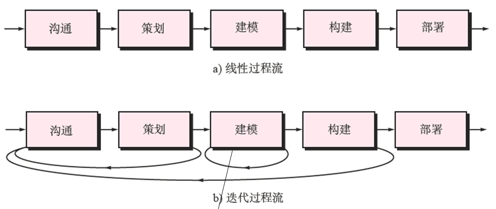
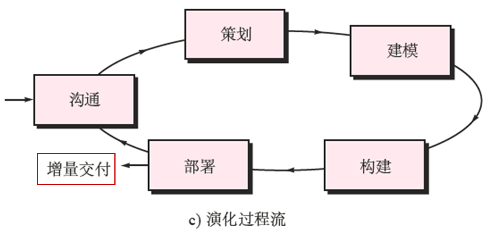
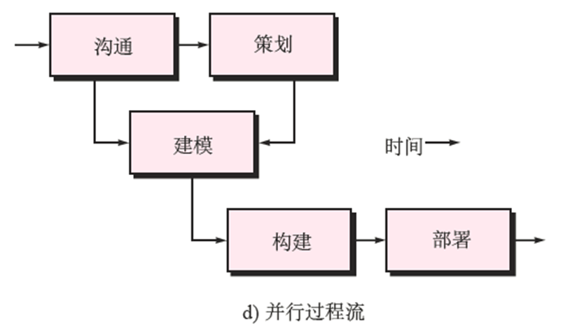
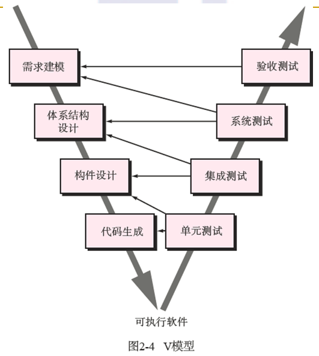
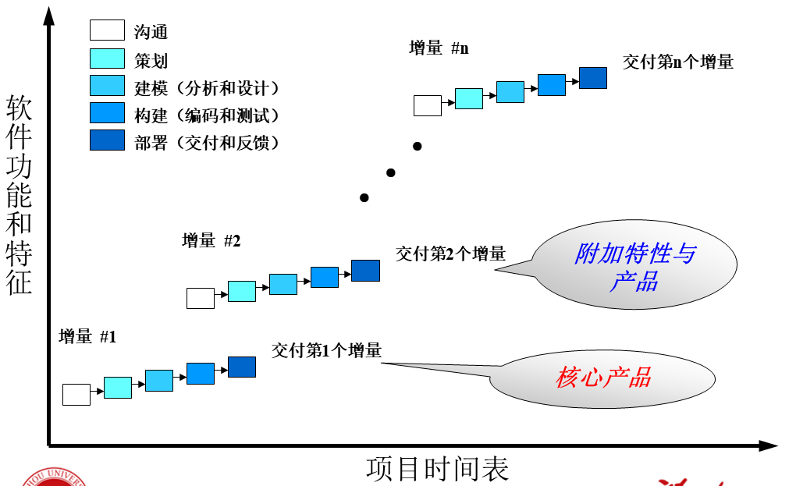
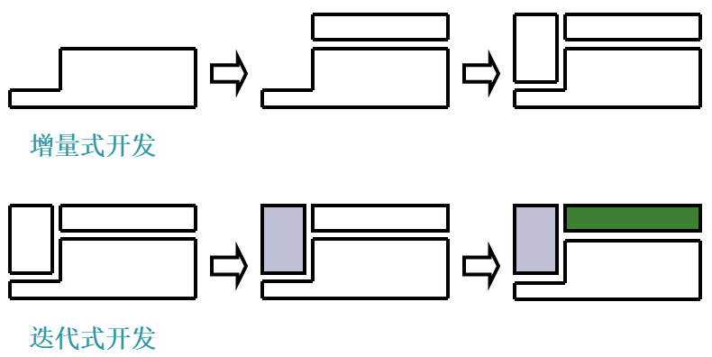
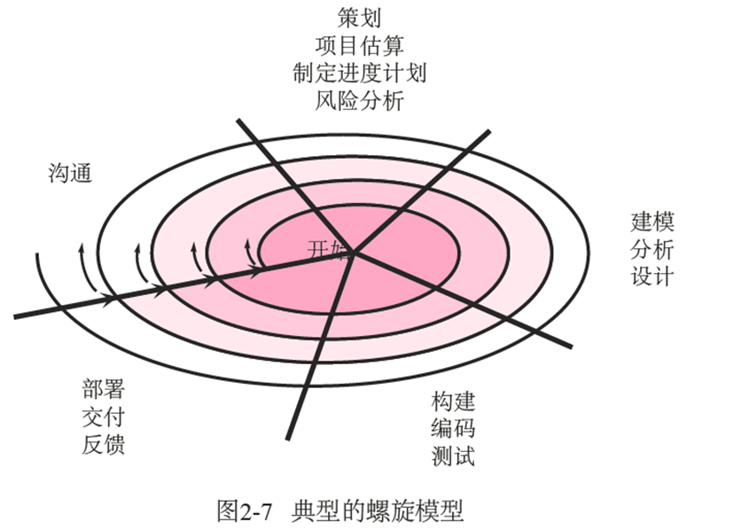
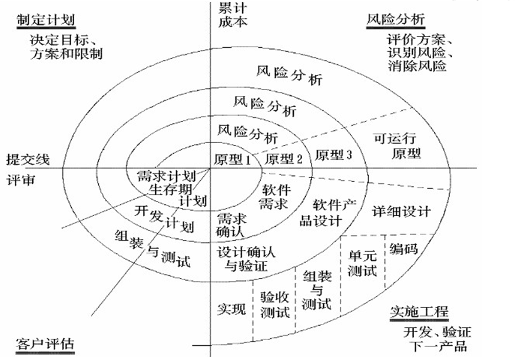
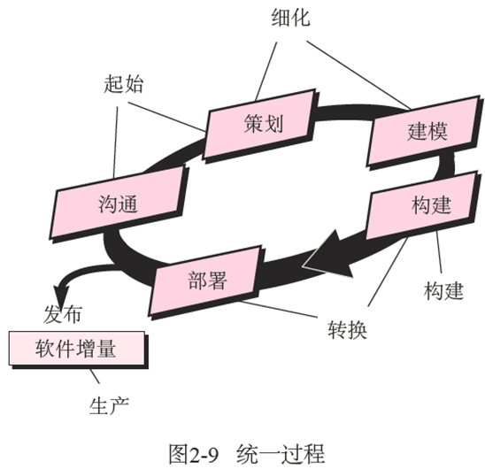

# 第 02 章 软件过程结构

## 通用过程模型

*2.1　课件第 3–6 页*

**过程模型**又称软件生存周期模型，描述软件过程中的活动如何组织和推进。各模型都支持通用框架活动，对活动的安排和侧重各有不同（第 20 页）。

**通用过程框架**给出五种基本活动，依次记为**沟通、策划、建模、构建、部署**（第 3 页）。图中的关系是**过程框架 → 框架活动 → 软件工程动作 → 任务集**。普适性活动覆盖各个框架活动。

**过程流**描述框架活动在时间上怎样排列、重复或重叠。

| 过程流 | 图形与运行特点 | 课件页码 |
| --- | --- | --- |
| **线性过程流** | 沟通 → 策划 → 建模 → 构建 → 部署，沿一条主线依次推进。 | 第 4 页 |
| **迭代过程流** | 进入下一个活动前，重复当前或先前的一个或多个活动。画图时用回返箭头表示。 | 第 4 页 |
| **演化过程流** | 多个框架活动组成循环。每轮都加深对系统的理解，产生更完善的版本，图中在部署处标出增量交付。 | 第 5 页 |
| **并行过程流** | 一个或多个活动与其他活动同时进行，各活动在时间上可以重叠，仍要满足依赖。 | 第 6 页 |

*课件第 4 页　线性过程流与迭代过程流*

*课件第 5 页　演化过程流*

*课件第 6 页　并行过程流*

## 2.2 定义框架活动（第 8 页）

同一个框架活动可以根据**项目规模、需求明确程度和利益相关者数量**拆成不同的动作。以沟通为例，小项目可能只需要一次电话交流。相应任务是联系利益相关者、讨论并记录需求、整理简明的书面需求、发邮件请对方审阅和批准。

多个利益相关者参与复杂项目时，沟通可分解成项目启动、需求获取、细化、谈判、规格说明与确认等动作。

## 明确任务集

*2.3　课件第 3、10–11 页*

**任务集**规定为实现某个软件工程动作的目标所需的工作。第 3 页的框架图列出四项内容，即**工作任务、工作产品、质量保证点、项目里程碑**。例如，需求访谈是工作任务，需求清单是工作产品，需求评审可作为质量保证点，确认需求清单可作为里程碑。

**需求获取**是沟通中的一个动作，目的是了解利益相关者要求软件提供什么功能和特征。

- **小型项目**（第 10 页）。列出利益相关者，安排非正式会议，逐一询问需求，讨论并确定需求清单，划分优先级并标出不确定的部分。
- **大型复杂项目**（第 11 页）。先识别并单独访谈利益相关者，整理初步功能与特征。再组织多次会议，建立并依据反馈细化用户场景，形成修订的需求清单。随后用质量功能部署（QFD）划分优先级，对需求分组以支持增量交付，记录系统约束，并讨论如何验证系统。

## 补充 过程模式

*课件第 13–18 页*

**过程模式（process pattern）** 描述反复遇到的过程问题、问题所处的环境，以及一个或多个经过验证的解决方案。团队可以组合多个模式，为具体项目组织开发过程。

| 类型（由高到低） | 描述对象 | 例子 |
| --- | --- | --- |
| **阶段模式** | 一系列框架活动 | 需求不清时，用原型开发组织一系列活动（第 17 页）。 |
| **步骤模式** | 一个框架活动 | 策划（第 14–15 页）。 |
| **任务模式** | 一个软件工程动作或任务 | 项目估算、回归测试（第 14–15、18 页）。 |

**Ambler 过程模式模板**（第 15–16 页）要写清模式名称、驱动力、类型、启动条件、问题、解决办法、结束条件、相关模式和已知应用实例。驱动力交代适用环境和主要难点，问题指明具体要解决什么。启动条件写进入状态、已完成工作和已有信息，结束条件写退出状态、应完成工作和产生的信息。

- **「需求不清」阶段模式**（第 17 页）。先识别利益相关者、建立沟通方式、明确主要问题，并初步了解项目范围、业务需求与约束。通过原型反复接受用户评估，直到主要需求获得认可。原型随后可以通过一系列增量演化为产品，也可以抛弃，再开发正式产品。
- **「回归测试」任务模式**（第 18 页）。输入为旧测试用例、修改后的软件和针对修改部分的新用例。课件示例先执行旧用例，再执行新用例，输出完成测试的软件。回归测试关注**变更有没有引入新错误或影响已有行为**，相关模式包括单元测试和系统测试。

## 惯用过程模型

*2.4　课件第 20–48 页*

### 瀑布模型与 V 模型

*课件第 21–24、57–62 页*

**瀑布模型（Waterfall Model）** 按固定的阶段主线组织开发，又称**经典生命周期**。第 22 页以五个通用框架活动画瀑布，第 57 页以**计划 → 需求分析 → 设计 → 编码 → 测试 → 运行与维护**画瀑布，并画出了相邻阶段的反馈回退。计划和需求分析属于定义阶段，设计、编码和测试属于开发阶段，运行与维护属于维护阶段。

第 22 页的框架活动及其动作是**沟通**（项目启动、需求获取）、**策划**（项目估算、进度计划、项目跟踪）、**建模**（分析、设计）、**构建**（编码、测试）和**部署**（交付、支持、反馈）。

瀑布模型有三个典型特点。

1. **阶段之间有顺序性和依赖性。** 前一阶段完成后启动后一阶段，前一阶段的输出文档是后一阶段的输入。
2. **推迟实现。** 先完成分析和设计、理清逻辑，再处理编程语言等具体实现问题，减少过早编码带来的返工。
3. **分阶段保证质量。** 每阶段完成规定的文档并复审，及早发现错误。

阶段模板让分析、设计、编码、测试和维护按可预期的顺序展开，适用于**需求能够准确定义、变更相对少**的项目（第 62 页）。需求频繁变化会扩大返工。用户通常较晚看到可运行软件，缺陷也可能较晚暴露。阶段依赖还可能造成等待和阻塞。

**V 模型**（第 23 页）保留瀑布的阶段主线，把验证与确认活动对应到早期的需求、设计和实现工作。沿左侧向下经过需求建模、体系结构设计、构件设计和代码生成。完成编码后，沿右侧向上开展测试。

*课件第 23 页　V 模型的开发阶段与测试层级*

| 右侧测试顺序 | 第 23 页中对应的左侧工作 |
| --- | --- |
| 单元测试 | 构件设计、代码生成 |
| 集成测试 | 体系结构设计、构件设计 |
| 系统测试 | 需求建模、体系结构设计 |
| 验收测试 | 需求建模 |

### 增量模型

*课件第 25–32、65–67 页*

**增量模型**把产品功能拆成若干批次，每一批次都经历一系列开发活动并交付**可运行且能为用户提供部分服务的产品**。每个增量内部可以采用瀑布或快速原型方式，不同增量可在时间上适当重叠（第 25、27、66 页）。

- **首个增量通常是核心产品。** 先满足基本需求，用户使用或评审后，根据反馈安排下一增量的改进和附加功能。文字处理软件可以先交付基本的文件管理和编辑功能，再追加复杂编辑、拼写及语法检查、高级排版（第 26 页）。购物网站可以先上线注册、搜索、购物与结算，再加入销售统计、推荐和会员管理（第 29 页）。
- **适用条件与收益。** 功能可分批交付且需要尽快提供可用版本时，团队可先集中力量保证核心功能，让用户提早使用、学习并反馈，也可用早期版本验证市场需求。人手有限时先做好核心。有交付时间不确定的硬件或技术时，可以把依赖它的功能安排在后续增量，降低整个项目无法交付的风险（第 28、30 页）。
- **主要难点。** 功能联系紧时难以拆成彼此可交付的版本。各增量需要预先协调共用模块和整体架构，用户也需要接受分批交付（第 31、67 页）。

第 27 页的图以项目时间为横轴、软件功能和特征为纵轴，先交付核心产品，再逐步加入功能。

*课件第 27 页　增量模型的交付时间线*

第 32 页的示意图区分两种侧重。**增量式开发**逐步增加功能模块，**迭代式开发**先形成各模块的初步版本，再轮流改进。

*课件第 32 页　增量式开发与迭代式开发*

### 原型开发

*课件第 33–35、64 页*

**原型开发**通过快速建造可供评估的原型，澄清需求或验证技术可行性。适用于客户说得清大体目标但尚未定义详细输入、处理、输出的项目，也适用于运行环境、算法效率、兼容性或交互方式尚不确定的项目。

**沟通 → 快速策划 → 快速设计 → 构建原型 → 交付评估并收集反馈 → 再沟通**。快速设计优先呈现对验证有用的部分，例如界面布局和输出格式。用户试用或评估后，团队据此修正原型、细化需求（第 33–34 页）。

课件强调用户积极参与，以及使用快速开发工具（第 64 页）。**抛弃型原型**用于明确需求，完成验证后全部或部分弃用，正式开发时充分考虑质量与可维护性。第 17 页也给出了通过后续增量使合适的原型演化为产品的情形。

主要风险是用户把试验原型当成已可交付的产品，或开发者把为快速验证而采用的临时语言、平台或低效算法带入正式系统。应明确原型的验证目标和正式发布所需的质量条件（第 35、64 页）。

### 演化过程模型与螺旋模型

*课件第 36–40、68–70 页*

**演化过程模型**以迭代方式产生更完整的软件版本，适用于业务或产品需求在开发中持续变化、核心需求已知但扩展细节不明，或面临提前交付压力的情况。迭代次数难预估，按活动线性排列制定计划和估算成本的方法往往需要调整。演化节奏过快容易失控，过慢会影响生产率，因此要在追求速度与灵活性的同时安排质量活动（第 36、40 页）。

**螺旋模型**是**风险驱动**的演化模型，结合瀑布模型的系统性与里程碑、原型开发的迭代性，并在每一圈进行风险分析。沿螺线由内向外逐步深化系统定义和实现。早期成果可以是需求规格说明、纸面模型或原型，随后形成更完整的版本。该方式适用于**风险较高的大型系统**（第 37–39、68–70 页）。

| 一圈的四项工作（第 69–70 页） | 主要任务 |
| --- | --- |
| **制定计划** | 确定本轮目标、备选方案与约束。 |
| **风险分析** | 评价方案，识别风险，并采取原型验证等办法降低风险。 |
| **实施工程** | 开发并验证本轮成果。 |
| **客户评估** | 评估成果、取得利益相关者反馈，同时形成下一轮计划。 |

第 38 页用五类框架活动画螺旋，把风险分析放在策划中。

*课件第 38 页　螺旋模型中的五类框架活动*

第 69 页用四个区域画每圈的工作，向外推进时累计成本增加。

*课件第 69 页　螺旋模型每一圈的四项工作*

用里程碑让各方评审并认可阶段方案，根据风险和阶段成果调整迭代计划。模型覆盖从概念开发、新产品开发到产品改进的整个生命周期。软件交付后有新的变更请求时，可以从相应的入口重新启动一轮演化（第 39 页）。

### 统一过程 UP

*课件第 41–48 页*

**统一过程（Unified Process，UP）** 是 Booch、Jacobson 和 Rumbaugh 提出的面向对象软件过程框架，可用统一建模语言（UML）表达各类模型。UML 提供表达系统的建模符号，UP 给出何时建模、建模结果怎样用于开发的过程框架。UP 强调客户沟通，从用户视角描述系统。三个特征是**用例驱动、以架构为核心、迭代并且增量**（第 41–42 页）。

| 阶段 | 主要工作与结果 | 课件页码 |
| --- | --- | --- |
| **起始（inception）** | 明确主要业务需求，写初步用例，形成初步体系结构。识别资源和主要风险，拟订迭代与增量计划。 | 第 44 页 |
| **细化（elaboration）** | 细化用例及体系结构的五类模型，即用例、需求、设计、实现和部署。可建立可执行的体系结构基线来验证架构可行性，同时修订范围、风险与进度计划。 | 第 45 页 |
| **构建（construction）** | 以体系结构模型为输入，开发或获取构件，实现该增量的功能，进行单元测试和集成测试，并从用例导出验收测试。 | 第 46 页 |
| **转换（transition）** | 交给最终用户进行 Beta 测试，收集缺陷和变更反馈，准备用户手册、排错指南等发布材料，形成可用发布版本。 | 第 47 页 |
| **生产（production）** | 监控运行、支持使用环境，记录和评估缺陷报告及变更请求。 | 第 48 页 |

第 43 页的图显示，这些阶段反复使用通用框架活动并发布软件增量。前一个增量进入构建、转换或生产时，下一个增量的工作可以已经启动。

*课件第 43 页　统一过程的阶段与增量交付*

## 补充 专用过程模型（第 50–52 页）

- **基于构件的开发模型**有演化与多轮迭代的特点。它利用预先打包的构件开发系统，通过复用减少开发费用和时间。基本步骤是**研究与评估可用构件 → 考虑集成问题 → 设计容纳构件的体系结构 → 集成构件 → 充分测试**（第 50–51 页）。
- **形式化方法模型**以数学形式的规格说明为基础，用严格的数学符号描述、开发和验证系统。它便于查出规格中的歧义、不完整和不一致，也可以作为程序验证的基础。代价是耗时、培训和开发成本较高，与不熟悉形式化表达的客户沟通较难。课件举出的应用包括对安全性要求高的航空器、医疗设施和经济领域软件（第 52 页）。

## 2.5 产品和过程（第 54 页）

良好的过程用标准、步骤和检查机制支撑产品质量。产品设计还需要创造性和针对具体需求的取舍。制定过程时要把必要的质量控制和可留给团队的判断空间一起考虑。

## 补充 过程模型回顾（第 56、71–73 页）

课件把过程模型的共性归纳为**定义或计划、开发、维护**三类工作，分别解决**做什么（What）、怎么做（How）、怎么改（Change）**。第 56 页还列出了快速应用开发、敏捷过程和并发开发等模型。

模型的适用性取决于需求稳定程度、功能能否分批交付、技术风险以及首次可用版本的期限。

## 自测题

### 作业一第 3–4 题

3. 什么是过程模型？有哪些框架活动？常见的软件过程普适性活动有哪些？
4. 惯用的过程模型有哪些？都有哪些特点和适用场景？

### 近年真题

#### 真题 1（2024 年 12 月卷，选择题第 4 题，2 分）

哪种模型是分批地逐步向用户提交产品，每次提交一个满足用户需求子集的可运行产品（　）。

- A. 增量模型
- B. 瀑布模型
- C. 原型模型
- D. 螺旋模型

#### 真题 2（2023 年 6 月卷选择题第 2 题、2024 年 12 月卷选择题第 7 题，各 2 分）

螺旋模型主要针对（　）。

- A. 需求不明确的项目
- B. 风险较高的大型系统
- C. 完成时间要求紧迫的项目
- D. 风险较低的小型系统

#### 真题 3（2023 年 6 月卷简答题第 4 题、2024 年 12 月卷简答题第 2 题，各 5 分）

公司计划采用新技术开发一款新的手机软件产品，希望尽快占领市场，假设你是项目经理，你会选择哪种软件过程模型？为什么？

### 课件选型例题

为下列每个项目选择过程模型，并用一句话说明理由。

1. 客户不太清楚待开发的系统需要提供什么服务。
2. 开发团队了解待开发软件的相关领域知识。尽管系统庞大，但它与已开发的系统差异并不大。
3. 软件对读入的浮点数开平方，结果应该精确到小数点后 4 位。
4. 开发一个已发布软件的新版本，公司规定了严格的完成期限，并对外公布。
5. 开发汽车防锁死刹车控制系统。
6. 用一套新的大学记账系统替换一个已存在的系统。
7. 开发一个位于火车站的交互式火车车次查询系统。

---

## 答案与解析

### 作业一

#### 作业第 3 题

**答案与解析**　过程模型是对软件过程的抽象描述，规定活动怎样组织、衔接和推进。五个通用框架活动是沟通（理解目标和需求）、策划（安排任务、资源和进度）、建模（分析需求和设计）、构建（编码和测试）、部署（交付、用户评估和反馈）。

八项典型普适性活动是**软件项目跟踪和控制、风险管理、软件质量保证、技术评审、测量、软件配置管理、可复用管理、工作产品的准备和生产**。它们贯穿项目，支撑进度、质量、变更与风险管理。比如制定工期属于策划，开发过程中持续对照工期并纠正偏差属于项目跟踪和控制。

**考法、答题要点与易错点**　先定义模型，再列两组活动。写框架活动时保留「建模」「构建」的课件术语，部署写到用户反馈。普适性活动常漏「可复用管理」和「工作产品的准备和生产」。

**课件位置**　课件第 3–6、20 页及第 01 章课件第 38–39 页。

**笔记位置**　[2.1 通用过程模型](#通用过程模型)

#### 作业第 4 题

**答案与解析**

| 过程模型 | 特点 | 适用场景 |
| --- | --- | --- |
| 瀑布模型 | 按阶段推进，前一阶段的输出是后一阶段的输入，每阶段要有文档和评审。 | 需求已准确定义，后续变更较少。 |
| 增量模型 | 先交付核心产品，再累加特性，每次提供一个可运行的产品。 | 功能能够按批次拆分，需要尽早交付基本服务，或早期人力和技术资源有限。 |
| 原型开发 | 快速制作原型给用户评估，通过反馈反复明确需求或验证可行性。 | 用户需求不具体，或关键技术、运行环境、交互方案有待验证。 |
| 演化过程模型（如螺旋模型） | 迭代产生更完整的版本。螺旋按风险驱动每一圈工作，并设评审里程碑。 | 需求可能变化。对于风险较高的大型系统，螺旋可逐轮控制风险。 |
| 统一过程 | 用例驱动、以架构为核心、迭代并且增量。 | 适合需要用 UML 建模、以用户用例和系统架构组织增量开发的面向对象项目。 |

**考法、答题要点与易错点**　每种模型都写「如何推进」和「适用前提」。增量答到每次交付可运行产品，原型答到用户评价和反馈，螺旋答到每轮风险分析。

**课件位置**　课件第 21–48、57–70 页。

**笔记位置**　[2.4 瀑布](#瀑布模型与-v-模型) · [增量](#增量模型) · [原型](#原型开发) · [演化与螺旋](#演化过程模型与螺旋模型) · [统一过程](#统一过程-up)

### 近年真题

#### 真题 1

**答案与解析**　选 **A. 增量模型**。首个增量通常交付可用的核心产品，后续增量增加或改进功能。每次发布都要覆盖一部分真实需求并具备运行和服务能力。

**考法、答题要点与易错点**　同时抓住「分批交付」「需求子集」「可运行产品」。原型可以主要用于评估和澄清需求。螺旋的早期成果也可以是纸面模型或原型。

**课件位置**　课件第 25–28、66、68 页。

**笔记位置**　[2.4 增量模型](#增量模型) · [演化过程模型与螺旋模型](#演化过程模型与螺旋模型)

#### 真题 2

**答案与解析**　选 **B. 风险较高的大型系统**。每一圈先确定目标、评价方案和风险，再实施工程并由客户评估，适合逐轮降低复杂项目的不确定性。

**考法、答题要点与易错点**　螺旋模型的辨识词是「风险驱动」。仅有需求不清这一线索时，要想到原型开发也可以处理这个问题。螺旋的典型适用场景还强调系统规模和风险程度。

**课件位置**　课件第 33、37–39、69–70 页。

**笔记位置**　[2.4 演化过程模型与螺旋模型](#演化过程模型与螺旋模型)

#### 真题 3

**答案与解析**　可选**演化式原型**。先做小规模原型，检验新技术和运行环境的兼容性，并让用户试用核心交互、明确关键需求。验证通过后，完善原型中适合保留的部分，按要求补足质量与可维护性，将核心功能做成可运行的首个版本并尽早发布。再根据真实用户反馈，通过后续增量扩展功能。

**考法、答题要点与易错点**　情境有两个约束。针对「新技术」写原型验证的目标，针对「尽快占领市场」写核心版本如何尽早发布，并说明怎样从反馈推进下一版。把可试用的原型和达到交付标准的首版交代清楚。

**课件位置**　课件第 17、25–28、33–36 页。

**笔记位置**　[需求不清的过程模式](#补充-过程模式) · [2.4 原型开发](#原型开发) · [增量模型](#增量模型)

### 课件选型例题

| 题号 | 答案与解析 | 考法、答题要点与易错点 | 课件位置 | 笔记位置 |
| --- | --- | --- | --- | --- |
| 1 | **原型模型**。用可评估的原型与客户反复确认系统服务。 | 客户尚未明确需求，优先安排能够获得反馈的验证。 | 课件第 71 页。 | [2.4 原型开发](#原型开发) |
| 2 | **瀑布模型**。团队熟悉领域，新旧系统差异小，可先定义需求，再按阶段推进。 | 规模大只是题设的一部分，选型依据是需求明确与经验充分。 | 课件第 71 页。 | [2.4 瀑布模型](#瀑布模型与-v-模型) |
| 3 | **瀑布模型**。功能和精度要求明确，可以按分析、设计、实现和测试的顺序做。 | 「小数点后 4 位」是可用于验证结果的明确要求。 | 课件第 72 页。 | [2.4 瀑布模型](#瀑布模型与-v-模型) |
| 4 | **增量模型**。先保证期限内交付新版的核心功能，再安排其他功能。 | 写清期限前交付的是可运行的一部分，并说明功能可分批。 | 课件第 72 页。 | [2.4 增量模型](#增量模型) |
| 5 | **螺旋模型**。控制系统需要应对较高的技术和安全风险，宜逐轮识别、验证和降低风险。 | 理由写到**风险分析**以及每圈怎样逐步加深定义和实现。 | 课件第 73 页。 | [2.4 螺旋模型](#演化过程模型与螺旋模型) |
| 6 | **瀑布模型**。在题设中，现有系统提供了明确的需求基线，可以据此规划各阶段。 | 已有系统帮助确定需求，仍应先确认替换范围。 | 课件第 73 页。 | [2.4 瀑布模型](#瀑布模型与-v-模型) |
| 7 | **原型模型**。可以快速展示查询界面和结果，依据用户试用反馈完善交互。 | 把「交互式」落实为需要用户反复确认的操作流程和信息展示。 | 课件第 73 页。 | [2.4 原型开发](#原型开发) |

题目来源　**作业一** · **2023-06-09 期末卷** · **2024-12-27 期末卷**
