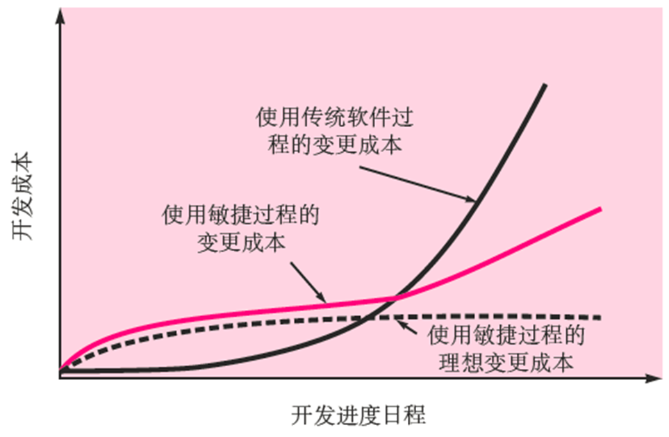
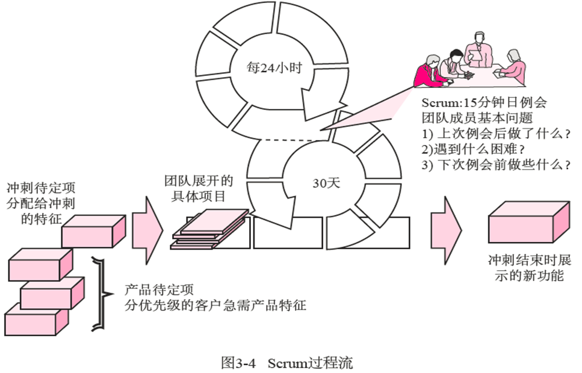
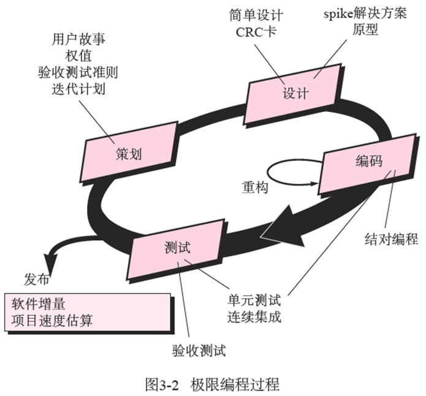
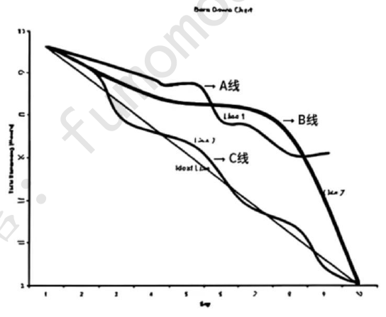

# 第 03 章 敏捷与敏捷过程

页码沿用 PPT 页脚。复习时先掌握敏捷宣言、敏捷过程的三个假设、Scrum 的过程流和 XP 的四类活动。 **第03章.ppt**

## 3.1 什么是敏捷（第 2–10 页）

**敏捷开发**是一种以人为核心、通过**迭代和增量交付**响应需求变化的软件开发方法。第 2 页指出，成员的技能和沟通方式有差异，僵化的流程容易遇到执行困难。面对需求、团队和技术的变化，敏捷团队通过合作缩短交付周期，让客户持续参与，并根据反馈调整计划（第 3、9–10 页）。

### 敏捷宣言（第 3 页）

1. **个体与交互**胜过过程与工具。
2. **可用的软件**胜过完备的文档。
3. **客户协作**胜过合同谈判。
4. **响应变化**胜过遵循计划。

两边的事项都有价值。遇到取舍时，左侧优先。例如，团队保留用于交付和维护的文档，把主要精力放在能运行、能让客户验证的软件上。

### 五项价值观（第 3–7 页）

| 价值观 | 在开发中怎样体现 |
| --- | --- |
| **沟通** | 让开发、业务人员和其他利益相关者及时交流，使大家对目标、需求和障碍有共同理解。 |
| **简单** | 选用能解决当前问题且容易交流和修改的设计与表达方式。 |
| **反馈** | 通过模型、测试和交付获得反馈，尽快纠正误解与错误。 |
| **勇气** | 主动承担责任，敢于测试和重构、回应变更、说明承诺的边界，并根据回顾和建议改进做法。 |
| **尊重（谦逊）** | 认可开发人员、客户等各方的专业知识和贡献，愿意听取反馈。 |

## 3.2 敏捷及变更成本（第 12–14 页）

第 14 页图的横轴是**开发进度日程**，纵轴是**开发成本**，曲线比较的是在不同阶段发生变更时的代价。

*课件第 14 页　敏捷与传统过程的变更成本*

| 曲线 | 如何理解 |
| --- | --- |
| **传统过程的变更成本** | 项目早期多在调整需求。项目后期，一项功能变更可能要改体系结构、补建或修改构件、重做测试，代价呈非线性增长。 |
| **使用敏捷过程的变更成本** | 实际曲线仍会升高，图中后期上升较缓。通过小增量交付和及时反馈，需求问题较早暴露。持续单元测试和结对编程也能尽早发现变更引起的错误。 |
| **使用敏捷过程的理想变更成本** | 曲线趋平，表示希望把项目后期的变更代价控制在可承受范围。 |

答「为什么能拉平」时，说明**小增量减少一次改动的范围，快速反馈提前暴露问题，持续测试和评审减少返工**（第 12–14 页）。

## 3.3 什么是敏捷过程（第 16–24 页）

**敏捷过程**是按敏捷原则组织开发、依靠反馈进行**自适应**并实现**增量式提高**的过程。不同敏捷模型可根据项目情况侧重不同原则（第 17–20 页）。

### 十二项敏捷原则（第 16–17 页）

1. 尽早、持续地交付有价值的软件，使客户满意。
2. 欢迎需求变化，包括开发后期的变化，并用变化为客户创造竞争优势。
3. 经常交付可运行软件，间隔可从数周到数月，优先选择较短的间隔。
4. 业务人员和开发人员在项目期间每天合作。
5. 围绕有积极性的人组建团队，提供环境和支持，并信任他们完成工作。
6. 用面对面交谈促进团队内高效沟通。
7. 以可运行软件作为衡量进度的首要标准。
8. 保持可持续的开发速度，让项目负责人、开发者和用户能长期以稳定节奏工作。
9. 持续关注技术水平和良好设计，提高适应变化的能力。
10. 保持简单，减少不必要的工作。
11. 用自组织团队形成好的体系结构、需求和设计。
12. 定期回顾工作方式，按回顾结果调整团队行为。

### 三个假设与自适应（第 19–20 页）

1. **需求和优先级难以事先预测。** 开发中会出现新需求，需求的轻重缓急也可能改变。
2. **设计和构建会交替反复。** 实现中发现的问题会推动设计调整。
3. **分析、设计、构建和测试都要不断调整。** 团队通过完成可运行的增量获得反馈，及时改变下一步工作的内容和方法。

自适应要形成闭环。**交付可运行增量 → 得到反馈 → 调整优先级、设计或测试 → 交付改进的增量**。

### 敏捷团队的人员因素（第 21–24 页）

| 因素 | 要求 |
| --- | --- |
| 基本能力 | 具备个人才能、软件相关技能，以及对所采用过程的整体认识。 |
| 共同目标 | 在承诺时间内向客户交付可运行的软件增量。 |
| 精诚合作 | 团队成员之间以及团队与其他利益相关者之间有效合作。 |
| 决策能力 | 团队对技术与项目问题拥有适当的自主决策权。 |
| 模糊问题解决能力 | 面对不完整的信息和变化，仍能做出决定、推进工作并及时纠正。 |
| 相互信任和尊重 | 建立凝聚力，发挥不同成员的长处。 |
| 自组织 | 团队自己**组织团队、组织过程、组织进度**，即安排工作分工、采用适合环境的过程、制定可交付增量的进度。 |

## 3.4 Scrum（第 26–29 页）

**Scrum**用一轮轮有固定时限的**冲刺（Sprint）**组织团队工作，从需求、分析、设计到演化和交付，按反馈推进。第 29 页过程图可读成**产品待定项 → 冲刺待定项 → 冲刺工作及每日例会 → 冲刺结束展示新功能 → 根据反馈安排后续工作**。

*课件第 29 页　Scrum 的冲刺周期与每日例会*

| 术语 | 含义和用途 |
| --- | --- |
| **产品待定项（Product Backlog）** | 按优先级排列、能带来业务价值的需求或特征。新项可以加入，课件将评估和调整优先级交给产品经理。 |
| **冲刺待定项（Sprint Backlog）** | 本轮从产品待定项中选入的特征及其具体工作。 |
| **冲刺（Sprint）与时间盒（time-box）** | 团队在预定时限内完成选定工作并产出可展示的新功能。第 27、29 页以 30 天为例。保持本轮工作安排稳定，新需求可登记到产品待定项，供后续计划考虑。 |
| **Scrum 例会** | 团队每天用短会同步进展和障碍。课件用 15 分钟举例，由 Scrum 主持人组织，帮助团队及时发现问题并促进自组织。 |

**例会三问**（第 28–29 页）

1. 上次例会后做了什么？
2. 遇到了什么困难？
3. 下次例会前计划做些什么？

### 燃尽图（真题补充）

**燃尽图（Burn Down Chart）**的横轴是迭代时间，纵轴是本次迭代的**剩余工作量**，本题用各故事或任务剩余时间的总和。理想参考线从初始工作量逐步下降，到迭代末降至零。看实际曲线时，观察它与参考线的差距、明显的平台或上升，以及迭代结束时是否归零。可在每日例会中结合任务情况讨论原因。图题见 2023 年 6 月卷第 9 页。

## 3.5 其他敏捷过程模型（第 31–55 页）

### 极限编程 XP（第 32–40 页）

**极限编程（Extreme Programming，XP）**是一组相互配合的敏捷准则和工程实践，追求使变更成本曲线趋平，课件说明它适合**小团队、高风险项目**。XP 推荐面向对象方法。它围绕**策划、设计、编码、测试**循环开展工作，每轮发布软件增量，再根据实现的故事估计项目速度（第 32–33 页）。

*课件第 33 页　XP 的四类活动及其工程实践*

#### 策划（第 34–35 页）

- 客户用自然语言写**用户故事**，说明希望系统提供的功能或特征。团队以开发周数估算故事的成本。
- 客户与团队共同分组、排序，决定下一版本包含哪些故事，形成发布承诺和迭代计划。可按业务价值或风险优先处理最重要的故事，并确定验收测试准则。
- 第一个版本发布后，课件用**实现的客户故事数**估计项目速度，用于推算后续进度和检查是否过度承诺。客户增加、删除、拆分故事或修改权值时，团队重新评估计划和交付内容。

#### 设计（第 36–37 页）

- **KIS（Keep It Simple）**。选择能满足当前故事的简洁设计，避免提前引入尚未需要的功能。
- **CRC 卡（类、责任、协作者）**。记录类负责什么、完成责任需要与哪些类合作，用卡片识别当前增量需要的面向对象的类。
- **Spike 方案**。某个故事遇到难以估计的设计问题时，先做小型可执行原型并评估它，把不明确的技术判断转化为可验证的估计，降低正式实现的风险。
- **重构（Refactoring）**。在**保持软件外部行为**的前提下改进内部结构。典型做法是提取重复代码并用测试验证原有行为。软件规模扩大时，重构可能涉及更多依赖和工作量。

#### 编码与测试（第 38–40 页）

| 实践 | 做法与作用 |
| --- | --- |
| **先写单元测试，再编码** | 为本增量的故事准备单元测试，然后实现功能，写完即可运行测试获得反馈。 |
| **结对编程** | 两名开发者在同一台计算机上共同实现一个故事。一人负责编码，另一人同步检查设计、正确性和编码标准，角色可轮换。这样能实时解决问题和评审代码。 |
| **连续集成** | 结对完成的代码及时和其他成员的代码合并，及早发现兼容性和接口问题。集成可由专人或结对成员完成。 |
| **自动化与回归测试** | 把单元测试组织到通用测试集，用自动框架重复执行。修改后及时回归，团队可每日开展集成和确认测试。 |
| **验收测试（客户测试）** | 客户基于本次发布的用户故事规定验收条件，检查客户可见、可评审的系统级特征和功能。 |

### 工业极限编程 IXP（第 41–45 页）

**工业极限编程（IXP）**在 XP 上增加六项实践，以支持更大的组织和项目。

| 实践 | 主要作用 |
| --- | --- |
| 准备评估 | 检查开发环境、利益相关者、质量要求、持续改进能力、组织文化和项目社区是否支持 IXP。 |
| 项目社区 | 将核心客户、技术专家、质量或业务等相关人员纳入社区，明确各自角色与协作机制。 |
| 项目特许 | 评估项目的商业依据及其是否支持组织的整体目标。 |
| 测试驱动管理 | 用可度量的标准评估项目状态和进展。 |
| 回顾 | 交付增量后复查问题、事件和经验，据此改进过程。 |
| 持续学习 | 学习新方法和技术，改进团队能力与产品质量。 |

### XP 的适用限制（第 46–47 页）

- **需求易变**时，非正式变更可能扩大范围并导致返工。遇到多个客户的需求冲突，团队还要有清晰的优先级和决策机制。
- **需求表达**过于非正式时，遗漏和矛盾可能发现得较晚。形式较重的规格说明又需要随变化更新。按风险选择合适的记录与评审方式。
- **体系结构设计**对复杂系统的质量和可维护性有影响。XP 强调简单设计并随增量演进，复杂或高影响的设计决策需要有计划地验证。

### 动态系统开发方法 DSDM（第 48–50 页）

**DSDM**在受控的项目环境中采用**增量原型开发**，用于构建和维护交付时间受限的系统。课件用「约 20% 的时间交付约 80% 的应用功能」说明 **80% 原则**。每一轮先完成足以进入下一增量的工作，细节等需求更清楚、变更达成一致后再补充。

1. **可行性研究**。确定业务需求和约束，判断项目能否用 DSDM 开发。
2. **业务研究**。明确有业务价值的功能和信息需求，确定基本体系结构及可维护性要求。
3. **功能模型迭代**。构建一系列增量原型，让用户试用并通过反馈补全需求，原型逐渐向可交付系统演进。
4. **设计和构建迭代**。把原型按工程质量要求重新构建，确保能提供可操作的业务价值。
5. **实现**。把可操作的增量投入运行环境，继续根据实际使用情况改进。

### 敏捷建模 AM（第 51–53 页）

**敏捷建模（AM）**的六项原则是**有目的的模型、使用多个模型、轻装上阵、内容重于表述形式、理解模型及工具、适应本地需要**。先确定模型要帮助谁理解什么事，再决定表示法和细节。需要时用多个模型表达系统的不同侧面，保留具有长期价值的模型，并结合团队需要选择工具。

### 敏捷统一过程 AUP（第 54–55 页）

**敏捷统一过程（Agile Unified Process，AUP）**采用**全局串行、局部迭代**。全局依次经过课件所说的开始（起始）、加工（细化）、构建和变迁（转换）四个阶段，每个阶段内迭代工作，尽快交付有意义的增量。

每次迭代包括**建模、实现、测试、部署、配置及项目管理、环境管理**。建模用足够表达业务和问题域的 UML 模型，实现将模型落实为代码，测试检查代码是否满足需求，部署交付增量并收集反馈。配置管理控制变更、风险和工作产品，项目管理跟踪进展，环境管理协调标准、工具和支持技术。

## 自测题

### 作业一第 5 题

什么是敏捷开发、敏捷过程？谈谈你对 Scrum 过程模型与极限编程的理解。

### 近年真题

#### 真题 1（2023 年 6 月卷，名词解释第 1 题，2 分）

解释名词 **结对编程**。

#### 真题 2（2023 年 6 月卷，名词解释第 4 题，2 分）

解释名词 **重构**。

#### 真题 3（2024 年 12 月卷，名词解释第 3 题，3 分）

解释名词 **CRC**。

#### 真题 4（2023 年 6 月卷简答题第 4 题、2024 年 12 月卷简答题第 2 题，各 5 分）

公司计划采用新技术开发一款新的手机软件产品，希望尽快占领市场，假设你是项目经理，你会选择哪种软件过程模型？为什么？

#### 真题 5（2023 年 6 月卷，综合题第 3 题，10 分）

燃尽图（Burn Down Chart）是在项目完成之前，对所需要完成工作的一种可视化表示，通常用于敏捷编程度量。燃尽图有一个 X 轴（时间）和一个 Y 轴（工作）。燃尽图的全称应该是「总剩余时间的燃尽图」，即本次迭代中所有故事（或拆分任务）的剩余时间总和，通常随日期的变化逐日递减，描述的是随着时间推移而剩余的工作数量。查看下图并回答问题。

1. 燃尽图中 A、B、C 三条线，哪一条是较为理想的曲线？并解释原因。（3 分）
2. 为什么 A 线不是一条逐渐递减的曲线，在局部区域会上升？试分析原因。（2 分）
3. 作为曲线 B 的项目团队，在项目管理上，应该如何改进？（2 分）
4. 如果将燃尽图作为考核团队绩效的主要依据，是否合理？请说明你的看法。（3 分）

---

## 答案与解析

### 作业一

#### 作业第 5 题

**答案与解析**

1. **敏捷开发**是以人为核心、通过迭代开发和增量交付响应客户需求变化的方法。
2. **敏捷过程**把敏捷原则用于实际开发。团队交付可运行增量，利用客户和工程反馈调整下一轮的优先级或做法，实现自适应和增量式提高。
3. **Scrum**用产品待定项管理特征和优先级，从中选出本轮工作放进有固定时限的冲刺，期间通过每日例会同步进度和障碍，冲刺结束展示增量并收集反馈。
4. **XP**通过策划、设计、编码和测试迭代交付。客户写故事并共同安排发布，设计保持简单，遇到不确定技术可用 Spike 验证。先准备单元测试再编码，并用结对编程、连续集成、重构和自动测试持续获得反馈、控制质量。

**考法、答题要点与易错点**　作答应覆盖两个定义和两种模型。Scrum 要写出「待定项 → 冲刺 → 每日例会 → 展示增量」，答 XP 要写全四个活动并举出具体实践。易漏的核心是**可运行增量和反馈调整**。

**复习位置**　课件第 3、9–10、16–20、26–29、32–40 页。 [3.1 什么是敏捷](#31-什么是敏捷第-210-页) · [3.3 什么是敏捷过程](#33-什么是敏捷过程第-1624-页) · [3.4 Scrum](#34-scrum第-2629-页) · [3.5 极限编程 XP](#极限编程-xp第-3240-页)

### 近年真题

#### 真题 1

**答案与解析**　结对编程是 XP 的一种编码实践。两名开发者使用**同一台计算机**共同编写一个故事的代码，一人负责当前实现，另一人同步审查设计和代码，并给出反馈。两人可以轮换角色。

**考法、答题要点与易错点**　名词解释写出**两人、同一台计算机、共同完成任务、实时评审**。答到分工后，补明同步检查有助于尽早发现错误。

**复习位置**　课件第 33、38 页。 [XP 的编码与测试](#编码与测试第-3840-页)

#### 真题 2

**答案与解析**　重构是在**保持软件外部行为不变**的前提下改进其**内部结构**的过程，以提高可读性和可维护性。例如，把重复逻辑提取成一个方法，并用已有测试确认调整前后的行为一致。

**考法、答题要点与易错点**　答全「保持外部行为」和「改善内部结构」。题目给出修改代码的案例时，先检查输入、输出或对外接口的行为是否发生变化，再判断属于哪类修改。

**复习位置**　课件第 36–37 页。 [XP 的设计](#设计第-3637-页)

#### 真题 3

**答案与解析**　**CRC** 指**类（Class）、责任（Responsibility）和协作者（Collaborator）**。一张 CRC 卡描述一个类承担哪些责任、完成责任需要与哪些类合作。它帮助团队识别类并分配责任，梳理对象间的协作。

**考法、答题要点与易错点**　写全三个词及卡片的用途。责任写类要完成的工作，协作者写为完成该工作而需要配合的其他类。

**复习位置**　课件第 36 页。 [XP 的设计](#设计第-3637-页)

#### 真题 4

**答案与解析**　可以采用**Scrum 敏捷过程**。先把能支撑上线的核心功能列入产品待定项，按业务价值和技术风险排序。用早期短冲刺验证新技术的关键性能或兼容性，并将核心功能做成可运行增量，达到上线条件后尽快发布。冲刺结束展示功能并收集反馈，再据此调整后续优先级，逐步扩展产品。

**考法、答题要点与易错点**　选型简答先给出一个主模型。理由分别扣住「采用新技术」和「尽快占领市场」。写清第一轮怎样降低技术不确定性、首个版本准备交付什么，以及用户反馈怎样进入后续迭代。

**复习位置**　课件第 9–10、19–20、26–29 页。 [3.3 什么是敏捷过程](#33-什么是敏捷过程第-1624-页) · [3.4 Scrum](#34-scrum第-2629-页)

#### 真题 5

**答案与解析**

1. **C 线较理想。** C 线整体接近理想参考线，剩余工作量较持续地下降，到迭代结束归零。B 线在中前期下降较慢，末段才集中下降。
2. **A 线的局部上升说明估计的剩余工作量增加。** 可能是新增了任务、发现缺陷需要返工，或者进一步分析后调高了已有任务的剩余工时估计。
3. **B 团队应提早处理进度偏差。** 用每日例会确认阻塞，拆分大任务，前置依赖或高风险工作，并每天更新真实的剩余工作量。依据进展调整任务分配和下一冲刺的计划。
4. **作为主要绩效依据不合理。** 燃尽图主要反映剩余工作和进度，容易受范围变化、估计偏差和更新方式影响。绩效还要结合实际交付的功能与价值、验收质量、缺陷情况和团队协作判断。

**考法、答题要点与易错点**　先认横纵轴，再对照理想线看下降节奏和期末剩余量。A 线的题目要求说明剩余工作为何增加，B 线要写具体的项目管理动作。评价绩效时先说明该图能反映什么，再说明应补充哪些证据。

**复习位置**　课件第 16–17、27–29 页涉及进度、可持续节奏及冲刺管理。题图见 2023 年 6 月卷第 9 页。 [3.4 Scrum](#34-scrum第-2629-页) · [燃尽图](#燃尽图真题补充)

题目来源　**作业一** · **2023-06-09 期末卷** · **2024-12-27 期末卷**
