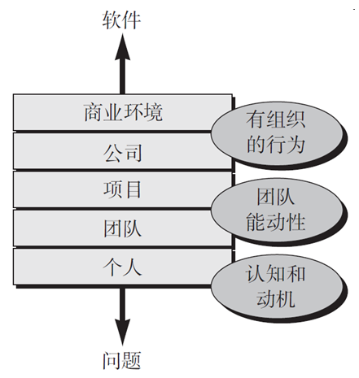
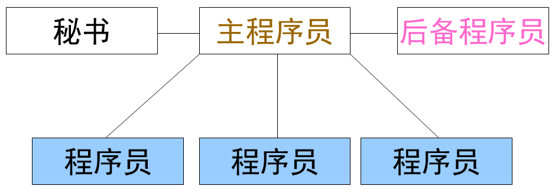
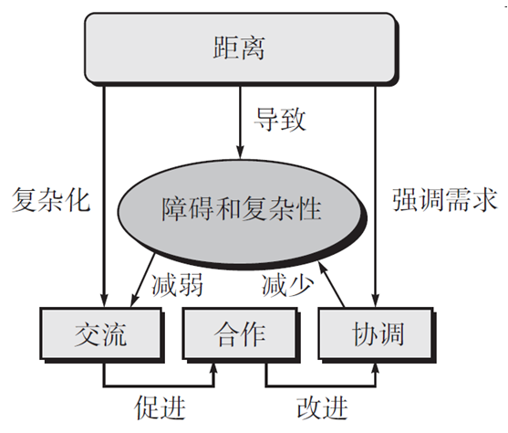

# 第 05 章 软件工程的人员方面

## 软件工程师的特质

*5.1　课件第 3–4 页*

| 特质 | 在工作中的表现 |
| --- | --- |
| **责任感**（第 3 页） | 对同事、利益相关者和管理者履行承诺，主动承担完成工作所需的责任。 |
| **对他人需求有敏锐的意识**（第 3 页） | 留意团队成员、利益相关者和管理者的需求，根据对方及所处的工作环境调整交流和做法。 |
| **坦诚**（第 3 页） | 发现有缺陷的设计时，诚实、有建设性地指出问题。 |
| **展现抗压能力**（第 4 页） | 面对需求变化、优先级调整和来自各方的压力，能处理问题并维持交付质量。 |
| **有高度的公平感**（第 4 页） | 公平看待他人的成果，与同事分享荣誉，避免利益冲突。 |
| **注重细节**（第 4 页） | 以性能、成本、质量等项目标准为依据，仔细考虑具体的技术决策。 |
| **务实**（第 4 页） | 根据实际场景调整软件工程方法和过程。 |

### 软件工程职业道德规范（作业补充）

IEEE-CS 与 ACM 联合制定的《软件工程职业道德与专业实践规范》把**公众的健康、安全和福祉**放在首位。 [IEEE Computer Society 发布的规范](https://www.computer.org/education/code-of-ethics)

| 原则 | 应承担的责任 |
| --- | --- |
| **公众** | 维护公共利益，对软件可能给用户或公众造成的危害向适当人员报告。 |
| **客户与雇主** | 在符合公共利益的前提下维护客户和雇主的利益。在能力范围内提供服务，履行保密义务，按授权使用资源并尊重知识产权。 |
| **产品** | 让产品及其修改尽可能达到最高专业标准，认真处理规格说明、质量和测试。 |
| **专业判断** | 保持诚实、独立的专业判断，妥善处理利益冲突。 |
| **管理** | 在软件开发和维护中采用并倡导合乎伦理的管理方式，重视质量和风险。 |
| **职业** | 维护软件工程职业的诚信和声誉，遵循专业规范。 |
| **同事** | 公平、支持地对待同事，尊重并认可他人的贡献。 |
| **自身** | 持续学习，保持专业能力，在实践中践行职业道德。 |

## 软件工程心理学

*5.2　课件第 6 页*

软件工程心理学关注个人的**认知和动机**、团队的**能动性**，以及公司应对商业环境时的**有组织的行为**。

*课件第 6 页　软件开发中的个人、团队与组织*

| 层面 | 关注点 |
| --- | --- |
| **个人** | 理解问题、具备解决问题所需的技能，并有动机在外部约束下完成工作。 |
| **团队和项目** | 团队能动性取决于团队结构与社会因素。交流、合作、协调与成员个人技能同等重要。 |
| **公司和商业环境** | 有组织的行为影响公司的决策，以及公司怎样应对商业环境。 |

## 5.3 软件团队（第 8–13 页）

### 团队凝聚力（第 9–10 页）

**凝聚力**是成员紧密合作、使团队的整体力量超过个体力量总和的能力。共同目标、共同文化和彼此支持让成员形成团队认同，能发挥各自的长处、增强动力并提高生产率。形成团队也有助于满足成员参与和协作的需求。

### 团队毒性

*课件第 11–12 页*

**团队毒性**指团队环境对协作、士气和工作成效造成的负面影响。

| 易产生团队毒性的环境 | 课件给出的改进思路 |
| --- | --- |
| **狂乱的工作氛围** | 提供完成工作所需的信息，确立并尽量稳定主要目标。 |
| **重大挫折造成成员摩擦** | 给团队相应的决策权，由团队参与寻找解决办法，恢复信心。 |
| **软件过程碎片化或协调很差** | 让团队选择适合项目的过程模型，改善任务间的衔接。 |
| **成员角色模糊** | 建立责任机制，明确任务负责人和交付要求，约定任务未完成时的纠正方式。 |
| **反复失败，信心和士气下降** | 建立面向团队的反馈与问题解决机制，及时发现原因、推动改进。 |

### 团队成员个性（第 13 页）

成员可能在**性格外向或内向、依赖直觉或逻辑证据、偏好详细计划或开放讨论、提前完成或临期集中完成**等方面有差异。团队负责人要帮助不同个性的人协同工作。例如，讨论设计时既提供书面材料，也安排交流。为任务设中间检查点，及早发现延期和阻塞。

## 团队结构

*5.4　课件第 15–22 页*

### 选择团队结构的七个项目因素（第 15 页）

团队结构受组织的管理风格、人员数量和技能水平影响。选择结构时还要看项目的七项条件。

1. 待解决问题的难度。
2. 软件规模，可以用代码行或功能点估计。
3. 团队成员需要共同工作的时间，即团队生存期。
4. 问题能够模块化划分的程度。
5. 系统的质量和可靠性要求。
6. 交付日期的严格程度。
7. 项目所需要的友好交流程度。

### 四种组织模式

*课件第 16–17 页*

| 模式 | 怎样组织团队 | 适用情形与局限 |
| --- | --- | --- |
| **封闭式模式** | 以传统的权力层次组织团队，决策和协调较集中。 | 适合开发与以往相似、可以沿用成熟经验的软件。分工和控制明确，创新空间较有限。 |
| **随机式模式** | 组织较松散，依靠成员的主动性和独立创新。 | 适合探索新技术或寻求突破。工作需要严格按顺序执行时，协调较困难。 |
| **开放式模式** | 兼顾控制和创新，重视充分沟通，依据团队整体意见做决策。 | 适合复杂、需要多人共同研判的问题。沟通和达成共识需要时间。 |
| **同步式模式** | 把问题按自然边界拆分，由成员分别负责不同部分，平时的主动交流较少。 | 适合容易切分成相对独立子问题的项目。各部分联系紧密时，需要投入更多协调工作。 |

### 主程序员式、随机式和民主式结构（第 18–22 页）

**主程序员式**是课件举出的早期封闭式结构。主程序员是高级工程师，负责计划、协调和评审技术活动。一般由 2–5 名技术人员承担分析和开发，后备程序员协助主程序员并可在需要时接替。第 19 页的图也画出了秘书岗位。

*课件第 19 页　主程序员式组织结构*

主程序员式的优点是分工专业化、管理较简单。难点是主程序员既要有技术深度，又要具备较强的管理能力。

**随机式**发挥成员的独立创造性，要求彼此信任、技能分布与问题相匹配，并处理影响合作与凝聚力的分歧（第 21 页）。

**民主式**强调成员地位平等，按能力和经验分工，通过全体协商决定项目工作。适合**规模小、能力强、有共同工作经验**的团队，可以激发创造力。意见难以统一时，达成决策会比较困难（第 22 页）。

## 5.5 社交媒体的影响（第 24–25 页）

| 形式 | 在软件工程中的用途 |
| --- | --- |
| **博客** | 记录和分享系统设计、开发中的功能以及技术经验，适合较完整的说明。 |
| **微博** | 发布即时短消息，让关注者快速获得更新。 |
| **专题在线论坛** | 围绕技术问题发布问题、案例和回答，便于讨论与积累经验。 |
| **社交网站** | 通过已有联系找到具备某个领域知识或经验的人。 |
| **兴趣社区** | 让相近领域的个人或团队长期交流、共享经验。 |
| **网址收藏夹（社会化书签）** | 整理并推荐共同感兴趣的技术资源。 |

## 5.6 全球化团队（第 27 页）

**全球化软件开发（GSD）** 中的距离让交流更复杂，也提高了协调要求。文化差异会带来额外的理解障碍，进一步削弱交流。

*课件第 27 页　全球化团队中的距离、交流、合作与协调*

**交流促进合作，合作改进协调，协调减少障碍和复杂性**。例如，分布在不同地点的团队可以用书面记录同步决定，并约定跨团队交接的负责人和时间。

## 自测题

### 作业一第 6 题

软件工程师职业道德规范、软件工程团队常见的组织模式有哪些？

### 近年真题

#### 真题 1（2023 年 6 月卷，简答题第 1 题，7 分）

在软件工程开发实践中，有项目组长曾经这样感慨：“我的三个队友，有的队友编码基础很弱，不太想学，也不知道要做什么。有的队友会编码，但却很忙，准备考研或有其他任务要做，没什么时间来做这个项目。那么这个项目大部分将只有我一个人在做，虽然我也不想这样，但可能成为事实。”试分析，如果你是项目组长，面对上述状况，应该从哪几方面协调改进？

---

## 答案与解析

### 作业一

#### 作业第 6 题

**答案与解析**　软件工程师职业道德可按八项原则作答。

1. **公众**。优先考虑公共利益和安全。
2. **客户与雇主**。在符合公共利益的前提下维护其正当利益，遵守保密与授权要求。
3. **产品**。按专业标准保障软件及其修改的质量。
4. **专业判断**。保持诚实与独立。
5. **管理**。以合乎伦理的方式管理开发和维护。
6. **职业**。维护职业诚信和声誉。
7. **同事**。公平对待、支持同事。
8. **自身**。终身学习并遵守专业规范。

软件工程团队常见的四种组织模式是**封闭式、随机式、开放式、同步式**。封闭式按层级组织，适合类似项目。随机式依靠成员主动性，适合创新。开放式兼顾协调和创新，通过沟通形成集体决策，适合复杂问题。同步式按问题的自然边界分工，适合相对独立的子任务。

**考法、答题要点与易错点**　按「职业道德」和「团队组织模式」两部分答。答职业道德时写清责任对象与行为要求。答组织模式时写全四种，并用决策方式、沟通程度或任务可划分性区分。主程序员式是封闭式的具体例子。若题目问民主式结构，其特征是成员地位平等、按能力分工、全体协商决策。

**课件位置**　团队组织见课件第 15–22 页，软件工程师的职业特质见第 3–4 页。

**规范来源**　职业道德八项原则来自 [ACM 与 IEEE-CS 联合发布的《软件工程职业道德与专业实践规范》](https://www.computer.org/education/code-of-ethics)。

**笔记位置**　[5.1 软件工程师的特质](#软件工程师的特质) · [软件工程职业道德规范](#软件工程职业道德规范作业补充) · [5.4 四种组织模式](#四种组织模式)

### 近年真题

#### 真题 1

**答案与解析**

1. **先沟通，明确共同目标。** 分别了解成员的基础、意愿和可投入时间。全组商定项目的最低交付目标，说明每个人的工作如何支撑它。
2. **按技能和时间分工。** 给基础弱的成员分配清楚的小任务，约定验收条件，并安排结对练习或技术指导。对会编码但时间少的成员，确认可用时段并安排边界明确的任务，例如接口实现或代码评审。把关键工作分给能够按期完成的人。
3. **明确责任，跟踪进度。** 给每项任务确定负责人、截止时间和完成标准，安排中间里程碑。用短会或共享任务表同步进度、依赖和困难，发现阻塞就协调帮助或调整分工。
4. **建立反馈机制，维持合作。** 请成员演示已完成的小成果，及时指出问题并提供支持。用阶段性成果让每个人看到自己的贡献，降低反复失败带来的挫折。
5. **处理剩余的资源缺口。** 如果调整后仍无法支撑原计划，向指导教师说明进度和风险，争取指导或资源。按优先级收敛非核心工作，确保在期限内交付核心成果。

**考法、答题要点与易错点**　这道题考能力、时间、角色与目标如何影响协作。分别处理「能力不足」「不知道做什么」「时间不足」，用具体分工、支持和反馈机制说明怎么改。写到项目计划时带上负责人、时间和验收条件。

**课件位置**　课件第 6、9–13、15–17 页。

**笔记位置**　[5.2 软件工程心理学](#软件工程心理学) · [5.3 团队毒性](#团队毒性) · [5.4 团队结构](#团队结构)

题目来源　**作业一** · **2023-06-09 期末卷**
