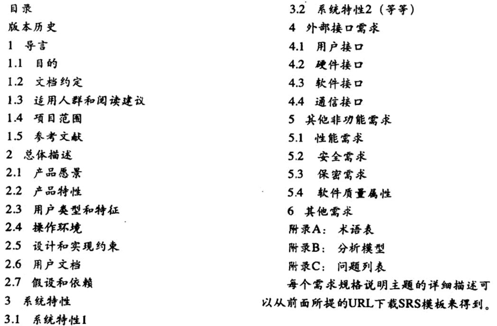
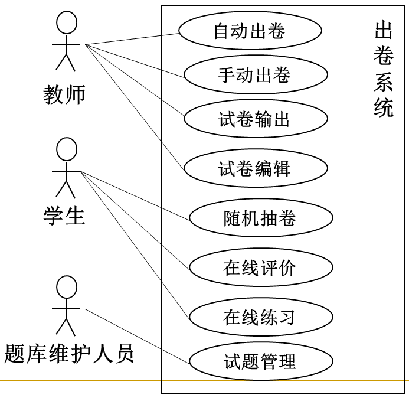
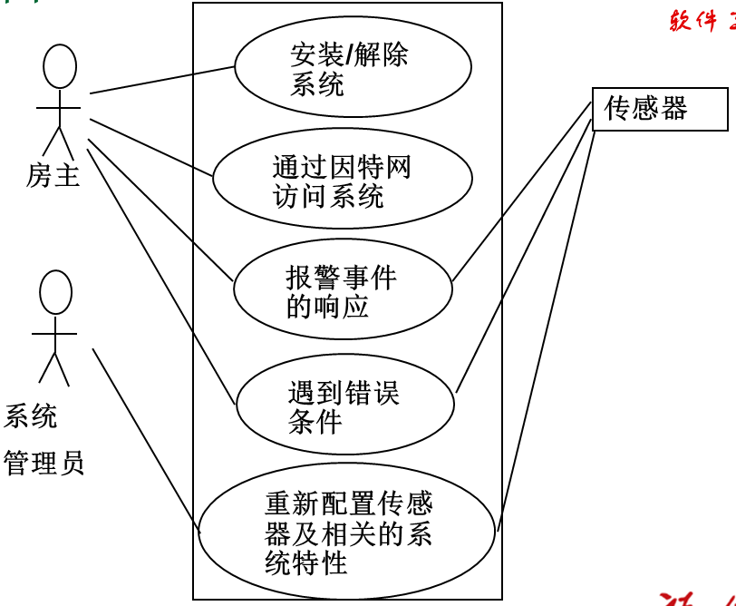
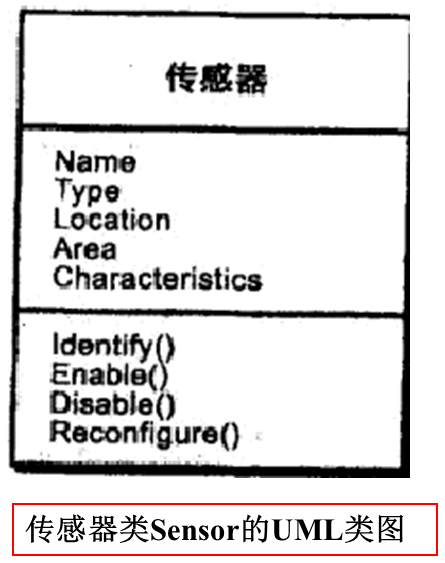
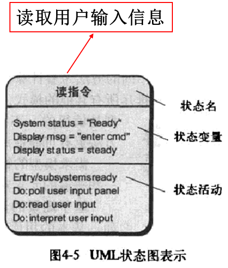

# 第 06 章 理解需求

## 6.1 需求工程（第 5–24 页）

客户说出的要求可能和实际需要有差距，已明确的需求还会随项目变化。理解偏差发现得越晚，越可能牵涉设计、实现、测试与交付安排。早期版本能帮助客户把需求说具体。开始开发前仍需了解关键目标和约束，并在每次反馈后核对需求变化（第 2–7 页）。

### 软件需求及分类

*课件第 8–9 页*

**软件需求**是对期望的软件行为的表达。

| 类型 | 写什么 | 例子 |
| --- | --- | --- |
| **功能需求** | 系统应提供的功能与服务、对输入的响应、在特定条件下的行为、禁止发生的行为，以及处理的数据。 | 用户可将商品放入购物车。库存不足时，系统提示用户修改数量。 |
| **非功能需求中的产品需求** | 产品行为应达到的质量水平，如性能、可靠性和可用性。 | 在约定负载下，95% 的商品搜索请求在 2 秒内返回。 |
| **非功能需求中的机构需求** | 客户或开发机构的政策和规定，包括过程标准、实现要求、交付要求。 | 交付时应提供机构规定的部署与运维文档。 |
| **非功能需求中的外部需求** | 系统外部因素带来的约束，如互操作要求、道德要求。 | 系统应按约定接口与支付平台互操作。 |

提供搜索是功能需求，搜索响应时间是该服务的性能需求。

### 需求工程与需求过程

*课件第 10–12 页*

**需求工程（Requirements Engineering，RE）** 是不断理解、分析、说明、确认和管理需求的一组任务与技术。从软件过程看，它**开始于沟通活动，延续到建模活动**，明确要做的工作、需求优先级及系统的信息、功能和行为，为后续设计与构建提供依据。

**需求过程**是组织这些需求活动的方式。第 11 页比较了两种做法。

| 需求过程 | 需求如何确定 |
| --- | --- |
| **瀑布式需求** | 在项目早期集中确定完整需求，作为后续阶段的依据。 |
| **进化式需求** | 结合迭代开发持续寻找、记录、组织、调整和跟踪需求。 |

### 七项需求工程活动

*课件第 12–24 页*

| 活动 | 要完成的工作 | 课件页码 |
| --- | --- | --- |
| **起始** | 从业务需要或市场机会出发，明确要解决什么问题、谁需要解决方案、项目大致范围。形成初步沟通与合作，做粗略的可行性分析。 | 第 13 页 |
| **获取** | 向客户、用户等了解系统的目标、业务需要、期望功能和日常使用方式。常遇到范围不清、双方理解有偏差、需求易变三类问题。 | 第 14–15 页 |
| **细化（精化）** | 扩展和提炼获取的信息，构建能说明功能、特征、信息和行为的需求模型。 | 第 16 页 |
| **协商** | 在资源有限、需求冲突时，按优先级评估每项需求的成本和风险，讨论删减、合并、分批实现或修改的方案。 | 第 17 页 |
| **规格说明** | 用文档、图形模型、形式化模型、使用场景、原型或它们的组合准确表达达成一致的需求。 | 第 18–21 页 |
| **确认** | 由软件工程师、客户、用户等通过正式技术评审检查需求工作产品，发现歧义、遗漏、不一致、冲突、不现实的要求，以及不符合规范或标准的内容。 | 第 22–23 页 |
| **管理** | 在系统整个生存期标识、控制和跟踪需求及其变更。 | 第 24 页 |

**可行性研究**要回答项目是否值得开发。起始阶段根据业务目标和范围，初步考察技术能否实现、投入和收益是否匹配、资源和时间能否支撑交付（第 12–13 页）。

需求管理可以给需求编号，记录来源、版本和变更。涉及修改时先检查它与哪些模型、设计或测试相关，再更新受影响的工作产品。

### 需求规格说明 SRS

*课件第 18–21 页*

第 19 页区分两类文档。**需求定义**是从客户角度整理的要求清单，通常由客户与需求分析师协作，主要供客户阅读和确认。**软件需求规格说明（Software Requirements Specification，SRS）** 由需求分析师将要求写成详细、规范的说明，供开发、设计、测试等人员使用。

SRS 记录系统**应做什么、与外部怎样交互、必须满足哪些约束**，可附模型与场景。第 21 页模板包括版本历史、导言和范围、总体描述（产品、用户、运行环境、实现约束、用户文档、假设及依赖）、系统特性、外部接口、非功能需求，以及术语、分析模型、待解决问题等附录。

*课件第 21 页　软件需求规格说明的目录模板*

外部接口包括用户、硬件、软件、通信接口。非功能部分记录性能、安全、保密和其他质量属性。操作环境、接口协议等是需求可以规定的约束，具体算法步骤在后续设计中说明。

正式的 SRS 尤其适用于第三方开发、缺少规格会造成严重业务问题，以及系统复杂或涉及关键业务的情形（第 20 页）。需求分析形成的用例、类或行为模型可以作为 SRS 的内容或附件。**需求规格说明书**是需求分析的最终工作产品。

## 6.2 建立根基（第 26–33 页）

**利益相关者**是直接或间接从开发中的系统获益的人，如业务和产品管理者、客户、最终用户、开发人员、运维及支持人员。他们对系统成功的预期和失败时承担的风险各不相同。

| 视角 | 典型关注点 |
| --- | --- |
| 市场销售 | 哪些功能吸引用户、帮助产品进入市场。 |
| 业务经理 | 预算是否可控，功能是否符合业务和市场约束。 |
| 最终用户 | 系统是否易学、易用，能否解决日常工作问题。 |
| 软件工程师 | 技术能否实现，代价有多大。 |
| 支持人员 | 系统是否容易维护。 |

收集多方观点后，辨认**公共区域**和**矛盾区域**，分别确认共识、记录并协调冲突。取舍仍有分歧时，由有决策权的项目负责人裁定（第 27–30 页）。

首次提问分三类（第 31–33 页）。

1. **人和价值**。谁提出、谁使用、成功会带来什么收益、还有哪些资源或人员可以帮助。
2. **问题和环境**。要解决什么问题、什么输出算成功、在怎样的业务环境使用、有哪些性能或其他约束。
3. **沟通效果**。对方是否合适并有权确认、问题是否相关、还要找谁、有没有漏问。

问答适合打开第一次交流。后续用协作获取、问题求解与协商把初步想法转为可确认的规格。

## 获取需求

*6.3　课件第 35–43 页*

### 协作收集需求（第 35–38 页）

会议由软件工程师和相关利益方共同参与。事先确定议程、规则与调解人，使用工作表、白板或电子协作工具记录结论。会议的目标是识别问题、形成初步方案，并协调差异。

- **会前列清单**。包括环境中的对象、系统使用或产生的对象、需要提供的服务、成本或业务约束，以及速度和精确度等性能标准。
- **会上细化**。对描述不足的对象或服务写**小规格说明**，交与会者讨论、增删或细化。例如，为 SafeHome 控制面板记录它与传感器的接口、用户输入方式及系统反馈。
- **会后整理**。把新发现的对象、服务、约束和性能要求补入清单。暂时无法解决的问题进入待处理列表。

### 质量功能部署 QFD（第 39–40 页）

**QFD（Quality Function Deployment）** 把客户要求转化为软件技术需求，使对客户有价值的要求落实到工程活动中。

| 需求类型 | 客户预期 | 例子 |
| --- | --- | --- |
| **正常需求** | 客户明确提出，实现后能满足客户的既定目标。 | 用户要求能选时段、预约自习室座位和取消预约。 |
| **期望需求** | 客户认为理所当然，可能省略。缺失时会明显不满。 | 即使未专门提出，同一座位的同一时段也不能重复分配。 |
| **令人兴奋的需求** | 超出客户原先预期，实现后能增加满意度。 | 在用户没有提出这项要求的情境下，预约冲突时自动推荐可替换的时段。 |

功能与非功能按需求所描述的内容划分。QFD 按客户的预期划分，同一项需求可以从这两个角度分别归类。

### 获取的工作产品与面向服务的方法

*课件第 41–43 页*

获取后要整理**需求及可行性陈述、范围边界、参与者名单、技术环境、带适用约束的需求清单、使用场景、能澄清需求的原型**，由参与需求获取的各方评审。使用场景通过例子描述用户如何使用系统，也是编写用例的材料。

**面向服务的方法**把系统看成一组面向用户目标的服务。获取需求时要明确服务对象、交互触点和交付结果，使每项需求都可追踪到相应服务。例如，酒店的登记应追踪到办理入住服务，客人交付行李后能查询行李到达状态的需求应追踪到行李服务（第 43 页）。

## 6.4 开发用例（第 45–61 页）

### 参与者与用例描述（第 45–48 页）

**用例**从参与者的视角描述怎样与系统交互以达成目标。**参与者（Actor）** 是系统边界外的人或设备在交互中扮演的角色。一个现实用户可能扮演多个角色，例如一名机床操作员可能负责操作编程、测试、监控和检修。

- **主要参与者**直接使用系统的功能，获得预期收益。
- **次要参与者**为交互提供支持，让主要参与者能够完成目标。通常先从主要目标找出主要参与者，再随用例细化识别提供支持的人员、设备或外部系统（第 47 页）。

建立用例先确定**谁发起、目标是什么、何时开始、要满足哪些前提**。再写**主成功场景、变化或异常、参与者获得或修改的信息、环境变更与系统通知**。用例图展示参与者与系统提供的用例之间的关系。用例文本进一步交代交互步骤、条件和结果。

### 出卷系统与短信系统（第 49–56 页）

以出卷系统为例，先区分用户角色，再把其目标提炼成用例。

| 参与者 | 主要用例 |
| --- | --- |
| 教师 | 自动出卷、手动出卷、试卷编辑、试卷输出。 |
| 学生 | 随机抽卷、在线练习、在线评价。 |
| 题库维护人员 | 试题管理，包括新增、修改和删除。 |

出卷设定包括总分、难度、题型和知识点配比，生成时要保证题目去重。题库至少要有 1000 道涵盖不同类型的试题，记录题目内容、答案、题型、难度、知识点和加入时间等。课件还提出多科目支持、允许教师调整和试卷分析。像「界面好」「符合要求 96%」这样的表述，需要补充判定标准或计算口径。

*课件第 53 页　出卷系统用例图*

短信系统的**用户**对应短信发送与接收。用户可选收件人、即时或定时发送，并用回执确认接收状态。对收到的短信可人工回复，也可按规则自动应答。**管理员**对应用户管理和系统设置。无线终端、移动网关等对接要求可记录在接口约束中（第 54–56 页）。

### SafeHome 的结构化用例（第 57–61 页）

房主可以查看安全区或传感器状态、触发紧急响应以及激活或解除系统。课件以**初始化监测**为例展示了如何把场景写成结构化用例。

| 字段 | SafeHome 示例 |
| --- | --- |
| 用例、主要参与者、目标 | 初始化监测。主要参与者是房主，目标是启动住宅监测。 |
| 前提条件与触发 | 系统已配置密码并识别传感器。房主决定启动监测。 |
| 主要场景 | 房主确认面板就绪，输入四位密码，选定在家或外出模式，再查看红色激活灯。 |
| 替代与异常 | 未就绪时查找并关闭开启的门窗。密码错误时面板鸣叫并等待重输。密码无法识别时转入重置。选择 `stay` 只激活外围传感器，选择 `away` 激活全部传感器。 |
| 其他字段 | 优先级为必须实现，首个增量可用，每天多次使用。房主使用控制面板，次要参与者有技术支持人员和传感器。待决事项包括密码输入时限和激活前的取消方式。 |

第 61 页的图还把**传感器**画在系统边界外。它与报警响应、异常及重新配置等用例交互，是设备角色的例子。

*课件第 61 页　SafeHome 的人员与设备参与者*

## 6.5 构建分析模型（第 63–68 页）

本章把**需求模型**和**分析模型**视为同一概念。结合多个建模角度能帮助发现需求遗漏、冲突和歧义。

| 元素 | 分析角度 | 例子与课件页码 |
| --- | --- | --- |
| **基于场景** | 用户以怎样的步骤使用系统。 | 用例、用例图及详细用例文本，常作为其他模型的输入（第 64 页）。 |
| **基于类** | 用户在场景中操作哪些对象，对象有哪些共性。 | 将具有相似属性和共同行为的对象归为类。传感器类可描述名称、类型、位置以及可执行的操作（第 65 页）。 |
| **行为** | 系统有什么状态，哪个事件引发状态改变，要执行什么动作。 | 状态图。第 66 页展示单个状态可包含状态名、状态变量与状态活动。 |
| **面向数据流** | 输入的信息怎样经处理变成输出。 | 从输入数据到转换处理再到输出，如读入用户提交的条件、筛选试题、输出试卷（第 67 页）。 |

*课件第 65 页　基于类的元素*

*课件第 66 页　行为元素中的 UML 状态表示*

**分析模式**是在某个应用领域反复用到的类、功能或行为等分析解决方案。复用这些模式，可加快分析建模，并为从分析模型转向设计模型提供基础（第 68 页）。

## 6.6 协商与确认需求（第 70–73 页）

### 需求协商（第 17、70–71 页）

出现需求冲突或成本、时间不足时，协商以功能、性能、成本、风险和上市时间为依据。每次迭代开始可先找出关键利益相关者，问清各方的「赢」是什么，再定优先级并达成可执行的取舍。

**双赢**是用户得到能覆盖主要需要的系统，同时软件团队在现实的预算和时间约束下完成工作。可采用合并相近需求、删减低优先项或分批交付等方式达成一致。

### 确认需求

*课件第 22–23、72–73 页*

用**正式技术评审**检查需求模型和规格说明。评审人员包括开发团队、客户、用户及其他利益相关者。每项需求可以用下面的检查表核对。

| 检查项 | 怎么检查 |
| --- | --- |
| **目标与必要性** | 是否符合整体目标，是否确有必要，是否位于当前阶段合适的抽象层。 |
| **清楚、完整、一致** | 含义和边界是否明确，有无歧义、遗漏、冲突或不一致，信息、功能、行为、性能和运行特征是否说全。 |
| **可追踪** | 需求有没有来源，能否追到原始人员、规则或文档及产品目标，能否关联已有模型和其他需求。可用编号或交叉索引矩阵记录。 |
| **可行** | 是否满足领域和技术环境的约束，资源、预算和时间能否支撑。 |
| **可测试** | 是否尽量用可度量的术语表达，能否给出测试或验收准则。 |
| **可读、易查** | 模型是否合理分层、逐步揭示细节，规格说明是否有索引、方便定位和引用。采用的分析模式也需评审是否符合实际需求。 |

例如验证「库存不足时不创建订单」，可以让业务人员确认这一规则，列出库存充足和不足的场景，并分别写清系统的处理与返回结果。

### 三种常见偏好（第 74 页）

| 偏好 | 影响与处理办法 |
| --- | --- |
| **特性偏好** | 过分追求功能覆盖率，容易忽略可用质量。先确认关键功能，并为已交付的功能明确必要的质量要求。 |
| **灵活性偏好** | 配置选项过多会增加使用、测试和维护难度。用清晰的范围和实际业务变化决定需要哪些配置。 |
| **性能偏好** | 片面追求性能容易损害可维护性、可靠性与安全性。按业务需求及非功能约束设定性能目标，并协调不同质量属性。 |

## 自测题

### 作业二第 1 题

什么是需求工程、需求过程、需求规格说明？

### 近年真题

#### 真题 1（2023 年 6 月卷与 2024 年 12 月卷，均为选择题第 3 题，各 2 分）

需求分析最终结果是产生（　）。

- A. 项目开发计划
- B. 需求规格说明书
- C. 设计说明书
- D. 可行性分析报告

#### 真题 2（2024 年 12 月卷，选择题第 2 题，2 分）

软件需求规格说明的内容不应包括（　）。

- A. 主要功能
- B. 算法的详细描述
- C. 用户界面及运行环境
- D. 软件的性能

#### 真题 3（2024 年 12 月卷，选择题第 6 题，2 分）

可行性研究的目的是（　）。

- A. 争取项目
- B. 项目是否值得开发
- C. 开发项目
- D. 规划项目

#### 真题 4（2024 年 12 月卷，综合题第 3 题的第 1、2 问，各 5 分）

若未来你所在的公司计划开发一款在线购物系统，以满足用户在线购物的需求。在需求分析阶段，开发团队与用户进行了深入的沟通和交流，收集了大量的用户需求。现在需要开发团队对这些需求进行整理和分析，形成系统的需求规格说明。

1. 请列出该在线购物系统的主要功能需求。
2. 如何确保这些功能需求的正确性和可行性。

---

## 答案与解析

### 作业二

#### 作业第 1 题

**答案与解析**

1. **需求工程**是为不断理解、分析、说明、确认和管理需求所采用的一组任务与技术。它开始于沟通，延续到建模，明确目标、功能、信息、行为、约束及优先级。
2. **需求过程**规定这些需求工作如何开展，包括起始、获取、细化、协商、规格说明、确认和管理。瀑布式在项目早期集中确定需求，进化式在迭代中持续记录和跟踪变化。
3. **需求规格说明**对待构建的软件给出详细、规范的描述。规格可用文档、图形模型、形式化模型、使用场景、原型或它们的组合表达。作为正式文档的 **SRS** 通常写清软件范围、用户和运行环境、功能、外部接口、质量要求及约束，为设计、测试和验收提供依据。

**考法、答题要点与易错点**　三个名词分开答。需求工程写清目标和工作范围，需求过程写展开方式与七项活动，SRS 写最终表达出来的内容。答需求管理时带上变更的标识、控制和跟踪。

**课件位置**　课件第 8–24 页。

**笔记位置**　[需求工程与需求过程](#需求工程与需求过程) · [七项活动](#七项需求工程活动) · [SRS](#需求规格说明-srs)

### 近年真题

#### 真题 1

**答案与解析**　选 **B. 需求规格说明书**。分析阶段把各方的原始要求转为可确认的系统功能、行为、接口和约束，并形成需求规格说明书，作为后续设计、开发和验收的依据。

**考法、答题要点与易错点**　看清题干所处的阶段。可行性分析报告服务于是否立项的判断，设计说明书在设计阶段描述解决方案。分析阶段的产物关键词是「需求规格」。

**课件位置**　课件第 16、18–21 页。

**笔记位置**　[需求规格说明 SRS](#需求规格说明-srs)

#### 真题 2

**答案与解析**　选 **B. 算法的详细描述**。功能、用户界面、运行环境及性能都在 SRS 的覆盖范围内。规定系统要满足的行为和约束属于需求工作，描述算法各步骤属于后续设计工作。

**考法、答题要点与易错点**　界面、环境和性能是需求可明确规定的条件。遇到题目列出算法细节时，检查它描述的是系统须达到的结果，还是为达到结果所采用的具体实现。

**课件位置**　课件第 8–9、18–21 页。

**笔记位置**　[软件需求及分类](#软件需求及分类) · [SRS 模板](#需求规格说明-srs)

#### 真题 3

**答案与解析**　选 **B. 项目是否值得开发**。可行性研究在投入主要资源之前，评估技术、业务价值、成本、资源与时间等，给出能否做、值不值得做的依据。

**考法、答题要点与易错点**　先判断项目是否值得立项，再根据结论安排后续工作。题干问研究的直接目的，选择体现立项判断的选项。

**课件位置**　课件第 12–13、42 页。

**笔记位置**　[七项需求工程活动中的起始](#七项需求工程活动) · [获取的工作产品](#获取的工作产品与面向服务的方法)

#### 真题 4

**答案与解析**

**第 1 问**。可沿用户完成购物的一次流程列功能。

1. **账号管理**。用户可注册、登录、维护个人信息和收货地址。
2. **商品查询**。用户可浏览、搜索、筛选商品，查看详情、价格与库存。
3. **购物车**。用户可添加或移除商品、修改数量，并查看小计与总价。
4. **结算与支付**。用户可选地址、确认配送和应付金额、提交订单并完成支付，系统反馈支付状态。
5. **订单与售后**。用户可查询订单历史、配送状态，在允许条件下取消订单或发起退换货。对商家或运营人员，可补充商品、库存和订单维护需求。

**第 2 问**。分别验证需求是否符合业务，以及项目是否具备实现条件。

1. **让相关各方确认需求。** 组织用户、业务人员和开发人员联合评审 SRS，逐项核对这些功能是否符合业务目标，有无遗漏、歧义或冲突，记录来源和修改结论。
2. **用原型与场景验证。** 让典型用户试用浏览、选购、结算等主流程，同时检查库存不足、支付失败等异常路径。明确预期系统行为并将其写成验收条件。
3. **评估实现的可行性。** 由开发团队检查库存、支付和物流对接等关键依赖，必要时做小规模验证。估算成本、人员和工期，据此协商功能优先级并确认首版范围。

**考法、答题要点与易错点**　第 1 问按用户要完成的操作写功能。第 2 问既要用评审、用例或原型核对正确性，也要核对技术与资源约束来判断可行性。写沟通和评审时，带上参与者、检查场景和验收条件。

**课件位置**　课件第 8–9、12–13、18–23、35–43、70–73 页。

**笔记位置**　[功能与非功能需求](#软件需求及分类) · [获取需求](#获取需求) · [确认需求](#确认需求)

题目来源　**作业二** · **2023-06-09 期末卷** · **2024-12-27 期末卷**
