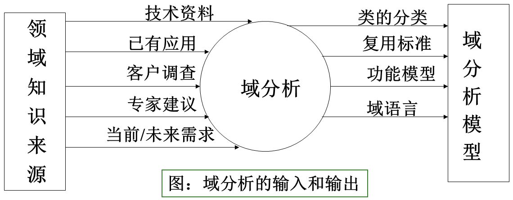
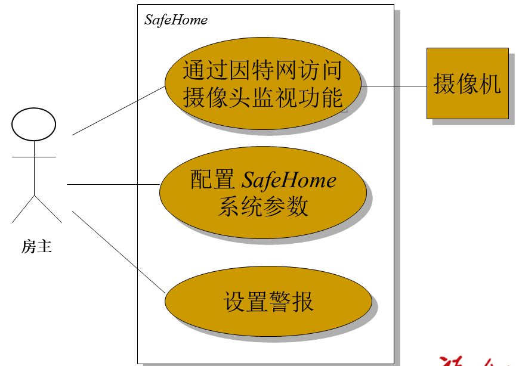
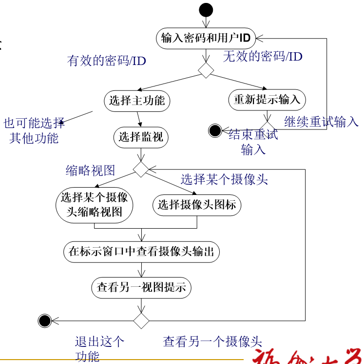
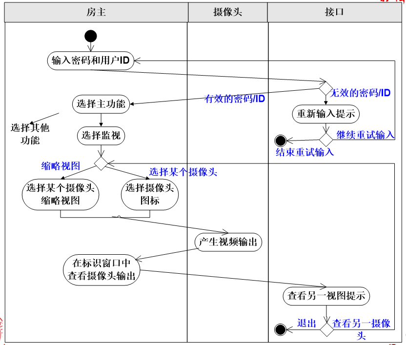
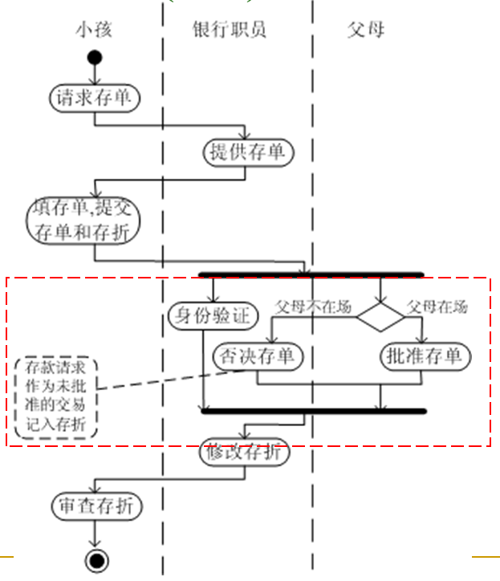
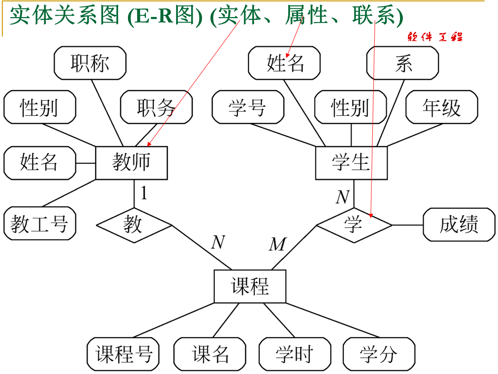
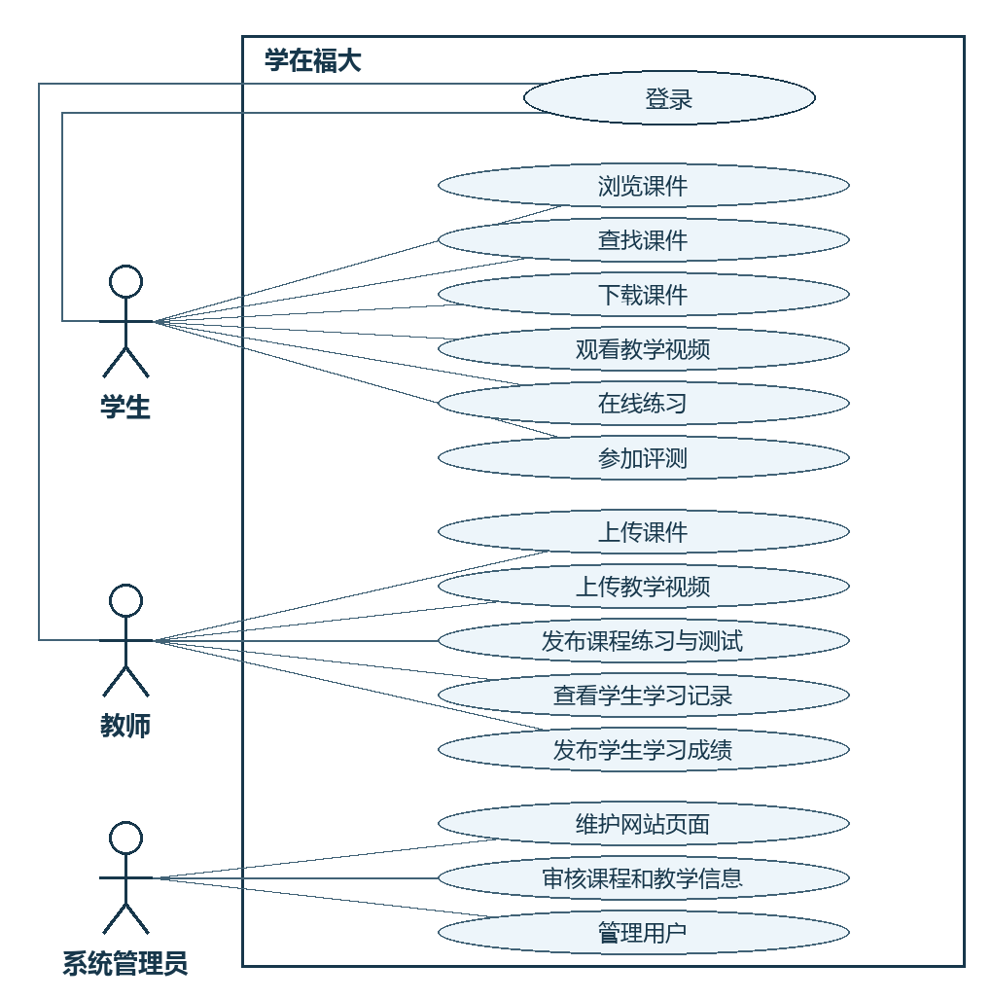

# 第 07-1 章 需求建模（基于场景的方法）

## 7.1 需求分析（第 2–12 页）

### 分析目标与经验原则（第 5–9 页）

**需求分析**要确定系统需要提供哪些交互、处理哪些对象、完成哪些功能、表现出什么行为，以及要满足的接口和约束。需求模型有三个目标。

1. 描述客户需要什么，并检查对需求的理解是否正确。
2. 为软件设计奠定基础。
3. 定义软件完成后可以确认的一组需求。

建模时保持在问题或业务域的抽象层，每个元素都要帮助读者理解信息、功能或行为。可以记录非功能约束，把具体基础结构及实现留到设计阶段。控制类和功能之间的互联程度，保留对业务人员确认需求、设计人员开展设计、测试人员编制验收测试都有用的内容。能用清楚的列表说明时，采用简洁的表达即可。

### 域分析（第 10 页）

**域分析**从同一应用领域中发现或建立可复用的分析类和分析模式。域分析师以技术资料、已有应用、客户调查、专家建议与当前或未来需求为输入，整理出类的分类、复用标准、功能模型和领域术语。

*课件第 10 页　域分析的输入和输出*

### 需求模型的不同视角（第 5、11–12 页）

| 视角 | 要解释的问题 | 常用表示 |
| --- | --- | --- |
| **场景** | 参与者如何使用系统达成目标。 | 用例、用例图、用户故事。 |
| **数据** | 系统处理哪些数据对象，数据间有何关系。 | 数据模型、E-R 图。 |
| **类** | 有哪些类、属性、操作和协作关系。 | 类图、协作图。 |
| **流** | 数据怎样经过各功能的加工发生变化。 | 数据流图。 |
| **行为** | 外部事件如何影响状态，交互消息怎样发生。 | 状态图、顺序图。 |

第 5 页单独列出数据模型。第 11–12 页从场景、类、行为和流四组说明常用表示，并把数据模型放在与流相关的一组。实际可以用多种图和文字从不同角度核对同一需求。

## 7.2 基于场景建模（第 14–28 页）

### 初始用例与主场景

*课件第 14–19 页*

**基于场景的需求建模**从特定参与者的视角，把模糊的要求具体化为一次可理解的使用过程。编写前先通过需求收集会议、质量功能部署（QFD）等方法识别利益相关者，划定系统边界、运行目标和优先级，并初步列出已知功能与系统处理的对象。

**用例**说明系统外有什么角色、参与者为实现哪个目标与系统交互、系统应完成什么。初始用例可以按叙述性文字写，也可以用编号列出参与者和系统的动作。**主场景**按顺序记录一次成功的交互。SafeHome 的远程查看主场景（第 17–19 页）。房主输入用户标识及两级密码。通过验证后，房主选择监视和选取摄像机功能，系统显示房屋平面图。房主选定摄像机并请求查看，系统为该摄像机打开窗口，以每秒一帧显示画面。

### 细化与正规用例（第 20–26 页）

逐步检查主场景中的每一步，发现可能的**次场景**。

| 检查方向 | SafeHome 示例 |
| --- | --- |
| 参与者是否能选择其他动作 | 从全部摄像机的缩略视图选取某个画面。 |
| 可能遇到什么错误 | 房屋平面图尚未配置，系统提示需要配置。 |
| 是否会发生参与者控制之外的事件 | 报警事件发生，系统显示报警地点和类型，并提供有关操作。 |

还应考虑超时、响应失败，以及响应慢时用户可能重复操作。为次场景写清**在哪一步触发、触发条件、如何处理、是否回到主场景或结束**。

简单用例可以采用叙述或步骤列表。涉及关键活动或较多异常的用例，可使用正规模板，记录名称、编号和迭代、主要参与者、情景目标、前置条件、触发事件、主场景、次场景和异常。必要时加入优先级、何时可用、频率、使用方式、次要参与者及未解决问题。**前置条件**说明用例开始前已满足的状态，**触发事件**说明这一次交互为何开始。远程查看用例的前置条件是系统已完整配置、房主持有有效凭据。触发事件是房主离家期间决定查看房屋。用例还可记录响应时间、视频帧率、未授权访问等需要进一步确认的问题（第 24–26 页）。

### 用例图

*课件第 27–28 页*

**用例图**用系统边界、参与者、用例和关联线表示系统对外提供的功能。框内椭圆是用例，框外是人员或设备在交互中承担的角色。连线表示参与者参与该用例。交互的顺序和异常可在用例文本或活动图中展开。

*课件第 28 页　SafeHome 初步用例图*

## 7.3 补充用例的 UML 模型（第 30–34 页）

### 活动图

*课件第 30 页*

**UML 活动图**把一个场景中的活动、判断、循环和并发画成流程，帮助读者检查所有执行路径。

| 图形 | 读法 |
| --- | --- |
| 实心圆、带外圈的实心圆 | 场景开始、活动结束。 |
| 圆角矩形 | 一项活动或系统功能。 |
| 带箭头的连线 | 下一步的控制流。 |
| 菱形 | 按条件选择分支，或合并互斥分支。 |
| 粗实线 | 分叉为并行活动，或汇合等待各并行分支完成。 |

*课件第 30 页　SafeHome 活动图中的分支与循环*

### 泳道图

*课件第 31–34 页*

**泳道图**是活动图的变形。按参与者或分析类划分泳道，把活动移到负责它的一方，保留原来的顺序、分支与并发关系。跨泳道的箭头显示责任交接。

*课件第 32 页　SafeHome 的责任分配*

存取款用例中，小孩向银行职员申请存单，填好后连同存折交回。银行查验身份与父母办理批准可以并行，两路在粗线处**汇合**后，银行职员修改存折，小孩取回并检查结果（第 33–34 页）。

*课件第 34 页　小孩存取钱案例中的并行处理*

## 补充 数据建模与 E-R 图（第 35–42 页）

**数据建模**描述系统处理的数据对象、对象间的联系及相关信息。**数据对象**是软件需要理解的复合信息，可以是外部实体、事物、事件、角色、组织、地点或结构。单独的宽度是属性，包含长、宽、高的一组尺寸可以作为数据对象。

- **命名属性**给实例命名，**描述属性**记录实例特征，**引用属性**引用另一个对象的实例。需要唯一定位实例时，可用一个或多个属性作为标识符或键。以汽车为例，制造商和型号用于命名，车身类型和颜色描述特征，车辆编号标识一辆车，车主编号引用车主的记录（第 36–39 页）。
- **联系**用来表达对象间的关系。给联系命名并明确阅读方向，例如「人拥有车辆」（第 40–41 页）。
- **实体关系图（E-R 图）** 用实体、属性和联系表达数据结构，并用基数反映一对一、一对多或多对多。第 42 页中，教师与课程是 1∶N 的「教」，学生与课程是 M∶N 的「学」。**成绩属于学生学习某门课程的联系**。

*课件第 42 页　教师、学生和课程的 E-R 图*

## 自测题

### 作业二第 2 题

什么是基于场景的需求建模？谈谈你对用例图、活动图、泳道图的理解。

### 近年真题

#### 真题 1（2023 年 6 月卷，综合题第 2 题第 1 问，4 分）

线上教学是教育数字化发展的重要方向之一。2020 级同学有意开发一套名为「学在福大」的线上网络教学系统。「学在福大」的功能需求如下。

学生登陆网站后，可以浏览课件、查找课件、下载课件、观看教学视频、课程在线练习和评测等。

教师登陆网站后，可以上传课件、上传教学视频、发布课程练习和测试、查看学生学习记录、发布学生学习成绩等。系统管理员负责对网站页面的维护、审核课程和教学信息、管理用户等。

画出「学在福大」系统的用例图。

---

## 答案与解析

### 作业二

#### 作业第 2 题

**答案与解析**

1. **基于场景的需求建模**从参与者的视角描述一个使用目标及达成目标时的系统交互。用例文本先写基本流程，再补充替代流程和异常条件。
2. **用例图**展示角色、系统边界、系统对外功能与关联。例如，学生连接到「交作业」，老师连接到「批改作业」。
3. **活动图**展开某个用例的控制流，例如学生提交作业后，系统按是否超过截止时间选择接收或拒绝。它还能表示循环和并行。
4. **泳道图**在活动图上标出责任。例如，把「上传文件」放在学生泳道，把「核对截止时间」「保存文件」放在系统泳道。

**考法、答题要点与易错点**　先给场景建模的定义，再分别写三种图各回答什么。用例图核对谁使用哪些功能，活动图核对怎样执行，泳道图核对各步骤由谁完成。画分支时要标明条件。

**课件位置**　课件第 14–28、30–34 页。

**笔记位置**　[初始用例与主场景](#初始用例与主场景) · [用例图](#用例图) · [活动图](#活动图) · [泳道图](#泳道图)

### 近年真题

#### 真题 1

**答案与解析**　一种画法如下。学生和教师共用一个「登录」用例，业务功能各自连接到相应的角色。也可在业务用例的描述中注明「用户已登录」这一前置条件。

**考法、答题要点与易错点**　先从题干圈出三个参与者，再提取各自的动宾短语作为用例名。角色放边界外，系统功能放边界内，用实线建立关联。尤其核对学生的「评测」、教师的「查看学生学习记录」及管理员的「维护网站页面、审核课程和教学信息、管理用户」。

**课件位置**　课件第 14–19、27–28 页。

**笔记位置**　[初始用例与主场景](#初始用例与主场景) · [用例图](#用例图)

题目来源　**作业二** · **2023-06-09 期末卷**
