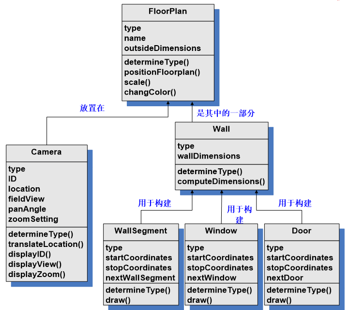
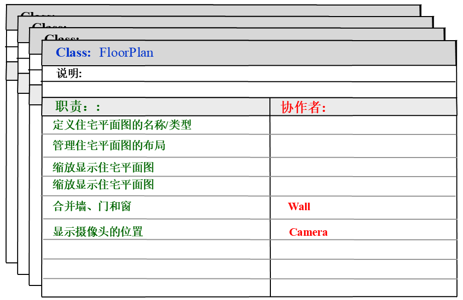
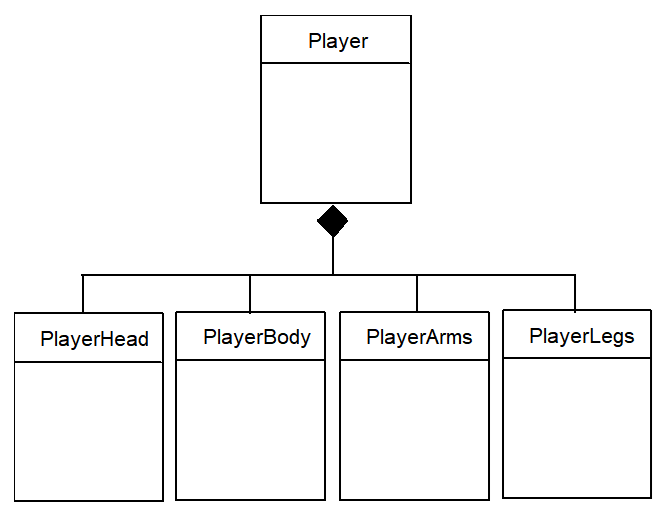
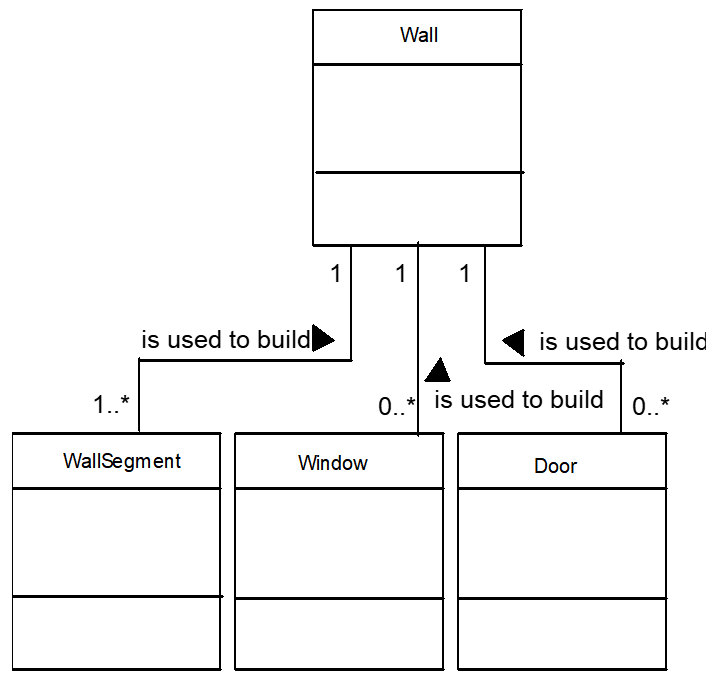
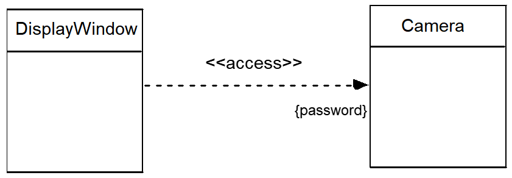
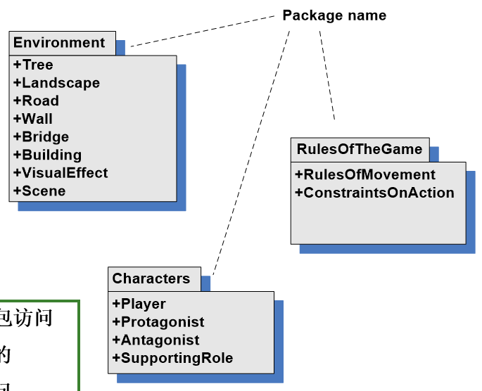
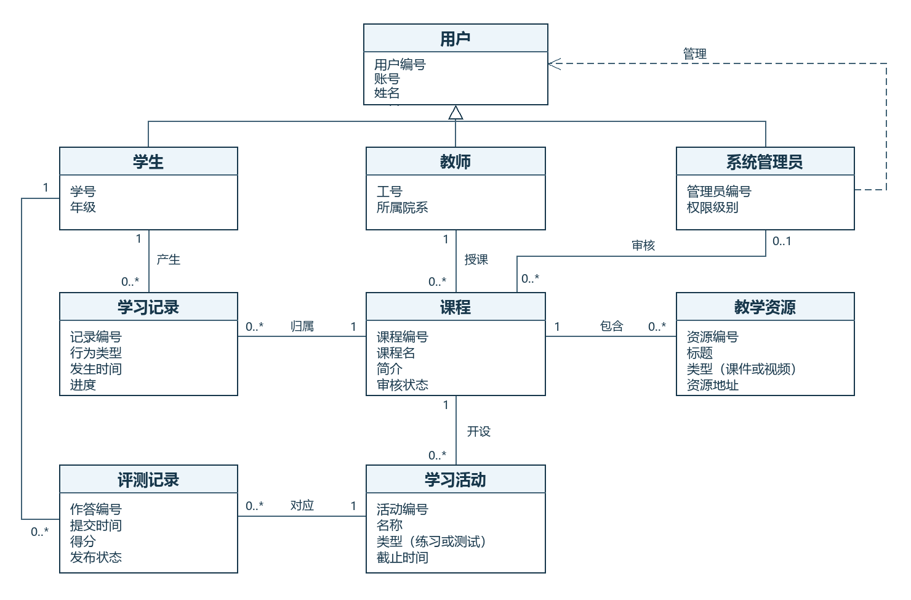

# 第 07-2 章 需求建模（基于类的方法）

## 识别分析类

*7.1　课件第 2–12 页*

**基于类的建模**属于面向对象分析。**对象**是问题域中具体的事物或实例，**类**概括一组对象的共同属性与行为。建模时从问题描述中识别候选类，结合业务范围筛选，随后确定属性、操作、职责和类间关系。常用表示包括类图、CRC 卡、协作图与分析包。

### 从名词找候选类（第 5–8 页）

先标出名词和名词短语，识别**外部实体、事物、事件、人员角色、组织单元、场地和结构**等候选对象。系统的统称通常过于宽泛，编号和类型通常是属性，纯动作通常是操作。根据上下文消除同名或一词多义的问题。

例如，SafeHome 的「传感器」可以是一个类，「传感器事件」可能也是类。「编号」和「类型」可作为 Sensor 的属性。

### 筛选潜在类的六项特征（第 9–12 页）

| 特征 | 要检查什么 |
| --- | --- |
| **保留信息** | 系统为了正常运行，是否需要记录该对象的信息。 |
| **所需服务** | 它是否具有一组可辨识的操作来改变和管理自身的属性值。 |
| **多个属性** | 它是否包含多个有意义的属性。只表达一个简单值时，可归入另一个类。 |
| **公共属性** | 能否定义一组适用于该类各实例的属性。 |
| **公共操作** | 能否定义一组适用于该类各实例的操作。 |
| **必要需求** | 该对象是否属于问题域，且其信息或服务对完成需求有用。 |

候选列表还要结合场景检查遗漏。在第 7–11 页的 SafeHome 案例中，传感器、安装和传感器事件通过筛选，编号、类型和主密码作为属性。房主与 Internet 等虽然参与系统交互，在这份初步分析模型中没有被选为类。可发声警报要进一步判断是否有独立的状态与服务。改变系统范围或问题描述会改变筛选结果。

## 描述属性

*7.2　课件第 14 页*

**属性**是属于类的信息，用来说明对象在问题域中是什么、要保留哪些数据。属性取决于当前系统的目的。例如，统计运动员表现需要比赛与成绩数据，管理其退休金则需要薪资、退休金选项和联系资料。列属性时围绕用例和类的职责，避免将不相关的信息都塞进类中。

## 7.3 定义操作（第 16–17 页）

**操作**是类应提供的行为。课件将操作分为四类。

1. **操作数据**，例如添加、删除、重新格式化、查找。
2. **执行计算**，例如计算墙体尺寸。
3. **获取对象的状态**，例如读取传感器状态。
4. **监视控制事件**，例如监测状态何时发生变化。

UML 类框通常从上到下写**类名、属性、操作**。第 16 页的 `System` 有 `systemStatus`、`delayTime` 等属性，提供 `query()`、`arm()` 和 `disarm()` 等操作。第 17 页的图进一步展示 FloorPlan、Camera、Wall 等类之间的关系。

*课件第 17 页　类名、属性、操作与类间关系*

## 7.4 类、职责与协作者建模（第 19–28 页）

### CRC 卡片

*课件第 19–20 页*

**CRC（Class–Responsibility–Collaborator）** 用一组索引卡识别、组织分析类。每张卡的顶部是**类名**，左栏是**职责**，右栏是完成相应职责所需的**协作者**。职责描述类知道什么、能做什么。需要向其他类请求信息或动作时，就为该职责填写相应协作者。

FloorPlan 卡中，「管理住宅平面图的布局」可由 FloorPlan 自己负责。「合并墙、门和窗」需要 Wall，「显示摄像头的位置」需要 Camera。

*课件第 20 页　CRC 卡片的三个组成部分*

### 实体类、边界类、控制类（第 21 页）

| 分析类 | 职责 | 例子 |
| --- | --- | --- |
| **实体类** | 表达问题域中有业务意义的信息与行为。 | FloorPlan、Sensor、课程、学习记录。 |
| **边界类** | 表达系统与参与者交互的接口。 | Camera Window、登录界面或打印报表。 |
| **控制类** | 协调一个工作单元，组织对象间消息和数据验证，按场景创建或更新实体对象，管理所需边界对象的实例。 | 协调从接收申请到完成处理的对象。 |

### 分配职责的五项原则（第 22–24 页）

1. **合理分布职责**。保持各类的职责聚焦，并处在相近的抽象层。职责列表过长时考虑拆分。
2. **尽量用通用方式说明职责**。能适用于多个子类的职责可放在共同上层。
3. **相关信息和行为放在同一个类**，使数据及其操作形成内聚的封装单元。
4. **同一种信息由一个类主要负责**，减少多处维护同一事实造成的不一致。
5. **相关类可以共享共同行为**。例如游戏中玩家的不同组成部分都有更新和显示职责，各自处理自己的属性。

### 协作与三种常见联系（第 25–28 页）

逐项看一个类能否用自身操作完成职责。需要向其他对象发送消息时，在 CRC 卡和模型中补上协作者。

- **is-part-of** 表示整体与部分。第 27 页的示例是 Player 与头部、躯干、手臂、腿，实心菱形放在整体端。
- **has-knowledge-of** 表示需要了解其他对象的信息。例如，控制面板需要知道传感器的状态。
- **depends-upon** 表示完成自身工作需要另一个类。例如，课件中 PlayerHead 的定位依赖 PlayerBody。

*课件第 27 页　类间的整体与部分关系*

## 关联和依赖

*7.5　课件第 30–32 页*

**关联**表示类的实例间具有业务联系。端点标注的**多样性（多重性）** 表示对端的一个实例可关联该端多少实例。`1` 是一个，`0..1` 是零或一个，`1..*` 是一个或多个，`0..*` 是零或多个，`*` 表示无上界。

第 31 页中一面墙由一个或多个墙段构成，可以有零个或多个窗和门。图中一扇窗关联一面墙。读图时要从**对端一个实例**出发解释标注。

*课件第 31 页　多样性在关联两端的读法*

**依赖**用虚线箭头从使用方指向被依赖方。第 32 页 DisplayWindow 依赖 Camera 提供图像，图中的 `«access»` 表明显示窗口访问摄像机输出时需要满足访问条件，例如提供有效密码。真题类图还可用**泛化**提取公共属性，用带空心三角的实线从学生、教师和管理员指向共同的用户类。

*课件第 32 页　依赖关系及箭头方向*

## 7.6 分析包（第 34 页）

**分析包**把相关用例、分析类等模型元素分类分组，并用能说明内容的名称标识。例如，视频游戏可以按环境、角色、游戏规则分包。第 34 页用 `+` 标记公共可见元素、`−` 标记对其他包隐藏的元素、`#` 标记只能由指定包内的类访问的元素。

*课件第 34 页　分析包的分组示例*

## 补充 E-R 图与构件级设计原则

**E-R 图**用实体、属性和联系描述数据结构，用 1∶1、1∶N、M∶N 等基数表示联系。联系本身也可以有属性，例如选课联系上的成绩。UML 类图则可同时表达类的属性、操作及对象间关系。 **第 07-1 章的数据建模与 E-R 图**

构件级设计的四条原则（第 10 章课件第 13–29 页）

| 原则 | 设计要求 |
| --- | --- |
| **开闭原则（OCP）** | 对扩展开放、对修改封闭。以稳定接口为基础，优先通过新实现扩展已有能力。 |
| **Liskov 替换原则（LSP）** | 子类能够替换基类使用，并继续满足调用方所依赖的前置、后置条件和行为约定。 |
| **依赖倒置原则（DIP）** | 让上层策略和底层实现通过抽象协作。调用者依赖接口或抽象类，底层实现可以按需要替换。 |
| **接口分离原则（ISP）** | 根据不同用户的需要设计专用接口，让各使用者依赖自己需要的操作。 |

## 自测题

### 作业二第 3 题

什么是基于类的需求建模？谈谈你对 CRC、类图、ER 图和设计原则（组件级设计）的理解。

### 近年真题

#### 真题 1（2024 年 12 月卷，名词解释第 3 题，3 分）

解释名词 **CRC**。

#### 真题 2（2023 年 6 月卷，综合题第 2 题第 2 问，5 分）

线上教学是教育数字化发展的重要方向之一。2020 级同学有意开发一套名为「学在福大」的线上网络教学系统。「学在福大」的功能需求如下。

学生登陆网站后，可以浏览课件、查找课件、下载课件、观看教学视频、课程在线练习和评测等。

教师登陆网站后，可以上传课件、上传教学视频、发布课程练习和测试、查看学生学习记录、发布学生学习成绩等。系统管理员负责对网站页面的维护、审核课程和教学信息、管理用户等。

画出「学在福大」信息系统的 UML 类图，给出其中主要的类和它们之间的关系，对于每个类，要给出它的属性。

---

## 答案与解析

### 作业二

#### 作业第 3 题

**答案与解析**

1. **基于类的需求建模**从问题描述和用例中识别并筛选分析类，明确其属性、操作、职责及类间关联，表达面向对象的需求。
2. **CRC**是类、职责、协作者建模。一张卡记录一个类，顶部写类名，左侧写这个类知道和能做的事，右侧写完成各职责所需配合的其他类。
3. **类图**用类框和连线表达系统的静态结构。类框写类名、属性、操作，关系用关联、多样性、泛化、依赖等记号。**E-R 图**用实体、属性、联系及基数说明系统中的数据结构。比如「学生」和「课程」存在多对多的「选课」联系，每次选课的成绩可放在联系上。
4. **构件级设计原则**包括开闭、Liskov 替换、依赖倒置和接口分离。分别通过扩展接口实现、保证子类遵守基类契约、依赖抽象和按用户需要划分接口，减少变更的影响。

**考法、答题要点与易错点**　按要求逐个回答，CRC 卡要说明「谁负责、与谁协作」，类图要能读出结构和关系，E-R 图要写出参与联系的实体与基数。构件级设计的四条原则用操作性的语言解释。

**课件位置**　本份课件第 2–34 页，第 07-1 章课件第 35–42 页，第 10 章课件第 14、19、24 页。

**笔记位置**　[识别分析类](#识别分析类) · [CRC 卡片](#crc-卡片) · [关联和依赖](#关联和依赖) · [E-R 图与构件级设计原则](#补充-e-r-图与构件级设计原则)

### 近年真题

#### 真题 1

**答案与解析**　CRC 是 **Class–Responsibility–Collaborator（类、职责、协作者）** 建模。每张卡的顶部是类名，左栏是类承担的职责，右栏是完成该职责需要配合的类。它用于识别、组织对象并分配职责。

**考法、答题要点与易错点**　名词解释写全三个词，再说明卡片布局或用途。职责可以描述类保留的信息和提供的操作，协作者要写具体的类。

**课件位置**　课件第 19–21、25–26 页。

**笔记位置**　[CRC 卡片](#crc-卡片)

#### 真题 2

**答案与解析**　下面是一种可行的画法。抽取用户基类，保留学生、教师和系统管理员各自的属性。课程关联教学资源与学习活动，学习记录把学生和课程联系起来，评测记录把学生与一次练习或测试联系起来。教学资源的类型区分课件和教学视频，学习活动的类型区分练习和测试。

图中约定一门课程有一位授课教师，当前审核人可以暂缺。题目如果另有多人授课或多人审核的要求，应按题设修改多样性。

**考法、答题要点与易错点**　先找人员和业务类，给每个类写有意义的属性，再画泛化与关联。教师与学生通过课程、学习活动和记录建立联系。得分与发布状态归在某次评测记录，便于表达同一学生的多次评测。多样性写在相应的关联端。

**课件位置**　课件第 5–16、30–32 页。

**笔记位置**　[识别分析类](#识别分析类) · [描述属性](#描述属性) · [关联和依赖](#关联和依赖)

题目来源　**作业二** · **2023-06-09 期末卷** · **2024-12-27 期末卷**
