# 第 07-3 章 需求建模（行为和模式）

## 补充 面向流程建模（第 4–19 页）

需求建模可按问题选用多种视角。业务场景说明怎样使用系统，数据流说明信息如何变换，行为模型说明系统怎样响应事件，模式用来复用已有的领域知识。

### 数据流图

*课件第 5–8 页*

**面向流程建模**描述数据对象在系统中的变换过程。**数据流图（Data Flow Diagram，DFD）** 按照**输入 → 加工 → 输出**表达系统的逻辑功能，说明数据从哪里来、经过哪些处理、存到哪里或流向谁。

| 记号 | 意义 | 命名与读法 |
| --- | --- | --- |
| 矩形 | **外部实体**，数据的源点或终点。 | 例如储户、外部设备或其他系统。 |
| 圆形或泡泡 | **加工（处理）**，把输入数据转换为输出。 | 用动宾短语，例如「校验请求」「抽取试题」。 |
| 带箭头的线 | **数据流**。 | 用名词短语标明传递的内容，箭头朝数据的去向。 |
| 双线或一端开口的框 | **数据存储**。 | 例如账卡、试题库、试卷等可读写的数据。 |

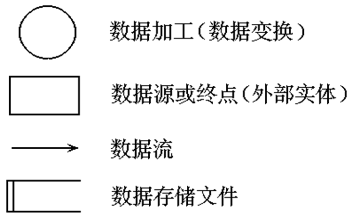

*课件第 6 页　DFD 的四种记号*

课件用取款案例说明读图方法。储户和日历是外部实体，检验、登录和付款是处理，账卡和存折是数据存储（第 7 页）。建模时先追踪数据流，再由用户复查。发现遗漏或错误时回到数据流分析。通过复查后，根据需要继续分解处理（第 8 页）。

### 分层与平衡

*课件第 9–19 页*

1. **第 0 层（环境层或顶层）DFD**把整个系统画成一个泡泡，标出边界外的实体以及跨边界的主要输入和输出。
2. **第 1 层 DFD**把这个泡泡分解为若干主要处理，补上内部数据流和数据存储。可以从用例叙述做语法分析，动词或动词短语用于找处理，名词短语用于发现外部实体、数据流或存储。
3. **第 2 层及以下**一次细化一个处理，直到每个泡泡代表一个明确、易实现的单一功能。子图对外的输入和输出应和父层中这个泡泡的输入和输出**保持平衡**，子图可以增加用于说明内部细节的数据流。第 11 页用编号表现从属关系，例如把加工 `2` 展开为 `2.1`、`2.2` 等子加工。

SafeHome 的三个层级对应以下三张图。先在环境层标出控制面板、传感器与系统交换的信息，并标识显示、警报和拨号输出。

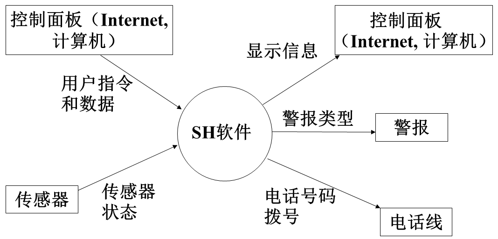

*课件第 12 页　SafeHome 第 0 层 DFD*

第 1 层把系统分成与用户交互、配置系统、处理密码、激活或解除系统、显示消息和状态、监测传感器六个主要处理。

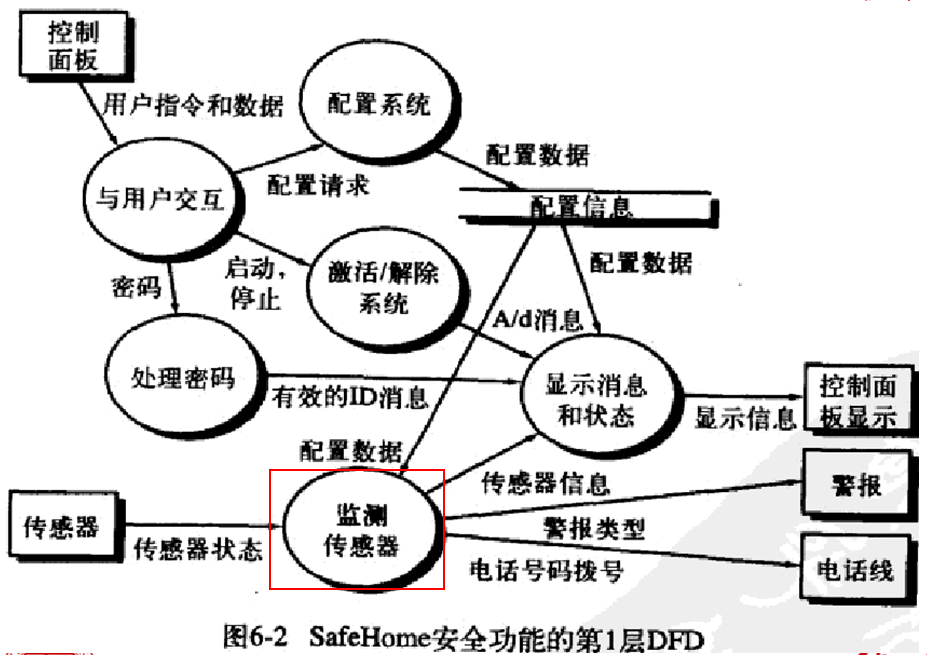

*课件第 17 页　SafeHome 第 1 层 DFD*

第 2 层细化「监测传感器」这个处理。核对传感器状态、配置数据等输入，以及传感器信息、警报类型和拨号信息等输出，即可检查与上层是否平衡。

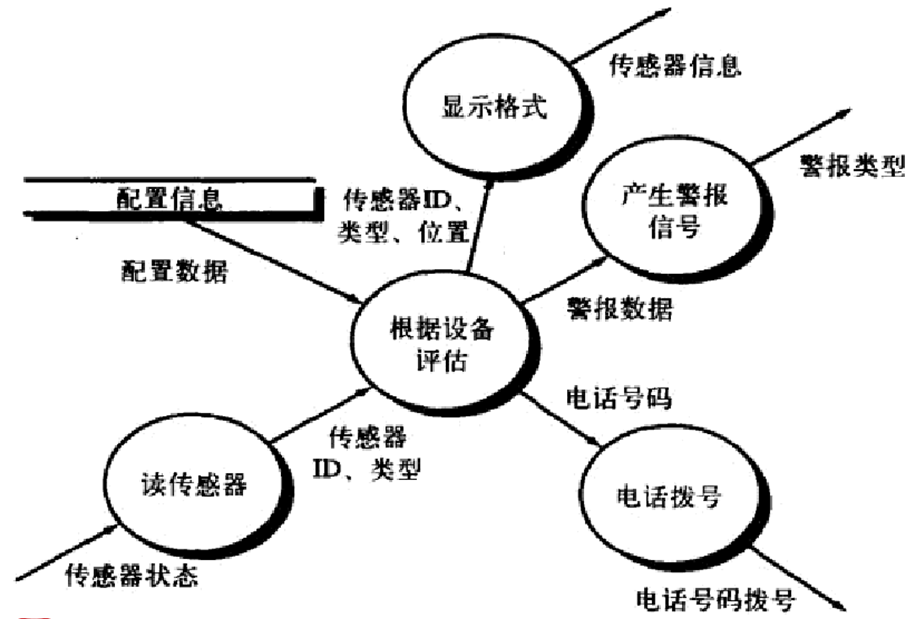

*课件第 18 页　SafeHome 的局部第 2 层 DFD*

## 补充 判定表与数据字典（第 21–26 页）

### 判定表

*课件第 21–22 页*

**判定表**把多个条件的组合及相应的动作写成表格。上部列条件，下部列动作，**每一列是一条规则**。条件可写真、假、取值范围或「任意」，动作行用勾标出该列应执行的动作。

第 21 页的入学例子中，标准考试成绩高时发录取表，其他条件填「任意」。标准考试成绩不高、在校成绩高时也发录取表。两种成绩都不高时，这个表给出的动作是发拒绝函。第 22 页按发货金额是否超过 500 美元、赊欠是否超过 60 天列四条规则。金额超过 500 且赊欠超过 60 天时不发批准书。金额不超过 500 但赊欠超过 60 天时，发批准书和发货单，同时发赊欠报告。另两种情况发批准书和发货单。

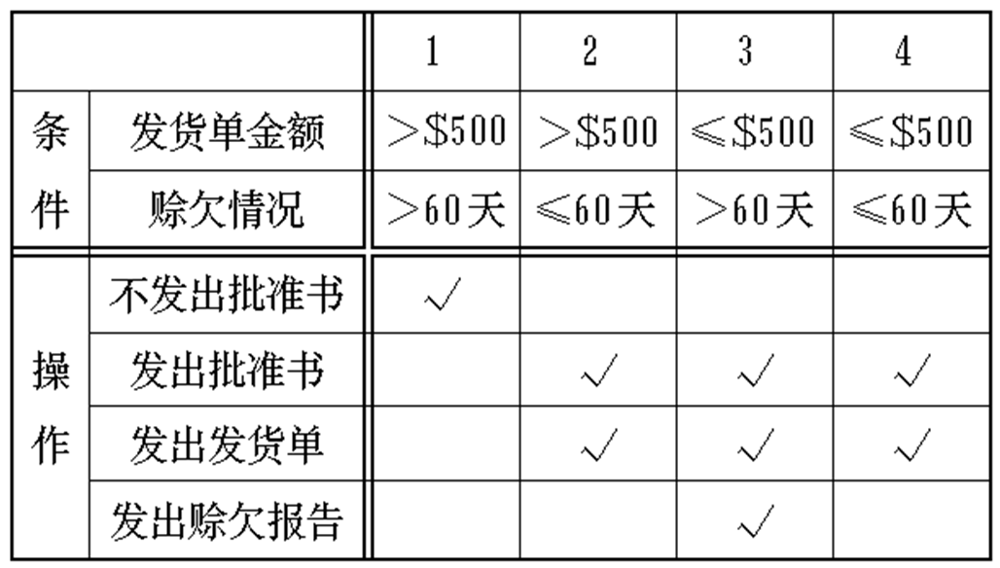

*课件第 22 页　多条件组合的发货规则*

一张完整的判定表应覆盖所有可行情形，边界值应落入明确的规则，同时满足多条规则时动作应相容。满足其余条件就能确定相同动作时，可以把无关条件写成「任意」来合并规则。

### 数据字典（第 23–26 页）

**数据字典**为模型里的数据项提供统一定义。它可以记录名称、别名与含义，类型、长度与组成，值域和使用方式，来源与使用它的处理，以及它所在的父结构或存储位置。DFD 用名字标数据流和数据存储，数据字典进一步解释名字。

组成数据对象时，等号表示定义，加号表示按顺序连接，方括号与竖线表示择一，花括号表示重复，左侧写最少次数，右侧写最多次数。圆括号表示可选。

- 订货报表 = 零件编号 + 零件名称 + 订货数量 + 价格 + 供应者。
- 零件编号 = 8{字符}8，表示固定 8 个字符。
- [难 | 中 | 易] 表示取一个难度值。1{知识点分数比例}* 表示至少包含一项，上界不限（第 41–42 页）。

## 7.1 生成行为模型（第 28 页）

**行为模型**说明系统如何响应外部事件或激励。先从用例中找出交互事件，再把它们分派给负责产生或识别这些事件的对象，最后用状态图或顺序图展示。

## 7.2 识别用例事件（第 30–31 页）

用例中系统和参与者交换信息的位置，是找事件的起点。对每一次交换，标出**有关的参与者、交换的信息、发生条件或限制**。例如，房主对象产生「输入密码」事件，控制面板负责接收信息并识别验证结果，再决定进入哪条路径。

## 7.3 状态表达（第 20、33–36 页）

### 状态图

*课件第 20、33–34 页*

- **被动状态**是对象当前属性值的集合，例如位置或方向。
- **主动状态**是对象在处理或持续变化中的阶段，例如读取、比较、锁定和选择。**事件或触发器**使对象从一个主动状态迁移到另一个状态。

**状态图**围绕一个对象或系统，画出其状态及触发状态改变的事件。箭头上的文字可带触发事件、条件和执行动作。状态内部的 **Entry** 表示进入状态时的初始化，**Do** 表示处在该状态时执行的活动。

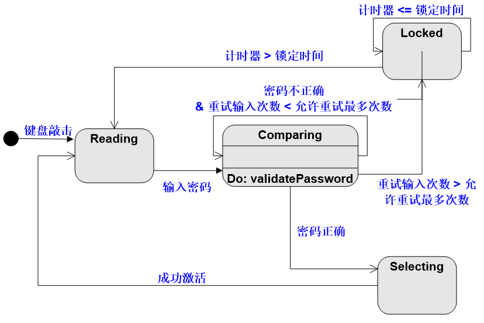

*课件第 34 页　对象的主动状态及转移*

第 20 页是 SafeHome 系统级状态图。上电后运行诊断，系统就绪后进入空闲。激活后监测传感器，传感器触发时启动计时器，超时进入报警响应，鸣响警报并通知处理人员。第 34 页则描述控制面板在身份验证场景下的状态。

### 顺序图

*课件第 35–36 页*

**顺序图（时序图）** 表现多个参与者或对象在一个场景中怎样交换消息。对象横向排列，各自下方的虚线是生命线。**时间从上到下**，消息箭头指向接收方。生命线上的窄矩形表示对象处理活动的持续时间。

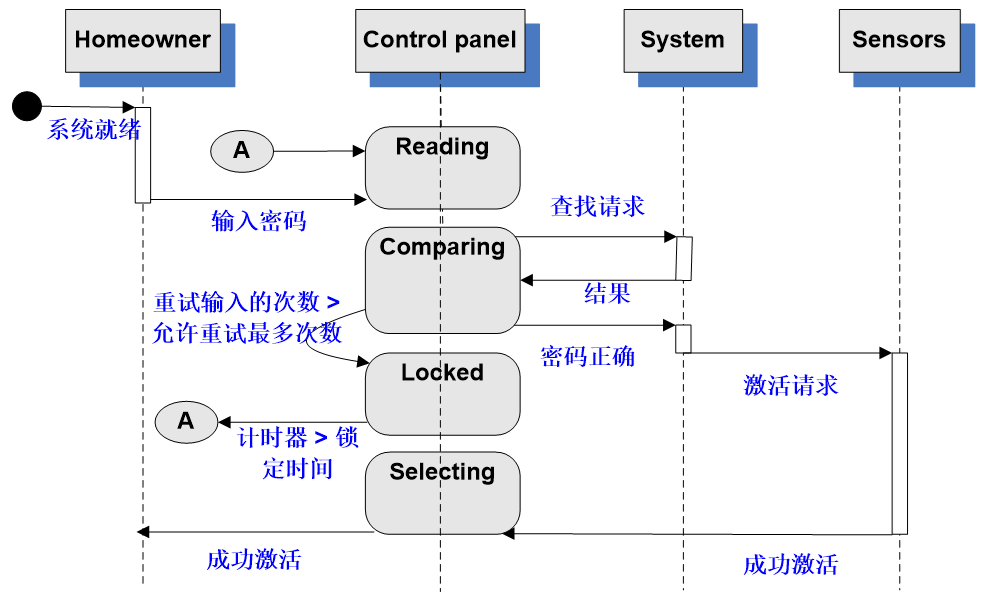

*课件第 36 页　SafeHome 的对象交互*

读状态图时关注「这个对象为什么换状态」，读顺序图时关注「谁在什么时候给谁发了什么消息」。描述业务活动执行路径可用活动图，描述数据如何变换可用 DFD。

## 课件案例（第 37–47 页）

### 出卷系统（第 37–42 页）

| 模型 | 从出卷案例中看到的内容 |
| --- | --- |
| 顶层 DFD | 教师提供出卷要求，系统生成试卷并保存到试卷数据存储。 |
| 一层 DFD | 教师发出出卷请求，设置出卷要求的处理把要求交给自动出卷或手动出卷，两种处理都可产生试卷。 |
| 二层 DFD | 细化自动出卷。按要求从试题库抽题，得到初步试卷，编辑过程中取得教师评价，再形成试卷。 |
| E-R 图 | 第 40 页的简化模型中，一份试卷依据一份出卷要求，包含多道题目。每道卷内题目由试题库中的试题抽取而来。 |
| 数据字典 | 「试卷」由试卷编号、课程名、出卷人、时间、总分和难度组成。「出卷要求」由总分、总难度和总知识点组成。 |

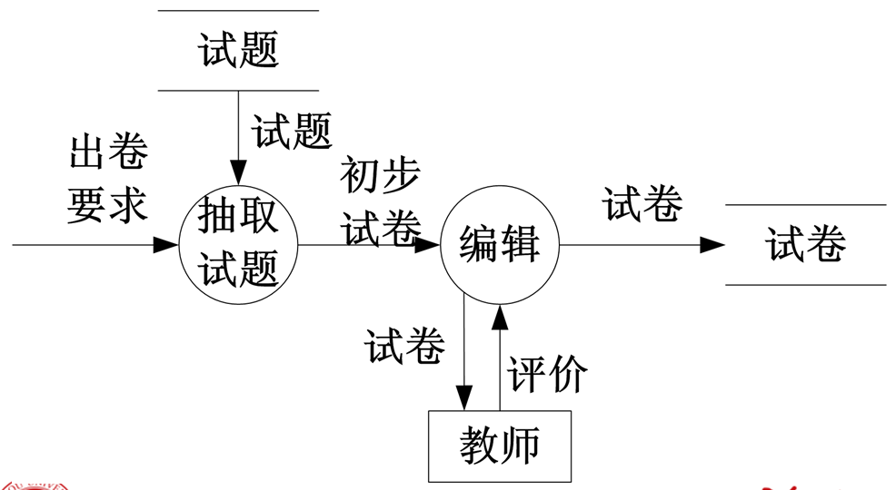

*课件第 39 页　出卷系统的二级数据流图*

### 短信系统（第 43–47 页）

- **用例场景**。发送时输入内容和收件人，系统编码后交给收发接口。接收时读取消息、解码、保存并显示。管理场景包括增删改人员，以及修改并保存系统设置。
- **分析类**。边界类包括发送、接收界面和收发接口。控制类协调发送、接收事务。实体类表达短信、短信串及相关领域操作。
- **对象协作**。发送请求由用户交给界面，界面再通知发送控制类。之后协作完成编码、存储和写入收发接口。协作图用连接和消息编号表达交互，顺序图用纵向时间顺序表达同一交互。

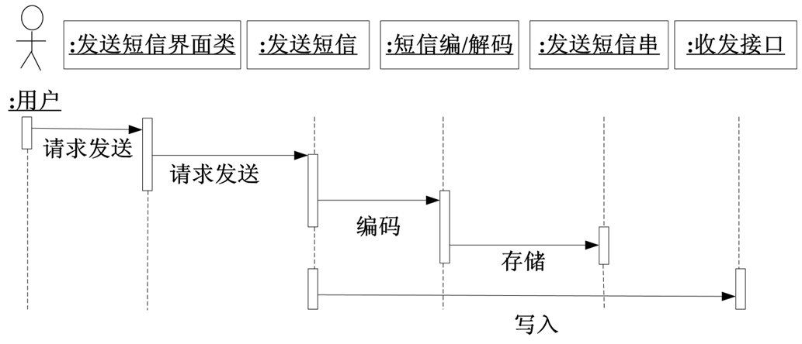

*课件第 47 页　发送短信的顺序图*

## 7.4 需求建模的模式（第 49–58 页）

**需求模式**是从已知场景中提炼的可复用领域知识。可以从用例、数据、类、流或行为模型中发现模式。一组连贯的用例能帮助找出反复出现的交互、约束或角色。**执行器—传感器**是有多种输入设备和执行部件的嵌入式系统中的常见模式。以倒车监控（第 51 页）为例，摄像机和近距离传感器提供画面和距离，控制软件根据速度与距离判定是否有碰撞风险，制动系统作为执行器接收停车指令。

| 成员或机制 | 职责 |
| --- | --- |
| **被动传感器** | 采用拉机制，由计算构件发出查询后返回值。 |
| **主动传感器** | 采用推机制，值改变时广播更新。还按约定时间间隔发送**生命刻度**（心跳消息），便于检测通信或设备故障。 |
| **执行器** | 接收计算构件的指令并执行动作。 |
| **计算构件与故障处理** | 读取或接收传感信息，给执行器发消息，检查设备操作状态和数值边界，按约定处理异常。 |

被动传感器、主动传感器和执行器可先定义为抽象类与通用接口，再分别建立布尔、整型、实型和复合等具体类型。模式说明中的主要内容包括**名称、目的、动机、适用性、约束、结构、行为、参与者、协作及结果**。课件用类图描述结构，用顺序图描述对象如何交互（第 52–58 页）。

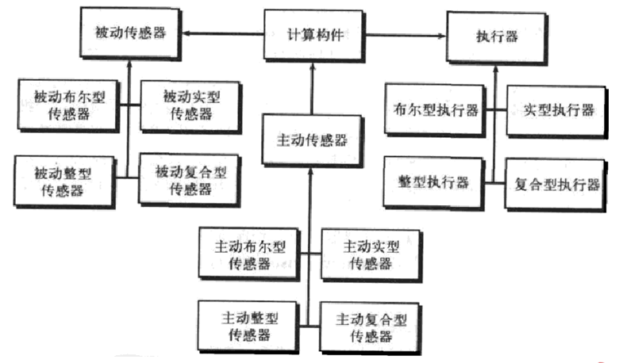

*课件第 54 页　执行器—传感器模式的结构*

第 55 页用安全摄像机的调整说明协作。控制面板查询位置传感器的状态和值，再向控制执行器设定调整值。发现传感器状态无效时，通知故障处理对象。

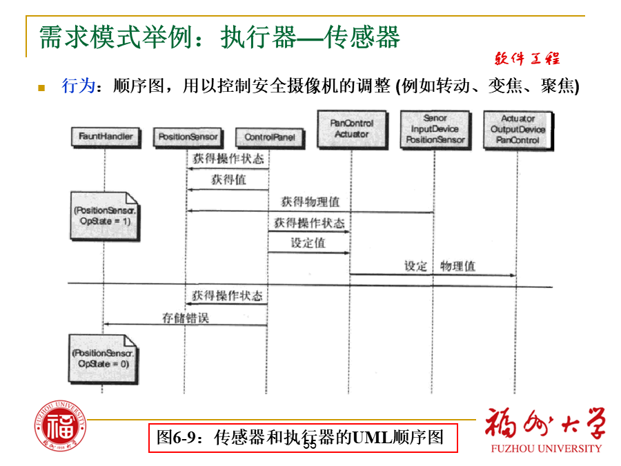

*课件第 55 页　传感器、计算构件和执行器的交互*

通用接口减少控制软件对具体设备的依赖。各类通过消息访问属性，设备可拒绝越界值或按约定采用边界值。检测到故障时通知 `FaultHandler` 并尝试恢复或切换备用设备。无法恢复时，按系统要求使用最后有效值或默认值（第 57–58 页）。

## 自测题

### 作业二第 4 题

什么是基于流程（数据流）的建模？谈谈你对数据流图、状态图、顺序图、判定表等的理解。

### 近年真题

#### 真题 1（2023 年 6 月卷，选择题第 5 题，2 分）

数据流图所描述的是实际系统的（　）。

- A. 物理模型
- B. 逻辑模型
- C. 层次模型
- D. 结构模型

---

## 答案与解析

### 作业二

#### 作业第 4 题

**答案与解析**

1. **基于流程的建模**沿着信息流动的路径说明输入怎样经加工变成输出，建立系统功能与数据之间的联系。
2. **数据流图**用外部实体、加工、数据流和数据存储表示数据从哪里来、如何变换和流向哪里。先画一个处理的环境层，再逐层细化，并核对父子层的边界数据流。
3. **状态图**以某个对象或系统为中心，表示各个状态、触发迁移的事件或条件，以及相应动作。
4. **顺序图**横向放参与者和对象，时间从上到下，用生命线和消息箭头表达一个场景中的对象协作。
5. **判定表**上部列条件，下部列动作，一列给出一条规则，说明一种条件组合下要执行哪些动作。它适合检查多条件业务规则是否有遗漏或重叠。

**考法、答题要点与易错点**　每种模型先写它回答什么，再写关键元素。DFD 的箭头表示具名的数据流。状态图的箭头表示某对象的状态迁移。顺序图看不同对象间消息的先后。判定表要把阈值和等号的归属写清。

**课件位置**　课件第 5–19、20–22、28–36 页。

**笔记位置**　[数据流图](#数据流图) · [分层与平衡](#分层与平衡) · [状态图](#状态图) · [顺序图](#顺序图) · [判定表](#判定表)

### 近年真题

#### 真题 1

**答案与解析**　选 **B. 逻辑模型**。DFD 表达系统需要接收哪些数据、将其做哪些变换并输出什么。数据如何存储在实际设备中、加工怎样写成代码，是具体实现的决定。

**考法、答题要点与易错点**　用「输入、处理、输出」解释为什么选逻辑模型。分层是展开模型的画法，题干问的是 DFD 描述的模型性质。

**课件位置**　课件第 5–10 页。

**笔记位置**　[数据流图](#数据流图) · [分层与平衡](#分层与平衡)

题目来源　**作业二** · **2023-06-09 期末卷**
