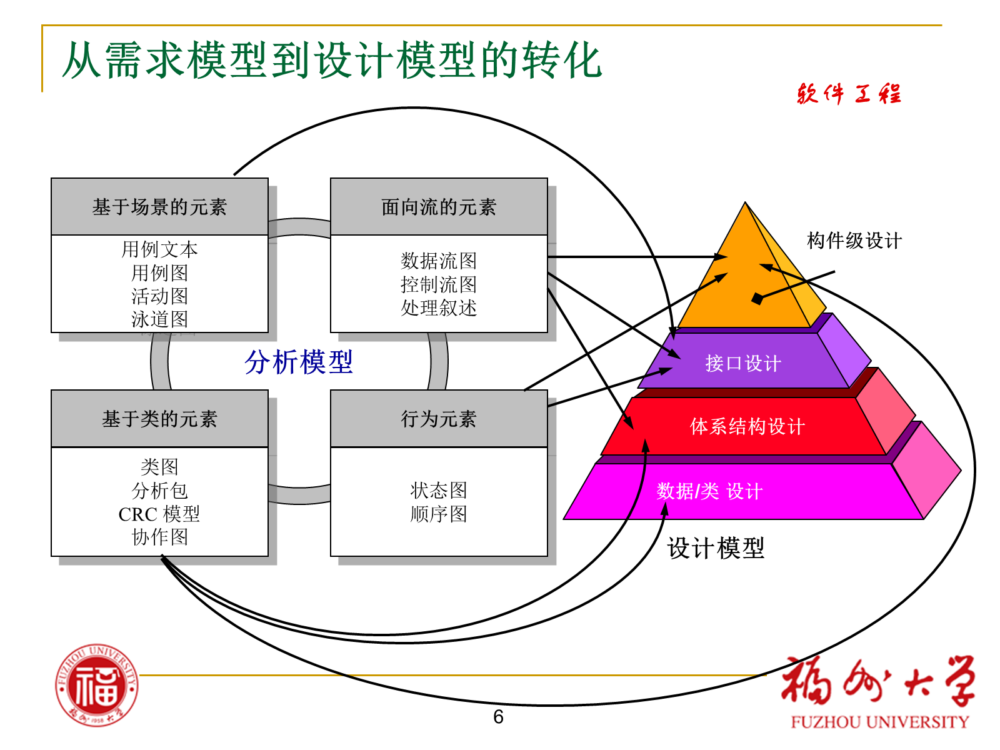
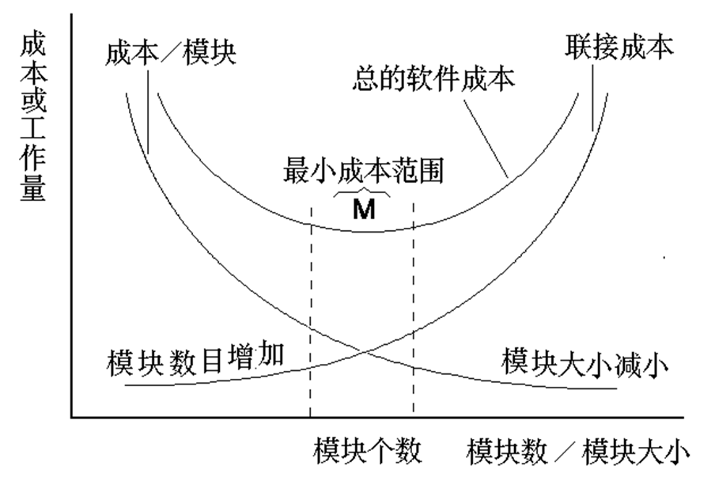
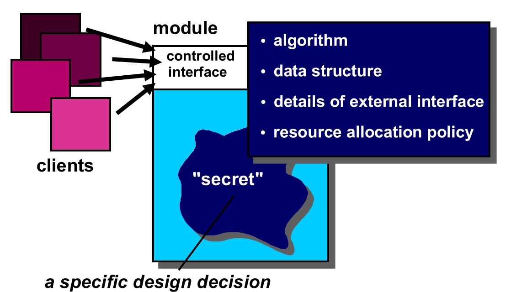
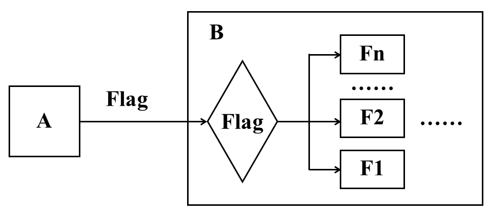
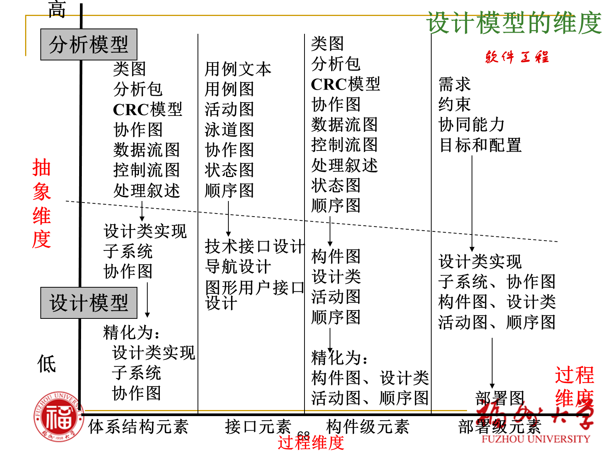
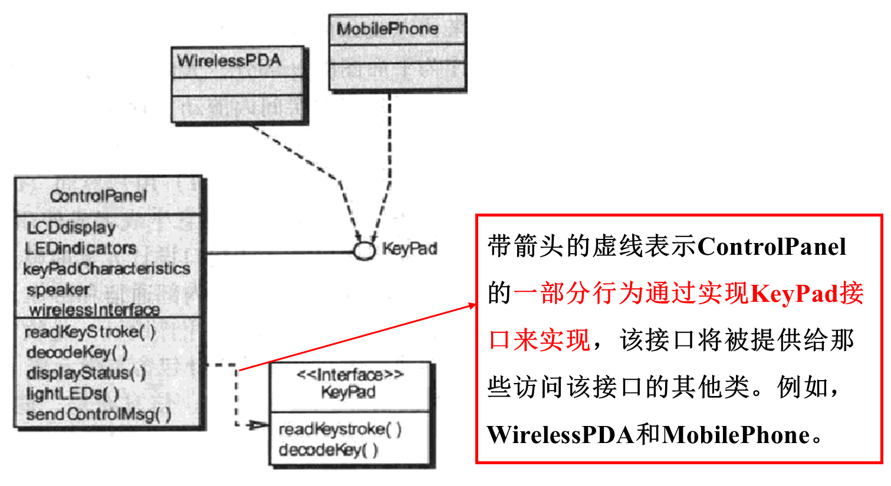
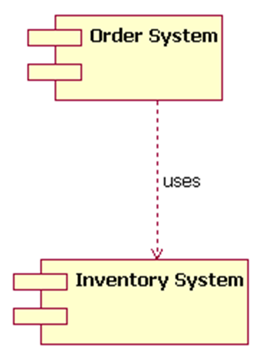
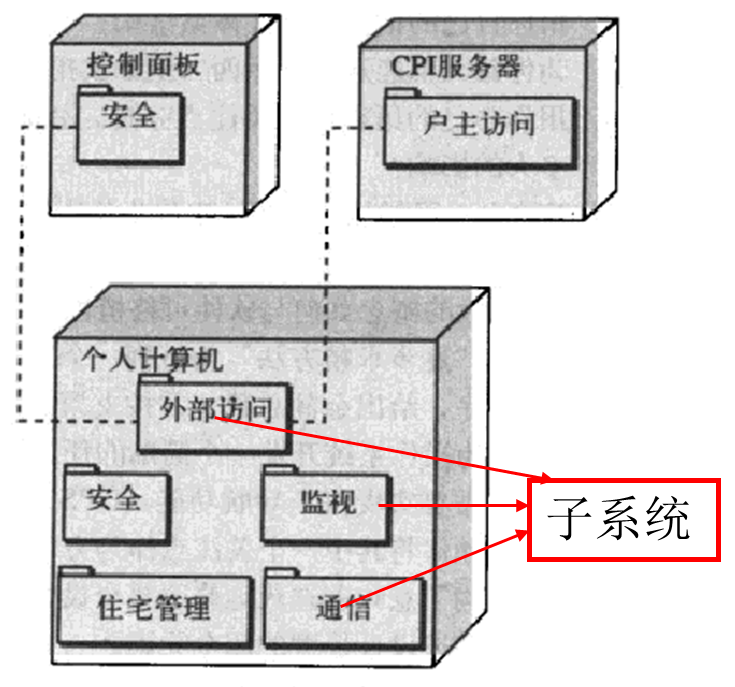

# 第 08 章 设计概念

## 8.1 软件工程中的设计（第 2–12 页）

### 初步设计与详细设计

*课件第 3、5、11、14 页*

**软件设计**把需求转化为可供构造软件使用的设计表示。分析在**问题空间**回答「做什么」，确定数据、功能和行为需求。设计在**解空间**回答「怎么做」，通常有多种可选方案。设计按迭代逐步求精，每一层表示都应能追溯到相应需求。

| 阶段 | 要解决的问题 | 典型结果 |
| --- | --- | --- |
| **初步设计（概要设计）** | 怎样把需求转成数据和软件框架？ | 主要的数据组织、子系统或模块划分、软件的总体结构。 |
| **详细设计** | 框架中的每个构件怎样实现？ | 构件内具体的数据结构、算法和处理流程，以及供其他构件访问的接口。 |

好的设计要**坚固、适用、愉悦**。坚固指软件能稳定履行功能，适用指符合开发目标，愉悦指使用体验好。在编码前就能评审设计，可以及早发现难以测试、修改容易扩散等结构问题（第 2、12 页）。

### 从需求模型到设计模型（第 6–11 页）

| 设计任务 | 从需求模型提取的信息 | 需要确定的内容 |
| --- | --- | --- |
| **数据／类设计** | 从类图、CRC 模型等提取分析类的属性、职责和关系。 | 落实为设计类和实现所需的数据结构。 |
| **体系结构设计** | 从系统规约、分析包和数据流图识别主要功能、数据传递和子系统交互。 | 划分主要构件，说明各自对外可见的属性与相互关系。 |
| **接口设计** | 从用例、活动图、数据流和顺序图提取用户操作、接口数据和协作消息。 | 定义用户、外部系统或设备与软件之间的接口，以及软件内部构件间的接口。 |
| **构件级设计** | 从分析类的职责、加工说明及状态图等提取处理规则和行为。 | 细化各构件的处理流程、局部数据结构和算法。 |

同一个需求模型元素可以支持多项设计任务。例如顺序图的消息可以细化为接口操作，消息发生的先后顺序也能指导构件内部的处理流程。设计逐步求精，每项关键决定都要能追溯到相应的数据、功能或行为需求。

*课件第 6 页　从需求模型到设计模型*

## 8.2 设计过程（第 14–21 页）

### 良好设计的特征与质量指导原则（第 14–17 页）

软件设计先给出高抽象层次的整体视图，再迭代细化到可实施的表示。课件用三个特征检查设计结果。

1. **满足需求**。实现需求模型中所有显式需求，满足用户期望的隐式需求。
2. **可读、可理解**。让后续开发人员能据此编码、测试、维护。
3. **全面性**。从实现角度给出数据、功能、行为的整体描述。

质量指导原则用于评审具体的设计表示。

1. 选用可识别的**体系结构风格或模式**，由质量良好的构件组成，支持逐步演化、实现和测试。
2. **模块化**，把软件合理划分为元素或子系统。
3. 为**体系结构、接口和构件**分别给出清晰的表示。
4. 导出适合设计类的**数据结构**，可从已知数据模式中提取。
5. 得到具有**功能独立性**的构件。
6. 用**简单清晰的接口**降低构件之间及构件与外部环境的连接复杂性。
7. 设计方法由**需求信息驱动**。
8. 选择**能准确传达设计意图的表示法**。

### 质量属性 FURPS（第 18–19 页）

| 字母 | 质量属性 | 评估时看什么 |
| --- | --- | --- |
| **F** | **功能性（Functionality）** | 功能集合、能力、各项功能的通用性和系统安全性。 |
| **U** | **易用性（Usability）** | 人员因素、整体美感、交互一致性与文档。 |
| **R** | **可靠性（Reliability）** | 故障频率与严重性、输出准确性、平均失效前时间（MTTF）、故障恢复能力和行为的可预见性。 |
| **P** | **性能（Performance）** | 处理速度、响应时间、资源消耗、吞吐量和效率。 |
| **S** | **可支持性（Supportability）** | 可维护性（如可扩展性、适应性和耐用性）、可测试性、兼容性、可配置性、安装和问题定位的难易程度。 |

质量属性要在设计开始时考虑，权重随系统目标变化。例如，抢课场景重视高峰时的响应时间和吞吐量，前者看一次请求要等多久，后者看单位时间能处理多少请求。

### 通用设计任务集（第 20–21 页）

1. 检查信息域模型，为数据对象及属性选择恰当的**数据结构**。
2. 用分析模型选择**体系结构风格**。
3. 划分并分配**子系统**。检查子系统的功能内聚性，设计其接口，并分配分析类或功能。
4. 建立**设计类或构件**。细化分析类，评估继承，定义方法和消息，选择适用的设计模式，再评审和修改。
5. 设计与外部系统或设备交互的**外部接口**。
6. 设计**用户接口**。从用户场景确定活动序列，建立交互行为模型，定义界面对象和控制机制，再评审。
7. 实施**构件级设计**。详细说明算法、局部数据结构和接口，逐个评审构件。
8. 建立**部署模型**，考虑软件元素怎样分配到实际运行环境。

## 8.3 设计概念（第 23–66 页）

### 抽象与逐步求精（第 23–27、57–58 页）

**抽象**通过保留当前层次需要的特征来控制复杂性。高层用概括术语描述方案，低层逐渐补足实现细节。

| 类型 | 定义 | 课件中的门 |
| --- | --- | --- |
| **数据抽象** | 组织描述某类数据对象的数据，并定义该类型和适用的操作。 | 「门」有类型、开启方向、开启机构、重量、尺寸等属性，并支持开门等操作。 |
| **过程抽象** | 用具有明确、有限功能的指令序列表达一个过程，用名称概括其功能。 | `open` 表示开门，内部可包含走向门、转动把手、必要时插钥匙等步骤，并使用门的属性。 |

**逐步求精**是自顶向下的设计策略。先给出宏观过程，再依次展开子功能、处理步骤和条件，直到能用程序语句表达。例如把「开门」精化为「检查门锁、操作把手、推拉门」，再把检查和操作展开为算法。抽象让人能在当前层次讨论对象或功能，求精补足实现所需的细节。

### 体系结构与设计模式（第 28–30、60 页）

**软件体系结构**描述构件的结构和组织、构件的交互形式，以及构件使用的数据结构。体系结构示意图为后续的接口与构件细化提供框架。课件要求从三个方面理解体系结构。

- **结构特性**。系统有哪些构件，怎样封装，彼此如何交互。
- **外部功能特性**。这种结构怎样满足性能、容量、可靠性、安全性、适应性等需求。
- **相关系统族**。从同类系统中提取反复出现的结构和关系，以重用体系结构构件。

**设计模式**是经过验证的、用于解决特定环境中反复出现的特定设计问题的方案。面向对象的设计模式关注类和相互通信的对象如何组织，怎样分配角色与职责、安排协作，以应对变化并提高复用性。

### 关注点分离与模块化

*课件第 31–40 页*

**关注点分离**按可独立解决或优化的关注点分解复杂问题，体现分而治之。**模块化**把软件设计分解为若干可独立命名、通过名字访问的模块。每个模块完成相对独立的子功能，通过接口与其他模块集成。类、过程、函数和子程序都可以充当模块。

第 35 页用 `C(p)` 表示问题的复杂度，用 `E(p)` 表示求解工作量。课件用 `C(p1) > C(p2) ⇒ E(p1) > E(p2)` 表示问题越复杂，解决它的工作量越大。对适合分解的问题，课件用 `C(p1+p2) > C(p1)+C(p2)` 表示合在一起求解更复杂，相应的工作量满足 `E(p1+p2) > E(p1)+E(p2)`。估算总成本时，还要计入模块的接口与集成工作（第 35、37 页）。

以智能灌溉为例，**传感器模块**采集土壤湿度等数据，**灌溉决策模块**结合数据和种植规则作决策，**灌溉设备控制模块**把决策转化为设备动作。三个模块可独立开发，通过约定的数据和控制接口配合。

**适度模块化**需要平衡开发和集成的开销。模块太少时，单个模块庞大，理解和开发成本高。模块越分越细时，接口、集成和人员沟通的开销会上升。图中横轴是模块数，纵轴是成本或工作量，向下的曲线表示单模块开发成本减少，向上的曲线表示联接成本增加，**总软件成本曲线的谷底**对应较合适的模块划分范围，即图中的 `M`。实际划分时，需要结合职责、接口数量和变更影响确定模块边界。

*课件第 39 页　模块数、联接成本与总成本的关系*

合理的模块划分便于规划和分工，可按增量交付，能把变更限制在更小的范围，也有利于单独测试、调试和长期维护。

### 信息隐蔽

*课件第 41–43 页*

**信息隐蔽（Information Hiding）** 把模块内部的实现细节放在受控接口背后，对外只提供完成协作必需的信息和操作。可隐蔽的设计决策包括**数据结构、算法、外部接口的实现细节及资源分配策略**。面向对象语言的访问控制符是常用手段，例如用私有字段封装存储细节，通过公开方法提供服务。

*课件第 42 页　模块的受控接口与被隐蔽的设计决策*

例如，选课模块对外提供查询余量的操作，内部可以用数据库记录或缓存来保存数据。调用方只依赖约定的输入、输出和行为。减少共享全局数据、保持接口稳定，可以降低变更的副作用和模块间的依赖。

### 功能独立与内聚

*课件第 44–46、48–49、56 页*

**功能独立**指每个模块负责需求的一个特定子集，专注于本模块的功能，并通过简单接口与其他模块协作。它是关注点分离、模块化、抽象和信息隐蔽的结果。功能独立性用两个指标衡量。**内聚**看一个模块内部各元素联系有多紧，**耦合**看模块之间依赖有多强。设计目标是**高内聚、低耦合**，便于独立开发、复用、测试和维护，也能缩小错误和修改的传播范围。

内聚由强到弱如下。

| 类型 | 判断依据 | 例子 |
| --- | --- | --- |
| **功能内聚** | 所有部分共同完成一个明确的功能。 | 比较湿度阈值和计算缺水量等步骤都用于完成「计算灌溉决策」。 |
| **顺序内聚** | 各处理形成数据传递链，上一步的输出供下一步使用。 | 解析原始成绩，后续统计使用解析结果。 |
| **通信内聚** | 多个处理访问同一数据或同一数据结构区域。 | 用同一份课程数据执行选课、退课和查询。 |
| **过程内聚** | 多个处理按规定的过程顺序执行。 | 按规定先清屏、再展示欢迎页、最后播放提示音。 |
| **时间内聚** | 多个任务发生在同一时段，如初始化或收尾。 | 启动时加载配置、打开日志、预热缓存。 |
| **逻辑内聚** | 把一类逻辑相关的操作放在一起，用参数选其中一种。 | 管理函数按操作类型选择发送通知、清理日志或重建索引。 |
| **巧合内聚（偶然内聚）** | 把缺少共同职责的片段放在同一模块，关联只来自偶然的相似或重复。 | 把若干无关的重复语句归在一个杂项模块中。 |

**顺序内聚**的次序由数据依赖决定，**过程内聚**的次序由处理规程规定。**通信内聚**强调各处理使用共同的数据，**时间内聚**强调各处理在同一时段发生。

### 耦合的七个层次

*课件第 47、50–56 页*

**耦合**描述模块之间的关联程度，受接口复杂性、访问位置和传递内容影响。依赖越强，局部的变更或故障越可能沿依赖链传播，课件称之为**涟漪效应**。

耦合由强到弱如下。

| 类型 | 判断依据 | 例子 |
| --- | --- | --- |
| **内容耦合** | 直接访问另一个模块的内部数据或处理过程。 | A 直接操作 B 的内部变量，或跳转到 B 内部某条语句。 |
| **公共耦合（共用耦合）** | 多个模块共同访问同一公共数据。 | A 和 B 共同读写全局变量。 |
| **外部耦合** | 多个模块受同一外部协议、格式或其他约束限制。 | 两个模块都要适配同一种第三方文件格式，格式变化会同时影响两者。 |
| **控制耦合** | 把决定接收方执行逻辑的控制信息作为参数传递。 | A 传入 `Flag`，B 按它选择执行 `F1`、`F2` 等分支。 |
| **标记耦合** | 把复合数据结构或对象作为参数传递，接口依赖其结构或类型。 | 方法参数是整个课程对象，处理只需其中的课程号。 |
| **数据耦合** | 通过接口传递简单的业务数据。 | 只传需要的课程号和学分。 |
| **非直接耦合** | 两个模块之间没有直接依赖，可相对独立地工作。 | 两个模块分别由上层调度，彼此没有直接调用或数据共享。 |

*课件第 55 页　A 传递 Flag 给 B，B 据此决定执行哪个分支*

判断时看**参数的作用和结构**。`Flag` 即使是整数，只要它指定接收方的操作分支，仍属于控制耦合。对于确实需要直接传值的模块，传递必要的简单数据可减少依赖。模块内按参数选择多个逻辑相关功能可能形成**逻辑内聚**，模块间传递该选择参数可能形成**控制耦合**。

### 重构

*课件第 59 页*

**重构（Refactoring）** 是在保持软件外部可观察行为的前提下，重新组织设计或代码的内部结构。常见动作包括消除冗余、提取重复逻辑、调整不恰当的数据结构。课件把一个同时承担三项弱相关功能的构件拆成三个高内聚构件，对外仍完成原来的功能，内部更容易集成、测试和维护。

### 设计类（第 61–64 页）

**分析类**以业务术语描述对象及其服务。**设计类**补充属性类型、方法、接口和协作等实现细节。随着体系结构形成，设计类可分为以下五类。

| 设计类 | 职责 |
| --- | --- |
| **用户接口类** | 表达人机交互所需的界面对象和操作。 |
| **业务域类** | 精化分析类，实现业务对象的属性和服务。 |
| **过程类** | 提供管理业务域类所需的业务流程或其他低层业务抽象。 |
| **持久类** | 表达需跨越程序执行期保存的数据，如存入数据库的数据。 |
| **系统类** | 实现软件的管理和控制，支持软件在计算环境中运行并与外界通信。 |

组织良好的设计类有四项特征。

1. **完整性与充分性**。封装覆盖合理用途所需的属性和方法，提供恰好能满足类目的的服务。
2. **原始性**。每种基本服务由明确的方法实现，避免为同一服务提供重复的实现途径。例如 `VideoClip` 用 `setStartPoint()` 提供设置剪辑起点的统一入口。
3. **高内聚性**。类承担少量、集中的职责，方法围绕相关属性和同一类目标。
4. **低耦合性**。把设计类之间的协作和依赖保持在必要的范围内。

### 依赖倒置

*课件第 65 页*

**依赖倒置原则（DIP）** 要求高层策略和低层实现都依赖抽象，具体细节实现抽象定义的契约。例如，灌溉决策依赖「灌溉控制」接口，水泵驱动和测试用的模拟控制器各自实现接口。高层只通过接口发出指令，具体实现可以替换。 **第10章.ppt**

### 测试设计（第 66 页）

**测试驱动开发（TDD）** 用短周期让测试指导设计。先写测试并运行，观察预期的失败。再写足以通过测试的代码，重新运行并确认通过。

若先做详细设计，则要为测试保留**接缝**。接缝是可以探查运行状态或把被测代码隔离到受控环境的位置。例如，灌溉决策通过传感器接口读取数据，测试时可换用返回指定湿度的测试替身，分别验证干旱和湿润场景。

## 8.4 设计模型（第 68–77 页）

### 设计模型的两个维度（第 68 页）

- **抽象维度**沿纵轴从高到低，表现分析模型怎样转化为设计模型，再精化到可实现的细节。
- **过程维度**沿横轴展示设计任务如何推进，课件依次列出体系结构、接口、构件级和部署级设计元素。

*课件第 68 页　设计模型的抽象维度与过程维度*

第 6 页从需求模型导出数据／类、体系结构、接口、构件级四项设计。第 68 页把设计随过程展开的产物画成维度图，其中设计类和数据结构也会随体系结构及构件细化进一步落实，部署则说明软件在物理环境中的分布。

### 体系结构设计元素（第 69 页）

体系结构模型提供软件的整体视图，可以从三个来源获得。**应用域信息**提供系统运行的背景，**需求模型元素**（如数据流图和分析类）提供职责、主要数据和交互关系，**体系结构模式**提供可以参考的组织方式。

### 接口设计元素（第 70–74 页）

接口设计说明信息如何进出系统，以及系统内构件之间如何通信。

| 类型 | 需要说明什么 |
| --- | --- |
| **用户界面（UI）** | 人怎样与软件交互。可用性设计包括美学元素（布局、颜色、图形、交互机制）、人机工程元素（信息布局、界面隐喻、导航）和技术元素（UI 模式、可复用构件）。 |
| **外部接口** | 怎样与其他系统、设备、网络或信息生产者及使用者通信。设计时要确认收发信息的正确性，加入错误检查和必要的安全检查。 |
| **内部接口** | 软件内部不同构件或类的操作怎样相互调用、交换信息与协作。它和构件级设计紧密相关。 |

第 74 页用两种方式表示同一个 `KeyPad` 接口。接在 `ControlPanel` 旁的小圆表示它**提供**接口。用 `«interface»` 方框展开时，指向接口的虚线空心三角表示 `ControlPanel` **实现**接口。`WirelessPDA` 和 `MobilePhone` **依赖**该接口，调用接口声明的操作。

*课件第 74 页　UML 类图中的接口、实现与依赖*

### 构件级设计元素

*课件第 75–76 页*

**构件**是软件体系结构中模块化、可部署、可替换的部件。它封装实现，通过一组明确的接口与其他构件或外部实体协作（第 10 章第 4 页）。**构件级设计**细化构件的三项内容，即**局部数据结构、处理算法、用来访问构件操作的接口**。

**UML 构件图（组件图）** 的主要元素是构件、接口和依赖。课件中虚线箭头从 `Order System` 指向 `Inventory System`，表示订单系统使用库存系统提供的服务。

*课件第 76 页　构件之间的依赖方向*

### 部署级设计元素（第 77 页）

**部署设计**把软件功能、子系统等分配到物理计算环境。课件的部署图用立体方框表示计算节点，方框内列出运行在其上的软件元素。例如，控制面板上有安全子系统，CPI 服务器上有户主访问子系统，个人计算机上分布有监视和住宅管理等子系统。读构件图找「哪个构件依赖哪个服务」，读部署图找「哪个软件元素部署在哪个节点」。

*课件第 77 页　软件子系统在物理节点上的部署*

## 自测题

### 作业二第 3 题（构件级设计部分）

什么基于类的需求建模，谈谈你对 CRC、类图、ER 图和设计原则（组件级设计）的理解。

本章作答题干中的「设计原则（组件级设计）」部分。

### 作业三

#### 作业三第 1 题

软件设计是将需求转变为软件表达的过程。如何从需求模型转变为设计模型？

#### 作业三第 2 题

设计概念有哪些？谈谈你对它们的理解。

#### 作业三第 3 题

谈谈你对高内聚、低耦合的认识。内聚和耦合各有哪些常见形式（各 7 种）？

### 近年真题

#### 真题 1（2023 年 6 月卷，选择题第 4 题，2 分）

软件详细设计的主要任务是确定每个模块的（　）。

- A. 算法和使用的数据结构
- B. 外部接口
- C. 功能
- D. 编程

#### 真题 2（2023 年 6 月卷选择题第 6 题、2024 年 12 月卷选择题第 5 题，各 2 分）

为了提高模块的独立性，模块最好是（　）。

- A. 逻辑内聚
- B. 通信内聚
- C. 功能内聚
- D. 层次内聚

#### 真题 3（2023 年 6 月卷，选择题第 7 题，2 分）

当类 B 被声明为类 A 某一操作中的一个参数类型时，类 A 和类 B 间的耦合就属于（　）。

- A. 内容耦合
- B. 共用耦合
- C. 控制耦合
- D. 标记耦合

#### 真题 4（2023 年 6 月卷，名词解释第 3 题，2 分）

信息隐蔽。

#### 真题 5（2023 年 6 月卷，名词解释第 4 题，2 分）

重构。

#### 真题 6（2024 年 12 月卷，名词解释第 5 题，3 分）

构件。

### 课件练习（依据 2024 年 12 月卷简答第 1 题可见题干自拟）

> 关注点分离是指将任何复杂问题分解成若干个可以独立解决或优化的块，可以更容易地处理。在软件设计中，我们通常利用模块化将软件划分为许多模块，从而降低软件开发的难度。

试卷的具体设问缺失。以下两问按本章课件设计。

1. 为什么分解可以降低软件开发的难度？以模块个数为横轴、成本或工作量为纵轴画示意图，说明为什么要适度模块化。
2. 在智能灌溉系统中，传感器模块与灌溉决策模块共同读写全局湿度变量。决策模块再传入 `Flag`，让设备控制模块从多个操作分支中选一个执行。这两处各是什么耦合？怎样改进接口？

---

## 答案与解析

### 作业二第 3 题

**答案与解析**

1. **开闭原则（OCP）**。模块对扩展开放、对修改封闭。可用抽象接口和多态引入新实现，使既有构件通过同一接口接受新增能力。
2. **Liskov 替换原则（LSP）**。在使用基类的地方可以用子类替换，子类要遵守基类与调用方约定的前置条件和后置条件。
3. **依赖倒置原则（DIP）**。高层策略和低层实现都依赖抽象。例如决策模块依赖传感器接口，各型号的传感器驱动实现该接口。
4. **接口分离原则（ISP）**。为不同客户类型提供专用的小接口，每种客户只依赖它会使用的操作。

**考法、答题要点与易错点**　列出原则名称，再写出它约束的对象和作用。开闭原则看扩展方式，替换原则看子类是否满足基类契约，依赖倒置看高层和低层的依赖指向，接口分离看调用方需要哪些操作。用接口解释扩展时，把高层策略、抽象和低层实现三个角色写清。

**课件位置**　本章课件第 65、75 页。第 10 章课件第 14–15、19、24、28 页给出四项原则。

**笔记位置**　[依赖倒置](#依赖倒置) · [构件级设计元素](#构件级设计元素)

### 作业三

#### 作业三第 1 题

**答案与解析**　以活动报名系统为例，从需求中提取数据、功能、交互和行为规则，并落实到四项设计。

| 设计任务 | 从需求到设计的例子 |
| --- | --- |
| **数据／类设计** | 从活动、学生、报名记录等分析类，导出设计类的属性类型、操作和数据结构。 |
| **体系结构设计** | 根据数据流和子系统协作，划分报名界面、报名服务、数据访问等构件，明确调用与数据传递关系。 |
| **接口设计** | 从提交报名用例和顺序图导出报名操作，明确请求中的学生与活动标识，以及成功、名额已满等返回结果。 |
| **构件级设计** | 根据报名规则，细化报名服务内部检查资格、检查名额、保存记录的处理步骤，以及异常处理和局部数据结构。 |

**考法、答题要点与易错点**　转换题按「需求模型中的依据 → 对应设计任务 → 设计产物」写。接口关注调用双方的约定，构件级设计再展开构件内部的处理。用一条具体需求贯穿四项任务，可以展示各设计结果如何追溯到需求。

**课件位置**　课件第 6–11、14 页。

**笔记位置**　[从需求模型到设计模型](#从需求模型到设计模型第-611-页) · [初步设计与详细设计](#初步设计与详细设计)

#### 作业三第 2 题

**答案与解析**

- **抽象与逐步求精**。数据抽象用属性和操作描述一类数据对象，例如门的开启方向与开门操作。过程抽象用名称概括一组操作，例如「开门」。求精再把开门展开为检查门锁、操作把手等步骤。
- **体系结构与设计模式**。体系结构规定构件及其交互的总体组织。设计模式为特定环境中反复出现的问题提供经验证的组织方案，例如安排相互协作的对象及其职责。
- **关注点分离、模块化、信息隐蔽、功能独立**。把复杂问题按关注点分解成模块，各模块隐藏内部数据结构和处理细节，通过接口协作。用内聚度和耦合度衡量功能独立性，目标是高内聚、低耦合。
- **重构与设计类**。重构在维持外部可观察行为的前提下改善内部结构。设计类把分析类或新增的实现职责落实为可编码的属性、操作、接口与协作。
- **依赖倒置与测试设计**。高层策略和低层实现通过抽象协作。测试可在编码前指导设计，也可在设计中保留接缝，支持观察状态和隔离被测部分。

**考法、答题要点与易错点**　每个概念写清「解决什么问题、做法是什么」。抽象与求精分别说明保留哪些信息和补足哪些细节。解释重构时要写出外部行为保持不变。

**课件位置**　课件第 23–66 页。

**笔记位置**　[抽象与逐步求精](#抽象与逐步求精第-23275758-页) · [体系结构与设计模式](#体系结构与设计模式第-283060-页) · [关注点分离与模块化](#关注点分离与模块化) · [信息隐蔽](#信息隐蔽) · [功能独立与内聚](#功能独立与内聚) · [重构](#重构) · [设计类](#设计类第-6164-页) · [依赖倒置](#依赖倒置) · [测试设计](#测试设计第-66-页)

#### 作业三第 3 题

**答案与解析**　内聚描述**模块内部**各元素联系的紧密程度，耦合描述**模块之间**的依赖程度。模块职责集中，通过简单接口交换必要信息，便于独立开发、测试与维护，也能缩小修改的影响范围。

- 内聚从强到弱为**功能、顺序、通信、过程、时间、逻辑、巧合内聚**。
- 耦合从强到弱为**内容、公共、外部、控制、标记、数据、非直接耦合**。

例如，计算运费模块中的各处理都服务于同一项功能，属于功能内聚。订单模块只传计算运费所需的重量与距离等简单数据，属于数据耦合。若把整张订单传过去而运费模块只用两个字段，则形成标记耦合。

**考法、答题要点与易错点**　内聚题看任务为何放在一起。上一步结果作为下一步输入属于顺序内聚，共用同一份数据属于通信内聚，按规定次序完成任务属于过程内聚。耦合题看模块如何联系。多个模块共同读写全局数据属于公共耦合，共同遵循外部协议或格式属于外部耦合，跨模块传递选择分支的标志属于控制耦合。

**课件位置**　课件第 44–56 页，七种内聚与七种耦合见第 48–51 页。

**笔记位置**　[功能独立与内聚](#功能独立与内聚) · [耦合的七个层次](#耦合的七个层次)

### 近年真题

#### 真题 1

**答案与解析**　选 **A. 算法和使用的数据结构**。详细设计逐步精化软件框架，落实到每个模块的处理步骤、局部数据结构和算法，使实现者能据此编码。

**考法、答题要点与易错点**　记住题干的「每个模块」和「主要任务」。简答时先说明设计层次，再答出构件内部的数据结构与算法。接口题则问通信约定或信息怎样交换。

**课件位置**　课件第 5、11、75 页。

**笔记位置**　[初步设计与详细设计](#初步设计与详细设计) · [构件级设计元素](#构件级设计元素)

#### 真题 2

**答案与解析**　选 **C. 功能内聚**。功能内聚的模块内部各部分为完成同一项明确功能而协作，是课件中内聚度最高的一类。

**考法、答题要点与易错点**　两份卷子考的是同一题。共同访问数据对应通信内聚，按参数挑选一类操作对应逻辑内聚，共同完成一项具体功能才对应功能内聚。简答问怎样提高模块独立性时，写全**提高内聚度、降低耦合度**。

**课件位置**　课件第 44–49、56 页。

**笔记位置**　[功能独立与内聚](#功能独立与内聚)

#### 真题 3

**答案与解析**　选 **D. 标记耦合**。类 A 的操作用类 B 作为参数类型，接口依赖 B 的对象类型。题干用「整个类的类型作为参数」提示标记耦合。

**考法、答题要点与易错点**　判断时先看模块之间传的是什么、用来干什么。传对象或复合数据时检查是否依赖其结构，传控制标志时检查是否用它选择执行分支。对象经接口传递属于题中所说的标记耦合，直接深入对方内部访问实现才属于内容耦合。

**课件位置**　课件第 50–55 页。第 10 章课件第 42 页补充了传入数据结构却只使用其中一部分的情形。

**笔记位置**　[耦合的七个层次](#耦合的七个层次)

#### 真题 4

**答案与解析**　信息隐蔽是一种将数据结构、算法等实现细节封装在模块内部、只通过受控接口提供必要服务的设计原则。调用方依赖接口契约，内部实现可以在契约范围内调整，减少变更扩散。

**考法、答题要点与易错点**　名词解释用三点写全**隐藏什么、怎样交互、带来什么效果**。访问控制符是实现手段，受控接口和减少模块依赖才体现设计意图。

**课件位置**　课件第 41–43 页。

**笔记位置**　[信息隐蔽](#信息隐蔽)

#### 真题 5

**答案与解析**　重构是在保持软件外部可观察行为的前提下，调整设计或代码的内部结构，以简化实现并改善可读性、可测试性和可维护性。例如在继续提供原服务的前提下，把兼做三项无关工作的构件改为三个职责集中的构件。

**考法、答题要点与易错点**　定义要同时写出**调整内部结构**与**保持外部行为**。举例时写清改了什么结构，以及用哪个可观察行为确认对外契约得到保留。

**课件位置**　课件第 59 页。

**笔记位置**　[重构](#重构)

#### 真题 6

**答案与解析**　构件是软件体系结构中**模块化、可部署、可替换**的部件。它**封装实现并暴露一组接口**，通过这些接口与其他构件或外部实体协作。

**考法、答题要点与易错点**　先用「体系结构中的部件」定位，再写三项属性和接口。构件级设计的三项内容是算法、局部数据结构和操作接口，分别从处理、数据和访问方式描述构件。

**课件位置**　本章课件第 11、75–77 页，构件的正式定义见第 10 章课件第 4 页。

**笔记位置**　[构件级设计元素](#构件级设计元素)

### 课件练习

**答案与解析**

1. 按业务职责分解后，每个模块负责一个容易理解的子问题，可以单独开发和测试。画图时横轴标模块个数，纵轴标成本或工作量。画出下降的模块开发成本、上升的接口与集成成本，再画先降后升的总成本。总成本最低处附近是适合的模块数量范围。粒度继续变小时，接口、集成和沟通的额外开销会超过拆分的收益。
2. 两个模块共同读写全局湿度变量属于**公共耦合**。可以把湿度数据封装在传感器模块内，由决策模块通过接口读取所需的湿度数值。用 `Flag` 指定设备控制模块的分支属于**控制耦合**。可分别设计 `开启灌溉(时长)` 和 `停止灌溉()` 等职责明确的操作，调用方按业务意图选择操作，只传执行所需的数据。

**考法、答题要点与易错点**　解释模块化成本时写出**分解收益、接口集成开销、总成本最低范围**三步。分析耦合时先点出依赖的证据，再给出具体接口。图上选取的是总成本曲线最低处。接口改进后也要检查各模块有没有集中承担自己的职责。

**课件位置**　课件第 31–43、44–56 页。

**笔记位置**　[关注点分离与模块化](#关注点分离与模块化) · [信息隐蔽](#信息隐蔽) · [功能独立与内聚](#功能独立与内聚) · [耦合的七个层次](#耦合的七个层次)

题目来源　**作业二** · **作业三** · **2023-06-09 期末卷** · **2024-12-27 期末卷**
