# 第 09 章 体系结构设计

页码沿用本份 PPT 页脚。先看构件怎样组织、通过什么接口协作，再练习从数据流图划出处理边界，画出模块控制结构。 **第09章.ppt** · [自测题](#自测题)

## 9.1 软件体系结构（第 5–10 页）

**软件体系结构（Software Architecture，架构）**是软件系统的一个或多个结构。每个结构描述**构件、构件的外部可见属性及构件间的相互关系**。例如，外部可见属性包括构件提供的服务和接口，关系可以表现为调用、信息传递或依赖。

体系结构帮助团队**分析设计能否满足需求、在变更代价较低时比较候选方案、降低软件构造风险**。一个规模较小、便于理解的架构模型还能支持利益相关者交流，明确影响后续开发的早期决策，并展示各构件怎样协作（第 5、7 页）。

课件用「类与对象」来解释架构和具体设计的关系。**具体设计体现了架构的选择**。同一个客户机—服务器架构可以用不同平台、构件和接口实现，例如课件中的 Java EE 与 .NET 方案（第 6 页）。

**体系结构描述**用不同的**视图**回答不同利益相关者的**关注点**。例如，开发人员关心子系统职责和接口，部署人员关心软件元素如何分布在运行节点上。选用什么视图取决于要回答的问题（第 8 页）。记录架构选择可使用[体系结构决策模板](#体系结构决策模板第-91029-页)（第 9–10 页）。

## 9.2 敏捷性与体系结构（第 12 页）

敏捷团队需要随新需求调整，架构设计师需要对重要结构进行斟酌并征求利益相关者意见。课件介绍**进展的签署**。每完成一轮新原型，就记录该轮工作产品和关键架构决定，由相关人员确认。这样可以在迭代中持续复核重要设计。

## 9.3 体系结构风格（第 14–24 页）

### 五种体系结构风格（第 14–22 页）

**体系结构风格**给出一类系统常用的构件组织和交互方式。判断风格时看构件主要凭什么协作。

| 风格 | 构件怎样协作 | 特点与限制 |
| --- | --- | --- |
| **以数据为中心的体系结构（仓库）** | 数据存储位于中心，客户构件访问和修改共享数据。**黑板**是变种，感兴趣的数据变化时会通知相应的客户软件。 | 数据可向需要使用它的构件开放，容易增添或替换客户构件。各客户要接受共同的数据格式，客户之间的协调通常需要另外设计。 |
| **数据流体系结构** | **过滤器**按约定格式接收数据、执行变换并产生输出，**管道**把数据送给后续过滤器。过滤器掌握自身输入和输出即可独立工作。 | 易于理解，部分处理可并行。各数据流需要协调，频繁的人机交互较难安排。课件的**批序列**按一条链依次处理一批数据。 |
| **调用和返回体系结构** | 程序构件通过调用与返回组织成控制层次。**主程序／子程序**逐层调用。**远程过程调用（RPC）**把被调用的构件分布到联网计算机上。 | 按控制层次分解功能，便于定位、修改和扩展相对独立的子功能。 |
| **面向对象体系结构** | 构件封装数据和施加于数据的操作，通过**消息传递**通信和协作。 | 用对象的职责和公开操作组织系统，便于封装内部状态。 |
| **层次体系结构** | 每层承担一定职责，**为上层提供服务，并使用下层服务**。 | 抽象层次清楚，便于增减和修改层次。采用前要判断业务的依赖关系能否合理分层。 |

读下面两张图时，先找数据的去向。仓库风格的箭头汇集到共享存储，管道—过滤器风格的箭头沿处理链在构件之间传递中间结果。

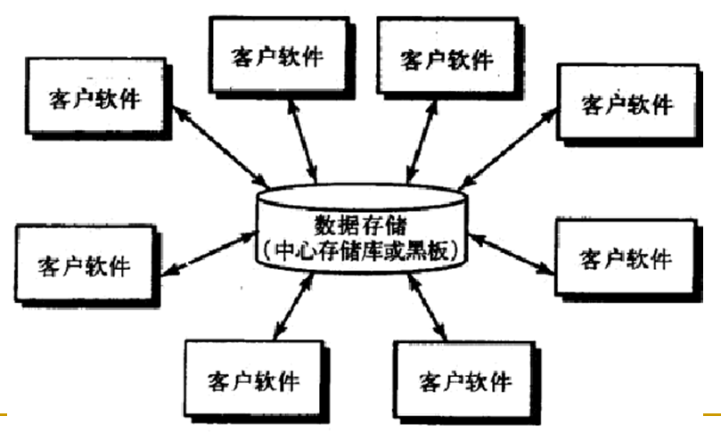

*课件第 14 页　以数据为中心的体系结构*

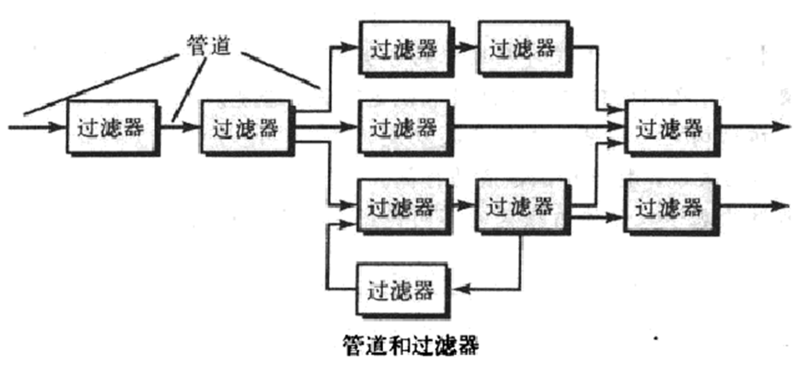

*课件第 17 页　数据流体系结构中的管道与过滤器*

### 体系结构模式与框架（第 23–24 页）

**体系结构模式**在特定环境、限制和约束下处理一类反复出现的应用问题。**体系结构框架**针对一个应用领域，将常见构件、连接和公共功能组织成可实例化的软件骨架。课件以 MFC 和 Struts 为例。选用框架后，还需要按项目要求实现具体的业务行为。

## 9.4 体系结构考虑要素（第 26–27 页）

| 要素 | 设计时要考虑什么 |
| --- | --- |
| **经济性** | 用抽象减少无用细节，把结构复杂度控制在需求所需范围内。 |
| **易见性** | 重要决策、依据和领域概念应能让后续设计、开发和评审人员看懂。 |
| **隔离性** | 划定构件边界，控制变化的影响范围。隔离过细会造成碎片化，也会让系统结构变得难以理解。 |
| **对称性** | 类似职责和生命周期采用均衡、一致的设计。例如账户同时有 `Open()` 与 `Close()`。 |
| **应急性** | 架构要能适应难以穷举的事件次序和持续时间。实时系统可通过事件驱动与灵活的自组织控制处理突发情况。 |

这些因素需要取舍。例如，继续隔离某个功能可以局部化变更，也会增加接口和理解成本。评估时要结合具体的质量需求和应用环境。

## 9.5 体系结构决策（第 9–10、29 页）

### 体系结构决策模板（第 9–10、29 页）

**体系结构决策模型**记录需要作出的选择、过去项目已作出的选择和支持这些选择的理由。评审或需求变更时，可以据此找到受影响的构件、约束和工作产品。

| 记录内容 | 课件中的模板字段 |
| --- | --- |
| 要解决的问题 | **设计问题**说明要做的选择，**分类**标明属于数据、构件结构或集成等哪一类，**相关关注点**关联具体需求。 |
| 备选与前提 | **候选方案**列出可行方案，**假设**写明成立前提，**约束**写明技术标准、可用模式或项目限制。 |
| 选择与理由 | **解决方案**写最终选择，**争论**写比较方案时的依据，**意义**写决定对后续设计造成的影响或限制。 |
| 可追踪的记录 | **相关决策**指出与其他决定的联系，**工作产品**注明在架构描述的何处体现，**注释**记录补充资料。 |

## 9.6 体系结构设计（第 31–39 页）

### 体系结构环境图（第 31–33 页）

**体系结构环境图**把目标系统放在中心，通过边界接口表示目标系统与外部实体怎样交互。具体角色取决于建模时选定的目标系统。

| 外部实体 | 相对目标系统的角色 |
| --- | --- |
| **上级系统** | 把目标系统当作更高层处理的一部分。 |
| **下级系统** | 被目标系统使用，为它提供需要的数据或处理能力。 |
| **同级系统** | 与目标系统对等交互，双方可能产生或使用相同的信息。 |
| **参与者** | 通过产生或消费处理信息与目标系统交互的人或设备。 |

以 SafeHome 的**安全功能**为目标系统。上方的 SafeHome 产品和基于因特网的系统使用该功能，下方的传感器提供状态等输入，右方的监视功能是同级系统，左方的控制面板和房主通过接口与它交互。

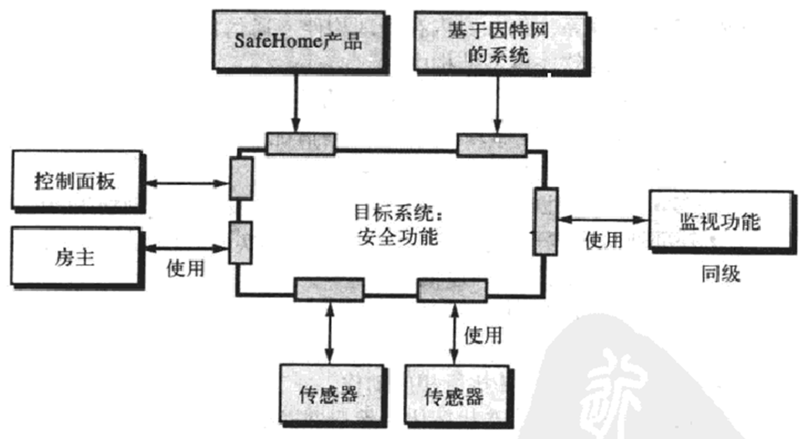

*课件第 33 页　SafeHome 安全功能的体系结构环境图*

### 体系结构原型与构件精化（第 34–37 页）

**体系结构原型**是对领域中关键角色和职责的高层抽象，可用少量类及其关系表达。SafeHome 原型包含**控制器、结点、探测器和指示器**。控制器协调警报操作，结点表达输入输出元素的集合，探测器代表摄像头等传感设备，指示器代表汽笛、闪灯等报警装置。图中探测器和指示器是结点的特化，控制器聚合结点。

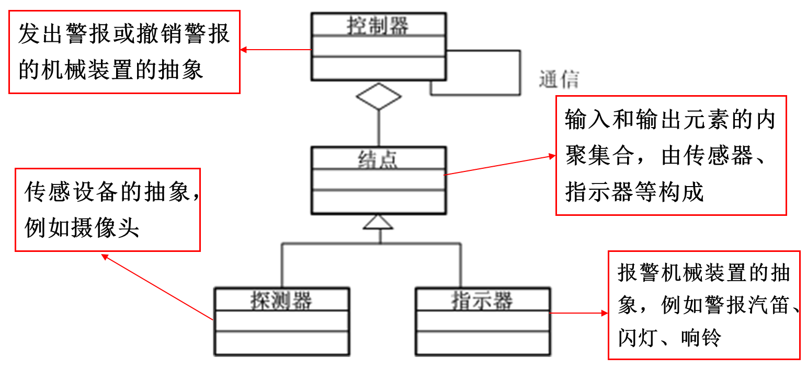

*课件第 34 页　SafeHome 安全功能原型的 UML 关系*

形成构件体系结构时，从三个来源识别构件（第 35 页）。

1. **应用领域**。由需求分析模型中的类和业务职责导出。
2. **基础设施域**。工程上需要的内存管理、通信、数据库等公共能力。
3. **界面领域**。由环境图中的接口导出负责交互的一个或多个构件。

顶层构件要反复迭代精化。SafeHome 的外部通信管理分为图形用户界面和 Internet 接口。安全功能分为控制面板处理、探测器管理、警报处理。后续把控制面板进一步细化为键盘处理与面板显示，探测器管理引入调度器，警报处理细化为电话通信与警报（第 36–37 页）。

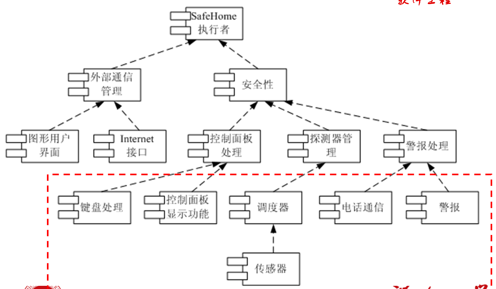

*课件第 37 页　SafeHome 的构件体系结构精化*

### C/S 与 B/S（第 6、38 页）

| 架构 | 客户端与服务器怎样分工 |
| --- | --- |
| **C/S（Client/Server，客户机／服务器）** | 客户端发起请求、负责交互，服务器接收请求并提供数据或应用服务。典型的两层设计由专用客户端直接访问服务器，客户端还可以处理部分业务逻辑。 |
| **B/S（Browser/Server，浏览器／服务器）** | 以通用浏览器作为客户端。浏览器通过 Web 请求与服务器交互，服务器处理应用请求并访问所需数据，返回页面或数据供浏览器呈现。应用服务集中部署，用户通常通过浏览器访问。 |

B/S 是以浏览器为客户端的 C/S 形式。一个常见的 B/S 部署是**浏览器 → Web／应用服务器 → 数据服务器**。写答题示意时，可以用这一路径说明表现、业务处理和数据管理的分工。

课件中的 **WebApp** 常按多层架构组织。**表现层**负责用户界面，**控制器**根据规则协调浏览器请求和应用交互，**内容层或模型层**组织数据及相关业务规则（第 38 页）。

### 移动 App 的体系结构（第 39 页）

常见层次包括**用户界面层、业务层和数据层**。影响设计的七项因素是客户端类型（瘦客户端或富客户端）、支持的设备种类、连接程度、带宽需求、移动平台限制、复用与可维护程度，以及电池、内存、处理器等设备资源。比如需要间歇联网的应用，要考虑本地数据管理和恢复连接后的交互。

## 9.7 评估候选的体系结构设计（第 41 页）

**体系结构评审**是技术评审。根据性能、可扩展性等**系统质量需求**评估架构满足要求的能力和潜在风险，尽早发现设计问题并控制修改代价。课件指出，评审通常由软件工程团队和独立专家参与。

| 评审技术 | 怎样使用 |
| --- | --- |
| **基于经验的推理** | 结合已有项目的经验分析当前方案可能遇到的风险。 |
| **原型评估** | 用针对关键问题的小型实现验证可行性或测量性能。 |
| **情境评审** | 给出明确的使用、负载或变更情境，沿实际处理路径检查架构怎样响应。 |
| **检查单** | 按质量属性和已知风险逐项审查，核对是否覆盖重要设计问题。 |

例如，评估抢课高峰下的响应时间，可以设定并发访问情境，跟踪请求经过的构件，找出可能拥塞的接口，再用原型测量关键路径。

## 补充 从数据流图映射到软件体系结构（第 42–77 页）

### 变换流与事务流（第 42–50、54–56 页）

**数据流图（DFD）**沿数据流描述输入、加工、存储与输出。**数据流映射**根据处理职责将 DFD 转化为由构件和控制关系组成的软件结构。DFD 的箭头表示数据传递，映射结果中的上下级关系表示调用或控制。

| 信息流类型 | 识别线索 | 映射关注点 |
| --- | --- | --- |
| **变换流** | 输入经**输入流**从外部表示转为内部表示，**变换中心**完成核心加工，再沿**输出流**将结果转换为外部表示。总体呈输入、变换、输出的线性处理特征。 | 找到输入与输出的边界，划出变换中心。不同输出可由同一次核心处理的结果生成。 |
| **事务流** | 外部信息转成事务。**事务中心**评估事务类型或条件，选择一条或若干条**动作路径**。 | 找到接收通路、集中分派的位置，以及各条动作路径。 |

判断时看分支的用途。若中心根据请求类型分派相应业务，按事务流考虑。若几路输出共同体现一次处理的结果，整体仍可按变换流考虑。大型系统常混合两者，课件建议**以变换分析为主、事务分析为辅**（第 42、55 页）。

两种映射的前三步相同。先评审基本系统模型，再细化 DFD，最后识别流类型。得到首版结构后，用设计启发式规则精化，导出接口描述和系统需要的数据结构，复查后进入详细设计（第 43、45、48 页）。

### 事务映射（第 44–46 页）

完成前三步后，按课件的第 4–7 步继续。

4. **标识事务中心与动作路径**。找出接收通路，分析分派条件和每条动作路径的流特征。
5. **映射事务结构**。设置总控。接收模块负责取得和预处理输入，调度模块按事务选择动作，各路径有自己的控制模块。
6. **分解和精化**。展开事务接收、分派和每条路径中的处理。路径内部可以继续作变换分析。
7. **精化首次迭代结构**。按功能独立性调整构件划分、调用关系和接口，检查每种事务是否进入对应的动作路径。

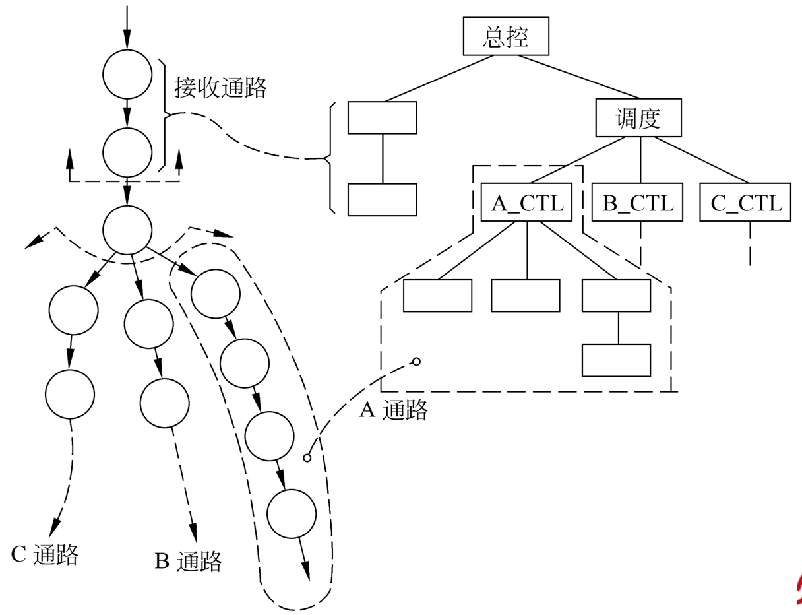

*课件第 46 页　接收通路、事务中心和 A／B／C 动作路径的映射*

### 变换映射（第 47–50、56、58–66 页）

完成前三步后，按课件的第 4–7 步继续。

4. **分离变换中心**。沿输入方向找到外部数据转换为内部表示的位置，沿输出方向找到内部结果开始转为外部表示的位置。两条边界之间是变换中心。作图时按职责和数据表示划出合理边界。
5. **第一级分解**。建立顶层**主控制器**，协调**输入流控制器、变换流控制器和输出流控制器**。顶层负责决策与协调，中间层承担部分控制和处理，底层完成主要的输入、计算和输出操作。
6. **第二级分解**。从变换中心边界沿数据流路径展开，把各加工分配到对应控制器下的模块。加工与模块可一对一映射，也可合并多个加工或进一步拆分单个加工。
7. **精化首次迭代结构**。以**高内聚、低耦合**为依据拆分或合并构件。保留满足功能独立性所需的模块，简化数据结构与接口，使结构易于实现、测试和维护。

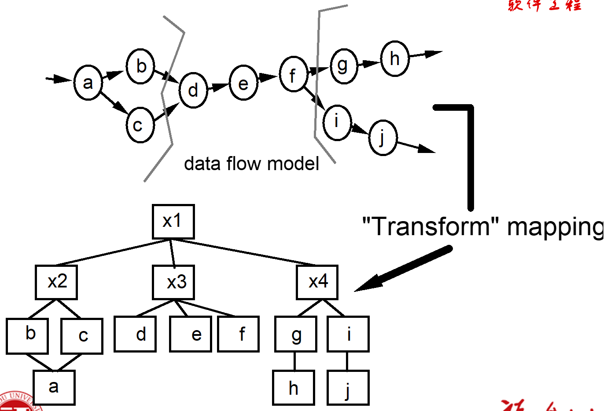

*课件第 49 页　x1 为总控，x2、x3、x4 分别控制输入、变换和输出*

初步映射以后，每个构件都要有**处理说明**，写清接口、内部数据结构、功能、限制与特殊要求，如文件输入输出、硬件依赖和时间要求（第 62 页）。

### SafeHome 的传感器监控案例（第 51–66 页）

1. 第 51–54 页从环境层逐步细化到「监控传感器」的第 3 层 DFD。每个加工已有相对单一、清楚的功能，可以据此分配构件职责。
2. 第 55–57 页判断整体为**变换流**。主要输入是传感器状态，还有配置数据参与处理。经过核心变换，数据可通过三路形成显示用的传感器信息、警报类型和电话语音。沿图上的两条分界读，可看到输入侧的读取与响应获取、中间的警报条件处理，以及右侧的输出。
3. 第 58–61 页先用「监控传感器执行者」作为总控，下设传感器输入控制器、警报条件控制器和警报输出控制器，再把读取、警报条件、显示、电话等具体加工放到相应分支。
4. 第 63–66 页按功能独立性重新组织。例如把显示格式化与生成显示合并为一个紧密职责，把部分只作转发的控制层并入处理模块，形成较简洁的结构。

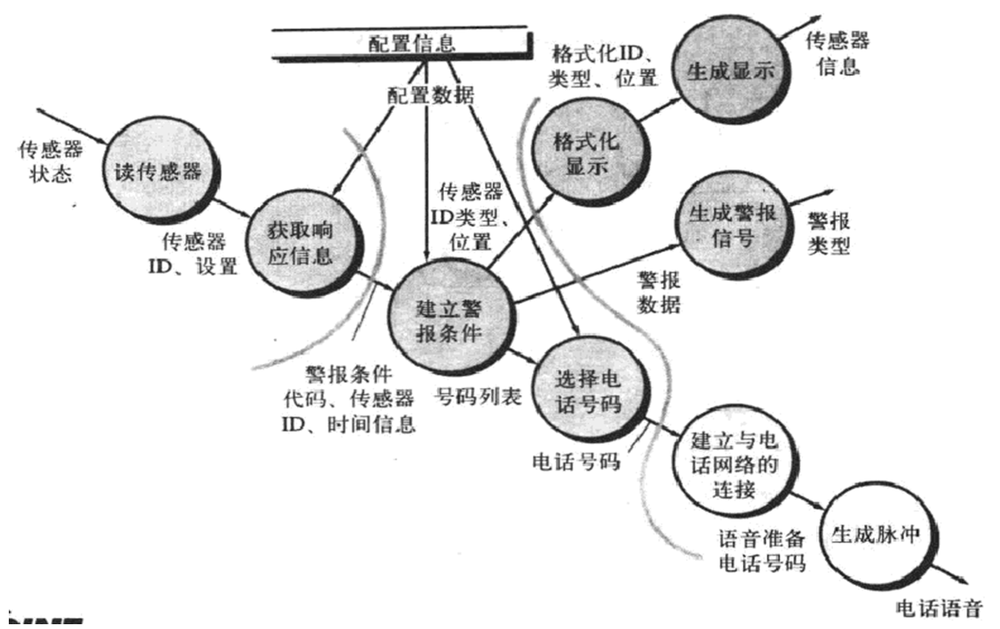

*课件第 57 页　监控传感器的输入、变换和输出边界*

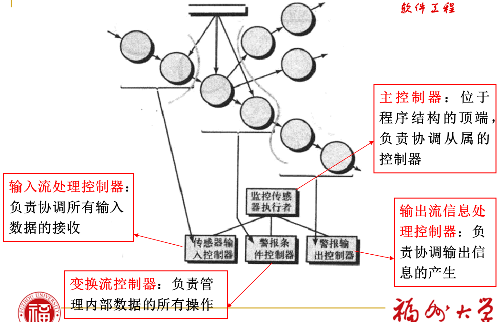

*课件第 59 页　从 DFD 到第一次分解的总控与三条分支*

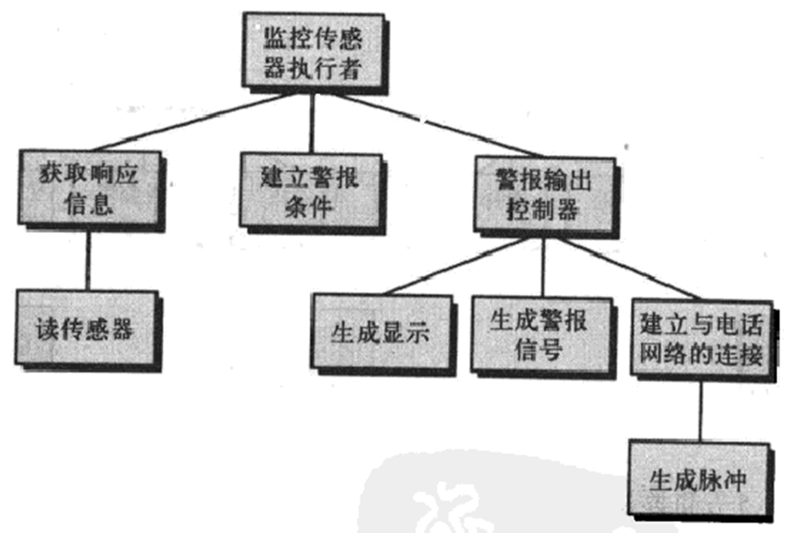

*课件第 65 页　合并部分处理后得到的程序结构*

### 汽车数字仪表板案例（第 67–74 页）

| 部分 | 课件如何分配模块 |
| --- | --- |
| **输入控制** | 接收旋转信号与燃料流传感器信号，读取、校核、求平均，得到转速 `rpm` 与燃料流量 `gph` 等内部数据。 |
| **变换控制** | 求车速 `mph`、里程、每加仑燃油行驶里程 `mpg` 与加减速状态，判断是否超过课件设定的 55 英里／小时。 |
| **输出控制** | 驱动仪表板，显示速度、里程、`mpg` 与加减速指示，超速时发出铃声。 |

两类输入服务于同一组仪表板计算，五类输出表现核心计算的不同结果。第 70 页画出总控和三个控制分支，第 71–73 页展开各分支，第 74 页进一步拆分或合并模块，例如让多种显示共用发光二极管显示构件。

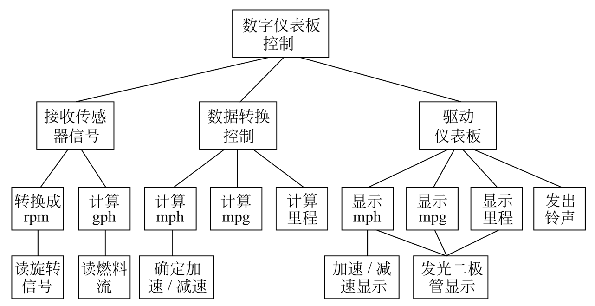

*课件第 74 页　汽车数字仪表板精化后的体系结构*

### 自动出卷案例（第 75–77 页）

第 75 页的一层 DFD 中，教师提供出卷请求，「设置出卷要求」把出卷要求提供给自动出卷与手动出卷两项加工。第 76 页展开的是**自动出卷**。它接收出卷要求，从题库抽取试题形成初步试卷，经过编辑及教师评价，得到试卷。

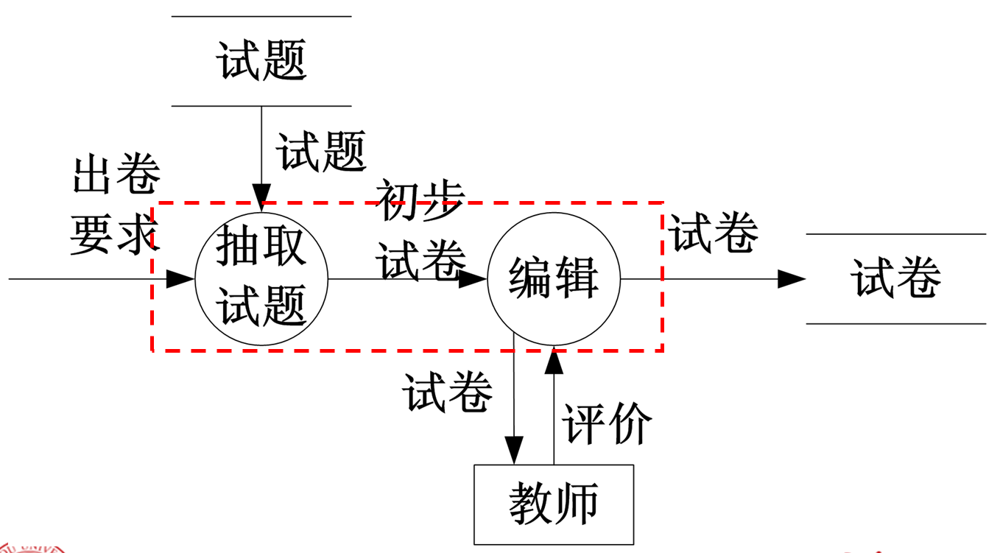

*课件第 76 页　自动出卷的二级 DFD*

沿自动出卷处理链作变换映射。总控「自动出卷」协调**读出试卷要求、出卷、显示试卷**三个分支。课件把抽取试题、评价和写入试卷放在「出卷」子树下，把显示试卷列为输出分支。作图时先按职责找总控和三条分支，再展开各子模块。

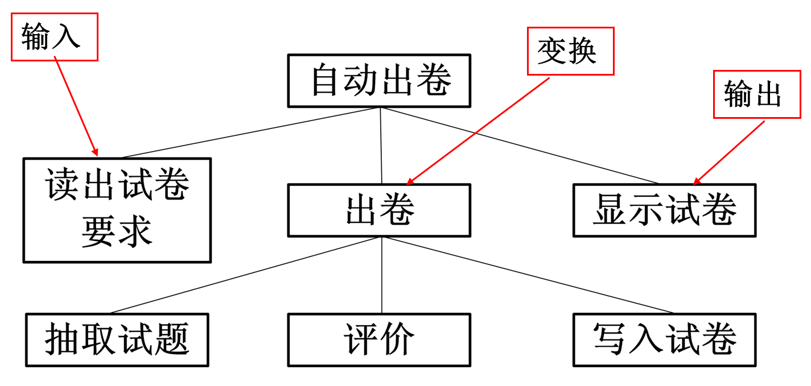

*课件第 77 页　从自动出卷 DFD 得到的软件结构*

## 自测题

### 作业二第 4 题

什么基于流程（数据流）的建模，谈谈你对数据流图、状态图、顺序图、判定表等的理解。

### 近年真题

#### 真题 1（2024 年 12 月卷，简答题第 4 题，5 分）

什么是 C/S（Client/Server）架构、B/S（Browser/Server）构架？

#### 真题 2（2023 年 6 月卷，选择题第 5 题，2 分）

数据流图所描述的是实际系统的（　）。

- A. 物理模型
- B. 逻辑模型
- C. 层次模型
- D. 结构模型

### 课件练习（自拟）

#### 练习 1

判断以下系统各采用了什么体系结构风格或子风格，并说明依据。

1. 多个独立的分析构件读写同一份共享数据。某个构件所关心的数据变化时，系统通知该构件。
2. 一组处理构件分别完成日志清洗、字段提取与脱敏。每个构件按约定格式接收数据，把处理结果交给下一构件。
3. 选课系统的界面调用业务服务，业务服务调用数据访问模块。各层按约定为上层提供服务。

#### 练习 2

阅读下面两个场景，判断主要是变换流还是事务流。画出各自的第一级模块结构，并说明你怎样判断分支的作用。

1. 成绩系统读取并校验各科原始分数，计算加权总评和等级，再根据同一组计算结果生成个人成绩单和班级汇总文件。
2. 自助借阅终端读取用户请求并校验身份，再根据请求类型处理借书、还书或续借。借书处理内部还需查询库存、登记借阅并返回回执。

---

## 答案与解析

### 作业二第 4 题

**答案与解析**

1. **基于流程的建模**按照数据流动的路径描述系统怎样接收输入、进行加工并产生输出。
2. **数据流图**用外部实体、加工、数据流、数据存储描述系统的逻辑功能。它可由环境层逐步细化，父子层对外数据流应保持平衡。
3. **状态图**围绕一个对象或系统，表示状态、触发状态迁移的事件与条件，以及相应动作。
4. **顺序图**沿时间顺序描述参与者和对象发送、接收消息的过程。对象有各自的生命线，时间从上到下。
5. **判定表**把条件组合与应执行的动作列出，每一列对应一条规则。

**考法、答题要点与易错点**　定义每种表示时写出它描述什么、用哪些元素。第 09 章进一步使用 DFD 做体系结构映射，先找数据经过的加工，再按职责确定模块和控制关系。状态图关注状态迁移，顺序图关注对象之间的消息，判定表关注条件组合与动作。

**复习位置**　第 07-3 章课件第 5–19、21–22、33–36 页，本章课件第 42–50 页。 **第 07-3 章的数据流图** · [本章的变换流与事务流](#变换流与事务流第-42505456-页)

### 近年真题

#### 真题 1

**答案与解析**　**C/S** 是客户机／服务器架构。客户机响应用户操作并发出服务请求，服务器处理请求，提供共享数据或应用服务。**B/S** 是浏览器／服务器架构，浏览器充当客户端，经 Web 与服务器交互。Web 或应用服务器按业务规则处理请求，访问所需数据并返回结果，由浏览器呈现。B/S 是 C/S 采用浏览器作为客户端的一种形式。

**考法、答题要点与易错点**　5 分简答写清两种名称、客户端角色、服务器职责及二者关系。举例时可画「专用客户端 → 服务器」和「浏览器 → Web／应用服务器 → 数据服务器」。两层和三层是常见实现示例，架构关系由客户端角色和通信方式来说明。

**复习位置**　课件第 6、38 页。 [C/S 与 B/S](#cs-与-bs第-638-页)

#### 真题 2

**答案与解析**　选 **B. 逻辑模型**。DFD 表示实际系统要接收哪些数据、做哪些加工、保存和输出哪些数据。

**考法、答题要点与易错点**　题目问模型性质。DFD 可用分层逐步展开逻辑功能，结构图用来说明构件层次与调用，部署图用来说明软件分布在哪些物理节点上。做本章的映射题时，用 DFD 的加工与数据关系作为输入，以构件控制层次作为设计结果。

**复习位置**　第 07-3 章课件第 5–10 页，本章课件第 42、46、49 页。 **第 07-3 章的数据流图** · [本章的变换流与事务流](#变换流与事务流第-42505456-页)

### 课件练习

#### 练习 1

**答案与解析**

1. **以数据为中心的体系结构中的黑板变种**。共享存储是协作中心，关注的数据变化会触发通知。
2. **数据流体系结构中的管道—过滤器**。清洗、提取和脱敏是各自负责一种变换的过滤器，处理结果经管道传递。
3. **层次体系结构**。界面、业务与数据访问各有职责，上层使用下层所提供的服务。

**考法、答题要点与易错点**　先写风格，再用题干中的交互方式作证据。共享仓库题找中心存储，黑板题还要找变化通知。管道题找数据从一个加工传给下一个加工的关系，分层题找上下层的服务依赖。

**复习位置**　课件第 14–19、22 页。 [五种体系结构风格](#五种体系结构风格第-1422-页)

#### 练习 2

**答案与解析**

1. **变换流**。分数从原始输入经过校验和核心计算，形成两类输出。成绩单和班级汇总都使用同一组总评和等级。第一级结构可以画成下面这样。

   ```text
   成绩处理总控
   ├─ 输入控制：读取并校验原始分数
   ├─ 变换控制：计算总评与等级
   └─ 输出控制：生成个人成绩单与班级汇总文件
   ```

2. **事务流**。读请求和校验属于接收通路。事务中心根据请求类型分派借书、还书和续借。借书路径进入自己的处理后，还能细化为查库存、登记借阅和生成回执。

   ```text
   自助借阅总控
   ├─ 请求接收：读取请求、校验身份
   └─ 事务调度：按请求类型分派
      ├─ 借书处理
      ├─ 还书处理
      └─ 续借处理
   ```

**考法、答题要点与易错点**　变换流先找核心计算及其输入、输出边界，把多个输出放到同一输出控制分支下细化。事务流先找分派条件，让调度模块协调各条动作路径。图上要能认出总控、各控制分支及模块间的调用层次。

**复习位置**　课件第 42–50、55–61 页。 [变换流与事务流](#变换流与事务流第-42505456-页) · [事务映射](#事务映射第-4446-页) · [变换映射](#变换映射第-4750565866-页)

题目来源　**作业二** · **2023-06-09 期末卷** · **2024-12-27 期末卷**
