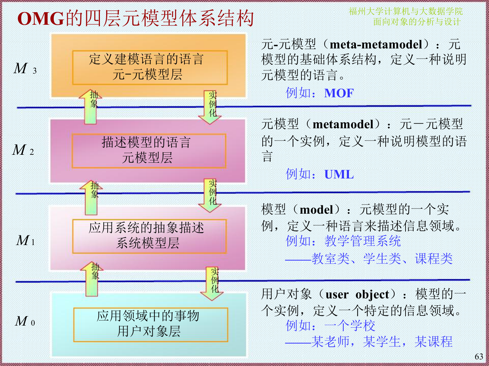
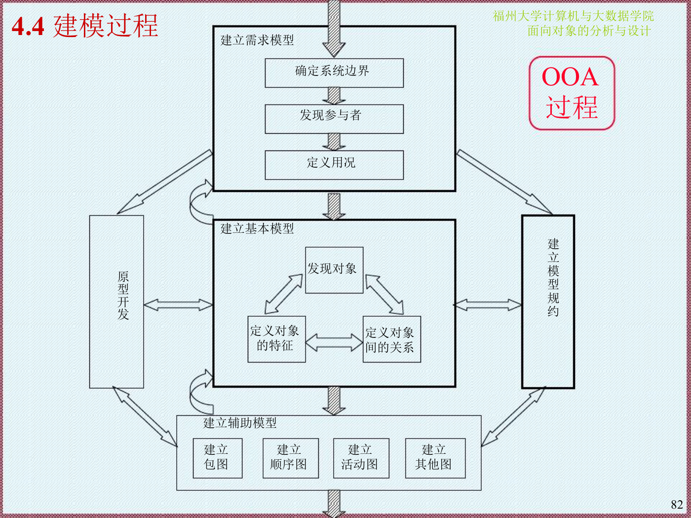

# 第1–4章 面向对象方法、UML 与分析设计框架

对应 **第1-4章.pdf**，页码按 PDF 阅读器计。四章在同一份课件内。

## 第1章 面向对象方法概论（第 2–33 页）

### 基本出发点（第 2–9 页）

面向对象既是一种编程范型，也是一种贯穿软件生命周期的开发方法。以现实问题域中的事物为起点，把与系统目标相关的部分抽象为对象。用属性与操作描述事物的静态、动态特征，利用类与类之间的继承、聚合、关联和消息构造系统，尽量保持对问题域的直接映射。

自然语言用于理解现实世界，程序语言用于精确实现。机器语言、汇编、高级语言、OO 语言逐步提高抽象层次。传统软件工程的分析与设计之间往往更换概念和表示，OOA 与 OOD 沿用共同概念、符号和模型，更容易追溯到实现。

### 核心概念（第 10–25 页）

| 概念 | 含义及辨析 |
| --- | --- |
| 对象、类 | 对象对应一个具体的有形或无形事物，由对象标识、属性与操作描述。标识可区分外部业务标识与内部标识。类是共同特征的抽象，描述一组实例。对象是类的实例 |
| 属性、操作 | 属性是静态特征的数据项，操作是动态行为的动作序列。封装将二者结合 |
| 抽象、分类 | 抽象聚焦与目标相关的特征，分类将有共同特征的对象归为一类。忽略更多个体差异可得到更一般的类 |
| 封装 | 隐藏内部数据和实现，给外部稳定的操作接口。可减少外部错误及局部改动的传播。课件指出严格封装可能增加调用与编程负担，可见性控制用于按需开放 |
| 继承、泛化 | 子类自动获得父类特征，并可增加自己的特征。语义是「is a kind of」。实例视角是子类实例集合包含于父类，特征视角是父类的共性由子类继承 |
| 多继承 | 一个特殊类有多个一般类。共同祖先常只应保留一次，同名成员可能冲突。如在职研究生的「攻读专业」与教职工的「从事专业」 |
| 整体–部分 | 语义是「has a」或「part of」，在类层规定实际实例间的构成关系。紧密固定的方式称组合，常可嵌套。松散灵活的方式可用指针或标识 |
| 关联 | 实例集合笛卡尔积中具有业务含义的一组实例组合。类层是关联，实例层的一条联系是链。教师授课、学生选课有应记录的关联 |
| 消息 | 广义为对象一次交互传送的信息，狭义为服务请求。函数调用是顺序系统中常见的实现。教务员调用学生对象办理注册，即使系统不记录长期的经办人关系，也能发送消息 |
| 多态 | 同一名称在不同类型语境下有不同语义或行为。重写是在子类重新定义；动态绑定按运行时对象确定代码；课程还把类属（泛型，类型参数化）列入实现机制 |
| 持久对象 | 程序退出后状态仍能保留，涉及外存支持 |
| 主动与被动 | 至少一个无需消息驱动而主动执行的操作，就属于主动对象。被动对象各操作依消息触发 |

课件将一般–特殊结构和整体–部分结构都视为以类为结点、关系为边的连通有向图。画图时用「白马是一种马」「机身是相机的一部分」区分前两类关系。消息与关联可以同时出现，选择哪种线依题目要表达的语义。

### 方法的发展（第 26–33 页）

| 阶段 | 课件中的代表 |
| --- | --- |
| 雏形 | **Simula 67** 引入类和继承。CLU、并发 Pascal、Ada、Modula-2 等支持抽象数据类型。Alan Kay 的 Flex 借鉴 Simula。PARC 的 Smalltalk-72 正式使用「面向对象」术语 |
| 完善 | Smalltalk-72、76、78 演进到 **Smalltalk-80**，基本概念与支持机制逐步齐备 |
| 繁荣 | 20 世纪 80 年代中期以后，C++、Objective-C、Object Pascal、CLOS、Eiffel 等出现或得到应用。课件区分纯 OO 与在传统语言中加入 OO 机制的混合型 |
| 扩展 | 从编程向分析、设计、测试、维护扩展。形成语言、类库与可视化环境结合的工具，也发展到数据库、构件、设计模式、体系结构等方向 |

传统方法常用「数据结构 + 算法」组织变化。OO 把数据和施加其上的操作围绕对象组织，以类／对象对应类型／变量，以消息表达调用及其他交互。

## 第2章 不同的分析与设计方法（第 34–55 页）

### 建模方法比较（第 35–43 页）

| 方法 | 建模入口、成果 | 课件强调的特点 |
| --- | --- | --- |
| 功能分解 | 按功能逐层分解子功能、定接口和数据结构，得到模块及其接口 | 起步直观。间接映射领域，需求变化容易影响多模块，分析和设计缺少明确划分 |
| 结构化分析与设计（SA／SD） | SA 追踪数据流，产出 **DFD**（数据流、加工、文件／存储、端点）及数据字典、处理说明。SD 概要设计产出模块结构图 **MSD**，详细设计给出内部数据结构及流程 | 分析规则明确。分析和设计表示不同，转化成本较高，数据流和处理可能膨胀 |
| 信息建模 | 源自 E–R。实体和关系均可有属性，扩展后可有类型与子类型 | 半直接映射。重在信息或状态，继承主要用于属性，缺少本课程 OO 的操作封装与消息 |
| 面向对象 | 以类及对象、属性和操作、继承聚合关联及消息组织模型 | 直接映射问题域，模型与源程序易对应，可降低改需求时的波及范围 |

**问题域**是系统处理的业务领域。**系统责任**是系统应该具备的职能。OOA 分析问题域与用户需求，产出满足责任的领域模型；OOD 基于 OOA 选定可行的实现结构。课件以电话业务登记、审批、安装、开通说明两种方式：SA 沿登记表的数据流建模，OO 把营业员、施工队、用户、账单等的相关职责放回各类。

### OOA、OOD 与经典方法（第 44–55 页）

- OOA 包括需求建模和系统的领域分析。OOD 早期常以结构化分析为输入，与 OOPL 联系紧密。20 世纪 90 年代后的课件口径以 OOA 为基础，两阶段概念一致，具体实现可由不同语言完成。
- 软件建模的难题包括领域与责任复杂、跨角色交流、需求变化、复用要求。课件认为功能及外部接口较易变，属性较易变，对象相对稳定。通过领域语言、封装和稳定的协作边界，使变化局部化并支持分析和设计级复用。

| 方法 | 选择题线索 |
| --- | --- |
| Booch | 六种图。基本图有类图、对象图、模块图、进程图，后两种专用于设计。补充图有状态转移图、交互图。宏过程为概念化、分析、设计、演化、维护。微过程识别类和对象、定语义、找关系、定接口与实现 |
| Coad／Yourdon | OOA 五层：主题、类和对象、结构、属性、服务。OOD 仍用五层，分问题域（PDC）、人机交互（HIC）、任务管理（TMC）、数据管理（DMC）四部分 |
| Jacobson／OOSE | 用况驱动，经需求分析、健壮性分析、构造与测试。分析对象分为**实体、界面、控制**，以交互图描述协作 |
| Rumbaugh／OMT | **对象模型、动态模型、功能模型**。过程包括分析、系统设计、对象设计、实现。课程讲义中系统设计部分可采用传统方法 |

## 第3章 统一建模语言 UML（第 56–71 页）

### 背景、规范与元模型（第 56–68 页）

UML 是用于可视化、详述、构造、建档的图形建模语言，也可用于业务建模。**UML 独立于开发过程**。RUP 是过程框架，OCL 是供模型补充约束的形式语言，UML 自身是图形建模语言规范。

- **历史时间线（按课件）**。1995 年 Booch 和 Rumbaugh 推出 Unified Method 0.8。1996 年 Jacobson 加入，推出 UML 0.9。1997 年先后形成 UML 1.0、1.1，11 月 OMG 正式采纳 1.1。后有 1.2、1.3、1.4、1.5 的修订，课件强调 1.3、1.4。重大修订阶段形成 UML 2.0。
- **UML1 六部分**。概要（概念、目标、范围等）、语义（定义语法语义）、表示法指南（图的符号）、外廓范例、模型交换、对象约束语言 OCL。
- **UML2 四规范（本课件口径）**。基础结构定义可复用的元语言内核；上层结构给出直接用于建模的元素与图；图交换支持工具间交换；OCL 描述形式化约束。
- **抽象元类**用于归纳建模元素的共同语义，如类目、关系等。**具体元类**可以实例化为用户模型里的元素，如类、接口、构件、结点、关联、泛化、依赖。

| 层次 | 含义 | 例子 |
| --- | --- | --- |
| **M3 元–元模型** | 定义元模型所用的语言 | MOF |
| **M2 元模型** | 定义怎样编写应用模型 | UML 的 Class、Association 等 |
| **M1 系统模型** | 具体应用领域的抽象描述 | 教学系统中的「课程」类、「教师」类及授课关联 |
| **M0 用户对象** | M1 模型的实际实例 | 图论课、具体教师、二者之间的一条授课链 |

### 图的版本辨析与扩展（第 65–71 页）

| 按课件版本 | 图的名称 |
| --- | --- |
| UML1 共 9 种 | 类图、对象图、用况图、顺序图、协作图、状态图、活动图、构件图、部署图 |
| UML2 结构图 6 种 | 类图、对象图、构件图、部署图、包图、组合结构图 |
| UML2 行为图 7 种 | 用况图、活动图、状态机图，加四种交互图（顺序图、通信图、交互概览图、定时图） |

**协作图**在 UML2 称**通信图**，**状态图**称**状态机图**。课件的 13 图口径中，交互图是行为图的子类名。选择题遇到 UML 版本要按题干判断。

课件在扩展机制页列出**约束**、**注释／注解**、**标记值**和**衍型**。约束表示应持续满足的条件，常用 `{条件}`。注解补说明，画折角矩形及虚线。标记值记录附加特征。衍型扩充语义，可在 `«关键词»` 与图标之间选用，例如课件的 `«界面»`。

## 第4章 本课程的 OOA&D 框架（第 72–89 页）

### 建模元素、原则和产物

课程强调在**类的抽象层次**建模，使用对象和类、属性与操作、一般–特殊、整体–部分、关联、消息等元素。建模原则另有抽象、分类、封装、继承、聚合、关联、消息通信、粒度控制、行为分析。

- **过程抽象**把完成确定功能的一组步骤看作一个可调用单元。**数据抽象**通过允许的操作来定义、观察和修改数据。
- **粒度控制**用包组织模型，先看宏观组成，再逐步展开细节。**行为分析**把行为放进承担该职责的对象操作，用消息表达对象依赖。识别主动行为与并发，设计阶段再按实现条件安排控制流。
- **需求模型**是用况图及其描述。**基本模型**是类图，可分对象、特征、关系三层。**辅助模型**按需用包图、顺序图、活动图、状态机图等，**模型规约**给图及元素附上精确细节。广义的模型包括图文，课件习惯分开谈模型图和规约。
- **OOD 的一个核心、三个外围**。核心是问题域，外围是人机交互、控制驱动、数据接口。各部分仍使用相近的建模概念与文档组织。

### 过程、分工与 MDA（第 82–89 页）

| OOA | OOD |
| --- | --- |
| 从系统边界、参与者和用况得到需求模型。再发现对象，定义特征及关系，按需画辅助图，写规约，可配合原型 | 输入 OOA 模型，在实现条件下调整问题域，设计三个外围，做构件化与部署，再输出给 OOP |
| 抽象层次较高，目标是满足需求并映射问题域 | 抽象层次较低，目标是在选定软硬件上实现 |
| 与领域和系统责任有关的细节可在分析阶段完成 | 选择语言、界面、存储、网络、线程等实现相关细节 |

瀑布模型强调顺序完成阶段，喷泉模型允许阶段交叠、回溯和迭代。课件比较了按「做什么／怎么做」划分与按「领域责任／实现条件」划分，倾向后者，因为领域内一项复杂业务操作的细节可在分析中讲清楚，且有助于复用分析模型。

**MDA（Model-Driven Architecture）**是 OMG 的模型驱动开发途径，借模型指导理解、构造、部署和维护。平台是一组经接口及规则提供功能的技术。**PIM**是平台无关模型，**PSM**是平台专用模型。模型转换用同一系统的 PIM 结合平台条件得到 PSM。课程用这个视角理解 OOA 到 OOD，同一份 OOA 可用于多个平台设计。

## 复习案例定位

选择题按章节概念和图形符号复习。画图题按案例动手，参看各章页码旁的勘误。

| 题类 | 练习位置 | 对应笔记 |
| --- | --- | --- |
| 分析题，图书管理／网上订餐／在线选课 | 案例分析 2、4、5 均为第 2 页用况、第 3 页类图、第 4 页状态、第 5 页顺序、第 6 页通信、第 7 页活动 | **第 5 章**、**第 8 章**、**第 9 章 (a)**.md>)、**第 9 章 (b)**.md>) |
| 设计题，类的化简和复用 | 案例分析 3 第 2–4 页，多继承、取消多态、复用车辆 | **第 11 章** |
| 设计题，界面与分包 | 案例分析 3 第 5–8 页，页面类图、提取交互、对话框复用、包图 | **第 12 章**、**第 9 章 (a)**.md>) |
| 设计题，映射数据库表 | 案例分析 3 第 9–11 页，多对多、继承、整体–部分 | **第 14 章** |
