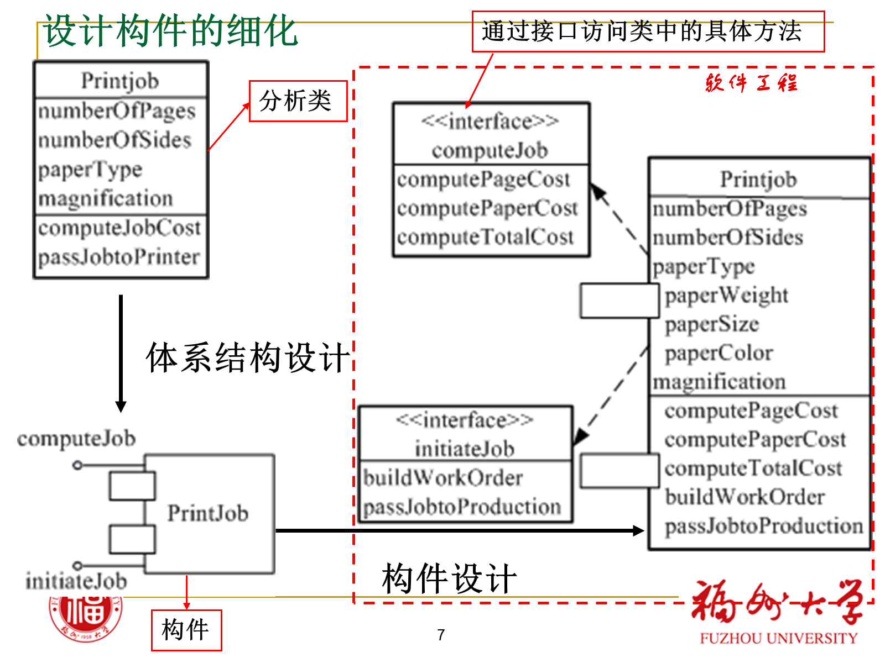
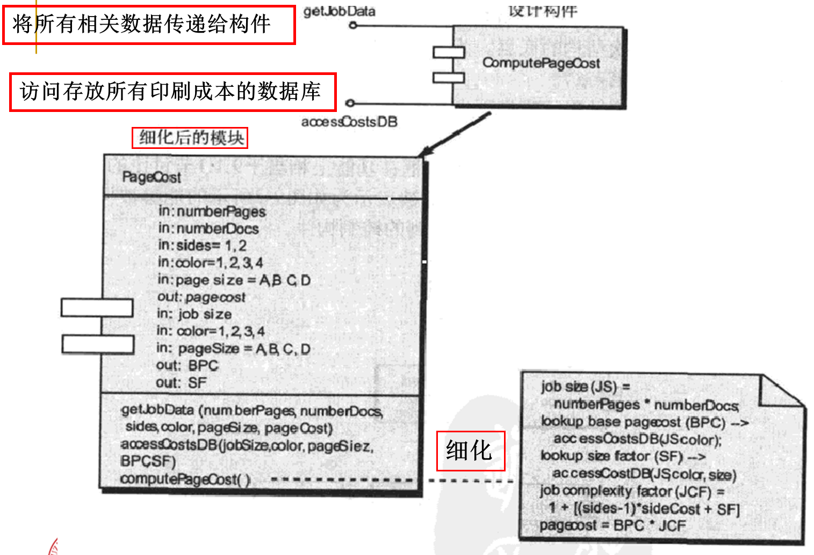
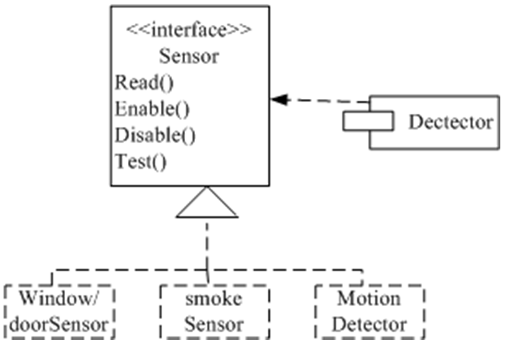
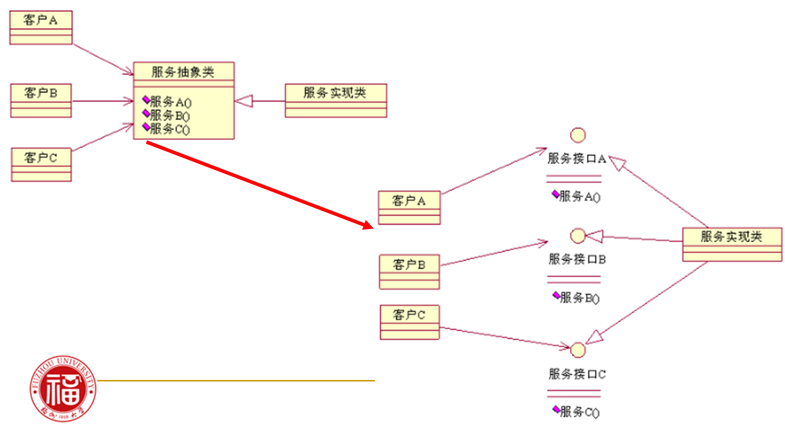
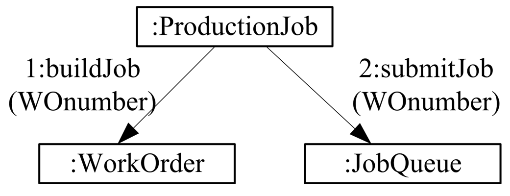
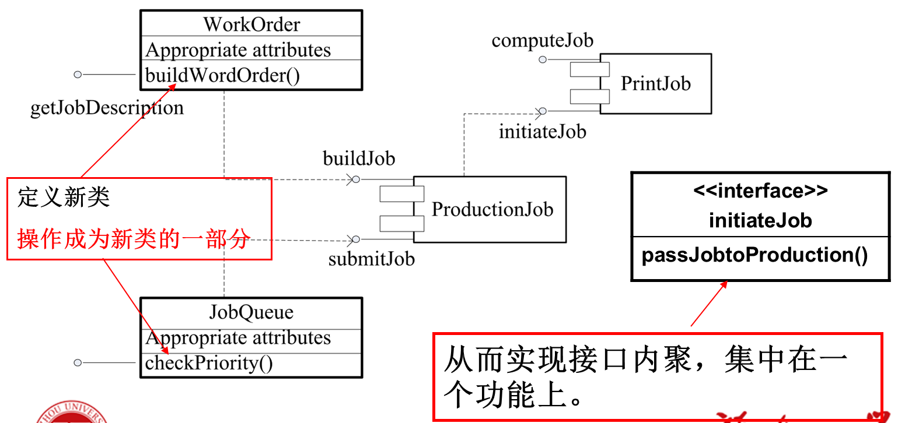
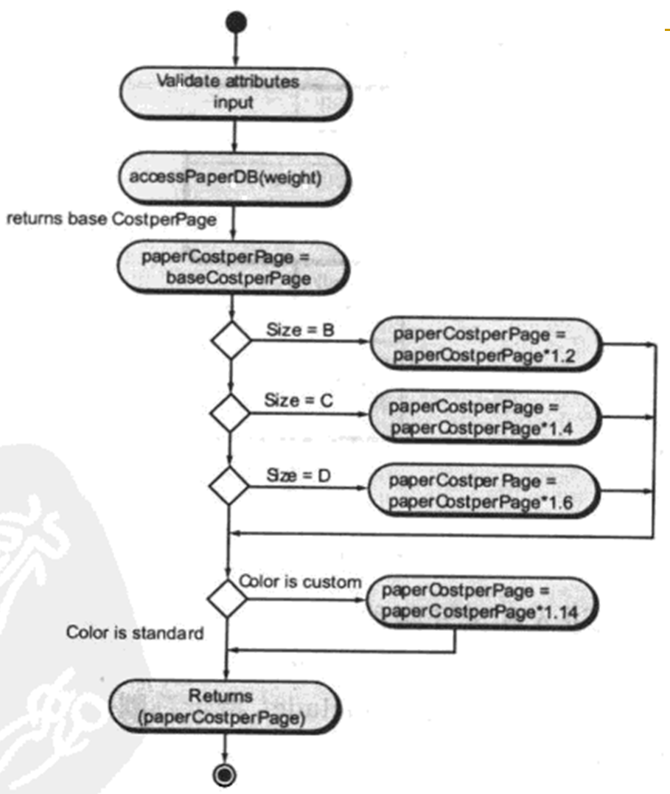
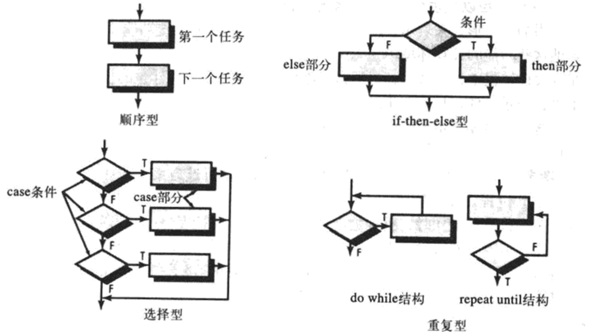
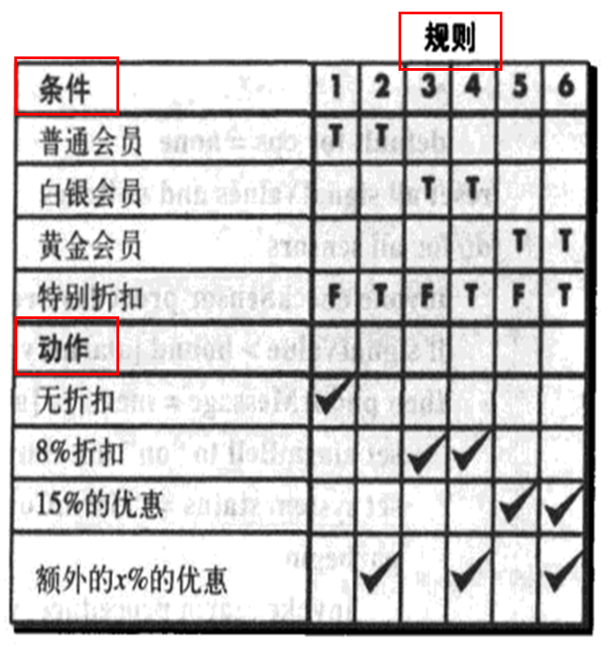

# 第 10 章 构件级设计

页码沿用本份 PPT 页脚。第 09 章确定软件由哪些构件组成，本章继续说明每个构件提供什么接口、内部怎样处理、如何复用或替换。 **第10章.ppt** · [自测题](#自测题)

## 10.1 什么是构件（第 2、4–12 页）

### 构件与构件级设计（第 2、4–5 页）

**构件（Component）**是系统中**模块化、可部署、可替换**的部件。它**封装实现，暴露一组接口**，通过接口与其他构件或边界外的系统、设备、人员协作。面向对象设计中，一个构件通常包含一组协作的类，也可以由一个类实现。

**构件级设计**在体系结构设计完成第一次迭代后开始。在程序结构和数据组织的基础上，明确构件的**接口、局部数据结构和处理逻辑**，使设计表示足以指导实现。

### 理解构件的三种观点（第 5–12 页）

| 观点 | 对构件的理解与设计重点 |
| --- | --- |
| **面向对象的观点** | 把构件看成一组协作的类。细化每个类的属性、操作和接口，明确数据结构及实现操作的算法。 |
| **传统观点** | 把构件看成程序的功能要素，也称模块。由处理逻辑、内部数据结构和可调用的接口组成。 |
| **过程相关的观点** | 在设计过程中识别并复用已有构件或设计模式，再补充系统所需的新构件。 |

传统构件有三种典型角色。**控制构件**在较高层协调其他构件的调用，**问题域构件**承担具体的用户功能，**基础设施构件**提供通信、数据管理等支撑能力。第 9 页的印刷系统以作业管理为上层控制，把计算成本、建立工作单和移交生产等任务分给下属模块。

印刷系统的目标包括收集客户要求、定价、把任务交给生产设备。第 7 页先用分析类 `PrintJob` 表达印刷作业，再得到带 `computeJob` 与 `initiateJob` 接口的构件。细化后可以看出纸张重量、尺寸、颜色等属性，以及计算每页印刷成本、纸张成本和总成本等操作。

*课件第 7 页　从分析类和体系结构构件细化出设计类及接口*

按传统观点设计 `ComputePageCost` 时，要写清页数、份数、单双面、颜色和纸张尺寸等输入，以及每页印刷成本这一输出。内部先用页数乘份数得到作业量，再访问成本数据库，取得基础单价和因子，结合复杂度计算结果。课件案例中，作业量增加使每页成本降低，印刷复杂度增加使每页成本升高（第 10–11 页）。

*课件第 11 页　将每页印刷成本构件细化为接口、数据与处理逻辑*

## 10.2 设计基于类的构件（第 14–45 页）

第 14 页给出四项基本设计原则。**开闭原则**关注怎样扩展，**Liskov 替换原则**关注子类遵守的行为契约，**依赖倒置原则**关注依赖指向，**接口分离原则**关注调用方需要使用的操作。

### 开闭原则（第 15–18 页）

**开闭原则（Open-Closed Principle，OCP）**要求构件对扩展开放、对修改封闭。做法是用抽象规定稳定的行为，再用多态接入新实现。扩展时新增派生类或接口实现，原有构件可沿用同一调用方式。

- **传感器案例**。让 `Detector` 通过 `Sensor` 接口读取、启用、禁用或测试传感器。门窗、烟雾、运动传感器分别实现接口，新增传感器依然可由 `Detector` 通过同一组操作使用。
- **画图案例**。第 16–17 页的 `DrawAllShapes()` 按图形类型进行 `switch` 分派，新增图形会牵动这个分派函数。第 18 页把 `Draw()` 定义为 `Shape` 的抽象操作，由 `Circle`、`Square` 等派生类各自实现。`DrawAllShapes()` 只遍历图形并调用 `Draw()`，扩展图形由新增实现完成。

*课件第 15 页　通过传感器接口接入不同类型的实现*

### Liskov 替换原则（第 19–23 页）

**Liskov 替换原则（Liskov Substitution Principle，LSP，也称里氏替换原则）**要求在能够使用基类对象的地方，使用其子类对象也能维持调用方依赖的契约。

- **前置条件**规定调用者在操作开始前应满足什么。子类应接受基类允许的所有输入和调用状态。
- **后置条件**规定操作结束后应保证什么。子类应兑现基类承诺的结果与状态。

例如基类规定「任意正整数页数都能计算报价，并返回非负金额」，子类就要接受 1 页、5 页等基类允许的请求，并保留有关返回值的保证。替换性使调用方可以通过基类契约使用派生对象，由运行时的实际对象决定执行哪个实现，也便于实施契约式编程。

第 21–23 页的动物示例中，调用代码接收 `Animal`，却要先判断 `Cat` 或 `Dog`，再调用各自的发声方法。若发声是该调用场景的公共需求，可以让具有同一发声契约的类型实现统一操作，再由多态选择实现。判断替换性时，检查**调用方使用的基类契约**及子类对该契约的履行情况。

### 依赖倒置原则（第 24–27 页）

**依赖倒置原则（Dependency Inversion Principle，DIP）**要求高层策略与低层实现都依赖**抽象**。抽象表达高层所需的服务契约，具体实现遵循这个契约。

课件先让 `Copy()` 直接读取键盘和写打印机，随后通过 `Reader.Read()` 与 `Writer.Write()` 表示读写契约。键盘读取器实现 `Reader`，打印机写入器实现 `Writer`。因此，`Copy` 可以专注于「循环读入并写出」，也可以接入符合契约的文件读写实现。

*课件第 26 页　复制策略和设备实现共同依赖读写抽象*

### 接口分离原则（第 28–29 页）

**接口分离原则（Interface Segregation Principle，ISP）**要求针对主要的客户类型提供**专用接口**，接口只声明该客户需要使用的操作。第 29 页把一个含 A、B、C 服务的「肥接口」拆成三个专门接口。客户 A 只依赖服务接口 A，其余客户同理。同一个服务实现类可以实现多个专用接口。

*课件第 29 页　按调用方的需要分解接口*

### 构件级设计指导方针（第 30–31 页）

- **命名**。构件和类采用完整、符合领域语言的名称，如 `Job management system`、`Detector`。属性和方法可用混合大小写。方法名体现动作和对象，如 `computePageCost()`，避免空泛命名和与类名重复。
- **接口**。按课件绘图约定，用棒棒糖式记号表示接口，将接口放在构件框左侧，图中保留与本构件有关的接口。
- **依赖与继承**。课件建议将依赖按从左到右布置，继承从下方派生类指向上方基类。通过接口表达构件间的依赖，使依赖对象与交换的服务清楚可见。

### 内聚性（第 32–37 页）

**内聚性（Cohesion）**衡量构件内部各部分联系的紧密程度，体现它的**专一性**。高内聚的构件把相互密切相关的属性和操作封装在一起。

| 类型 | 判断依据与例子 |
| --- | --- |
| **功能内聚** | 模块各部分共同完成一项明确功能，例如计算每页印刷成本。课件将它列为最好的内聚。 |
| **顺序内聚** | 前一步的输出是下一步的输入。第 33 页用「输入方程系数 → 求解 → 输出解」举例。 |
| **通信内聚** | 多个处理使用同一份数据，第 37 页以「所有成分引用共同数据」考查。 |
| **时间内聚** | 因多个任务必须在同一时间段执行而组织到一起，例如初始化字体和窗口、在结束时清理资源。 |
| **逻辑内聚** | 将同类操作组合在一起，每次由判定参数选择执行的操作，例如按参数选择读记录或写记录。 |
| **实用内聚（巧合内聚）** | 缺少统一职责的工具性处理或零散代码因为方便复用、节省空间等原因归在一起。 |

第 08 章还讲了**过程内聚**，其判据是按指定过程顺序执行。做题时用「前一处理的输出被下一处理采用」识别顺序内聚，用「处理共同的数据」识别通信内聚。 **第 08 章的内聚类型**

### 耦合性（第 38–44 页）

**耦合性（Coupling）**衡量构件之间联系的紧密程度。依赖越多或越深入，局部变化越容易传播。构件设计追求**低耦合**。第 39–43 页重点考查以下几类。

| 类型 | 如何识别 | 对设计的影响 |
| --- | --- | --- |
| **内容耦合** | 直接访问另一模块的内部数据，或进入其内部处理流程。课件的多入口例子允许从不同位置进入同一处理过程。 | 调用方依赖对方内部细节，这是强度最高的一类。 |
| **共用耦合（公共耦合）** | 一组模块共同访问全局数据结构、共享通信区等公共数据环境。 | 修改共享数据容易产生连锁影响和副作用。 |
| **控制耦合** | 传递开关、标志或名字，用它指定被调用模块选择哪一项功能。 | 被调用模块的分支变化可能要求调用方同时调整标志的含义。 |
| **标记耦合（特征耦合）** | 把数据结构或对象整体作为参数。典型情形是被调模块只使用其中一部分。 | 调用接口依赖结构，引入额外数据和随结构变化的成本。 |
| **数据耦合** | 通过简单数据参数交换完成任务所必需的信息，例如传入页数和份数。 | 调用关系较容易理解，课件推荐这种直接传值方式。 |

第 44 页另列举四种依赖来源。**例程调用耦合**来自操作间的调用，**类型使用耦合**来自使用其他构件定义的数据类型，**包含或导入耦合**来自引入包或内容，**外部耦合**来自与操作系统、数据库、通信等基础设施的协作。可以把外部依赖集中在少数构件，控制接口和变更范围。 **第 08 章的耦合层次**

### 扇入与扇出（第 45 页）

- **扇出**是一个模块直接控制的模块数。扇出过大时，该模块要协调过多直接下属，往往意味着控制逻辑复杂。
- **扇入**是直接调用某模块的上级模块数。扇入大表示该模块被更多上级共享。

例如 A 直接调用 B、C，B 和 C 都直接调用 D，则 A 的扇出为 2，D 的扇入为 2。只按直接调用计数。课件给出的经验参考是平均扇出约 3–4，上限约 5–9。设计较好的结构常表现为**顶层扇出高、中层扇出少、底层扇入高**。

## 10.3 实施构件级设计（第 47–57 页）

### 七个实施步骤（第 47–48、56–57 页）

1. **标识问题域设计类**。使用需求模型与体系结构模型，找到并细化业务类和体系结构构件。
2. **标识基础设施设计类**。补充分析模型中可能没有表达的 GUI、操作系统、对象管理和数据管理等构件。
3. **细化需要自行实现的设计类**。依次说明消息细节、确定接口、细化属性、详细描述各操作中的处理流。
4. **说明持久数据源**。明确数据库和文件的结构与组织，以及负责管理数据源的类。
5. **细化行为表示**。用状态图等表示影响构件或类的事件、对象状态及状态迁移。
6. **细化部署图**。补充运行硬件、操作系统环境、构件包的位置等实现信息。
7. **评审并考虑候选方案**。迭代检查完整性、一致性和精确性，必要时重构职责、数据或接口。

### 细化设计类的四项工作（第 48–55 页）

**说明消息细节**。为参与协作的对象写清发送者、接收者、消息名称、参数及次序。第 49 页的 `ProductionJob` 先向 `WorkOrder` 发 `buildJob(WOnumber)`，再向 `JobQueue` 发 `submitJob(WOnumber)`。消息编号 1、2 表示本次协作的次序。

*课件第 49 页　印刷任务的协作对象、消息参数和消息次序*

**确定接口**。接口说明一组**对外可见的操作**。画本章 UML 接口时，在 `«interface»` 框里列出需要暴露的操作，属性与内部结构写在相应的设计类中。第 51 页的 `initiateJob` 包括建立工作单、检查优先级和移交生产三个操作。第 52 页把建立工作单放到 `WorkOrder`，把检查优先级放到 `JobQueue`，让 `initiateJob` 集中在移交生产这项职责上。

*课件第 52 页　按职责重构接口和类，提高接口内聚性*

**细化属性**。确定属性名、数据类型、默认值和取值约束。例如 `numberOfSides: integer = 1 {1, 2 之一}` 表示单双面是整数属性，默认值为 1，值域是 1 和 2。复杂且在多个类中反复出现的属性可以提取为专门的类（第 53 页）。

**细化操作中的处理流**。先确定操作，再补齐参数、返回值及处理步骤，例如把 `computePaperCost()` 精化为 `computePaperCost(weight, size, color): numeric`。复杂算法可用活动图或伪代码表达。第 55 页先校验输入，按纸张重量查基础成本，再按尺寸和颜色调整，最后返回每页纸张成本。

*课件第 55 页　computePaperCost 操作的 UML 活动图*

## 10.4 专用的构件级设计（第 59–70 页）

### 设计传统构件（第 59–62 页）

**结构化构造**用少量逻辑块表达处理过程，降低复杂性，提高可读性、可测试性和可维护性。流程图可以表示**顺序、选择和重复**。顺序结构按次序执行任务，选择结构用条件选择双分支或多分支，重复结构控制一组任务是否继续执行。读循环图时看判定节点的位置，先判型在执行循环体之前检查，后判型至少执行一次。

*课件第 60 页　传统构件的图形化设计表示*

**决策表（判定表）**把复杂的条件组合和对应动作放在同一张表上。每一列表示一条规则，一条规则可以对应多个动作。它便于检查条件覆盖，也可以作为表驱动算法的输入。课件给出四步（第 61–62 页）。

1. 列出过程或构件可能执行的所有**动作**。
2. 列出影响动作的所有**条件**。
3. 枚举可行的条件组合，剔除无法同时成立的组合。
4. 为每个组合指定一个或多个动作，形成规则。

会员折扣表把三个互斥的会员等级和「有／无特别折扣」组合成六条规则。例如第 4 列为白银会员且有特别折扣，动作标记在 8% 折扣和额外优惠两行。

*课件第 62 页　每一列是一条条件与动作的规则*

### 基于构件的开发（第 64–70 页）

**基于构件的软件工程（Component-Based Software Engineering，CBSE）**强调使用可复用的软件构件设计和构造系统。工程重点在于查找和评估候选构件、处理适配、组装集成，以及验证组合后能否满足系统目标。持续复用需要构件库、检索与文档、复用投入和相应激励（第 64–65 页）。

**领域工程**为特定应用领域识别、构造、分类并传播可复用构件，以便现有和未来的软件共享。三项主要活动是**分析、构造、传播**。领域分析依次界定领域、对提取的项分类、收集有代表性的应用样本、分析样本并定义分析类、为这些类建立需求模型（第 66 页）。

#### 合格性检验与适应性修改（第 67–68 页）

**构件合格性检验**要确认候选构件实现所需功能、契合体系结构并满足性能、可靠性、可用性等质量需求。课件给出七项检查因素。

1. **API** 是否提供所需操作，参数、返回和用法是否匹配。
2. 所需的**开发与集成工具**。
3. **运行时需求**，如内存、外存、时间、速度和网络协议。
4. **服务需求**，如操作系统接口和其他构件提供的支持。
5. **安全特征**，如访问控制和身份验证机制。
6. **嵌入式设计假定**，如构件内采用的算法及其前提。
7. **异常处理**，如异常如何上报、处理或交给应用承担。

有些候选构件通过合格性检验后仍需解决具体的集成冲突，可以采用**构件包装**。

| 适应性修改方式 | 可用条件 | 怎样消除冲突 |
| --- | --- | --- |
| **白盒包装** | 有权访问构件的内部设计和代码。 | 检查内部处理，并在代码层调整冲突之处。 |
| **黑盒包装** | 通过构件库给出的扩展语言或 API 进行适配。 | 在接口边界加入预处理和后处理，例如转换输入和输出格式。 |

#### 构件组合与可复用设计（第 69–70 页）

**构件组合**把经过合格性检验、适应性修改的复用构件，以及自行开发的构件，装配进应用体系结构。基础设施把构件绑定到运行系统，提供协作模型及所需服务。课件列举了 OMG/CORBA、COM／.NET 和 JavaBean 等构件技术。

构成复用设计基础的关键是**标准数据、标准接口协议、程序模板**。标准数据统一领域内共用的文件或数据结构。标准接口协议覆盖模块内部接口的基本属性、外部技术接口和人机接口。程序模板把适合领域的体系结构风格作为新系统的设计起点。

## 自测题

### 作业二第 3 题（构件级设计部分）

什么基于类的需求建模，谈谈你对 CRC、类图、ER 图和设计原则（组件级设计）的理解。

本章练习题干中的「设计原则（组件级设计）」部分。

### 近年真题

#### 真题 1（2023 年 6 月卷，名词解释第 2 题，2 分）

Liskov 替换原则。

#### 真题 2（2024 年 12 月卷，名词解释第 5 题，3 分）

构件。

#### 真题 3（2023 年 6 月卷选择题第 6 题、2024 年 12 月卷选择题第 5 题，各 2 分）

为了提高模块的独立性，模块最好是（　）。

- A. 逻辑内聚
- B. 通信内聚
- C. 功能内聚
- D. 层次内聚

#### 真题 4（2023 年 6 月卷，选择题第 7 题，2 分）

当类 B 被声明为类 A 某一操作中的一个参数类型时，类 A 和类 B 间的耦合就属于（　）。

- A. 内容耦合
- B. 共用耦合
- C. 控制耦合
- D. 标记耦合

### 课件练习（第 37 页）

请指出以下内聚度类型。

1. 一组语句在程序的多处出现，为了节省内存空间把这些语句放在一个模块中，该模块的内聚度是 ______ 的。
2. 模块中所有成分引用共同的数据，该模块的内聚度是 ______ 的。
3. 模块内的某成分的输出是另一些成分的输入，该模块的内聚度是 ______ 的。
4. 模块中所有成分结合起来完成一项任务，该模块的内聚度是 ______ 的。

### 综合练习（自拟）

#### 练习 1　印刷系统的设计原则

指出每种设计最直接涉及的原则，并写出改法。

1. 每增设一种报价规则，都要修改报价总控的 `switch`。
2. 报价基类承诺为任意正整数页数计算报价并返回非负金额，某个子类只接受 10 页及以上的订单。
3. 印刷流程构件直接依赖某厂商的打印机驱动类。
4. 前台只需提交订单，却依赖同时声明提交订单、设备自检和更换耗材等操作的接口。

#### 练习 2　报价构件的复用

印刷系统拟复用第三方报价构件。本系统的报价接口以分传递金额，候选构件的 API 用元。团队能调用 API，并可在调用前后处理数据。该构件只提供二进制包。需要检查哪些条件来决定能否采用？应使用哪种包装，怎样让构件接入系统？

---

## 答案与解析

### 作业二第 3 题

**答案与解析**

1. **开闭原则（OCP）**。对扩展开放、对修改封闭。用抽象和多态为变动预留扩展点，新增业务通常通过新增实现接入。
2. **Liskov 替换原则（LSP）**。可以在使用基类的地方用子类替换。子类要遵守基类与使用方约定的前置条件和后置条件。
3. **依赖倒置原则（DIP）**。高层策略与低层实现共同依赖抽象，具体细节实现抽象所规定的契约。
4. **接口分离原则（ISP）**。按客户的需要设置专用接口，让每种客户依赖自己需要的操作。

**考法、答题要点与易错点**　先写四个名称与完整定义，再用一句话给出每项原则的落地做法。区分考查的是新增功能时改哪里、子类能否履行原契约、依赖指向哪一层，还是接口给哪个调用方使用。

**复习位置**　课件第 14–29 页。 [开闭原则](#开闭原则第-1518-页) · [Liskov 替换原则](#liskov-替换原则第-1923-页) · [依赖倒置原则](#依赖倒置原则第-2427-页) · [接口分离原则](#接口分离原则第-2829-页) · **第 07-2 章同一作业的需求建模部分**

### 近年真题

#### 真题 1

**答案与解析**　Liskov 替换原则是指在使用基类对象的地方，使用其子类对象仍能满足调用方依赖的行为契约。子类应接受基类的前置条件所允许的调用，并满足基类的后置条件所承诺的结果。

**考法、答题要点与易错点**　名词解释写清**子类替换基类**与**遵守契约**。案例题分别找调用前要满足的条件和调用后要保证的结果，据此检查子类能否接受原调用并给出原承诺的结果。

**复习位置**　课件第 19–23 页。 [Liskov 替换原则](#liskov-替换原则第-1923-页)

#### 真题 2

**答案与解析**　构件是软件体系结构中**模块化、可部署、可替换**的部件。它**封装内部实现并暴露一组接口**，通过这些接口与其他构件或外部实体协作。

**考法、答题要点与易错点**　按「三项性质 → 封装实现 → 提供接口」作答。面向对象的题目还可说明一个构件通常由一组协作的类实现。

**复习位置**　课件第 4–7 页。 [构件与构件级设计](#构件与构件级设计第-245-页) · [理解构件的三种观点](#理解构件的三种观点第-512-页)

#### 真题 3

**答案与解析**　选 **C. 功能内聚**。功能内聚的模块把内部各部分集中到同一项功能，内聚度最高。

**考法、答题要点与易错点**　看到「同一数据」判通信内聚，看到「由参数在多项操作中选一个」判逻辑内聚，看到「所有部分共同完成一项明确功能」判功能内聚。若题干问模块独立性如何提高，答出**高内聚、低耦合**两个目标。

**复习位置**　课件第 32–38 页。 [内聚性](#内聚性第-3237-页) · [耦合性](#耦合性第-3844-页)

#### 真题 4

**答案与解析**　选 **D. 标记耦合**。题干以类 B 为操作的参数类型，提示类 A 的调用接口使用类 B 的对象。把复合数据作为参数传递时，只用其中少量字段是课件给出的典型标记耦合情形。

**考法、答题要点与易错点**　抓住「作参数」这条线索。通过公共数据环境联系是共用耦合，通过参数选择接收方的分支是控制耦合，直接访问接收方内部细节是内容耦合。题目只描述引用其他构件定义的数据类型时，还可按第 44 页的类型使用耦合识别。

**复习位置**　课件第 39–44 页，重点看第 42 页。 [耦合性](#耦合性第-3844-页)

### 课件练习

**答案与解析**

1. **实用内聚（巧合内聚）**。题干给出的组合依据是节省内存空间。
2. **通信内聚**。各处理引用共同的数据。
3. **顺序内聚**。一个处理的输出成为另一处理的输入。
4. **功能内聚**。所有部分协同完成一项任务。

**考法、答题要点与易错点**　判断时给类别和依据各一句。把「使用同一数据」与「数据由上一步产生并交给下一步」这两条线索记清。

**复习位置**　课件第 32–37 页。 [内聚性](#内聚性第-3237-页)

### 综合练习

#### 练习 1

**答案与解析**

1. **开闭原则**。把报价计算抽象为统一接口。每种规则实现该接口，总控通过接口计算，新规则以新增实现的方式接入。
2. **Liskov 替换原则**。子类要求至少 10 页，拒绝了基类契约允许的 1 到 9 页。应让它也能处理这些调用并兑现返回非负金额的保证，或把仅适用于大批量订单的报价定义为具有单独契约的类型。
3. **依赖倒置原则**。先从印刷流程需要的操作提炼打印输出接口，流程依赖该接口，由厂商驱动的适配类实现接口。
4. **接口分离原则**。给前台单独提供提交订单的接口，把设备自检和耗材维护放到面向运维方的专用接口。

**考法、答题要点与易错点**　改造题先点名原则，再指出题干中决定判断的设计事实，最后给出具体职责或接口。LSP 小问要说出是哪一条调用契约受到影响。

**复习位置**　课件第 15–29 页。 [开闭原则](#开闭原则第-1518-页) · [Liskov 替换原则](#liskov-替换原则第-1923-页) · [依赖倒置原则](#依赖倒置原则第-2427-页) · [接口分离原则](#接口分离原则第-2829-页)

#### 练习 2

**答案与解析**

1. **合格性检验**。核对报价功能与业务规则，确认 API 所需数据、部署环境和其他依赖能接入本系统，检查响应时间、故障处理和金额精度等质量要求。
2. **黑盒包装**。包装层对系统提供用分计价的接口，调用前将相关金额从分转换成元，再通过构件 API 取得结果。调用后按本系统的金额精度约定转换结果、处理异常。
3. **构件组合**。把包装层和报价构件配置到运行环境中，接入订单流程，验证正常报价、金额边界、异常响应及整体性能。

**考法、答题要点与易错点**　把「是否适合」「如何消除接口冲突」「怎样组装并验证」分别对应到合格性检验、适应性修改、构件组合。包装方式根据能否访问内部设计和代码、能通过哪些边界机制适配来判断。

**复习位置**　课件第 64、67–70 页。 [合格性检验与适应性修改](#合格性检验与适应性修改第-6768-页) · [构件组合与可复用设计](#构件组合与可复用设计第-6970-页)

题目来源　**作业二** · **2023-06-09 期末卷** · **2024-12-27 期末卷** · **第10章.ppt 第 37 页**
