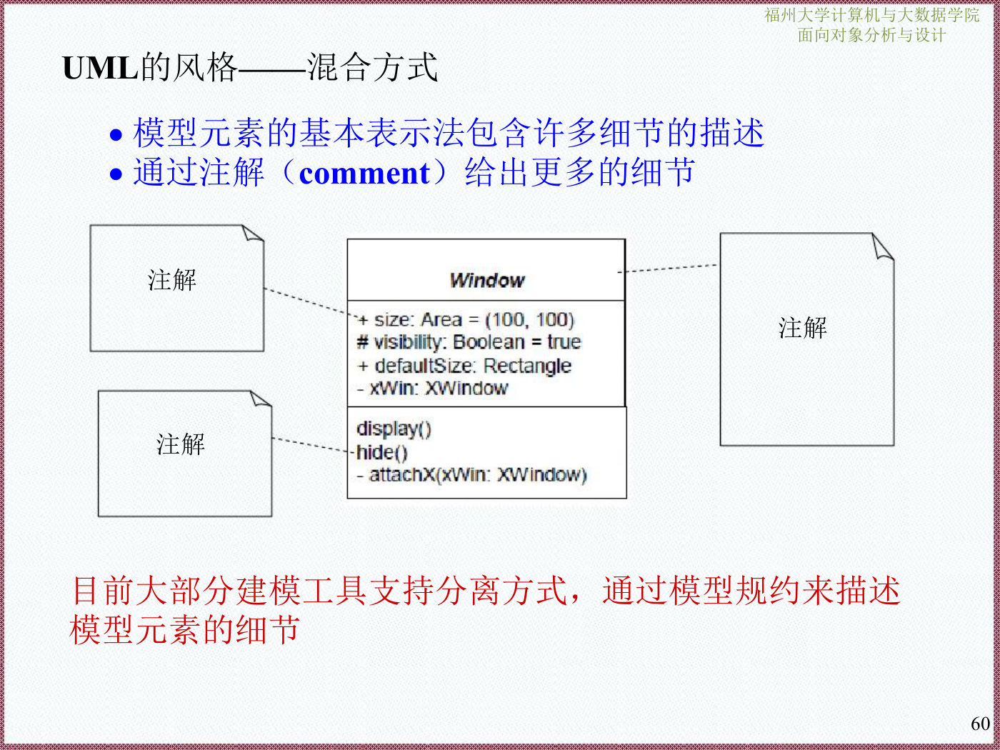

# 第10章 模型规约

对应 **第10章 模型规约.pdf**，页码按 PDF 阅读器计。**第9章 UML中的几种其他图(b)**.md>) 的第 34–43 页也收录了这一组内容。

## 1. 规约的作用与组织（第 1–5 页）

**模型规约（model specification）**给模型元素补上图里难以详尽、精确表达的信息。需求模型用用况图，基本模型用类图及它的对象、特征、关系层，包图、顺序图等按需要辅助。规约可以与画图同步，也可在图完成后补写。

| 方案 | 特征 |
| --- | --- |
| 分离方式 | 模型主图与详细规约分别组织，可相互导航。课件采用这个方式，并使用格式化描述 |
| 混合方式 | 在同一张图放模型基本表示和附加细节。课件以 UML 类框与折角注解为例 |
| 自然语言与形式语言 | 自然语言便于人阅读，约束或签名可借助 OCL 等形式表达减少歧义。按读者能力和自动化需求选用，课件建议两者结合 |

规约追求**完整性、易读性、支持自动化处理、支持软件复用**。课件用 Rational Rose 展示类规约可在建模工具里单独维护，并在类规约内描述类之间的关系。

## 2. 类规约的四块（第 6–8 页）

类规约（class specification）是课件中最主要的模型规约。图上每个类应能找到自己的详细定义。

| 组成 | 字段 |
| --- | --- |
| 总体说明 | 类名、含义、一般类、主动性 Yes/No、永久性 Yes/No、辅助模型访问路径和名称 |
| 属性说明 | 名称和类型、解释、多态性、是否表征关联／聚合／组合以及关系说明 |
| 操作说明 | 特征标记、解释、主动或被动（主动可进一步标进程／线程）、多态性、发出的消息、操作流程文档访问路径 |
| 对象实例说明 | 存放或运行的处理机结点、内存对象（可注明数组维数等）、外存对象 |

- 签名写作 `操作名(参数名: 类型, ...): 返回类型`，无参数可留空，返回类型可按约定省略。发出消息可以写 `类名·操作名`。
- 用况图的规约就是每个用况的文字描述。包图可按需说明每个包的意义。活动图、状态机图、定时图常已作为类行为或状态的详细说明，通常按需要再补文字细节。

## 3. 分析与设计的分工（第 9–10 页）

OOA 记录问题域固有的对象、特征和关系，例如「记录必须关联一个学生与一门课程」。OOD 再确定实现有关的内容，例如签名类型、持久化存取方式和处理机分布。课件允许部分工作视项目需要在任一阶段完成。

可用在线选课自测。给「选课记录」写一句职责和两个关联端，再给「登记选课」写参数、返回信息、向课程发送的更新消息及规约链接。读者应能从规约追溯类图上的关联，也能用规约验证顺序图中消息最终由谁处理。
