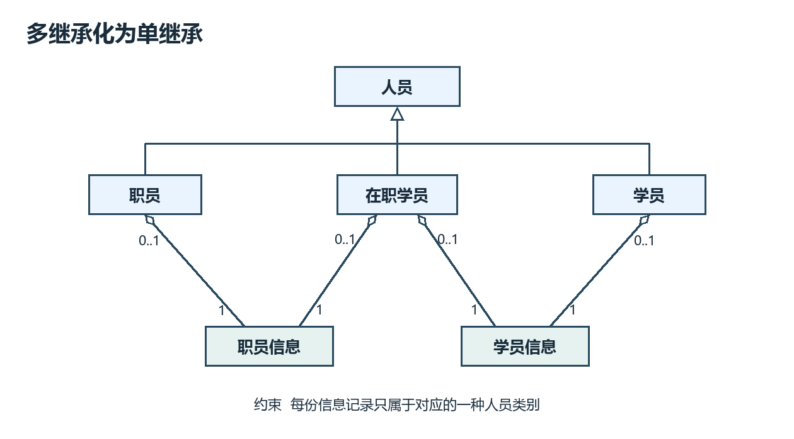
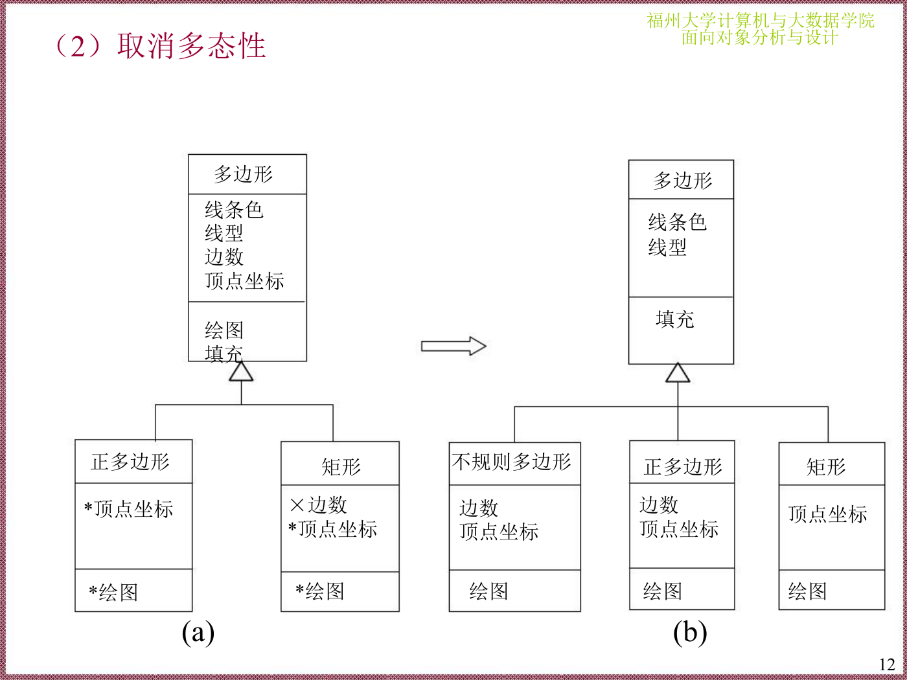
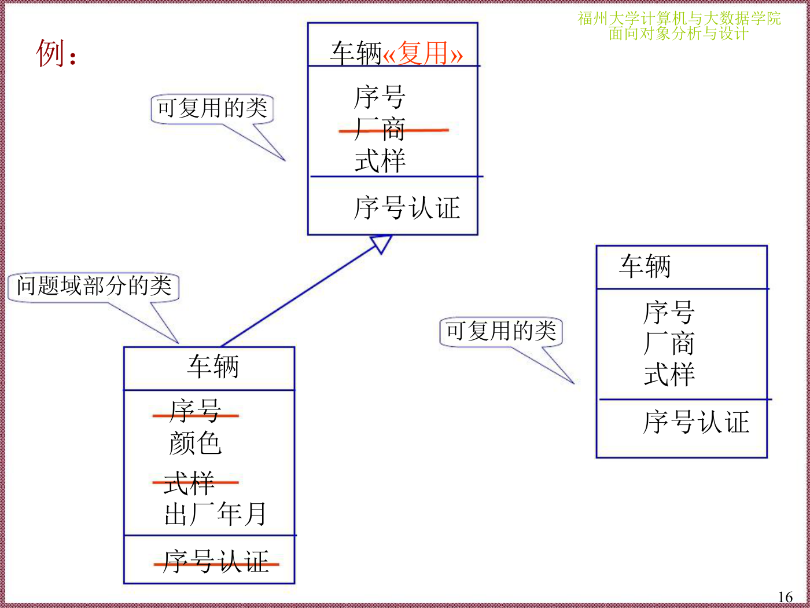

# 第11章 问题域部分的设计

对应 **第11章 问题域部分的设计.pdf**，页码按 PDF 阅读器计。案例分析 3 第 2–4 页对应多继承化简、多态化简和类复用。

## 1. OOD 模型与问题域部分（第 1–7 页）

OOD 有一个核心和三个外围。核心是**问题域部分**，外围是**人机交互、控制驱动、数据接口**。各部分仍可用需求模型、类图、辅助模型和规约表达。设计以 OOA 为输入，先得到问题域部分，三个外围在此基础上细化，最后组织构件并部署，输出给实现。

问题域部分由领域对象构成。在 OOA 模型副本上修正需求与模型问题，再按实现条件调整。课件的 MDA 图把 OOA 模型和实现条件作为设计转换的输入。编程语言影响多继承、多态与类型支持，硬件、操作系统和网络影响分布、并发、通信和性能，类库影响复用，数据管理系统影响持久化，界面框架影响消息衔接。

## 2. 多继承转为单继承（第 8–11 页）

狭义菱形有一个共同根类、两条中间继承路径和一个多继承子类。广义菱形可有更多交叉路径。先找出每条路径承载的事实，化简后检查共同祖先信息只存一处，专属信息仍可取得。

| 方法 | 变换 | 判题依据 |
| --- | --- | --- |
| 简单转换 | 保留一条合理的继承，把另一侧改为整体–部分，或在两个部分关系均成立时把两条都改成整体–部分。冷藏车可以继承汽车，并拥有制冷设备 | 「人是其身份的一个部分」等不合理构成应避开。若嵌入的两个类均继承同一人员信息，会产生重复 |
| 重定义类，改用身份 | 保留人员作为稳定主体，职员身份和学员身份作为可选部分，各 `0..1`。也可抽取身份一般类，课件例为一个人员有 `0..2` 个身份 | 适合身份可增减。按需要约束每种身份至多一个 |
| 保持分类，剥离多继承信息 | 职员、在职学员、学员均单独继承人员。把职员特有特征移入职员信息，把学员特有特征移入学员信息 | 职员持有职员信息，学员持有学员信息，在职学员各有一份。可避免把成员重复写进多个类 |

**案例分析 3 第 2 页**使用第三法。参考图的信息类两条边在所有整体端都写 `1`，逐边读会要求同一份职员信息既属于一位职员又属于一位在职学员。按独立人员类别建模时，把各整体端改成 `0..1`，同类信息记录的两条归属补互斥约束。整体看其对应的信息端仍是 `1`。图中空心菱形在拥有信息的人员类别端，共有人事信息只留一份在「人员」。**案例分析 3 第 2 页**

## 3. 多态化简（第 12 页）

当实现条件要求取消课件标出的多态时，找出重定义的成员（`*`）和拒绝继承的成员（`×`），把分歧成员下放。若原一般类还涵盖一般实例，增加一个子类承接原句义。仍适用于所有后代的特征留在一般类。

| 变换后 | 成员 |
| --- | --- |
| 多边形 | 线条色、线型、填充 |
| 不规则多边形 | 边数、顶点坐标、绘图 |
| 正多边形 | 边数、自己的顶点坐标表示、绘图 |
| 矩形 | 自己的顶点坐标表示、绘图。边数固定，可省去独立属性 |

三个子类都沿**实线空心三角**指向多边形。原来在多边形里的默认绘图放到不规则多边形，以保留一般形状的行为。若保留公共绘图声明再由三个子类覆盖，仍有该操作的运行时多态。画题要求「取消」时，应按图重置分配并明确各自实现。**案例分析 3 第 3 页**

## 4. 共同协议与类复用（第 13–16 页）

- **共同协议**。加根类提供全系统通用的创建、删除、复制等操作。加局部一般类可提供持久对象共同的保存、恢复等操作。
- 复用前比较现有类和目标类所需信息，包括属性、操作及其语义。课件给出四种用法：相等时直接复用，现成定义只覆盖一部分时继承并补特征，现成定义包含目标且有冗余时剪裁，两者只有部分重合时剪裁冗余再继承扩充。课件在类名用 `«复用»` 标来源。

**案例分析 3 第 4 页车辆题**。现有车辆有序号、厂商、式样、序号认证，目标有序号、颜色、式样、出厂年月、序号认证。按「剪裁再继承」画适配后的复用基类，保留序号、式样、序号认证。目标车辆继承它，只新增颜色、出厂年月。图中划掉的厂商表示从**用于本题的复用定义**剪裁，原始可复用类仍保留在来源。画清哪个框是原版、哪个是适配后基类，同一继承树中无需再写目标类继承来的三个成员。**案例分析 3 第 4 页**

## 5. 性能、细化与追溯（第 17–24 页）

| 设计工作 | 复习要点 |
| --- | --- |
| 提高性能 | 调整对象分布以减少跨机消息，设缓冲缩短存取，合并交互特别频繁的类，缓存派生属性以减少重复计算，降低算法复杂度，按具体类型细分以便选择合适算法，或者把复杂对象拆成整体–部分（例如帧的背景和前景） |
| 持久性 | 补保存、恢复所需协议和属性，具体映射见 **第 14 章** |
| 完善类 | 完善领域特征、封装辅助操作和面向三个外围部分的操作。为复杂操作画流程。表示关联的属性取决于多重性。组合可用嵌套对象，松散聚合可用引用或标识 |
| 定义实例 | 逻辑实例是类描述的实际事物。物理实例可体现为内存变量、文件记录或表元组。按处理机写明每组内存对象或外存记录 |
| 更新辅助模型和规约 | 类增减、拆并后更新包图。操作和消息变化后更新顺序图。流程变更后更新活动图及受影响的其他辅助图，细化属性、操作和关系的规约 |
| 建立 OOA–OOD 映射 | 记录 `1=1` 原样、`1 to 1` 调整、`1 to m` 拆分、`m to 1` 合并、`m to m` 重组、`0 to 1` 新增。由旧模型能追到设计类 |

画设计题时先圈题干给定的约束，按题意选化简或复用策略，再画变换后的完整结构。逐个检查属性、操作、继承与归属是否在新图里还能找到。
