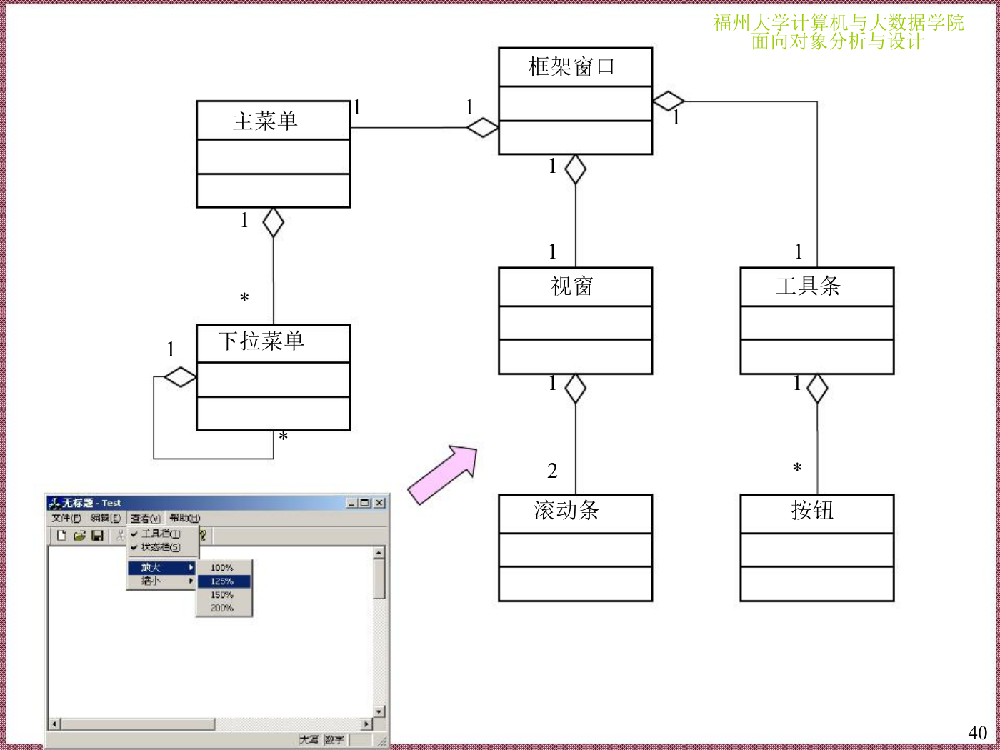
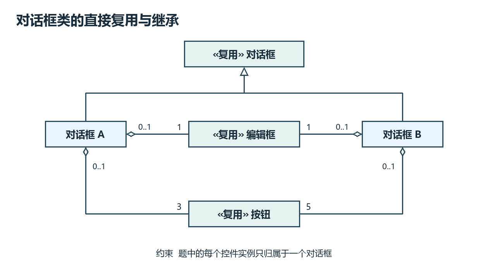

# 第12章 人机交互部分的设计

对应 **第12章 人机交互部分的设计.pdf**，页码按 PDF 阅读器计。案例分析 3 第 5–7 页是页面类图、交互用况抽取、对话框复用。

## 1. 人机交互部分及需求（第 1–3 页）

人机交互是 OOD 的外围部分，**界面对象**共同构成人机界面。设计同时取决于人机交互需求和界面支持系统。单列该部分可隔离更换界面技术对问题域对象的影响。界面工作同时需要理解人如何发命令、系统如何向人提交信息，以及交互和视觉习惯。

- **客观需求**是实现功能所必须的交互内容。**主观需求**是不同使用者对风格、表现和操作方式的偏好。
- 列出会使用系统的人员角色，调研、分类、估算各类比例，并了解各类用户的偏好与能力。按交互内容和用户特征选适合的表现。

## 2. 从用况提取人机交互（第 4–7 页）

把参与者与系统的行为按时间分栏。找人发给系统的命令、数据，以及系统返回给当前参与者的提示、反馈和结果。把混合动作拆开，仅保留有输入或输出的部分。删掉失去内容的控制语句及其成对标记，保留依然决定输入／输出顺序的循环与分支。随后细化每次 I/O 的步骤、设备、信息表示。课件把一次输入广义称作一条命令，输入通常主导交互。

**考试落笔稿**。收款员收款题保留如下交互。用于其他题时也要先确定是哪一个角色的交互。库存低提醒在原文是发给供货员的消息，从收款员的交互流中移出。**案例分析 3 第 6 页**

```text
收款员输入开始收款命令
系统输出收款提示
对顾客选购的每种商品重复
    收款员输入商品编号
    若同种商品多于一件
        收款员输入商品数量
    系统打印编号、名称、数量、单价和该商品总价
系统打印应收款总数
收款员输入顾客交款数
系统打印交款数和找回款数
```

原用况中还包含初始化、检索、减库存、低库存处理、合计、算找零、记账。提取结果仍包含系统提示与打印，内部动作从这份交互描述中去掉。「计算总价并打印」只保留打印这一部分。保留按商品的循环及数量条件。

## 3. 命令和输出的组织（第 8–12 页）

| 术语 | 含义与例子 |
| --- | --- |
| 高层命令 | 组织和引导到其他命令，本身可作为入口。例「查看」菜单 |
| 基本命令 | 使用一项独立系统功能。例「设置缩放比例」 |
| 命令步 | 基本命令中的一次具体输入。例选中比例后确认 |
| 分解 | 将含大量参数或选项的一条基本命令拆成若干命令步 |
| 组合 | 将许多基本命令组织到一组高层命令，用菜单组织和引导 |

命令步结构可为线性、树型、半序网状或一般网状。先分析常规输入，再设计异常处理（取消、失败重试、异常命令等）。两层命令之间可有**提示信息、反馈信息、处理结果**，提示指导下一步，反馈反映系统对操作的响应，结果交付处理所得。界面准则包括**使用简便、一致、启发、减轻记忆、减少重复输入、容错与及时反馈**。风格、视感、美观也影响体验。

## 4. 界面支持系统与 OO 设计（第 13–19 页）

| 支持层 | 提供内容 |
| --- | --- |
| 窗口系统 | 管理位映像显示器和输入设备，控制屏幕、窗口、颜色、字体、光标及图形资源。课件例 X Window |
| GUI | 位于窗口系统之上，提供更高层的界面支持及特定视感。课件例 OSF/Motif、Open Look |
| 可视化编程环境 | 集窗口系统、GUI、可视化工具、语言和类库于一体，支持所见即所得。课件例 Visual C++、Visual Basic、Delphi |

结合硬件、操作系统、语言、支持层次及视感选择。主界面可用框架窗口或对话框。高层命令用窗口／菜单／下级菜单的层次表现。由菜单选项触发基本命令，选合适的控件完成各步 I/O，按题意支持右键菜单等异常或替代入口。

- **类和属性**。先找类库复用 `«复用»`，补领域所需的自定义类。物理特征包括位置、尺寸、颜色，逻辑特征包括命令含义与聚合／关联。
- **操作**。可有创建、激活、最大化、最小化、移动、选中、单击、双击。
- **整体–部分**表达构成与命令层次，如窗口包含菜单，菜单包含下级菜单。**泛化**表达自定义控件继承类库控件。如对话框 A 指向 `CDialog «复用»`。**关联**表达有意义的联系，例如一个按钮打开与之对应的对话框。
- **消息**。高层到低层命令由界面对象发给界面对象。执行基本命令时从界面对象发给功能对象。输出结果时从功能对象发给界面对象。

### 页面设计题

课件的图把「框架窗口」作为整体，包含 1 个主菜单、1 个视窗、1 个工具条。主菜单包含多个下拉菜单，下拉菜单可再有子下拉菜单。视窗中的水平、垂直滚动条数量为 2，工具条包含多个按钮。界面截图下方还有状态栏，若要求完整覆盖截图可给框架窗口补「状态栏」部分，工具条和状态栏的显示状态可用可见性表达。

参考图的自聚合在父菜单端标 `1`，若同一类也包含直接挂在主菜单下的顶层下拉菜单，父级下拉菜单最多一个，改成 `0..1`。子菜单端是 `0..*`，并依据界面约束区分直接归主菜单和归父菜单。菱形都在拥有者端。**案例分析 3 第 5 页**



## 5. 可视化编程环境下的策略（第 20–26 页）

1. **类先考虑复用**。直接现用类，如 `CEdit`，或继承复用，如自定义对话框继承 `CDialog`。有必要共享业务特征时再抽出自定义中间基类。
2. **属性优先逻辑特征**，如菜单选项命令、包含哪些控件。大小、颜色、边框等可由所见即所得工具安排。类库有单独类定义的组成部分，可画作部分对象。课件举的下拉菜单选项与窗口边框可当普通属性。
3. **操作**按课件图式，显式列所需沿用的高层操作，如用标记列出继承的 `SetDlgItemText`。概念上仍是继承来的方法。
4. **关系与消息**。组合或聚合表现界面与命令结构。关注需要手写的消息，尤其是界面把事件交给功能对象、功能对象请求界面做输入输出。环境自动处理的消息可以省去。

### 对话框 A、B 复用题

题目要求 A 有 1 个编辑框与 3 个按钮，B 有 1 个编辑框与 5 个按钮。A、B 各从自定义类用**实线空心三角**指向同一个可复用「对话框」。编辑框、按钮用类库类型，作为 A 与 B 的各自部分。手绘参考图把几个菱形画在编辑框／按钮端。**整体是 A 和 B，菱形均移到 A／B 端**。数量标在被数的控件端。修正版用空心菱形沿用课件示例。若把各框的控件实例建模为强拥有，可以在说明生命周期后采用实心菱形。**案例分析 3 第 7 页**


