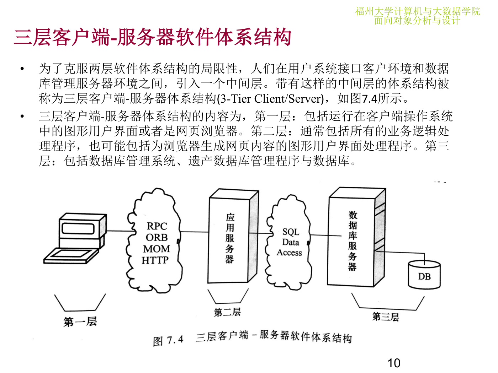
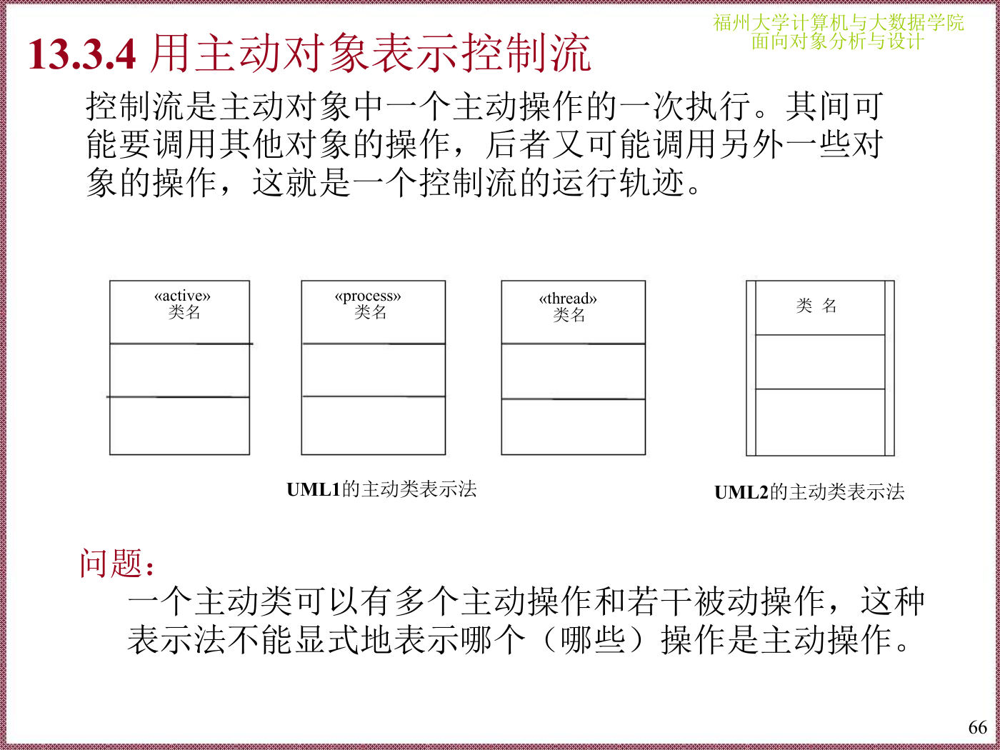
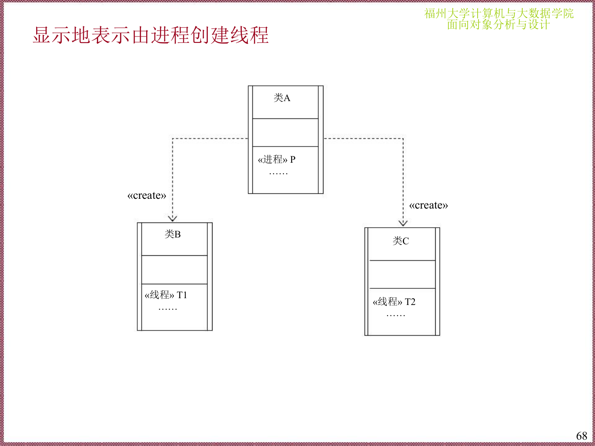

# 第13章 控制驱动部分的设计

对应 **第13章 控制驱动部分的设计.pdf**，页码按 PDF 阅读器计。本章重点是架构辨析、按结点识别控制流，以及主动类符号。

## 1. 控制驱动部分（第 1–4 页）

控制驱动是 OOD 外围部分，由系统中的主动类组成。**控制流**在本章指进程或线程；每次执行一个主动操作可发起一个控制流。在这条运行轨迹中，主动操作可以依次调用其他对象的被动操作。多控制流并发的系统又称多任务系统。

分开设计这部分，便于表达领域固有并发和实现决策，隔离硬件、OS、网络的变化。并发可来自设备与主机、多窗口、多用户、多子系统、多处理机，也可能发生在单处理机。设计条件包括 CPU 数量和存储性能、OS 的并发通信能力、网络拓扑与速率、语言的进程线程支持，以及 DBMS、界面与构件库的共享能力。

**软件体系结构**描述系统元素、元素间交互、组合模式及约束。课件第 4 页列出的风格有管道与过滤器、数据抽象、面向对象、隐式调用、层次、仓库、黑板、解释器、进程控制、客户–服务器。风格可作为组织构成与通信方式的分类依据。

## 2. 网络体系结构（第 5–16 页）

### 客户–服务器

| 形态 | 功能和数据在哪里 | 识别线索 |
| --- | --- | --- |
| 一层（课件的历史模型） | 主机处理业务和数据，终端只负责输入输出 | 大型机分时，终端无独立应用逻辑，主机通常较昂贵 |
| 文件共享 | 文件集中存放，客户端取文件、本地处理、再写回 | 文件传输量大时效率下降，客户端各自部署业务 |
| 两层 | 客户端含 GUI 和部分或全部业务，服务器提供 DBMS 与共享数据，可借存储过程或触发器承接一部分业务 | 客户端直接向数据库服务器发 SQL、收结果 |
| 三层 | 表示层（界面或浏览器）、中间的业务逻辑层、数据层（数据库和 DBMS） | 客户端经中间层调用业务，业务层访问数据 |

### P2P 的三种形态

- **集中目录式**。对等点向中央目录登记地址、元数据、服务。查询者先查目录并定位对等点，然后点对点获取内容。目录是发现服务的单点，数据保存在对等点。
- **纯 P2P**。各点既可作客户也可作服务方，向相邻结点广播转发请求。课件例用 `ping/pong` 寻找邻点，`query/query hit` 查询并响应，`push` 作为后续传输消息。无中央目录有利于避免中心失效，泛洪会消耗带宽，大网络查询覆盖和命中率受限，也会接收无效或恶意信息。
- **层次式非结构化 P2P**。超级结点构成一个上层覆盖网络，叶子结点利用超级结点发现资源，缓解纯广播扩张后的发现困难。

## 3. 进程、线程与并发方案（第 17–23 页）

| 术语 | 含义 |
| --- | --- |
| 进程（process） | 资源分配单位，拥有地址空间等资源，是课件所说的重量级控制流。进程可为单线程或含多个线程 |
| 线程（thread） | 在进程内可独立调度的执行单位，线程共享进程资源，是轻量级控制流。并发程序可拆为若干各自顺序执行的流 |
| 并发与并行 | 并发的控制流执行可交错。不同处理器可物理同时执行，单 CPU 也能调度多个进程或线程产生并发 |

课件的遥感例把接收、处理、显示分成三段。多进程方案各段有进程，用 IPC 传数据；多线程方案在同一遥感处理进程内区分三条线程；混合方案用多线程遥感进程，另有业务处理进程，经 IPC 或 RPC 通信并由 DBMS 管理数据。查看是否需要跨地域、跨结点、多用户同时处理，或在同一时间对多个功能、外部参与者进行响应。

## 4. 如何设计（第 24–30 页）

1. **选架构**。按功能提供位置、长期数据与临时数据所在位置确定功能分布和数据分布。
2. **分布对象与类**。先用集中式类图梳理职责。按用况放置合作紧密的对象，追踪消息尽量把同一控制流所经的对象放在一处，减少远程传输并便于管理。可把每处理机上的类组织为包。案例分析 3 第 8 页的功能分包见 **第 9 章 (a)**.md>)。
3. **以结点为单位找控制流**。看同一结点哪些功能需同时执行、哪些可随时被用户触发、哪些处理异常。也参照 OOA 主动对象、优先级与紧急任务、并行计算线程、结点间通信进程和协调其他控制流的任务。
4. **落实到主动类和主动操作**。UML1 课件写 `«active»`、`«process»`、`«thread»`。UML2 主动类可用左右加内竖线。类图可在操作前标 `«进程»`、`«线程»`，避免把主动类的所有操作都读成主动。某个进程操作创建线程时，按课件第 30 页用虚线 `«create»` 指向新线程所属类，也可在顺序图画具体创建。
5. **核对消息**。同流通常按顺序调用，跨流可同步或异步；画出需要的通信、共享资源访问及协调。类图消息标法见 **第 8 章**。

