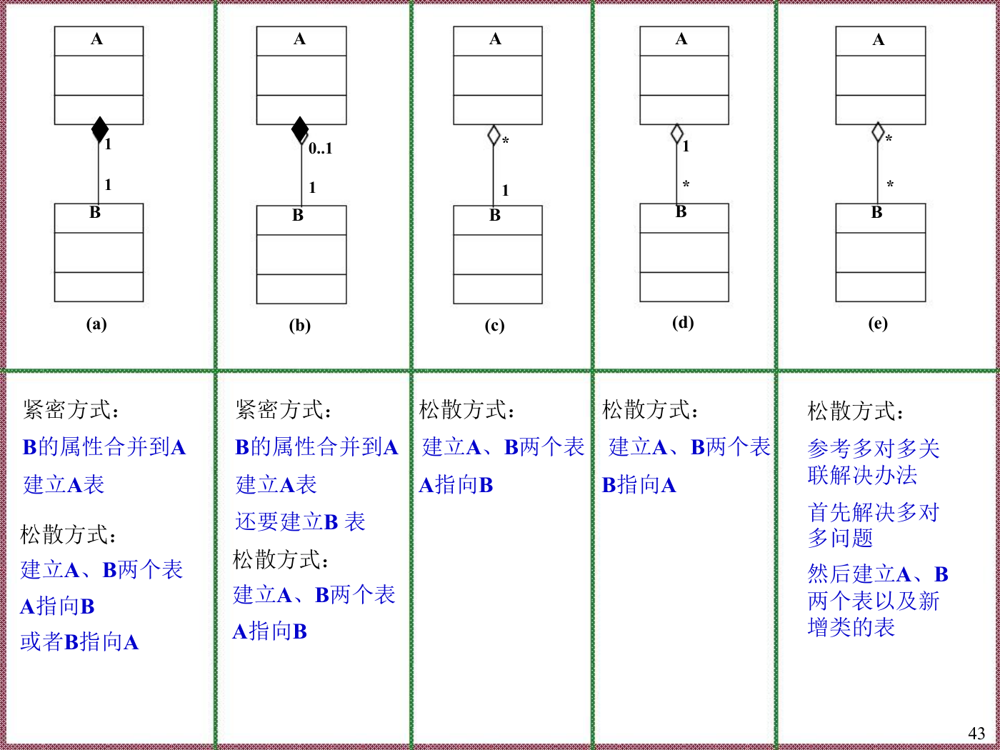
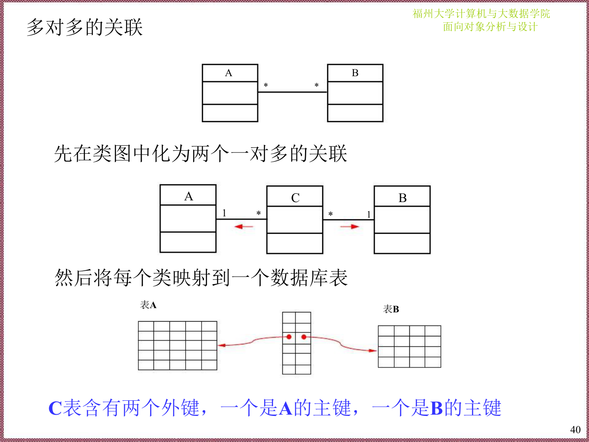

# 第14章 数据接口部分的设计

对应 **第14章 数据接口部分的设计.pdf**，页码按 PDF 阅读器计。第 51–59 页随附第 15 章「构件化与系统部署」。案例分析 3 第 9–11 页依次考多对多、一般–特殊、整体–部分到关系表的映射。

## 1. 数据接口及数据管理系统（第 1–16 页）

**数据接口**是 OOD 的外围部分，负责把需持久化的对象接到选定数据管理系统，提供保存、检索及恢复。持久化对象时记录需要保留的属性状态与必要引用，操作代码随实现提供。集中存取有利于隔离持久化技术的更换，减少问题域部分的改动。

| 方式 | 要记的定义和取舍 |
| --- | --- |
| 文件系统 | 通常由 OS 管理外存文件。物理结构指存储组织，逻辑结构是用户看到的流式或记录式等组织。普通命令或程序指令包括创建、删除、打开、关闭、读写。成本低、基本类型限制少，属性查询、共享、完整性、事务和恢复通常要额外处理 |
| 数据库与 DBMS | 数据库是长期存储、有组织、可共享的数据集合。DBMS 用来建立、使用与维护，负责管理安全和完整性。数据模型包含结构、操作及完整性约束，有层次、网状、关系、OO 等 |
| RDBMS | 关系是各属性域笛卡尔积的子集，可用表表示。关系／文件／表，元组／记录／行，属性／字段／列是课件中的术语对照。属性值按关系模型可视作原子值。提供并交差、选择、投影、联结。擅长结构化数据、共享、完整性及事务。复杂对象要做映射 |
| OODBMS | 基于面向对象模型，既支持对象标识、类、封装、继承、关联、多态等概念，也支持数据定义与操作、完整性、安全、并发、事务及恢复。课件的历史分类是 OOPL 扩充（GemStone、ObjectStore）、RDBMS 扩充（Iris、POSTGRES）、全新 OO 模型（O2、DAMOKLES） |

文件与 RDBMS 可以组合使用。选择时同时比较技术条件（数据类型、检索与共享、完整性与事务、对象模型匹配）及非技术条件（成本、工期、风险、成熟度、团队背景、现有系统）。选定后回答三个问题：如何映射数据、需要哪些数据接口类、问题域类如何发出请求。

## 2. 文件系统方案（第 17–22 页）

- 内存对象与外存记录可一一映射，也可按格式组织成别的映射。课件基本策略是**每个具有需永久保存的直接实例的类一个文件**，每实例一个记录，保存所需属性（包括继承来的）。按整个继承树共用一个文件容易产生空字段，模糊分类并使操作复杂。
- 关键字与物理记录位置有规律时用换算定位。能比较和排序时可对有序记录折半查找，也可用排序索引表通过指针找记录。其他选项有散列表、倒排表、二叉排序树。
- 数据接口可设计「对象存取器」，有类名到文件名对照、对象存储、对象恢复。按定位策略区分换算型、查找型、索引型。索引型使用索引表。
- 问题域需要发出请求保存、请求恢复。可在需要持久化的类中单独加入，也可定义存储协议一般类，由所有永久对象继承。

## 3. 关系库的数据准备（第 23–35 页）

类对应表、完整属性对应列、实例对应行是课件的默认策略。RDBMS 也允许应用对象查询共享库中的普通数据，和保存／恢复自身是两种用法。类与表的结构差异需要格式转换。先处理规范化、修改类图、确定键，再画映射，并核对引用和基数。

| 范式 | 课堂复习要点 |
| --- | --- |
| 1NF | 每列取值原子，单值属性。需要独立操作的复合或多值数据可拆出 |
| 2NF | 非主属性完全函数依赖各候选键，避免只依赖组合键的一部分 |
| 3NF | 课件以消除非键属性经其他非键属性产生的传递依赖说明。例 `SID → Building → Fee` |
| BCNF | 每个非平凡函数依赖的决定项都应是超键 |
| 4NF | 每个非平凡多值依赖的决定项都应是超键。课件以独立的学生专业和活动为例 |

- **3NF 例**。住宿表 `(SID, Building, Fee)` 中房费由楼决定。拆成 `住宿(SID, Building)` 和 `楼房费(Building, Fee)`，后者以楼为键。
- **4NF 例**。学生可有多个专业和多个活动，两者若彼此独立，把所有组合放在 `(SID, Major, Activity)` 会产生交叉重复。拆成 `(SID, Major)` 和 `(SID, Activity)`，分别用两列作键。类图可对应学生与两侧实体之间的两个中间类。
- 职工的月工资与所得税若按当期规则可算，考虑按规则求值以避免重复存储。规则、历史等具体需求决定是否保留结果。
- 规范化减少冗余和更新异常，但可能增加连接和理解成本。可保持领域类图而单独规范表，在读写时转换。课件偏好按规范化调整类图，并作为问题域设计的一部分。键应尽量精简，常按需引入编号，确认每类至少满足 1NF、所需更高范式和唯一标识。

## 4. 类图映射为表（第 35–44 页）

本课件采用**存实例的具体类建表、继承属性铺平**的策略。每个需要保存直接实例的类建表。同一个共同祖先的字段在一个表内只列一次。含义不同的同名继承属性改用具体名称。抽象类无直接实例，可以只把字段展开到各具体类的表。

| 关系 | 放置外键的规则 |
| --- | --- |
| 一对一 | 在必然需要引用另一端的表加外键并加唯一约束。例 `A 0..1 ─ 1 B`，每个 A 必须有一个 B，优先在 A 加 `B_ID NOT NULL UNIQUE`；反向时 B 可能有空的 A 外键 |
| 一对多 | 多端表保存指向一端主键的外键。若一端允许缺省，外键可空。复合主键的所有组成列都要对应 |
| 多对多 | 先变成 `A 1 ─ * C * ─ 1 B`，然后得到 A、B、C 三表。C 有两个非空外键，带上关联特有字段。若同一对 A、B 最多有一条记录，可联合主键 |
| 松散整体–部分 | A、B 分表，按基数放外键。多对多用中间表 |
| 紧密整体–部分 | 固定、独占的一件 B 的属性可并入整体 A。若 B 也可独立存在，仍需另建表表达无归属的 B |

表可以只含类的自身字段，可以同时含自身字段和外键，也可以只由外键构成，如某些纯中间表。注意「外键引用某表主键」是不同表列之间的关系。

| 课件第 43 页，整体 A 与部分 B 的端点 | 方案 |
| --- | --- |
| (a) A 端 `1`、B 端 `1` | 紧密时 B 并入 A，只建 A。松散时分表，任一端承担唯一、非空外键 |
| (b) A 端 `0..1`、B 端 `1` | 紧密时在 A 展开 B 字段，并保留能存独立 B 的表。松散时 A 持有指向 B 的唯一非空外键 |
| (c) A 端 `*`、B 端 `1` | 分表，A 引用 B，同一个 B 可供多个 A |
| (d) A 端 `1`、B 端 `*` | 分表，B 引用 A |
| (e) 两端 `*` | 增中间类及中间表，如运动队与学生之间的「队员」 |

### 案例分析 3 的三道表题

**多对多化简**。原图 `A * ─ * B` 拆成 `A 1 ─ * C * ─ 1 B`。落到表写 `A(A_ID PK, …)`、`B(B_ID PK, …)`、`C(A_ID FK→A, B_ID FK→B, …)`。在「一对只出现一次」的前提下为 C 写 `PK(A_ID, B_ID)`。参考图的形状可以用，画表时把键与引用方向写出来。**案例分析 3 第 9 页**

**一般–特殊结构**。按题意「人员」为抽象类时不单独建表，姓名、出生年月铺进各具体表。参考图的教职工表未给可靠唯一标识，下表补「教职工ID」作设计键。列出的学号假设在对应表内唯一。继承来的攻读专业、从事专业分别保留。若「人员」本身也有需要持久化的直接实例，才为这类直接实例另建表。**案例分析 3 第 10 页**

| 表 | 列 |
| --- | --- |
| 研究生 | 学号 **PK**、班级、姓名、出生年月、攻读专业 |
| 教职工 | 教职工ID **PK**（新增）、姓名、出生年月、职称、从事专业 |
| 在职研究生 | 学号 **PK**、班级、姓名、出生年月、攻读专业、职称、从事专业、在职单位 |

**相机–机身紧密方式**。菱形在相机端，相机端 `0..1`，机身端 `1`。每台相机必有一件机身，一件机身可以处于未装配状态。原参考答案给两个表，但照相机表漏掉并入部分的「机身ID」。按保留机身标识的紧密方式修正如下。已装配机身的记录放进照相机行，独立表只放未装配机身。同一机身ID在这两种位置互斥，装配／拆离时随状态迁移。用题中的型号 ID 当相机键，前提是该 ID 能区分题目中的每条相机记录；若按实物区分，需独立相机编号。**案例分析 3 第 11 页**

| 表 | 列 |
| --- | --- |
| 照相机 | 照相机型号ID **PK**（按题设标识）、镜头、底片、机身ID **NOT NULL UNIQUE**、暗室、快门 |
| 机身（尚未装配） | 机身ID **PK**、暗室、快门 |

松散方式的对照画法是将全部机身放在机身表。照相机表写唯一非空的机身外键，暗室、快门由机身表提供。答此题时按指定的紧密方式落表。

## 5. RDBMS 对象存取器与 OODBMS（第 45–50 页）

RDBMS 存取器需要知道内存对象、所属类及关键字，分别决定从哪取数据、走哪张表、定位哪个元组。

| 设计 | 接口参数与取舍 |
| --- | --- |
| 每类一对保存、恢复 | 传对象变量和关键字值。表与键构成可预先确定，通常可用静态数据操纵语句。操作数随类增长，领域请求分散 |
| 全系统一对保存、恢复 | 传类名、对象变量、键值，存取器维护类名到表名对照。统一协议便于提取共同「永久对象」一般类，对语言和动态数据操作能力要求更高 |
| OODBMS | 内外数据模型较一致，通常无须做关系规范化式改造，也可不另设存取类。主要按 DBMS 和语言提供的类定义、查询与访问能力实现模型 |

## 6. 随附第 15 章 构件化与系统部署（第 51–59 页）

- 面向对象方法贯穿生命周期，解决如何依据类、关系和行为认识及映射领域。**构件**的粒度更大，是可独立开发、装配、发布、复用和升级的产品单位。二者可配合使用。领域分析、OOA、OOD、实现可分别得到领域级、分析级、设计级和实现级可复用成分。
- **构件化**。一个构件常包含多个类。类可完整地在多个构件中复用，保持类本身的原子性。按类关系、对象来源、功能、通信频率和并发分布，以包为起点，必要时拆包或合包，并考虑发布方式。
- **制品分类**。源文件制品、编译生成的可执行制品、数据库和数据文件、模型及规约、测试用例、说明书与帮助文档。
- **部署步骤**。描述结点与通信路径，配置结点执行环境（OS、编译系统、DBMS、GUI、中间件等），再把制品放到结点。源文件和可执行物按构件所在地，数据按使用范围与传输量，模型测试和文档按作用范围部署。安装、售后和最终使用可有不同方案。符号见 **第 9 章 (b)**.md>)。
