# 第 15 章 软件测试（构件级）

页码沿用本份 PPT 页脚。先分清测试层次、驱动与桩，再练习画控制流图、计算环路复杂度、列独立路径和推导测试用例。 **第15章.ppt** · [自测题](#自测题)

## 15.1 软件测试的策略性方法（第 2–21 页）

### 测试目标、策略与层次（第 2–7、13、17–19 页）

**软件测试的直接目的是发现错误**。测试策略安排**测试计划、测试用例设计、测试执行、结果收集与评估**。好的策略让测试进度可度量，使缺陷尽早暴露，并按开发阶段、工程方法和测试目标选用相应技术。测试开始前可以通过技术评审排除明显问题。

| 层次 | 测试对象 | 主要依据或目的 |
| --- | --- | --- |
| **单元测试** | 单个最小可测试单元 | 核对模块的接口、内部数据和处理逻辑是否符合详细设计。 |
| **集成测试** | 已组装的多个模块 | 核对软件设计所规定的接口、协作与体系结构。 |
| **确认测试** | 已集成的软件 | 根据软件需求，检查主要功能和行为能否满足用户需要。 |
| **系统测试** | 软件与硬件、网络等组成的整个系统 | 在系统环境中检查整体行为和质量要求。 |

课件用螺旋图说明范围的变化。开发从系统工程、需求和设计逐步进入编码，测试则从代码和构件层向外扩展。第 13 页还列出了功能、性能、验收和安装等测试活动。

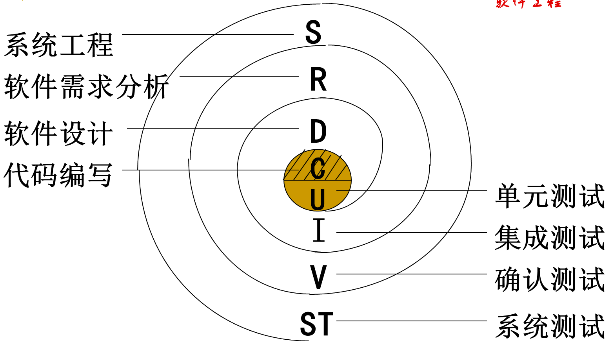

*课件第 18 页　开发逐步细化，测试范围逐步扩大*

### 检查、验证、确认与调试（第 6、11–12、17 页）

- **软件检查**是静态活动，分析需求文档、设计文档和源代码等表示形式。课件用桌面检查说明非正式检查，以审查、走查举例说明技术评审。
- **软件测试**是动态活动，用测试数据运行软件，观察并比较输出和运行行为。
- **验证（Verification）**检查软件是否按规格或设计正确实现了规定的功能，回答「产品构造得正确吗」。**确认（Validation）**检查产品是否满足实际用户需求，回答「构造的是用户需要的产品吗」。测试可以为验证和确认提供证据。
- **调试（Debugging）**在发现失效后定位原因并修改代码或设计。修改后重跑相关测试，检查修复结果和可能受影响的行为。

### 软件错误的来源和类型（第 8–10 页）

错误可以来自**错误、缺失或无法实现的需求**，也可以在设计和编码中引入。

| 类型 | 常见表现 |
| --- | --- |
| **算法错误** | 初始化、计算、判定或分支控制出错，产生意外结果。 |
| **精度错误** | 运算或输出达不到规定精度。 |
| **文档错误** | 文档描述和程序的实际行为不一致。 |
| **压力错误（能力错误）** | 活动量接近指定极限时，系统性能变得不可接受。 |
| **吞吐量错误（性能错误）** | 在规定的测试条件下，处理速度达不到要求。 |
| **恢复错误** | 发生失效后，系统不能按要求恢复。 |
| **计时错误（协调错误）** | 并行进程或需按特定顺序执行的操作协调失败。 |
| **硬件和系统软件错误** | 依赖的硬件或系统软件未提供预期行为。 |

### 测试组织、原则和结束条件（第 14–21 页）

- **开发人员负责单元测试**，通常也参加集成。大项目可设置**独立测试组（Independent Test Group，ITG）**，独立设计和执行测试，主动寻找缺陷。ITG 可早期参与策划和规程制定，并在体系结构形成后开展相应的测试。开发人员与测试人员需要持续协作，及时复现和修复故障。
- **Pareto 原则（80/20 原则）**提示缺陷和运行时间往往集中在少量代码，可优先测试缺陷密集、执行频繁或影响大的模块。**木桶理论**提示整体质量会受薄弱环节限制。发现缺陷集中时，应继续排查附近代码和依赖。
- 既有用例反复运行主要验证已覆盖的行为。要发现新缺陷，需要持续补充不同输入、边界和运行条件。测试在某个阶段按质量目标、覆盖情况和遗留风险告一段落。运行环境和需求变动后还要继续验证。 [估计剩余错误](#估计剩余错误第-96100-页)

## 15.2–15.3 单元测试与测试用例（第 23–47 页）

### 测试用例与测试记录（第 4、29、39 页）

**测试用例**是针对特定测试目标设计的一组**测试输入、执行条件和预期结果**。可用编号把用例与需求或路径对应起来。测试计划可在编码前准备，实际运行后记录观察结果，并与预期结果比较。考场写用例时，至少写清题目要求的输入、预期输出及覆盖目标。

### 单元测试的五项内容（第 23–26、33–40 页）

**单元测试（Unit Testing）**验证软件中人为规定的最小可测试单元，如 C 函数、Java 类或某个窗口。它依据**源程序和详细设计**，重点检查单元的内部处理逻辑和数据结构。单元测试可尽早准备，测试驱动开发还会先写测试，再编写实现。

| 检查对象 | 怎样测、容易发现什么 |
| --- | --- |
| **模块接口** | 先确认信息能正确流入、流出。检查实参与形参的个数、类型、属性与次序，以及文件属性、打开方式、编码和全局变量约定。 |
| **局部数据结构** | 检查运行中数据的完整性，如类型、变量名、初值、默认值、溢出和地址。 |
| **独立路径** | 设计输入执行程序的基本路径，找错分支、算术或逻辑优先级错误、比较精度问题、循环终止错误。 |
| **边界条件** | 检查允许的最大与最小值、比较阈值两侧及恰等于阈值的情形，以及循环 0、1 和上限次数等情况。 |
| **错误处理路径** | 主动触发错误，核对异常是否被正确处理、错误信息是否准确充分，以及处理是否及时。 |

常见流程是先编译作基本检查，再对照编码规范静态检查，接着动态执行合法、非法和边界用例。第 41–42 页的 `iszero` 规定非零时输出原值，遇到零时输出 1。按题意逐项给出 1、2、3、4、0，预期逐项输出 1、2、3、4、1。还应按输入规定检查非法字符和输入数量边界。

### 驱动程序与桩程序（第 27、30–32、43–47 页）

被测单元依赖其他部分时，可以用辅助程序建立可运行的测试环境。

- **驱动程序（Driver）**模拟上层调用方，读入测试用例，调用被测单元并记录结果。
- **桩程序（Stub）**模拟被测单元依赖的下层构件，提供必要的接口与受控返回，帮助复现正常或异常情况。

例如 `main()` 调用 `fun1()`。`main()` 尚未实现时，为 `fun1()` 写驱动。`fun1()` 尚未实现时，可用同接口的桩帮助测试 `main()`。两类辅助程序属于测试开销，需要随被测单元的接口或测试目标更新。

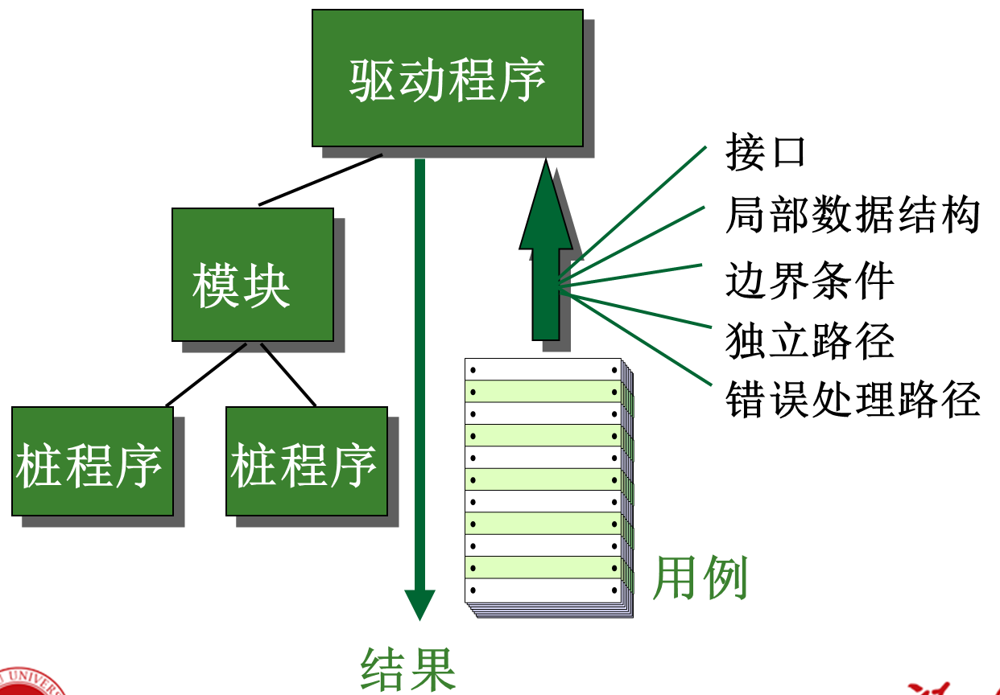

*课件第 27 页　单元测试环境中的调用方向*

## 15.4 白盒测试（第 49–78 页）

### 白盒测试与逻辑覆盖（第 49–51、64–67 页）

**白盒测试**又称结构测试、玻璃盒测试或逻辑驱动测试。它根据程序的**内部逻辑结构**设计输入，检查执行路径、逻辑判定、循环上下限和内部数据结构。课件列出以下覆盖准则。

| 覆盖准则 | 要达到的目标 |
| --- | --- |
| **语句覆盖** | 每条可执行语句至少运行一次。 |
| **判定覆盖（分支覆盖）** | 每个判定的每种结果至少出现一次，二值判定通常为真、假。 |
| **条件覆盖** | 每个判定中的每个基本条件都取到真和假。 |
| **判定／条件覆盖** | 同时满足判定覆盖和条件覆盖。 |
| **条件组合覆盖** | 对每个判定，覆盖各基本条件的可行真值组合。 |
| **路径覆盖** | 按要求覆盖程序的可行执行路径。循环会使路径数大幅增长。 |

**判定**是整个表达式的结果，**基本条件**是其中一个比较或布尔项。例如 `A && B` 的判定为真需要 A、B 同为真。写真值表时可从输入推得各项真值，分析实际执行时还要按短路规则确认右侧条件是否被求值。第 65–67 页用同一段程序比较条件、语句和分支覆盖。

### 基本路径测试（第 53–62 页）

**基本路径测试**以程序的**控制流图**为基础，用环路复杂度确定基本路径集合的规模。它挑选一组线性独立的入口至出口路径，用较少用例覆盖可执行语句与对应控制结构。列路径时通常从最简单的可行路径起步，后续每条路径引入至少一条尚未走过的边。

**控制流图**用圆形结点表示一个或多个连续处理或判定，用有向边表示控制流。可以合并顺序执行的语句，并给汇合、入口或出口适当编号。回边属于图中的边。第 55 页把原流程图的 2、3 合为一个结点，也把 4、5 合为一个结点。

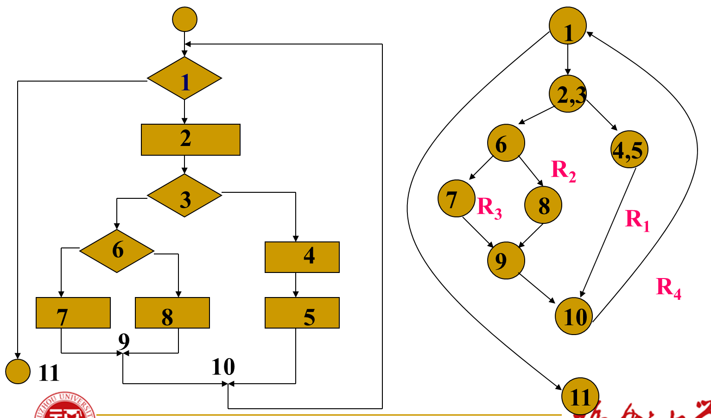

*课件第 55 页　从流程图得到控制流图，图外的 R4 也算一个区域*

环路复杂度记为 **V(G)**。对本章单入口、单出口的连通控制流图，可用三种方法互相核对。

1. **数区域**。包括图的外部区域。
2. **V(G) = E − N + 2**。E 是边数，N 是结点数。
3. **V(G) = P + 1**。P 是二分判定结点数。在第 55 页右图中，E = 11、N = 9、P = 3，三种算法都得到 4。

按第 59 页的四步作答。

1. **画流图**。合并顺序段，拆分复合条件。对 `A && B`，A 为假时直接走假分支，A 为真才检查 B。对 `A || B`，A 为真时直接走真分支，A 为假才检查 B。
2. **算复杂度**。先数判定结点，再用边和结点数复核。
3. **列独立路径**。从入口写到出口，按图保留回边，选出能引入新边的路径。
4. **推导用例**。给路径上的每个条件标真或假，回推输入并正向算输出。遇到互相矛盾的条件，说明该路径不可行，再检查可行路径能覆盖哪些边。

课件第 60–62 页把两个复合判定拆成四个判定结点，所以 V(G) = 5。图示的路径 `1–4–6–7` 要求 `A > 1` 为假，同时要求 `A == 2` 为真，两个条件无法同时成立。可以输入 `(A, B, X) = (2, 1, 1)`，沿 `1–2–4–6–7` 覆盖 `4 → 6`，得到输出 `(2, 1, 2)`。

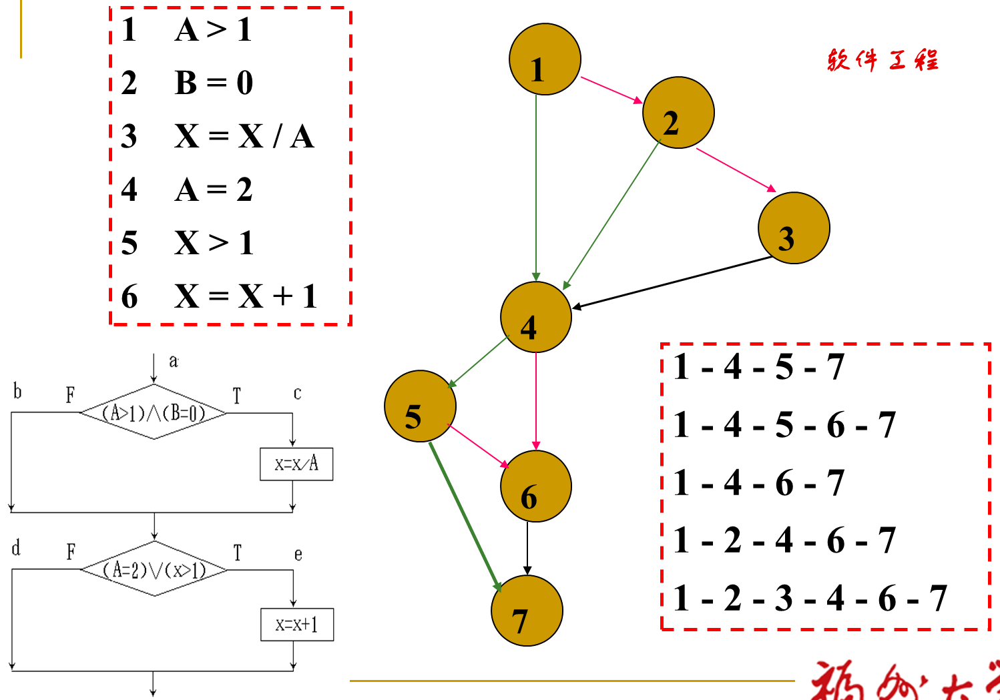

*课件第 61 页　按短路规则拆分复合条件，保留每条控制边*

### 数据流测试（第 64、68–75 页）

控制结构测试还包括**条件测试、数据流测试和循环测试**。数据流测试按变量的**定义点**与**使用点**选择路径。

- **定义（Def）**是赋值或读取输入。**计算性使用（C-use）**出现在计算、函数参数或输出中，**判定性使用（P-use）**出现在条件中。例如 `y = x + 2` 是 y 的定义和 x 的计算性使用，`if (x < 2)` 是 x 的判定性使用。
- **定义—使用对（DU 对）**要求该定义的值能沿一条可行路径到达使用点。若途中重新给同一变量赋值，使用点收到的是新定义的值。

第 71 页中，`z < 0` 时没有进入 `if`，`x = 0` 的初始定义直接到达 `g(x, y)`。若 `z ≥ 0`，`x = sqrt(z)` 覆盖初值，并可能到达内层判定、`f(x)` 和后面的 `g(x, y)`。

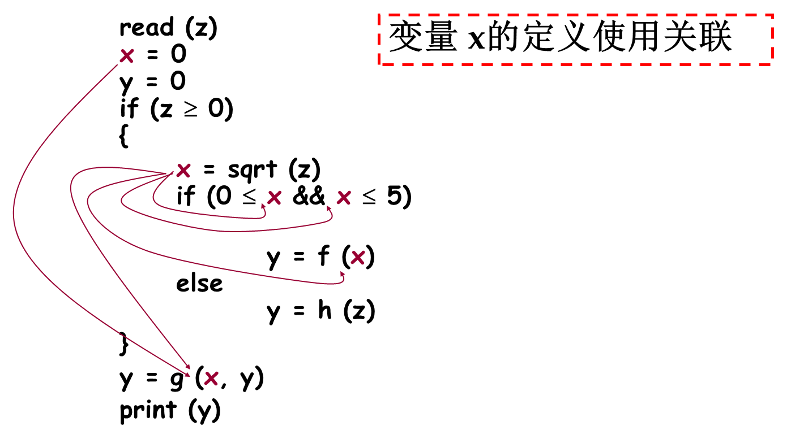

*课件第 71 页　按变量值的实际来源寻找定义—使用对*

第 73–75 页的变量 `i` 有第 1、4、9 行三个定义点，第 15、18 行两个使用点。名义上有 6 对。让第 1 行的值到达第 15 行，需要跳过第 4、9 行的重定义，并走第 14 行的真分支，即同时满足 `a ≥ 30`、`a ≤ b`、`b < 30`。这一对不可行，其余 5 对可设计输入验证。

### 循环测试（第 38、76–78 页）

- **简单循环**。测试能否跳过循环，以及执行一次、两次、典型次数和上限附近时的行为。后判循环至少执行一次，应按控制结构选择可行的下界。
- **嵌套循环**。先控制其他层次数，测内层边界，再逐层变动外层次数。
- **串接循环**。相邻循环独立时分别检查。有数据依赖时，需要组合测试它们的边界。
- **非结构化循环**。先根据控制流明确入口、回边和退出条件，再选可达路径。

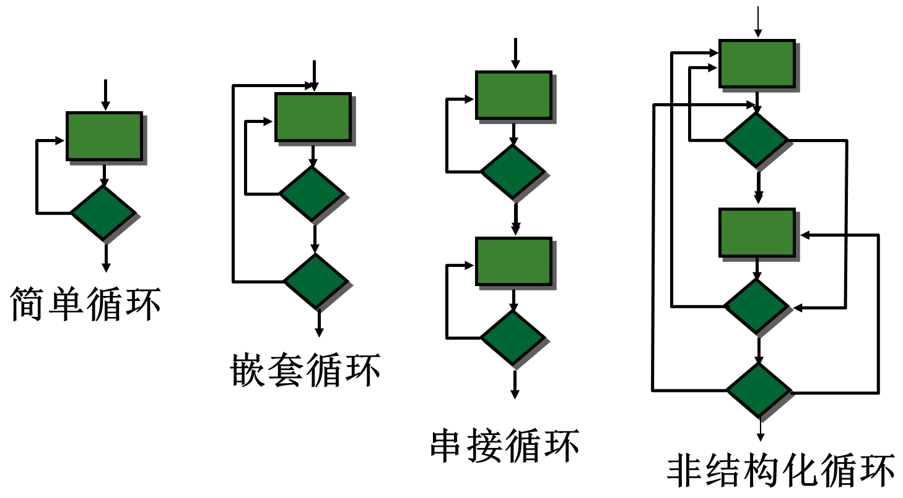

*课件第 76 页　四类循环结构*

第 77–78 页的 `findTotal(numItems)` 在允许范围内累加数组前 `numItems` 项中的正数。用例输入依次为 0、1、2、5、9、10、11，期望依次得到 0、5、5、17、26、36、0。11 用于检验上限之外的实际行为。

## 15.5 黑盒测试（第 80–100 页）

### 黑盒测试的依据与目标（第 80–83 页）

**黑盒测试**又称功能测试或行为测试。测试者根据**需求规格说明、接口及可观察行为**选择输入，在接口处核对输出和状态变化，不需要查看程序内部结构。它可发现错误或遗漏的功能、接口输入输出错误、数据或外部文件访问错误、性能问题，以及初始化或终止错误。

多输入的组合数会迅速增长。课件用两个 32 位整数说明穷举规模可达 2 的 64 次方。等价类划分和边界值分析用有代表性的用例检查主要情况。

### 等价类划分（第 84–92 页）

**等价类**是输入域的一个子集，其中的输入对揭露某类错误具有相同作用。分别划分**有效等价类**和**无效等价类**，再从每类选代表值。

| 规格中的约束 | 怎样划分 |
| --- | --- |
| **规定范围** | 课件示例 1 到 999，划为 1–999、低于 1、高于 999，分别为一类有效和两类无效。 |
| **规定取值集合** | 若集合中的值按同一种方式处理，集合内为一类有效，集合外为一类无效。 |
| **列举的值各有不同处理** | 每种处理可对应一个有效类，其他值为无效类。课件用软件开发、测试、质量保证三个岗位举例。 |
| **规定格式或规则** | 合规则的输入是一类有效，从不同角度违反规则的输入可形成多个无效类。 |

用例设计先给每个类编号。一个合法用例应尽量覆盖多个尚未覆盖的有效类。一个非法用例通常**只覆盖一个尚未覆盖的无效类**，其余条件取合法值，便于定位触发错误的条件。

第 91–92 页的 Pascal 例从标识符个数、长度、组成、首字符和使用顺序五个方面划分。可分别检查 0 个标识符、长度超限、非字母数字字符、保留字、非字母开头、未声明即使用等情况。长度条件涉及有效字符数 8 和最大字符数 80 两条界限，设计用例时按题设区分两条界限对应的处理。

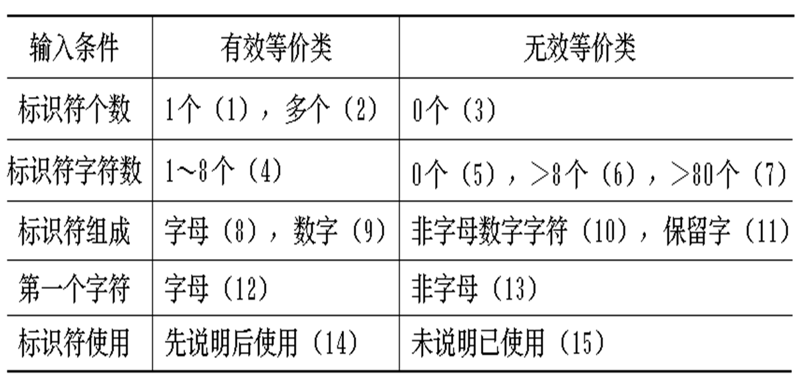

*课件第 91 页　按输入条件划分等价类并统一编号*

### 边界值分析（第 93–95 页）

**边界值分析**针对输入、输出及有容量限制的数据结构的边界。对整数闭区间 `[a, b]`，可以取端点 `a`、`b`，各端点内外最近的值 `a−1`、`a+1`、`b−1`、`b+1`。第 95 页范围为 0 到 5000，所以取 −1、0、1、4999、5000、5001。多个输入都有边界时，可固定其余输入为有效典型值，再逐个改变待测变量。

在三角形例子中，边长都应大于 0，任意两边之和应大于第三边。固定前两边为 2 和 3，取第三边 4、5、6，可以区分和刚好大于、等于、小于第三边三个情形。把相应条件的比较符号写错时，恰好等于的用例最容易揭示问题。

### 估计剩余错误（第 96–100 页）

测试结束可参考估计出的剩余错误数。两种方法都依赖发现比例的假设。

- **错误播种法**。设播入 S 个种子错误，找到其中 s 个，同时找到 n 个真实错误。若种子错误和真实错误的发现比例近似相同，则 `s/S ≈ n/N`，估计真实错误总数 `N ≈ S×n/s`，剩余真实错误约为 `N−n`。第 98 页播入 100 个、找到 70 个，估计已发现约 70% 的真实错误。种子错误应与真实错误在种类、难度上接近。
- **分别测试法**。两组独立测试，分别发现 x、y 个错误，两组同时发现 q 个。若两组发现概率比较稳定，估计第一组发现率 `E1≈q/y`，第二组 `E2≈q/x`。总数 `N≈xy/q`，实际已发现的不同错误数为 `x+y−q`，用总数减去已发现数可估计剩余。第 100 页 `x=25, y=30, q=15`，估计总数 50，已发现 40，剩余约 10 个。

## 15.6 面向对象测试（第 102–113 页）

### 测试类的内容与难点（第 102–104 页）

一个类测试用例应有**唯一标识、被测类、测试目的和步骤**，并说明待测状态、消息或操作、可能异常、外部条件以及辅助信息。**封装**增加了直接观察内部状态的难度，测试可通过公开操作和可观察结果检查状态。**继承**会引入新的运行环境和多态调用。

例如 `Derived` 重写 `redefined()`。若继承得到的 `inherited()` 直接或间接调用 `redefined()`，应在派生类环境中重新测试 `inherited()`。根据相关行为的依赖决定重测范围。基类和派生类可能使用相同输入，其预期结果要按各自的行为约定计算。

### 类级测试序列与划分（第 106–110 页）

类的操作常依赖当前状态，需要测试一段**合法操作序列**。银行 `Account` 示例可从 `open → setupAccnt → deposit → withdraw → close` 开始。一般序列在开户、设置与首次存款后，可反复插入存款、取款或查询，再完成结清和销户。每一步记录**输出和预期状态**。例如课件第 108 页存入 150 和 2000、取出 1500 后余额为 650，立即销户应失败。

| 划分依据 | 课件中的例子 |
| --- | --- |
| **基于状态** | 存款、取款改变余额状态。查询余额、账户摘要和信用额度属于观察操作。 |
| **基于属性** | 以 `creditLimit` 为例，分别检查读取、修改与无需使用此属性的操作。 |
| **基于类别** | 按初始化、计算、查询、终止划分操作，分别从各类选代表。 |

### 从行为模型导出类间测试（第 112–113 页）

集成面向对象系统时，要测试类之间能否正确协作。课件列出**随机方法、划分方法、基于场景测试、行为测试**。行为测试从状态模型提取测试序列，并检查每一步消息、状态和输出是否符合模型。

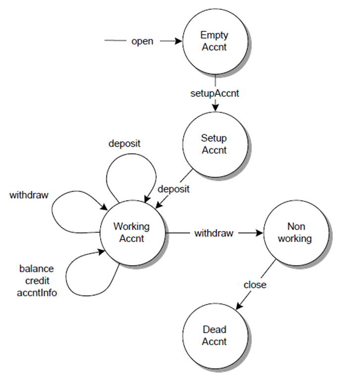

*课件第 113 页　Account 的状态迁移图*

- **覆盖状态**。选择能经过各个状态的操作序列。按图可用 `open → setupAccnt → deposit → withdraw → close`，其中取款金额要能使账户进入非工作态，例如取完余额。
- **覆盖操作**。在工作态插入存取款和余额、信用额度、账户信息查询，再取完余额并销户。和覆盖状态相比，覆盖操作还要走到查询等保持状态的操作。

## 自测题

### 近年真题

#### 真题 1（2023 年 6 月卷名词解释第 5 题，2 分。2024 年 12 月卷名词解释第 4 题，3 分）

黑盒测试。

#### 真题 2（2024 年 12 月卷，选择题第 8 题，2 分）

下面哪一项测试技术不属于白盒测试（　）。

- A. 语句覆盖
- B. 等价类划分
- C. 条件覆盖
- D. 分支覆盖

#### 真题 3（2023 年 6 月卷，综合题第 1 题，15 分）

现有一段 C 语言程序如下。

```c
void dowork(int i, int j)
{
    int k = i + j;
    do {
        if ((i > 4) && (j < 3)) {
            i = i * j - 1;
        }
        if ((k < 9) || (j > 5)) {
            k++;
        }
        i++;
    } while (i < j);
    printf("%d,%d,%d", i, j, k);
}
```

1. 给出以上程序对应程序控制流图。（5 分）
2. 本段程序的环路复杂度是多少？（2 分）
3. 具体给出各个独立路径。（4 分）
4. 使用基本路径测试法设计测试用例，满足上述独立路径覆盖要求。（4 分）

#### 真题 4（2024 年 12 月卷，综合题第 2 题，13 分）

现有一段 C 语言程序如下。

```c
void myflow(int x, int y)
{
    int a;
    if (y == 0) {
        a = 1;
    } else {
        a = y;
    }
    y = x - a;
    if ((a > 0) || (a < -10)) {
        a = x;
    } else {
        a = x + 1;
    }
    printf("%d\n", a);
}
```

1. 绘制 `myflow(int x, int y)` 函数的流图。（5 分）
2. 根据（1）中获得的流图，提供需要测试的所有基本路径。（4 分）
3. 给出可以执行上述基本路径测试的测试用例。请按照以下格式编写每个测试用例。（4 分）

   `[输入，输出]：[(x, y), (x, y, a)]`

### 课堂小测 2

对下列 C 语言程序进行基本路径测试。

```c
void Sort(int iRecordNum, int iType)
{
    int x = 0;
    int y = 0;
    while (iRecordNum-- > 0) {
        if (0 == iType) {
            x = y + 2;
            break;
        } else if (1 == iType) {
            x = y + 10;
        } else {
            x = y + 20;
        }
    }
}
```

1. 绘制流图，标明各结点对应的语句。
2. 计算环路复杂度。
3. 列出各个独立路径。
4. 针对独立路径给出测试用例。写出输入 `(iRecordNum, iType)`，以及程序结束时的值 `(iRecordNum, iType, x, y)`。

### 课件练习（自拟）

实验室预约功能接收预约时长 `h`（整数小时）与用户类型 `role`。时长须为 1 到 8 小时，用户类型须为学生或教师。有效请求分别显示「学生预约成功」或「教师预约成功」。无效请求拒绝预约，并提示有问题的字段。

1. 对两个输入划分有效和无效等价类，编号并选取覆盖各类的用例，写出预期结果。
2. 固定用户类型为学生，用边界值分析设计时长用例。

---

## 答案与解析

### 近年真题

#### 真题 1

**答案与解析**　黑盒测试是根据软件的**需求规格说明**和接口约定设计用例，通过接口提供输入，观察软件的输出和行为，并同预期结果比较，判断功能和行为是否符合要求。它又称功能测试或行为测试，设计依据是外部约定。

**考法、答题要点与易错点**　用「依据需求与接口、提供输入和观察输出、对照预期结果」三个短句组织答案。同一个单元可以按接口规格做黑盒测试，也可以按内部结构做白盒测试。

**复习位置**　课件第 11、49、80–83 页。 [黑盒测试的依据与目标](#黑盒测试的依据与目标第-8083-页) · [白盒测试与逻辑覆盖](#白盒测试与逻辑覆盖第-49516467-页)

#### 真题 2

**答案与解析**　选 **B. 等价类划分**。等价类划分依据规格说明把输入归类，属于黑盒技术。语句覆盖、条件覆盖和分支覆盖依据代码内部结构确定覆盖目标，属于白盒技术。

**考法、答题要点与易错点**　分支覆盖检查整个判定的结果，条件覆盖检查组成判定的各个基本条件。给输入分组、选各组代表值是等价类划分的线索。

**复习位置**　课件第 49–51、65–67、84–90 页。 [白盒测试与逻辑覆盖](#白盒测试与逻辑覆盖第-49516467-页) · [等价类划分](#等价类划分第-8492-页)

#### 真题 3

**答案与解析**

1. **画流图**。按 C 的短路求值拆分 `&&` 和 `||`，入口与初始化合为一个结点，输出结点也是出口。

   - 处理结点 1 是 `k = i + j`，4 是 `i = i * j - 1`，7 是 `k++`，8 是 `i++`，10 是打印结果。
   - 判定结点 2、3 依次检查 `i > 4`、`j < 3`。结点 5、6 依次检查 `k < 9`、`j > 5`。结点 9 检查 `i < j`，为真则回到 2。

   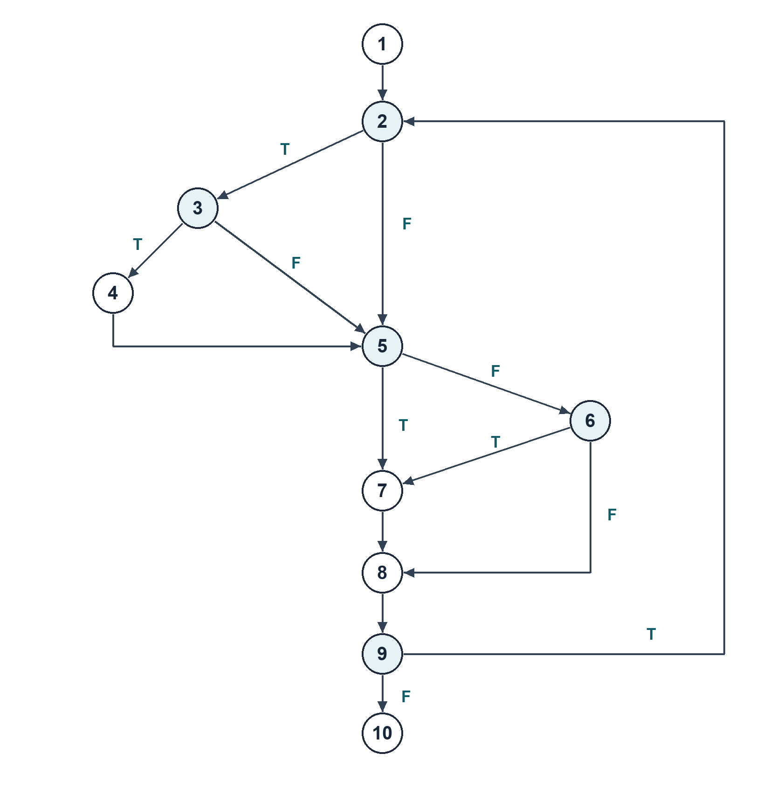

   *真题 3 示例控制流图，T 表示真，F 表示假*

2. **算复杂度**。判定结点为 2、3、5、6、9，故 `V(G) = 5 + 1 = 6`。图有 14 条边、10 个结点，按 `14 − 10 + 2` 复核也等于 6。
3. **列路径与用例**。下表给出一组完整的基本路径与对应输入。每条新增路径都经过至少一条前面尚未覆盖的边。

   | 路径 | 结点序列 | 输入 (i, j) | 预期打印 |
   | --- | --- | --- | --- |
   | P1 | `1–2–5–7–8–9–10` | `(3, 2)` | `4,2,6` |
   | P2 | `1–2–3–5–7–8–9–10` | `(5, 3)` | `6,3,9` |
   | P3 | `1–2–3–4–5–7–8–9–10` | `(5, 2)` | `10,2,8` |
   | P4 | `1–2–3–5–6–7–8–9–10` | `(5, 6)` | `6,6,12` |
   | P5 | `1–2–3–5–6–8–9–10` | `(6, 4)` | `7,4,10` |
   | P6 | `1–2–5–7–8–9–2–5–7–8–9–10` | `(0, 2)` | `2,2,4` |

P3 输入 `(5, 2)`，先算得 `k=7`，进入结点 4 后 `i=9`，再使 `k=8`、`i=10`，退出并打印 `10,2,8`。P6 输入 `(0, 2)`，两轮中 i 分别变成 1 和 2，k 分别变成 3 和 4，第二次检查循环条件时退出。

**考法、答题要点与易错点**　每个复合条件按短路规则画边。进入 `do` 后先执行循环体，循环条件在结点 8 的 `i++` 之后判断。回边返回第一个判定，k 的初始化只执行一次。写完每行用例后按结点顺序重算 i、j、k。

**复习位置**　课件第 53–62、76–78 页。 [基本路径测试](#基本路径测试第-5362-页) · [循环测试](#循环测试第-387678-页) · [测试用例与测试记录](#测试用例与测试记录第-42939-页)

#### 真题 4

**答案与解析**

1. **画流图**。入口记为 1，结点 2 是 `y == 0`，结点 3、4 分别是 `a = 1`、`a = y`。两条分支都汇合到结点 5 的 `y = x - a`。
2. 结点 6 是 `a > 0`，为真就去结点 8 执行 `a = x`。为假才到结点 7 判断 `a < -10`，其真分支也去 8，假分支去结点 9 执行 `a = x + 1`。两条线均在结点 10 打印并结束。

   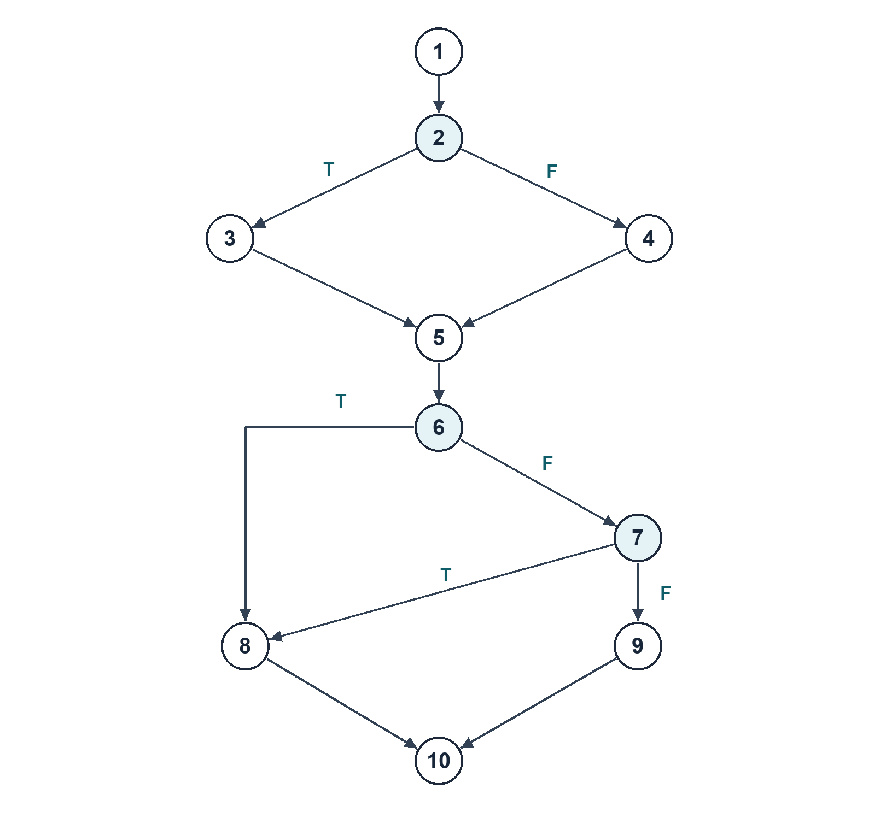

   *真题 4 示例控制流图，T 表示真，F 表示假*

3. **核对路径数**。按课件的短路拆分画法有 3 个二分判定、12 条边、10 个结点，`V(G) = 4`，可采用下表四条基本路径。输出是函数末尾的 `(x, y, a)`，其中 `a` 是 `printf` 显示的值。

   | 路径 | 结点序列 | ［输入，输出］ |
   | --- | --- | --- |
   | P1 | `1–2–3–5–6–8–10` | `[(5, 0), (5, 4, 5)]` |
   | P2 | `1–2–4–5–6–8–10` | `[(5, 2), (5, 3, 5)]` |
   | P3 | `1–2–4–5–6–7–8–10` | `[(5, -11), (5, 16, 5)]` |
   | P4 | `1–2–4–5–6–7–9–10` | `[(5, -10), (5, 15, 6)]` |

P4 输入 `(5, -10)`，先令 `a=-10`，再令 `y=15`。由于 `a > 0` 和 `a < -10` 都为假，执行 `a=x+1=6`，得到 `(5, 15, 6)`。

**考法、答题要点与易错点**　先求分支赋给 a 的值，再更新 y，最后由当时的 a 判定走哪条分支。初始 y 为 0 时，结点 3 已将 a 设成 1，随后直接走结点 6 的真分支。比较 `a < -10` 时可以用 −11 和 −10 检查阈值两侧的处理。

**复习位置**　课件第 29、53–62、93–95 页。 [测试用例与测试记录](#测试用例与测试记录第-42939-页) · [基本路径测试](#基本路径测试第-5362-页) · [边界值分析](#边界值分析第-9395-页)

### 课堂小测 2

**答案与解析**

- **结点编号**。1 初始化 `x, y`，2 判断 `iRecordNum-- > 0`，3 判断 `iType == 0`，4 执行 `x = y + 2` 并 `break`，5 判断 `iType == 1`，6、7 分别执行 `x = y + 10`、`x = y + 20`，8 结束。
- **环路复杂度**。判定结点 2、3、5 共 3 个，`V(G) = 3 + 1 = 4`。也可用 `10 − 8 + 2 = 4` 复核。

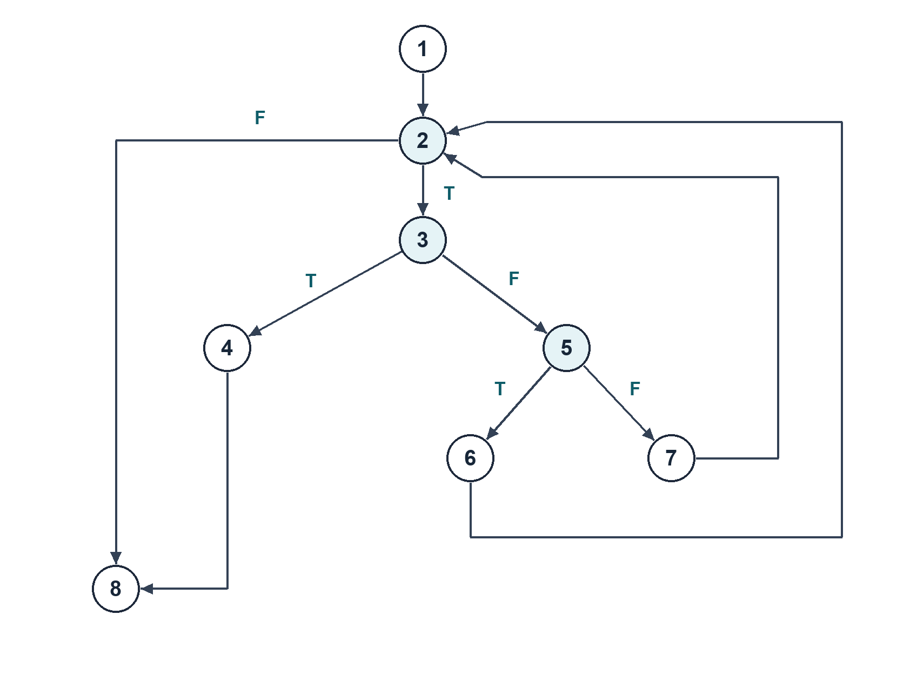

*课堂小测 2 示例控制流图，T 表示真，F 表示假*

| 路径 | 结点序列 | ［输入，输出］ |
| --- | --- | --- |
| P1 | `1–2–8` | `[(0, 0), (-1, 0, 0, 0)]` |
| P2 | `1–2–3–4–8` | `[(1, 0), (0, 0, 2, 0)]` |
| P3 | `1–2–3–5–6–2–8` | `[(1, 1), (-1, 1, 10, 0)]` |
| P4 | `1–2–3–5–7–2–8` | `[(1, 2), (-1, 2, 20, 0)]` |

例如 P3 的第一次条件判断用的是递减前的 1，成立后计数值变为 0。下一次判断用 0，判定失败并将计数值减到 −1。P2 则由 `break` 直接结束，保留第一次判断后的 0。

**考法、答题要点与易错点**　把 `break` 接到循环出口，把常规执行路径接回循环条件。后缀 `--` 先用旧值比较、再递减，循环最后一次失败的条件也会递减。题目要求的是结束时各变量的值。

**复习位置**　课件第 53–62、76–78 页。 [基本路径测试](#基本路径测试第-5362-页) · [循环测试](#循环测试第-387678-页)

### 课件练习

**答案与解析**

1. 时长可分为 E1 有效的 1–8、E2 小于 1、E3 大于 8。用户类型可分为 E4 学生、E5 教师、E6 其他类型。学生与教师对应不同提示，所以分别划为两个有效类。

   | 用例 | 对应等价类 | 预期结果 |
   | --- | --- | --- |
   | (4, 学生) | E1、E4 | 显示「学生预约成功」 |
   | (4, 教师) | E1、E5 | 显示「教师预约成功」 |
   | (0, 学生) | E2 | 拒绝并提示时长字段错误 |
   | (9, 学生) | E3 | 拒绝并提示时长字段错误 |
   | (4, 访客) | E6 | 拒绝并提示用户类型字段错误 |

2. 固定类型为学生，选 `h = 0, 1, 2, 7, 8, 9`。1、2、7、8 预期预约成功，0 与 9 预期因时长无效而拒绝。

**考法、答题要点与易错点**　先按输入条件列类，再给具体输入和可判断的预期结果。无效用例每次只让一个条件失效。边界用例要包含端点和端点内外相邻值，明确包含端点的范围。

**复习位置**　课件第 84–95 页。 [等价类划分](#等价类划分第-8492-页) · [边界值分析](#边界值分析第-9395-页)

题目来源　**2023-06-09 期末卷** · **2024-12-27 期末卷** · **软件工程课堂小测 2**
