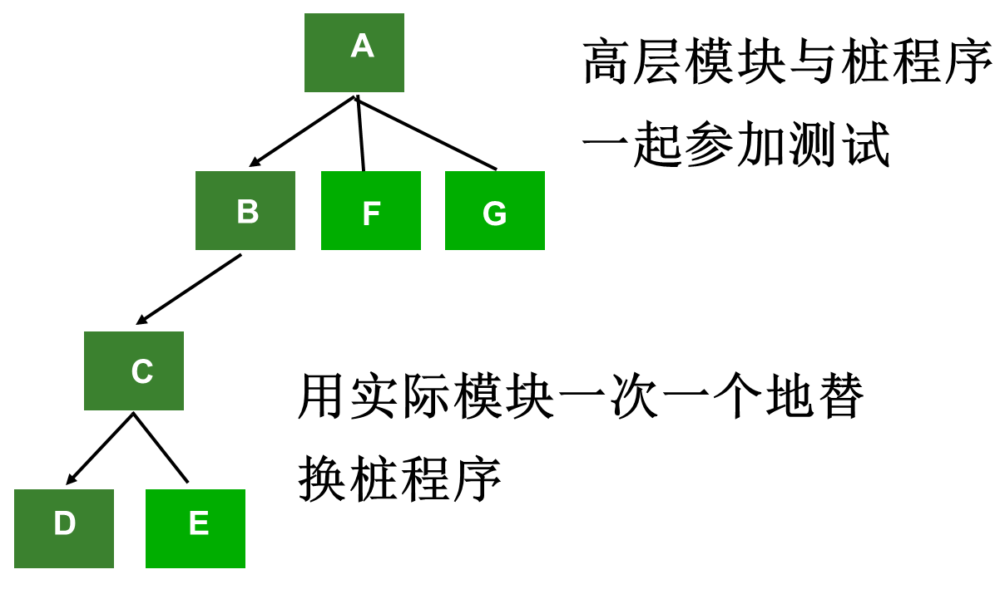
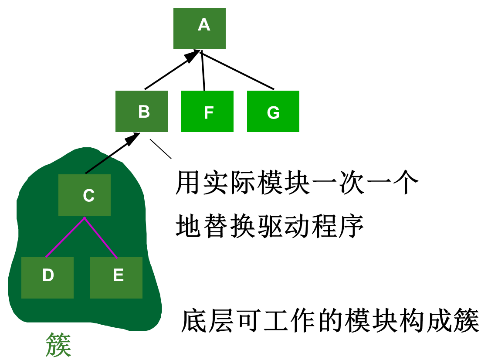
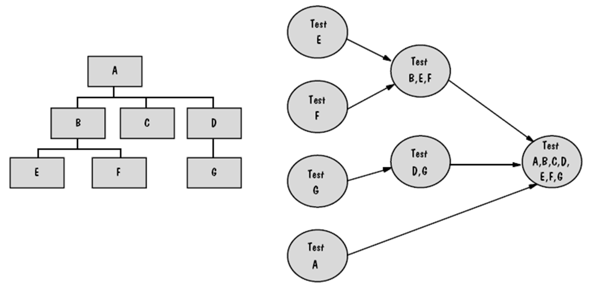
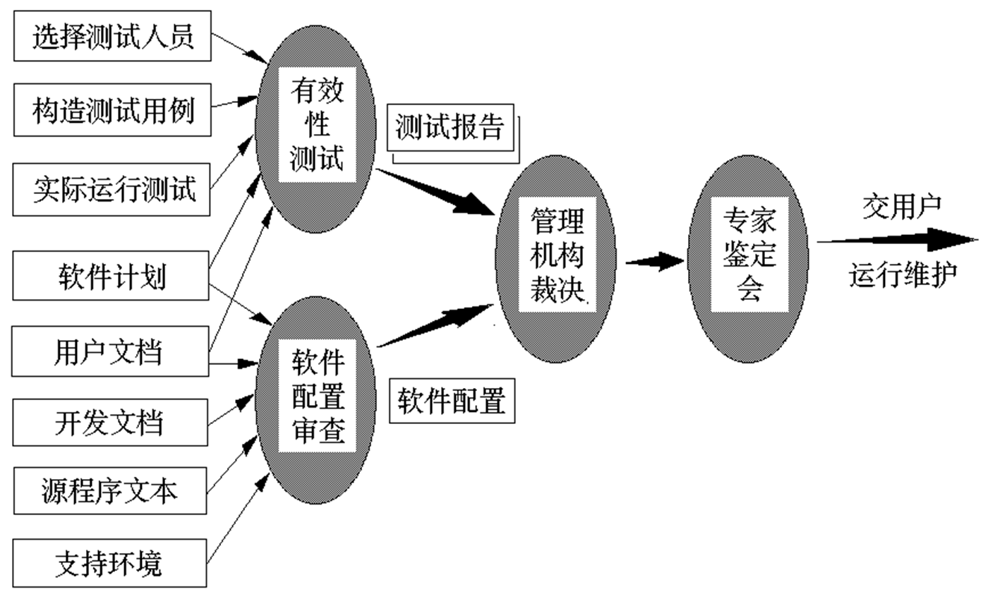
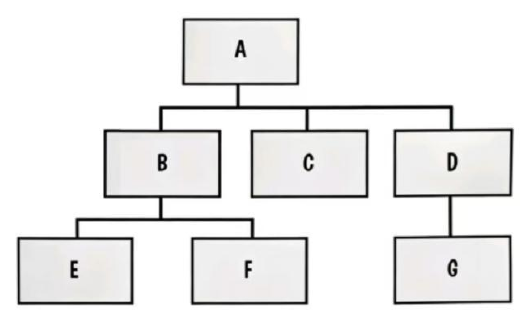

# 第 16 章 软件测试（集成级）

## 16.1 软件测试基础（第 3–9 页）

### 软件可测试性

*课件第 3–8 页*

**可测试性**是软件能够被测试的容易程度。课件用抽球比喻测试。白球对应产生正确输出的输入，黑球对应产生错误输出的输入。**测试有效性**看固定次数内能发现多少黑球，**可测试性**用一次尝试发现黑球的难易来说明。

一次可观察的**失效**往往经过三个环节。输入触发有缺陷的代码，执行使内部数据进入错误状态，错误状态传到输出并表现为异常。隐藏得深的缺陷难以触发和观察，含糊或缺失的文档也会增加判断难度。

| 属性 | 怎样让测试更容易 |
| --- | --- |
| **可操作性** | 软件稳定运行到需要测试的步骤，减少阻塞测试的其他错误。 |
| **可观察性** | 输出清楚，状态和变量可查询，内部错误能报告，测试人员能比较预期和实际行为。 |
| **可控制性** | 能设置输入、软硬件状态及变量，使目标代码得到执行，方便自动化和复现。 |
| **可分解性** | 按相对独立的模块隔离测试范围，定位问题后可有针对性地重测。 |
| **简单性** | 让功能划分、体系结构和代码清晰。用单一职责、模块化和编码规范降低测试难度。 |
| **稳定性** | 控制变更及其对既有测试的影响，并能从失效中恢复到可测试状态。 |
| **易理解性** | 提供准确、详细且便于查找的技术文档，说明体系结构和构件间的依赖。 |

设计时可简化模块、维护注释与文档，并尽早确定用户接口。例如，测试账户异常时，可设置账户的初始状态体现**可控制性**，可查询状态并核对错误输出体现**可观察性**。

### 好的测试的属性（第 9 页）

好的测试具有**高有效性**，发现错误的可能性较高。用例应**不冗余**，各自有清楚的目标。**最佳性**体现在有限资源下选取最有可能暴露错误的用例。复杂度要适当，大用例可拆分为若干容易分析的用例。每个用例应有明确且可重新建立的初始条件，以便独立执行，避免前一个用例遗留的状态掩盖问题。

## 16.2 集成测试（第 11–25 页）

### 集成测试的目标（第 11–12 页）

**集成测试（Integration Testing）** 将已经通过单元测试的模块组装成子系统或系统，再检查它们共同工作时的行为。重点看三项。

1. **组装后的功能**。各子功能组合后，是否实现预期业务流程。
2. **模块间的接口**。调用关系、传递的数据及其完整性是否正确。
3. **集成后的性能**。组装后资源使用、处理效率和整体响应是否达标。

单个模块可正常工作，接口连接后仍可能出现数据丢失、模块间副作用、累积精度误差、全局数据冲突或整体功能偏差。集成用例应经过真实的调用和数据交接点。

### 一步到位与增量集成（第 13–16、24 页）

| 方法 | 怎样组装 | 适用性与定位问题 |
| --- | --- | --- |
| **一步到位集成** | 等各单元就绪后一次全部连接，按整体测试。 | 小型应用可以采用。发现问题时需要同时排查许多接口和构件，对进度要求也较集中。 |
| **增量集成** | 把已测试的模块按小批次加入已集成部分，逐次构造、测试和复查。 | 适合较大应用，单元测试与集成可以重叠进行。发现新问题时优先检查刚接入的模块及其接口。 |

每次接入后既要测试新模块的交互，也要重跑受变更影响的既有用例。增量集成常用自顶向下、自底向上或组合方法。

### 自顶向下集成

*课件第 17–19、25 页*

**自顶向下集成**从**主控模块**开始。主控要调用但尚未接入的下层模块用**桩程序**模拟。每加入一个真实模块，就用它替换对应的桩。若它还有未接入的直接下层调用，再给这些下层调用提供桩。逐次测试新接入的真实接口，并做必要的回归测试。

- **广度优先（横向）**。先接完当前层中直接从属于上一层的模块，再进下一层。
- **深度优先（纵向）**。先选一条主控路径接到较深层，然后继续其他分支。

第 18 页的广度优先例子先测 `A`，再接入同一层的 `B`、`C`、`D`，最后接入底层的 `E`、`F`、`G`。

这种方法能早期展示系统框架，较早发现高层控制与接口问题。成本主要来自桩程序。实际输入输出模块接入前，需要用桩构造数据和返回结果。

*课件第 19 页　真实模块从上往下逐个替换桩*

### 自底向上集成

*课件第 20–22、25 页*

**自底向上集成**先测试底层**原子模块**，再按相关子功能把它们组合成可工作的**簇**。用**驱动程序**模拟尚未接入的上层调用者，提供输入、发起调用并检查结果。真实上层接入时替换相应驱动，簇再逐级扩大，最终到达主控模块。

下层子模块已组装并经测试，按此流程用真实子模块提供服务。第 21 页先从 `E`、`F`、`G` 等底层模块开始，分别形成 `B–E–F` 和 `D–G` 的簇，再同 `C` 一起接入 `A`。优点是底层模块可及早取得真实测试数据，用例较易设计。主控和完整系统框架较晚形成，高层错误也发现得较迟。

*课件第 22 页　从可工作的底层模块簇向上集成*

沿调用关系判断辅助程序。**负责调用被测模块的是驱动**，**被被测模块调用的是桩**。 **第 15 章的驱动程序与桩程序**

### 组合方法（三明治集成）（第 13、23 页）

**组合方法**让上层采用自顶向下、下层采用自底向上，在中间接口汇合。图中高层 A 与底层的 E、F、G 可分别测试，E、F 纳入 B 所在的簇，G 纳入 D 所在的簇，再与高层及其余模块组装。上下两侧可以并行推进，到汇合处再验证真实接口。

*课件第 23 页　上下两侧测试后汇合*

## 回归测试

*16.3　课件第 26、28–29 页*

**回归测试（Regression Testing）** 在新增、修改或删除构件等重要变更后，重跑一部分已执行过的测试，检查原有功能是否仍符合预期，防止变更扩散出副作用。

课件的做法是先测试修改部分及其下层依赖，隔离该修改检查其余部分，再把两部分集成后重新测试。可先向下测修改模块及其子模块，将它们当成一个子系统，再向上复查调用该子系统的功能。

| 样本 | 怎样选 |
| --- | --- |
| **代表测试样本** | 选能代表整套软件各项功能的用例，使所选样本保持整体功能覆盖。 |
| **必要测试样本** | 测被改动构件的功能和边界，例如修改过的计算、状态或接口行为。 |
| **额外测试样本** | 测可能受影响的其他功能，沿调用关系、共享数据和业务流程定位。 |

例如修改订单金额计算时，代表样本可覆盖主要订单流程，必要样本核对改动过的优惠规则，额外样本检查使用订单金额的退款、对账或导出。选择依据是覆盖、影响范围和测试代价。

## 面向对象环境中的集成测试

*16.4　课件第 31–33 页*

面向对象测试以**类及其状态和操作**为基本单元。继承来的操作要在实际子类环境中检查，尤其是其行为可能受子类属性或重写方法影响时。多个类通过消息协作，往往缺少固定的主控层次。集成可以按外部事件组织，也可以沿类之间的使用依赖逐步推进。

| 策略 | 组装顺序 | 例子 |
| --- | --- | --- |
| **基于线程的测试（Thread-based Testing）** | 选择一个外部输入或事件，组装处理该事件所需的一组类。逐个测试业务处理链，并对已集成的线程做回归。 | 围绕「提交订单」集成界面、订单服务、库存和支付相关类。 |
| **基于使用的测试（Use-based Testing）** | 从很少依赖其他服务类的**独立类**开始，再逐步接入使用它们的**依赖类**。 | 先测商品目录与库存等基础服务类，再测使用这些类的订单服务，最后接入界面。 |

按事件组织时，关键是该事件涉及哪些类以及它们发送怎样的消息。按使用关系组织时，关键是谁提供服务、谁依赖服务。

## 16.5 确认测试（第 35–40 页）

### 确认测试准则（第 35–37、40 页）

**确认测试（Validation Testing）** 在集成测试结束后开始。此时软件已有完整软件包，主要接口错误已处理。它以**软件需求规格说明**为依据，检查所有功能、行为、内容展示和性能，以及文档、可移植性、兼容性、错误恢复、可维护性等要求。

**测试计划**列出要执行的测试类别，**测试规程**给出具体用例、步骤和比较准则。执行每个用例后，符合规格的特征可接受，出现偏差则记录缺陷并与客户商定处理方式。第 40 页同时画出了**有效性测试**和**软件配置审查**。前者运行软件并形成测试报告，后者核对计划、用户文档、开发文档、源程序及支持环境等交付资料，供交付评定使用。

*课件第 40 页　运行测试与配置审查共同支持交付决定*

### 验收测试、α 测试与 β 测试

*课件第 38–39 页*

**验收测试**由最终用户或客户主导，按需求、合同或验收准则确认产品能否接收。开发人员和质量保证人员可配合正式验收。

| 项目 | α（Alpha）测试 | β（Beta）测试 |
| --- | --- | --- |
| **人员** | 代表性的最终用户使用软件，开发人员在场观察。 | 一个或多个最终用户在自己的环境中使用，开发人员通常不在场。 |
| **地点与控制** | 开发者场所，测试环境受开发方控制。 | 用户场所，使用条件来自实际运行环境。 |
| **问题记录** | 开发人员观察用户自然使用的过程并记录错误、使用问题。 | 用户记录遇到的问题并定期反馈给开发方。 |

课件把**客户验收测试**作为 β 测试的一种变体介绍。按合同交付时，正式验收可由客户在约定环境下执行，开发与 QA 参与并提供支持。

## 16.6 系统测试（第 42–48 页）

### 五种典型系统测试

*课件第 42–48 页*

**系统测试**将软件放在由硬件、操作系统、网络、其他软件等组成的实际或代表性系统环境中，验证整体协作与指派的功能。

| 类型 | 针对的问题 | 怎样验证 |
| --- | --- | --- |
| **恢复测试（第 43 页）** | 出现故障后，系统能否在规定时间内恢复或维持服务。 | 在受控测试环境模拟故障，检查重新初始化、检查点、数据恢复和重启。人工恢复时用平均修复时间 **MTTR** 评估恢复耗时。 |
| **安全测试（第 44 页）** | 系统的保护机制能否阻止未授权访问、保护数据与服务。 | 在授权范围内检查身份验证、权限控制和故障恢复后的安全约束，并记录结果。 |
| **压力测试（第 45–46 页）** | 异常的数量、频率或容量下能承受多大负载，何时明显退化。 | 逐步增加并发、数据量、内存或 I/O 压力，识别可接受性能的上限，观察超载后的行为。 |
| **性能测试（第 47 页）** | 在规定负载下能否达到响应时间、吞吐量等性能目标。 | 设定一组明确的负载条件，记录指标和资源使用，发现延迟或效率下降的环节。 |
| **部署测试（第 48 页）** | 软件能否在目标平台与配置上正确安装、运行。 | 覆盖预定的操作系统与浏览器等组合，检查安装程序和用户文档。课件也称配置测试。 |

**敏感性测试**是课件列出的压力测试变体。它在**有效输入类**中寻找可能触发处理极端、错误或性能骤降的数据组合。例如同样合法的搜索条件中，有些会命中异常多的结果。部署测试则可以为 SafeHome 远程监视功能列出浏览器与操作系统组合，逐项验证登录、查看画面和安装使用说明（第 48 页）。

### 性能问题的测试方案

*课件第 45–47 页*

定位性能问题时，先分别复现响应慢的业务，再固定数据和运行环境，每次改变一个主要变量。把观测指标与候选原因相联系。

1. **量化用户感受到的慢**。登录记录请求响应时间、吞吐量和失败率。视频记录首帧时间、卡顿次数和时长。搜索分开记录接口响应和页面呈现时间。可用 P95 响应时间表示约 95% 的请求在该时间内完成。
2. **按候选原因分组验证**。改变并发量观察服务端排队与资源曲线，分段记录数据库查询或外部接口时间，固定负载后对比不同网络条件。
3. **用现象与指标配对判断**。比如并发升高后响应变慢、吞吐趋于平稳、队列持续增加，支持服务容量不足的判断。在相同负载下若数据库时间占主要部分，优先核查查询或连接等待。
4. **区分任务目标**。在目标负载下与性能需求比较是性能测试。继续增大压力寻找失效或可接受性能的上限是压力测试。题目没有给指标时，可对比基线和逐级变化，并写清用于判定的指标。

## 自测题

### 作业四

#### 作业四第 4 题（集成测试）

什么是集成测试？常见的集成测试方法有哪些？比较 α 测试与 β 测试。

### 近年真题

#### 真题 1（2023 年 6 月卷，简答题第 2 题，8 分）

在软件项目的集成测试时，可以采用许多不同的增量集成策略，如自顶向下的集成和自底向上的集成。

1. 简要解释这两种集成测试策略，即自顶向下的集成和自底向上的集成。（4 分）
2. 基于这两种测试策略对下图中的模块结构进行测试，编写模块的测试方法。（4 分）

*2023 年卷第 4 页　原题模块结构图*

#### 真题 2（2023 年 6 月卷，综合题第 2 题第 3 问，6 分）

线上教学是教育数字化发展的重要方向之一。2020 级同学有意开发一套名为「学在福大」的线上网络教学系统。「学在福大」的功能需求如下。

学生登陆网站后，可以浏览课件、查找课件、下载课件、观看教学视频、课程在线练习和评测等。教师登陆网站后，可以上传课件、上传教学视频、发布课程练习和测试、查看学生学习记录、发布学生学习成绩等。系统管理员负责对网站页面的维护、审核课程和教学信息、管理用户等。

（3）系统上线不久，即不少用户反馈系统登陆响应很久、视频访问卡顿严重等问题。根据你所学过的专业知识，详细分析可能是因为哪些原因引起上述问题，并设计一套测试方案来分别验证这些可能的原因。（6 分）

#### 真题 3（2024 年 12 月卷，综合题第 3 题第 3 问，5 分）

若未来你所在的公司计划开发一款在线购物系统，以满足用户在线购物的需求。在需求分析阶段，开发团队与用户进行了深入的沟通和交流，收集了大量的用户需求。现在需要开发团队对这些需求进行整理和分析，形成系统的需求规格说明。

（3）系统上线后，不少用户反馈系统登录响应很久、搜索访问卡顿严重等问题。根据你所学过的专业知识，详细分析可能是因为哪些原因引起上述问题，并设计一套测试方案来分别验证这些可能的原因。（5 分）

### 课件练习（自拟）

#### 练习 1　可测试性与回归测试

活动预约系统替换了名额扣减模块。剩余一个名额时，至多一人能预约成功。查询剩余名额和导出预约名单也会读取该模块的数据。测试时，失败只显示统一提示，测试人员无法查看扣减前后状态，每次还需手工发出真实预约才能准备不同的初始名额。

1. 哪两项可测试性最需要提高？分别举出一种改进办法。
2. 这次变更应按什么顺序测试？为三类回归测试样本分别举例，并说明预期结果。

#### 练习 2　类的集成与用户测试

预约系统的「提交预约」会调用预约界面、预约服务、名额管理和通知等类。日历规则类和资格规则类很少依赖其他服务，预约服务使用这两个类，界面使用预约服务。系统组装完成后，团队先请代表性用户到开发场地试用并观察操作，再让另一批用户在各自单位使用并反馈。

1. 怎样按基于线程和基于使用两种策略组织集成测试？
2. 识别上述两轮用户测试的类型，并解释判断依据。

---

## 答案与解析

### 作业四

#### 作业四第 4 题（集成测试）

**答案与解析**　集成测试把已经过单元测试的模块组装起来，检验**接口、组装后的功能与性能**，发现数据交接、构件协作和整体行为中的问题。

| 方法 | 组装思路与特点 |
| --- | --- |
| **一步到位集成** | 所有模块一次组装，整体测试。组装步骤少，发生故障时排查范围较大。 |
| **自顶向下增量集成** | 从主控开始，按深度优先或广度优先逐步以真实模块替换下层的**桩**。可较早验证主控流程。 |
| **自底向上增量集成** | 从底层原子模块开始，组成功能簇，以**驱动**模拟上层调用，逐级向上组装。可较早验证底层功能。 |
| **组合方法（三明治集成）** | 上层自顶向下、下层自底向上，在中间层集成并测试接口。 |

面向对象的集成还可**基于线程**，围绕一个外部事件组装协作类，或**基于使用**，先集成独立类，再逐步集成使用它们的类。

**α 测试和 β 测试**属于确认阶段的用户测试。α 测试由代表用户在开发者场所试用，环境受开发方控制，由开发人员观察并记录问题。β 测试由用户在实际使用场所进行，开发人员通常不在场，由用户记录并反馈问题。

**考法、答题要点与易错点**　集成方法按「组装起点 → 怎样接入下一批模块 → 用到哪种辅助程序」写。驱动代替调用者，桩代替被调用者。比较 α、β 测试时，写清地点、环境控制和记录问题的人。

**课件位置**　课件第 11–25、31–33、38–39 页。

**笔记位置**　[集成测试的目标](#集成测试的目标第-1112-页) · [一步到位与增量集成](#一步到位与增量集成第-131624-页) · [自顶向下集成](#自顶向下集成) · [自底向上集成](#自底向上集成) · [组合方法](#组合方法三明治集成第-1323-页) · [面向对象环境中的集成测试](#面向对象环境中的集成测试) · [验收测试、α 测试与 β 测试](#验收测试α-测试与-β-测试)

### 近年真题

#### 真题 1

**答案与解析**

**第 1 问**。自顶向下从主控模块开始，按控制层次向下，引入真实子模块替换桩，可以选广度优先或深度优先。自底向上从原子模块开始，将底层模块组成簇并用驱动调用。真实上层逐步接替驱动，把已测簇向上组装，最终集成主控。

**第 2 问**。原图中 A 调用 B、C、D，B 调用 E、F，D 调用 G。自顶向下可选**广度优先**。每加入一个真实模块，都检查相应的调用与数据传递，并重跑受影响的用例。

| 真实模块的接入顺序 | 当前怎样测试 | 接下来仍使用的桩 |
| --- | --- | --- |
| 先装 A | 由 A 调用三个桩，测试主控逻辑。 | B、C、D |
| 接入 B | B 替换桩，测 A 对 B 的调用，B 先调用 E 与 F 的桩。 | C、D、E、F |
| 接入 C | C 替换桩，测 A 与 C 的真实接口。 | D、E、F |
| 接入 D | D 替换桩，测 A 与 D，D 先调用 G 的桩。 | E、F、G |
| 依次接入 E、F、G | 分别用真实模块替换三个桩。检验 B 与 E、F，以及 D 与 G。每接一个都测一次，最后测整体。 | 逐个撤下，最后全部撤下 |

若选深度优先，也可按 A、B、E、F、C、D、G 接入并逐次替换对应的桩。

自底向上可按下表组装。

| 阶段 | 真实模块与驱动的安排 |
| --- | --- |
| **先测叶子模块** | 用模拟 B 的驱动调用 E、F，用模拟 D 的驱动调用 G。C 直接从属于 A，用模拟 A 的驱动测试 C。 |
| **装上 B 和 D** | 用真实 B、D 分别接替对应驱动，形成 B、E、F 和 D、G 两个簇。由模拟 A 的驱动调用 B、D，测试各簇的功能及接口，可逐簇进行。 |
| **接入 A** | 用真实 A 接替驱动，将 B、E、F 簇、C 和 D、G 簇接入。检验 A 与 B、C、D 的真实接口以及完整功能，再做回归。 |

**考法、答题要点与易错点**　先写起点和方向，再写辅助程序和真实模块的替换顺序。图上的 C 虽与 B、D 同层，也是叶子，可以从底部优先测试。自顶向下换入 B 时，下属 E、F 尚未接入，仍需相应的桩。自底向上接入 B 时，先确保 E、F 已可实际调用。

**课件位置**　课件第 13、16–25 页。

**笔记位置**　[自顶向下集成](#自顶向下集成) · [自底向上集成](#自底向上集成) · [回归测试](#回归测试)

#### 真题 2

**答案与解析**　登录慢和视频卡顿要分别记录。先在与上线环境相近的测试环境中固定测试账号、版本、视频内容和数据规模，做低负载基线，随后对每项假设做对照。

| 现象与可能原因 | 怎样验证以及看什么结果 |
| --- | --- |
| **登录慢，应用服务并发容量不足** | 单独阶梯式增加同时登录的用户数，保持账号数据和网络条件一致。测响应时间、吞吐、失败率，记录 CPU、线程或队列。若延迟与排队同时上升、吞吐达到平台，支持容量不足的判断。 |
| **登录慢，鉴权、数据库查询或连接等待耗时** | 固定并发，分段记录登录请求的服务处理、凭据查询和连接等待。若大部分时间花在数据库或鉴权环节，再比较代表性账号与数据条件，定位具体的等待来源。 |
| **视频卡顿，用户网络吞吐不足或波动** | 固定视频、码率、浏览器与服务器负载，改变可用带宽或延迟。记录首帧时间、媒体数据下载时间、卡顿次数和时长。若吞吐降低时缓冲耗尽而服务响应平稳，支持链路瓶颈的判断。 |
| **视频卡顿，媒体服务忙或视频码率偏高** | 固定网络，分别比较同一视频在不同播放并发下的表现，以及同一并发下不同码率的表现。结合媒体响应时间和服务器 I/O 判断是取流环节随负载恶化，还是高码率所需持续吞吐超过实际供给。 |

**考法、答题要点与易错点**　登录写请求用时与失败情况，视频写首帧和卡顿指标。每个原因都配一个能改变相关因素的对照测试，并写「出现什么结果支持该原因」。若约定了目标并发和性能指标，先在目标负载下验证，再增加负载寻找上限。

**课件位置**　课件第 42、45–47 页。

**笔记位置**　[五种典型系统测试](#五种典型系统测试) · [性能问题的测试方案](#性能问题的测试方案)

#### 真题 3

**答案与解析**　准备固定规模的商品数据、代表性账号和关键词，分别对登录与搜索建立基线，再检查二者在混合负载下会不会争用同一资源。

| 可能原因 | 测试方法与判定依据 |
| --- | --- |
| **应用服务或共享资源饱和** | 分别增加登录并发和搜索并发，随后按真实比例混合执行。记录两种接口的 P95 响应时间、吞吐、失败率和 CPU、连接数、排队时长。若两项在混合负载下同时退化并伴随共享资源饱和，可进一步定位共同瓶颈。 |
| **登录查库或商品检索慢** | 固定并发，跟踪登录鉴权和搜索查询的分段耗时。用常见和命中量大的关键词分组测试，记录查询耗时、扫描数据量及等连接时间。若服务端耗时主要随查询规模或连接等待增长，支持该环节是瓶颈的判断。 |
| **网络传输延迟或响应体较大** | 固定服务负载、请求和返回内容，对照不同带宽、延迟的客户端环境。比较客户端请求总耗时、下载时长与服务端处理时间，确认慢主要出现在哪一段。 |
| **搜索结果的页面渲染过慢** | 固定网络和服务端响应，控制页面展示的结果数量，测浏览器收到结果到完成呈现的时间。若接口快而这一段时间随展示量显著增加，支持前端处理是瓶颈的判断。 |

**考法、答题要点与易错点**　先按两个现象分别验证，再用混合负载判断共享资源影响。搜索卡顿既可能在后端检索，也可能在网络传输或页面呈现，用分段耗时区分。考场时间紧时，每个原因用一组「控制什么、改变什么、测什么」表述即可。

**课件位置**　课件第 42、45–47 页。

**笔记位置**　[五种典型系统测试](#五种典型系统测试) · [性能问题的测试方案](#性能问题的测试方案)

### 课件练习

#### 练习 1

**答案与解析**

1. **可观察性**。增加在测试环境下可查询的扣减前后名额和失败原因，便于确认状态变化。**可控制性**。通过测试数据或初始化工具设置可重复的名额与预约状态，例如每轮均从剩余 1 开始。
2. 先测修改后的名额模块，再隔离它检查其他已存在的功能，最后集成后回归。**代表样本**可执行有效预约和查询，检查成功提示和剩余名额一致。**必要样本**从剩余 1 开始同时提交两条有效预约，预期至多一条成功，名额不会出现负数。**额外样本**在变更后导出预约名单，检查与成功预约一致，并验证重复或失败预约的记录处理符合规格。

**考法、答题要点与易错点**　能否看到当前值属于可观察性，能否把系统设置到特定初值属于可控制性。回归题写出变更点，分别说明样本覆盖全局主流程、改动本身还是可能受影响的其他功能。

**课件位置**　课件第 4–8、26、28–29 页。

**笔记位置**　[软件可测试性](#软件可测试性) · [回归测试](#回归测试)

#### 练习 2

**答案与解析**

1. **基于线程**。围绕「提交预约」事件组装预约界面、预约服务、名额管理与通知等类，测试它们传递的消息、状态变化和最终结果。集成其他业务线程后回归已通过的预约用例。**基于使用**。先检查日历规则类、资格规则类等独立类，再按服务依赖接入名额管理、通知和预约服务等类，最后接入依赖预约服务的界面。
2. 开发场地中由代表用户试用、开发者观察的是 **α 测试**。在用户各自单位使用并记录反馈的是 **β 测试**。判断时看场所、环境是否受开发方控制、问题由谁观察和记录。

**考法、答题要点与易错点**　基于线程围绕一个外部事件找协作类，基于使用按类之间的服务依赖分层。两轮用户测试都由用户使用软件，验收题要进一步交代谁主持、在哪里进行和按什么准则通过。

**课件位置**　课件第 31–33、38–39 页。

**笔记位置**　[面向对象环境中的集成测试](#面向对象环境中的集成测试) · [验收测试、α 测试与 β 测试](#验收测试α-测试与-β-测试)

题目来源　**作业四** · **2023-06-09 期末卷** · **2024-12-27 期末卷**
