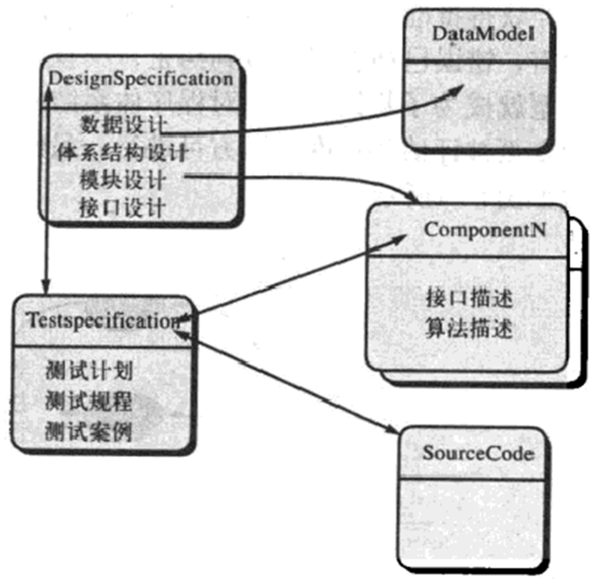
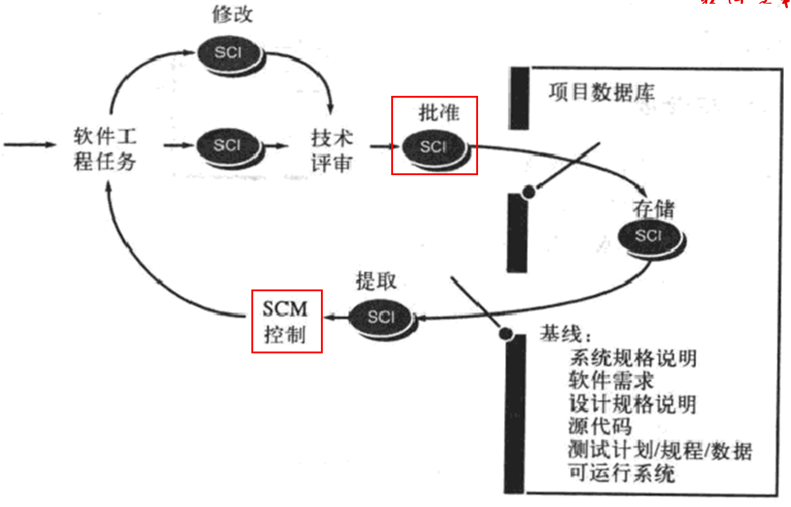
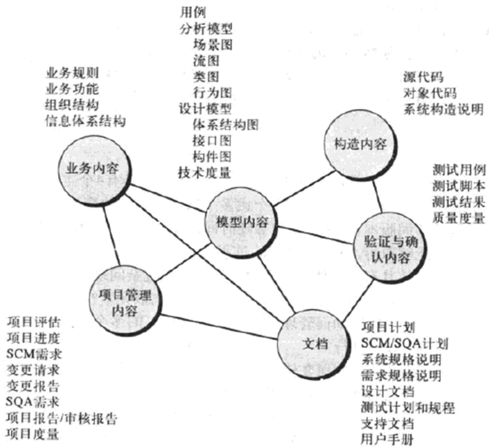
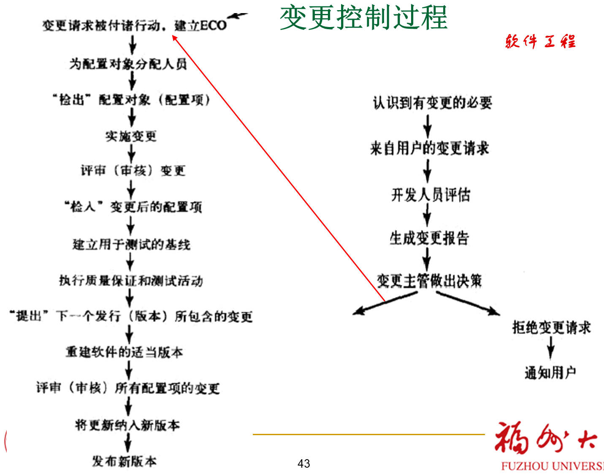

# 第 17 章 软件配置管理

页码沿用本份 PPT 页脚。读本章时跟踪一次变更的全过程，从确定改动涉及哪些配置项，到批准、测试、审核并发布。 **第17章.ppt** · [自测题](#自测题)

## 17.1 软件配置管理概述（第 2–22 页）

### 软件配置管理的目的与范围（第 2–5、8 页）

**软件配置管理（Software Configuration Management，SCM）**是一组标识、组织、跟踪和控制软件修改的活动。它是贯穿整个软件过程的**普适性活动**，从项目启动到软件退役一直实施。其目的在于使团队能够协调变更，减少错误和返工，提高生产率。

SCM 要做到**标识变更、控制变更、保证变更恰当实施、向利益相关者报告变更**。缺少事前分析、实施记录、变更通知或控制规程，容易造成版本混淆、并行修改相互覆盖，人员交接时也难以查清来龙去脉。

课件列出四类变更来源。

1. **业务或市场条件变化**。产品需求和业务规则随之调整。
2. **客户提出新需要**。系统提供的数据、功能或服务需变更。
3. **企业组织或规模变化**。项目优先级、团队结构等随之调整。
4. **预算或进度限制**。团队重新划定项目或产品范围。

### 软件配置与软件配置项（第 7、21–22 页）

**软件配置**是软件过程产生的程序、文档、数据或内容的集合，体现软件在某一时刻的状态。**软件配置项（Software Configuration Item，SCI）**是其中可标识、受配置管理的一个工作产品或信息项。

| 类别 | 典型 SCI |
| --- | --- |
| **程序** | 源代码、可执行原型、可执行程序。 |
| **文档** | 项目计划、需求与设计规格、测试计划和规程、用例与结果、安装说明、用户手册、维护记录和工程标准。 |
| **数据或内容** | 数据库描述、数据定义、测试数据、产品内外使用的内容。 |

课件将 SCI 组织为具有**名称、属性和关系**的配置对象，按类别保存在项目数据库。图中单向箭头 `A → B` 表示 B 是 A 的组成部分，双向箭头表示两个对象存在内在联系。沿着关系查看，可以找到一次变更可能影响的设计、接口、代码和测试。

*课件第 22 页　从配置对象的组成和关联追踪影响范围*

### 软件支持与维护类型（第 4、9–13 页）

**软件支持（维护）**是在软件交付、投入运行后开展的工程活动。维护产生的需求、代码、测试和文档变更仍由 SCM 跟踪和控制。课件重点讲三类维护。

| 类型 | 触发原因与目标 | 常见例子 |
| --- | --- | --- |
| **改正性维护** | 使用中发现已有错误或性能缺陷，修改软件使行为符合已有要求。 | 修正错误结算、修复原本应正常工作的导出功能。 |
| **适应性维护** | 外部运行环境或数据环境改变，调整软件使它能继续工作。 | 迁移操作系统、更换数据库、适配新的数据格式或输入输出方式。 |
| **完善性维护** | 用户提出新的功能、性能或可维护性要求，扩充或改善软件。 | 新增筛选功能，或将已有报表的响应目标从 5 秒提高到 2 秒。 |

题目用**维护动因**分类。原功能本来达不到既定性能指标，修复属于改正性维护。产品可达到原指标，用户提出更高目标，改进属于完善性维护。近年题的另一选项**预防性维护**指为降低将来的故障风险，提前发现和处理潜在问题。第 13 页的统计示意用来说明完善性维护常占较大比重，维护本身也占软件生命周期的重要部分。

### SCM 中的角色（第 14–17 页）

| 角色 | 承担什么工作 |
| --- | --- |
| **项目经理** | 监控进度、发现并处理问题，组织团队在约定时间交付。 |
| **配置管理员** | 落实 SCM 方针，使配置项的创建、修改和测试遵循规程。维护可查询的项目信息，组织变更请求、评估、批准和记录。 |
| **软件工程师** | 在工作空间创建、修改、测试和集成代码，记录构件演化，与其他成员协调变更。 |
| **客户或用户** | 使用产品，通过规定渠道提出变更请求或报告缺陷。 |

配置管理员可引入**变更控制委员会**等评估与批准机制。具体批准权由项目规定的变更控制授权人承担。

### 基线与基线的形成（第 18–20 页）

**基线（Baseline）**是**已经正式评审和批准的规格说明或产品**。它作为后续开发的共同基础，此后的修改要通过**正式的变更控制规程**。随着对需求和技术的认识加深，合理变更仍会出现。基线让团队能从同一份明确的规格或版本出发评估和实施变更。

配置项可在形成基线前随着评审修改。软件工程任务产生或修改 SCI，经过技术评审和批准后进入项目数据库，成为受控的配置项。下一轮工作从库中提取相应项，按变更控制要求修改，再评审和入库。需求规格、设计说明、源代码、测试资料和可运行系统都可在适当阶段形成基线。

*课件第 20 页　SCI 从产生、评审和批准到入库，以及后续提取和受控修改*

## 17.2 SCM 中心存储库（第 24–31 页）

### 作用、能力与内容（第 24–28 页）

**中心存储库（Repository）**是集中保存和管理软件工程信息的项目数据库。它使团队能查找配置项，回溯何时由谁修改，根据受控配置重建指定版本，并维护对象间的关系。它也能按规则统一工作产品的结构和格式。

作为团队的中心存储库，课件要求它具备四项能力。

1. **支持过程管理**，使工作产品与相关开发、评审及交付活动关联。
2. **支持 SCM 规则并维护所需数据**，例如版本与变更记录。
3. **提供与其他软件工程工具的接口**。
4. **存储多种数据对象**，如文本、图形、视频、音频等。

图中的内容可以按业务、模型、构造、验证与确认、文档和项目管理六类理解。它们相互关联。例如一条业务规则会关联分析模型、相应源代码和验证该规则的测试用例。

*课件第 28 页　中心存储库保存多类相互关联的工程信息*

### 支持 SCM 的五项特征（第 29–31 页）

| 特征 | 要回答什么 |
| --- | --- |
| **版本控制** | 某个工作产品有哪些版本？如何取回以前的版本用于测试、调试或构造发布？跟踪粒度可以是一个定义，也可以是一组模块。 |
| **依赖性跟踪和变更管理** | 改某个配置对象后，还有哪些关联对象可能受影响？例如修改 UML 类图时检查接口、代码和测试。 |
| **需求跟踪** | **正向**从需求查到其设计、构件、测试等产物。**反向**从产物查它所依据的需求。 |
| **配置管理** | 如何找出与某个里程碑或产品发布对应的一组配置？ |
| **审核跟踪** | 某变更发生在何时，由谁作出，理由是什么？库可提示补充相应记录。 |

例如要修改还书接口，先从需求**正向**找到对应设计、代码和用例，再用依赖关系查找使用该接口的管理员报表。若从某条旧用例查它验证的是哪条需求，则属于**反向**跟踪。

## 17.3 版本控制系统（第 33–34、40–41 页）

**版本控制系统**管理配置对象的不同版本。课件列出四项功能。

1. **中心存储库**。存储相关配置对象。
2. **版本管理**。保存历史变化，可比较、查询或重建指定对象的版本。
3. **版本制作**。收集属于某一配置的对象，按所需版本组合并构造软件。
4. **问题跟踪**。记录与配置对象关联的问题、变更及处理状态。版本控制和变更控制工具可集成该功能。

课件列举 Git、SVN、Mercurial、CVS、Perforce 等系统。做题时用下面三个概念判定同一份成果可能具有什么身份。

| 概念 | 判断标准 |
| --- | --- |
| **版本（Version）** | 一组具体配置对应的系统实例。开发与测试也会产生内部版本。 |
| **发布（Release）** | 分发给客户或用户的版本。更新发布可以取代旧版本。 |
| **基线（Baseline）** | 已正式评审批准、作为后续工作基础并受变更控制的规格或产品。 |

同一构建通过正式评审并成为后续开发起点后，可作为产品基线。分发给客户时，它又是发布版本。

## 17.4 持续集成（第 36 页）

**持续集成（Continuous Integration，CI）**把团队的小批修改频繁集成到共享代码，并通过构建、自动测试或代码检查及时反馈结果。例如修改还书接口后，构建能发现调用方签名问题，测试能发现报表读取接口时的行为偏差。

| 课件列出的优点 | 为什么 |
| --- | --- |
| **加速反馈** | 集成失败及时通知，便于在较小的改动范围内复现和修复。 |
| **提高质量** | 频繁构建和测试及早发现交互、兼容性和行为问题。 |
| **降低风险** | 设计和集成问题较早发现，减少最后集中集成的压力。 |
| **改进报告** | 构建、测试和代码分析结果为配置状态统计提供信息。 |

## 17.5 SCM 过程（第 38–51 页）

课件给出四个目标。**统一标识 SCI，管理配置项变更，便于构造不同版本，在配置演化中保持软件质量。** 对应的工作包括配置标识、版本控制、变更控制、配置审核和配置状态报告。配置标识先明确对象及其关系，后续才能对变更、构造与交付进行跟踪。

### 变更控制流程（第 42–43 页）

1. **请求与评估**。用户或开发方提交变更请求。评估技术可行性、潜在副作用、对其他 SCI 和整体功能的影响，以及预期成本，形成**变更报告**。
2. **决策与立单**。**变更控制授权人（Change Control Authority，CCA）**根据报告决定是否批准、如何安排优先级。拒绝时通知请求方。批准时建立**工程变更工单（Engineering Change Order，ECO）**，写明要改什么、有哪些约束、按什么准则评审和审核。
3. **实施与检入**。分配人员，从库中**检出**配置项，在工作空间实施变更。评审修改，把修改后的配置项**检入**存储库。
4. **测试、审查与交付**。建立用于测试的配置基线，执行测试与质量保证活动。确定下一版本纳入的变更，重建适当版本，审核相关配置项，再将更新纳入可交付版本。

*课件第 43 页　从变更请求到批准、实施和发布的流程*

### 审批级别与变更控制的两个要素（第 44–47 页）

- **配置项成为基线之前**，课件允许按项目和技术需要进行较快的非正式控制。
- **成为基线之后**，局部变更在课件场景中由项目管理者批准。影响其他 SCI 的变更须由 CCA 批准。个别情况可以简化书面材料，仍要评估、跟踪、评审。
- **CCA 的组成**可由一人如项目经理承担，也可由软件、硬件、数据库、支持、市场等方面的代表组成。它要从全局考虑硬件、性能、用户体验、质量和可靠性等影响。

**访问控制**管理谁可以访问、修改特定配置对象。**同步控制**保护并行修改，使两个开发人员的改动能被协调和合并，避免相互覆盖。

### 技术评审与配置审核（第 48–50 页）

**技术评审**关注变更的技术正确性，检查修改后与其他 SCI 是否一致、有没有遗漏、会不会产生副作用。**软件配置审核**检查实施是否符合批准范围、流程与记录要求。课件的检查项包括以下六点。

1. ECO 规定的修改是否完成，是否还发生额外修改。
2. 是否已进行技术评审。
3. 是否遵循软件过程及工程标准。
4. SCI 是否清晰标记改动，记录日期、人员，并反映在配置对象属性中。
5. 是否按 SCM 规程标注、记录并报告变更。
6. 相关 SCI 是否都已正确更新。

### 配置状态报告（第 51 页）

**配置状态报告（Configuration Status Reporting，CSR）**也叫**状态账目**。它向相关人员说明**发生了什么、谁做的、何时发生、影响其他哪些事情**。例如报告可指向实际修改的还书接口版本，以及受影响的界面、报表和测试用例。存储库中的审核跟踪为这种报告提供历史记录。

## 自测题

### 作业一第 3 题

什么是过程模型，有哪些框架活动，常见的软件过程普适性活动有哪些？

### 近年真题

#### 真题 1（2023 年 6 月卷和 2024 年 12 月卷，均为选择题第 9 题，各 2 分）

某企业的软件系统希望从 Windows 平台移植到 Linux 平台上，软件开发厂商为了满足企业的要求进行的维护属于（　）。

- A. 改正性维护
- B. 适应性维护
- C. 完善性维护
- D. 预防性维护

### 复习资料练习（按名词解释范围整理）

分别解释 **SCM、SCI、CCA、CSR**。说明每项的作用，并举一个软件配置项的例子。

### 综合练习（自拟）

某图书借阅系统已向图书馆分发 v1.2，另有一份 v1.3 供团队内部测试。当前需求和接口规格已经正式评审批准，作为后续修改的基础。图书馆提出还书时应显示逾期天数，管理员报表也要保留该字段。此变更会涉及多个配置项，两名开发人员还需要并行修改同一份接口规格。

1. 指出情境中的版本、发布版本和基线。为这次变更列举受影响的 SCI，并说明怎样从新需求找到关联的设计、代码与测试。
2. 写出从提出变更请求到新版可交付的主要步骤，说明谁批准变更、ECO 要写什么，以及怎样管理两人的并行修改。
3. 举例说明持续集成、技术评审与配置审核各能检查什么。完成变更后，配置状态报告要让相关人员知道哪些信息？

---

## 答案与解析

### 作业一第 3 题

**答案与解析**　过程模型描述软件过程中的活动怎样组织、衔接和推进。五个通用框架活动是**沟通、策划、建模、构建、部署**。典型普适性活动包括**软件项目跟踪和控制、风险管理、软件质量保证、技术评审、测量、软件配置管理、可复用管理、工作产品的准备和生产**。软件配置管理从项目启动持续到退役，在需求、设计、实现、测试及运行维护阶段跟踪和控制变更。

**考法、答题要点与易错点**　先说明过程模型，再列框架活动与普适性活动。结合本章补一句 SCM 的用途，即标识、控制、验证并报告修改。作答时用「贯穿整个过程」说明其普适性。

**复习位置**　本章课件第 2–4 页。第 02 章课件第 3–6、20 页和第 01 章课件第 38–39 页。 [软件配置管理的目的与范围](#软件配置管理的目的与范围第-258-页) · **第 02 章的作业第 3 题解析**

### 近年真题

#### 真题 1

**答案与解析**　选 **B. 适应性维护**。Windows 到 Linux 的移植是由**外部运行环境变化**触发的，修改的目的是让软件继续在新环境中运行。

**考法、答题要点与易错点**　先找题干中的动因。改正性针对已有错误，适应性针对环境变化，完善性针对新的功能、性能或可维护性需求，预防性针对未来可能暴露的隐患。题中的「移植到 Linux」直接给出了判断依据。

**复习位置**　课件第 9–13 页，重点看第 11 页。 [软件支持与维护类型](#软件支持与维护类型第-4913-页)

### 复习资料练习

**答案与解析**

| 缩写 | 名称与作用 |
| --- | --- |
| **SCM** | **软件配置管理（Software Configuration Management）**，标识、组织、跟踪和控制变更，保证变更恰当实施并向有关人员报告。 |
| **SCI** | **软件配置项（Software Configuration Item）**，软件过程中产生、可标识并受管理的信息或工作产品。例如一份需求规格说明或一组测试用例。 |
| **CCA** | **变更控制授权人（Change Control Authority）**，根据评估报告决定是否批准变更及其优先级。 |
| **CSR** | **配置状态报告（Configuration Status Reporting）**，说明发生了什么变更、由谁完成、何时发生、影响其他哪些事项。 |

**考法、答题要点与易错点**　先写全称，再用一条职责或用途收尾。SCM 是活动，SCI 是受管对象，CCA 有决策权，CSR 记录和传达状态。ECO 是批准后建立的工单，可结合 CCA 一起记。

**复习位置**　课件第 3、21–22、42、46–47、51 页。 [软件配置管理的目的与范围](#软件配置管理的目的与范围第-258-页) · [软件配置与软件配置项](#软件配置与软件配置项第-72122-页) · [变更控制流程](#变更控制流程第-4243-页) · [配置状态报告](#配置状态报告第-51-页)

### 综合练习

**答案与解析**

1. **识别配置**。v1.2 和 v1.3 都是版本，v1.2 已分发给图书馆，是发布版本。正式批准的需求和接口规格是基线。查找受到影响的借阅需求、还书接口规格、包含逾期天数的数据定义、处理代码、管理员报表、测试用例及用户说明。先从需求正向追踪实现和测试，再沿接口与数据的依赖关系检查调用方。
2. **控制变更**。登记请求，评估涉及的功能、配置项、风险和工作量，形成变更报告。此次跨多个配置项，由 **CCA** 决定批准与优先级。批准后建立 **ECO**，列明修改范围、适用约束、评审与审核准则。明确两名开发人员的修改权限，用同步控制记录各自改动、发现并处理冲突。检出相关项、实施并评审、检入，建立用于测试的配置，运行集成与回归测试，审核后构造可交付版本。
3. **验证与报告**。CI 将近期修改纳入同一次构建，及时发现接口变更导致的构建或测试失败。技术评审核对逾期天数的计算、显示和报表数据在相同借阅规则下是否一致。配置审核核对 ECO 规定的修改、评审记录、相关 SCI 是否同步更新。CSR 记录**改了什么、谁完成、何时发生、影响了哪些接口和工作产品**。

**考法、答题要点与易错点**　案例题写明受影响的具体对象，尤其别漏相关测试和文档。先评估并形成报告，由 CCA 作决定，获批后才建立 ECO。论述「如何保证正确」时，把技术正确性和过程、记录的一致性分别落到实际检查项。

**复习位置**　课件第 18–22、29–31、36、41–51 页。 [基线与基线的形成](#基线与基线的形成第-1820-页) · [支持 SCM 的五项特征](#支持-scm-的五项特征第-2931-页) · [版本控制系统](#173-版本控制系统第-33344041-页) · [持续集成](#174-持续集成第-36-页) · [变更控制流程](#变更控制流程第-4243-页) · [技术评审与配置审核](#技术评审与配置审核第-4850-页) · [配置状态报告](#配置状态报告第-51-页)

题目来源　**作业一** · **2023-06-09 期末卷** · **2024-12-27 期末卷** · **复习资料《大题》**
