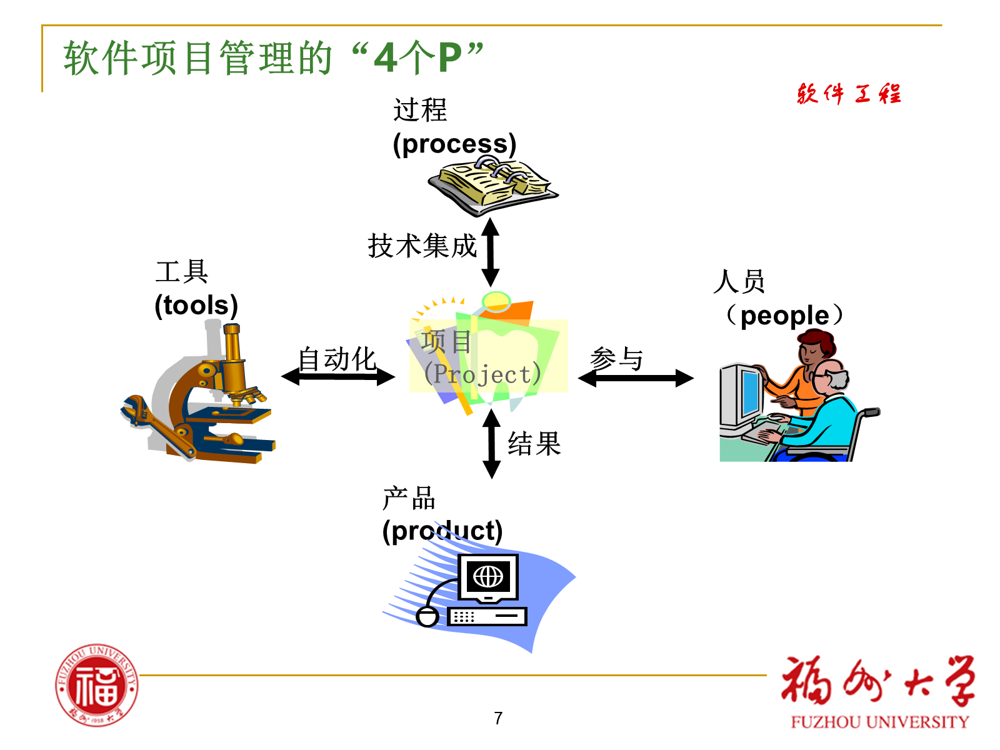
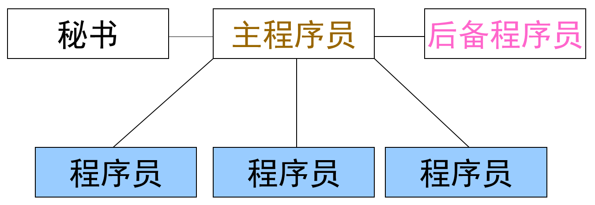
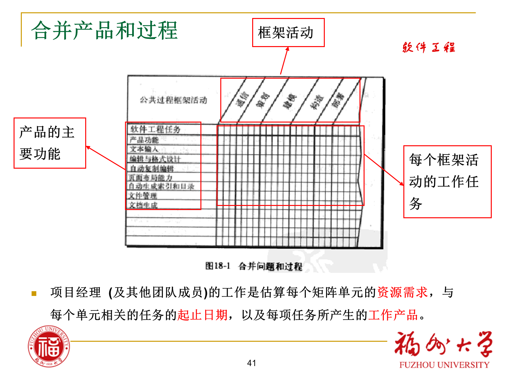

# 第 19 章 项目管理概念

## 19.1 管理涉及的范围（第 4–11 页）

### 项目与项目管理（第 4–5、46 页）

**项目**是为创造独特的产品、服务或其他成果而开展的一次性工作。项目有明确的目标和完整的活动，执行过程存在不确定性，需要逐步细化。项目组织具有临时性和开放性，项目的完成依赖人员、经费、技术等资源。

**项目管理**以项目为对象，通过临时、柔性的组织，运用知识、技术和工具，在有限资源下对项目的全过程进行**计划、组织、指挥、协调、控制和评价**，动态协调各项目标。软件项目有两个特点。软件产品无形，进度需要通过工作产品和质量检查来判断。不同项目的需求、技术和约束不同，团队要选择合适的过程并据此确定任务。

### 软件项目管理的 4P

*课件第 7–11 页*

| 管理对象 | 含义 | 管理中要解决的问题 |
| --- | --- | --- |
| **人员（People）** | 参与、影响项目的利益相关者及开发团队。人员素质和组织管理是项目成功最重要的因素。 | 谁参与、谁负责，团队如何配备、沟通和协作。 |
| **产品（Product）** | 将要开发的软件。 | 软件要达到什么目标，交付哪些数据、功能和行为，需要满足什么约束。 |
| **过程（Process）** | 完成工作所需的框架活动和软件工程任务。 | 采用什么过程模型，各项活动包含哪些任务，怎样验收。 |
| **项目（Project）** | 为实现产品所做的全部工作。 | 怎样安排资源、计划进度并跟踪实际执行。 |

*课件第 7 页　人员、产品、过程和项目的关系。图中的工具提供自动化支持。*

**人员能力成熟度模型（People-CMM）** 关注组织吸引、发展、激励、组织和留住人才的能力。主要实践域包括人员配备、沟通与协调、工作环境、业绩管理、培训、报酬、能力素质分析与开发、个人职业发展、工作组发展、团队精神或企业文化培养。人员管理越成熟，组织越有可能有效开展软件项目管理（第 8 页）。

## 19.2 人员（第 13–34 页）

### 五类利益相关者（第 14 页）

| 角色 | 职责 |
| --- | --- |
| **高级管理者** | 定义业务问题。 |
| **项目（技术）管理者** | 计划、激励、组织和控制软件开发人员。 |
| **开发人员** | 运用技术和领域知识开发产品或应用。 |
| **客户** | 提出软件需求。 |
| **最终用户** | 在软件交付后直接与产品交互。 |

在教务系统项目中，教务处可能作为客户提出选课规则，教师和学生是直接使用系统的最终用户。确定产品目标时要了解不同角色的需要。

### MOI 模型与项目经理的四种品质

*课件第 15–18 页*

团队负责人要具备管理人员和组织协作的能力。**MOI 模型**描述了三种领导能力。

| 能力 | 项目中的表现 |
| --- | --- |
| **M　激励（Motivation）** | 帮助成员理解目标、看到贡献，鼓励他们发挥潜能。 |
| **O　组织（Organization）** | 沿用或改进过程，组织成员把最初的概念转化为可交付的产品。 |
| **I　思想或创新（Idea or Innovation）** | 在开发目标的约束下鼓励成员提出、尝试新思路。 |

课件还列出项目经理应有的四种品质。

1. **解决问题**。识别关键的技术和组织问题，系统提出方案并推动实施，运用过往经验，必要时及时调整方向。
2. **管理者的特性**。掌控项目整体，为技术人员保留开展专业工作的自主空间。
3. **成就**。认可或奖励主动工作且取得成果的成员，提高团队生产效率。
4. **影响和队伍建设**。理解成员的语言和非语言信号并回应其需求，在压力下仍能妥善处理局面。

### 选择团队结构的七个项目因素（第 21 页）

团队结构受组织管理风格、团队规模、成员技能和问题难度影响。选择时比较以下七项条件。

1. 待解决问题的难度。
2. 软件规模，可用代码行或功能点度量。
3. 成员需要共同工作的时间，即**团队生存期**。
4. 问题可以模块化划分的程度。
5. 系统的质量和可靠性要求。
6. 交付日期的严格程度。
7. 项目所需的友好交流程度。

### 四种组织范型

*课件第 22–23 页*

| 范型 | 分工和决策方式 | 适用条件与局限 |
| --- | --- | --- |
| **封闭式** | 按传统的权力层次组织，协调和决策较集中。 | 适合开发与已有产品相似的软件。组织控制清晰，创新受限。 |
| **随机式** | 组织较松散，依靠成员的主动性和独立创造性。 | 适合寻求创新或技术突破。工作必须按严格次序衔接时难以协调。 |
| **开放式** | 兼顾组织控制与创新，重视沟通，按团队整体意见决策。 | 适合需要共同研判的复杂问题。充分交流和达成共识需要时间。 |
| **同步式** | 按问题的自然边界划分，由成员分别处理一部分，主动交流较少。 | 适合能拆成相对独立子问题的工作。子任务依赖强时需要更多协调。 |

### 主程序员式、随机式和民主式结构

*课件第 24–28 页*

**主程序员式**是早期的封闭式团队结构。主程序员是高级工程师，负责计划、协调和评审技术活动。通常有 2–5 名技术人员承担分析和开发。后备工程师协助主程序员，必要时能以较小代价接替其工作。图中还设有秘书岗位。分工专业化能降低管理复杂性并提高效率，难点是找到技术和管理能力兼备的主程序员。

*课件第 25 页　主程序员式组织结构*

**随机式结构**要发挥成员的创新性，需要彼此信任、技能分布契合问题。课件指出，若成员长期坚持己见、妨碍团队合作，可调整其团队安排以保持凝聚力（第 27 页）。

**民主式结构**强调成员地位平等，按个人能力和经验分工，通过全体协商决定项目工作。它适用于规模小、能力强、有共同工作经验的团队，可以激发创造力，帮助集体攻克难题。意见分歧较大时，缺少能够协调和决断的权威会拖慢工作（第 28 页）。

### 凝聚力与团队毒性

*课件第 29–31 页*

**凝聚力**来自共同目标、共同文化和紧密协作，使团队的整体力量超过个体力量的总和。凝聚力强的团队往往有更高的生产率和更强的动力，也能满足成员的归属和合作需要。

| 容易形成团队毒性的环境 | 课件给出的处理方式 |
| --- | --- |
| **狂乱的工作氛围**，信息不全、主要目标频繁变化。 | 让团队获得完成工作所需的信息，保持主要目标稳定。 |
| **重大挫折引发摩擦**。 | 给予团队更多适当的决策权，增强信心。 |
| **软件过程糟糕**，任务碎片化或协调很差。 | 让团队参与选择适合项目的过程模型。 |
| **角色模糊**，责任不明、相互指责。 | 建立责任机制，约定任务未完成时的纠正办法。 |
| **反复失败**，自信和士气下降。 | 建立团队反馈机制，用明确的方法分析并解决问题。 |

### 成员个性、沟通与选人

*课件第 32–34 页*

- **个性差异**表现为外向与内向、依赖直觉与依赖逻辑论据、偏好详细进度与偏好开放讨论、倾向提前完成与倾向临近期限集中完成。可在讨论前提供书面材料，并为任务设置检查点，让不同工作习惯的成员顺利合作（第 32 页）。
- **沟通有效性**受小组规模、组织结构、成员构成和物理工作环境影响。小组越大，越难保证所有成员有效交流。较少的正式层级有利于直接沟通，同类型成员间也可能发生冲突。工作场所的安排可以促进或阻碍交流（第 33 页）。
- **选人因素**包括应用领域经验、编程语言与平台经验、教育背景、沟通能力、适应性（主要指学习能力）、工作态度与个性（第 34 页）。

## 19.3 产品（第 9、36–38 页）

### 产品目标与软件范围

*课件第 9、36 页*

**产品目标**从利益相关者的角度写明软件要带来什么结果。例如，把纸面报修转为可查询进度的线上服务。**软件范围**界定应交付的主要数据、功能和行为，明确系统边界及约束，使管理人员和技术人员都能理解，并尽可能量化。例如，报修系统的范围可列明楼栋、故障描述与处理状态等数据，报修提交、进度查询等功能，以及状态变化时的通知行为。响应要求可以写成「100 人并发时，95% 的进度查询在 2 秒内返回」，并注明目标环境与内存限制。

确定目标和范围后，再比较备选方案。可依据**交付期限、预算、可用人员、技术接口**等条件，选择满足约束的方案。

### 问题分解（第 37–38 页）

**问题分解**从范围陈述出发，把大的产品功能逐级划分为较小的子功能，直至可以据此估算和安排工作。例如，先确定字处理软件中连续语音输入是否需要用户训练、页面布局支持到什么程度，再细化课件所说的「自动复制编辑」，也就是自动校订文字、格式和引用。

| 子功能 | 需要实现的工作 |
| --- | --- |
| 单词拼写检查 | 识别可能存在的拼写错误。 |
| 语句文法检查 | 检查句子的文法。 |
| 文档引用检查 | 检查正文中的参考书引用是否能在参考书目中找到。 |
| 样式表 | 使整份文档的样式保持一致。 |
| 章节引用确认 | 核查文档内引用的章节。 |

如果某个子功能仍难以制定计划，可以将其进一步分解。

## 19.4 过程（第 40–44 页）

### 过程模型与任务集

*课件第 40、42–44 页*

过程管理要确定开发经历的活动、采用的技术方法及阶段验收标准。团队先选择适当的**过程模型**，以其框架活动制定初步计划，再分解出每个活动要执行的**任务集**。小型项目与以往项目相似时可考虑线性顺序方法。时间紧且功能可以分批时可采用增量策略。需求不确定、技术有突破性或客户沟通困难时，要依据具体限制另选过程模型。

同为**沟通活动**，任务集可随规模和复杂度变化。

| 项目情形 | 沟通任务的安排 |
| --- | --- |
| **小型、较简单** | 列出待澄清问题，和利益相关者会面讨论，共同撰写范围陈述，由相关人员评审，再按反馈修改。 |
| **大型、复杂、商业影响重要** | 评审客户需求，计划由主持人组织的正式会议，研究备选方案和现有方法并准备工作文档及议程。通过会议共同形成描述数据、功能和行为的微型规格说明，或编写用例。逐项检查正确性、一致性和无歧义性，将微型规格说明组装成范围文档，再由相关人员评审和修订范围文档或用例集。 |

### 合并产品与过程

*课件第 41 页*

**合并产品与过程**是将产品的主要功能和过程的框架活动放在一张矩阵中。行列交叉处对应某个功能在相应活动下的具体软件工程任务。团队要为每个单元估算**资源需求**，安排任务的**起止日期**，明确任务应产出的**工作产品**。

*课件第 41 页　合并产品与过程的矩阵*

例如，对字处理软件的「自动复制编辑」功能做建模，可以安排一名分析人员在第 2–3 天形成拼写检查的规则说明和输入输出规格。功能拆分回答「产品做什么」，过程分解回答「开发团队具体做哪些工作」。

## 19.5 项目（第 46–50 页）

### 项目陷入危险的十个信号

*课件第 47 页*

1. 软件人员不了解客户需要。
2. 产品范围定义得很糟糕。
3. 变更管理不善。
4. 所选技术发生变化。
5. 业务需求发生变化或定义不清。
6. 设定的最后期限不切实际。
7. 客户抵制。
8. 失去项目赞助或始终未得到真正支持。
9. 团队缺少具备合适技能的人员。
10. 管理者和开发人员没有用好已有的最佳实践和经验。

### 项目的 90-90 规则与五项管理实践

*课件第 48–50 页*

**90-90 规则**用夸张的比例描述软件项目的收尾困难。前 90% 的任务消耗已分配工作量和时间的 90%，最后 10% 的任务又消耗原先所分配工作量和时间的 90%。例如，按件数看大部分开发任务已完成，剩下的集成、缺陷修复和验收却可能耗费很多时间。进度要结合剩余工作和质量状态评估。例如，任务是否通过集成、交付物是否满足验收标准，都能用来验证它是否真正完成。

1. **在正确的基础上开始工作**。充分理解要解决的问题，给参与者设定现实的目标和期望。
2. **保持动力**。激励成员、保持人员稳定、重视每项任务的质量。高层管理者为团队保留工作自主性。
3. **跟踪进展**。把进度跟踪纳入质量保证活动，收集过程和项目的度量数据，并与组织的历史平均数据对照。
4. **做出英明的决策**。保持方案简单，尽可能采用商用成品软件、既有构件或模式，优先使用标准接口，规避明显风险，为复杂和高风险任务留出足够时间。
5. **进行事后分析**。比较计划和实际进度，分析度量数据，听取团队和客户反馈、记录发现，并把经验用于后续项目。

## W5HH 原则

*19.6　课件第 52–53 页*

**W5HH 原则**由 Boehm 提出，用七个问题明确项目目标、任务、进度与里程碑、责任、技术和管理方法、资源。

| 问题 | 项目计划应给出的内容 |
| --- | --- |
| **Why　为什么开发这个系统？** | 说明业务理由、价值和开展项目的必要性。 |
| **What　将要做什么？** | 定义项目需要完成的任务集。 |
| **When　什么时候做？** | 规定任务的时间安排和各个里程碑。 |
| **Who　某项功能或任务由谁负责？** | 明确团队成员的角色、职责和对应的工作。 |
| **Where　这些角色位于组织的什么位置？** | 写明相关人员的组织归属、跨组织的分工和责任，包含客户、用户及其他利益相关者。 |
| **How　如何完成技术和管理工作？** | 确定产品范围后，规定采用的技术策略和管理策略。 |
| **How much　每种资源需要多少？** | 估算人员、经费、设备等资源的用量。 |

## 自测题

### 作业五

#### 作业五第 1 题

什么是项目管理？常见的团队组织有哪些？

### 作业一

#### 第 4 题（过程模型）

惯用的过程模型有哪些，都有哪些特点/适用场景是？

#### 第 6 题（职业道德与团队组织）

软件工程师职业道德规范、软件工程团队常见的组织模式有哪些？

### 近年真题

#### 真题 1（2023 年 6 月卷，简答题第 1 题，7 分）

在软件工程开发实践中，有项目组长曾经这样感慨：“我的三个队友，有的队友编码基础很弱，不太想学，也不知道要做什么；有的队友会编码，但却很忙，准备考研或有其他任务要做，没什么时间来做这个项目。那么这个项目大部分将只有我一个人在做，虽然我也不想这样，但可能成为事实。”试分析：如果你是项目组长，面对上述状况，应该从哪几方面协调改进？

#### 真题 2（2024 年 12 月卷，选择题第 4 题，2 分）

哪种模型是分批地逐步向用户提交产品，每次提交一个满足用户需求子集的可运行产品（　）。

- A. 增量模型
- B. 瀑布模型
- C. 原型模型
- D. 螺旋模型

#### 真题 3（2024 年 12 月卷，简答题第 2 题，5 分）

公司计划采用新技术开发一款新的手机软件产品，希望尽快占领市场，假设你是项目经理，你会选择哪种软件过程模型？为什么？

### 本章应用练习（自编）

#### 练习 1　4P、软件范围与任务矩阵

学校组织 4 人团队，要求 4 周内交付一个宿舍报修系统。首版支持学生提交文字报修、管理员派单并更新状态、学生查询进度。系统需要支持手机浏览器，可供 100 名学生同时访问。学校希望系统「响应要快」，图片上传和维修评价安排到后续版本。

1. 说明 4P 在这个项目中分别指什么。
2. 写出首版范围，给出一个可验收的响应时间指标。
3. 以「进度查询」和「建模」的交叉单元为例，写出一项软件工程任务，以及其资源、起止时间和工作产品。

#### 练习 2　90-90 规则与项目预警

团队报告已完成 90% 的任务，离原定上线仅剩两天，核心功能的集成、回归测试和试运行尚未开展。新增需求口头插入计划，团队也没有同客户确认试运行的验收指标。解释这里的 90-90 问题，列出两个项目危险信号，说明项目经理接下来怎样跟进，以及项目结束后怎样复盘。

#### 练习 3　W5HH

课程项目拟做一个校内失物招领系统。用 W5HH 列出项目计划需要回答的七个问题，并用该项目举例说明 Who、Where、How much 各应记录什么。

---

## 答案与解析

### 作业五解析

#### 作业五第 1 题

**答案与解析**

**项目管理**以项目为对象，通过临时而灵活的组织，运用相关知识、技术和工具，在有限资源下对项目全过程进行计划、组织、指挥、协调、控制和评价，协调工期、成本与质量等目标。管理涉及四个方面，即**人员、产品、过程、项目（4P）**。

| 组织范型 | 怎样分工和决策 | 适用情形 |
| --- | --- | --- |
| **封闭式** | 按权力层次分工，协调和决策较集中。 | 需求和工作方式熟悉，同类软件开发较多。**主程序员式**是课件给出的实例。 |
| **随机式** | 组织较松散，依靠成员的主动性和创造力。 | 需要创新或技术突破，成员能自行协作。 |
| **开放式** | 兼顾组织控制和创新，通过充分沟通形成团队决策。 | 存在复杂问题，需要多个成员共同研判。 |
| **同步式** | 按问题的自然边界分工，由各成员解决各自部分。 | 问题可以划分为相对独立的子任务。 |

课件第 24–28 页还介绍了主程序员式、随机式和民主式结构。**民主式**的成员地位平等，按能力和经验分工，由全体协商决定项目工作，适合能力强且有共同工作经历的小团队。

**考法、答题要点与易错点**　定义题写清「对象、组织手段、管理活动、目标」。问组织范型时，依次列四种并说明各自的协调方式。题干若说按自然边界分给不同成员，判同步式。若强调通过充分交流形成集体意见，判开放式。4P 用来说明项目管理的范围。

**课件位置**　本章课件第 4–5、7–11、21–28、46 页。第 05 章课件第 15–22 页也讲了团队结构。

**笔记位置**　[项目与项目管理](#项目与项目管理第-4546-页) · [软件项目管理的 4P](#软件项目管理的-4p) · [四种组织范型](#四种组织范型) · [主程序员式、随机式和民主式结构](#主程序员式随机式和民主式结构)

### 作业一解析

#### 作业一第 4 题

**答案与解析**

| 惯用过程模型 | 特点与适用场景 |
| --- | --- |
| **瀑布模型** | 线性顺序地推进各阶段，每阶段有明确的输出和评审。适合需求较明确、变化较少、技术较成熟的项目。 |
| **增量模型** | 先交付可用的核心产品，再分批增加功能。适合功能能独立划分、需要较早交付，或前期资源有限的项目。 |
| **原型开发** | 快速构造原型供用户评价，通过反馈澄清需求或验证关键技术。适合需求、交互或技术可行性有待确认的项目。 |
| **演化过程模型（如螺旋模型）** | 通过多轮迭代形成越来越完整的版本。螺旋模型由风险驱动，适合需要逐轮控制风险的大型系统。 |
| **统一过程（UP）** | 用例驱动、以架构为核心、迭代且增量。适合需要围绕用例和架构组织开发的面向对象项目。 |

**考法、答题要点与易错点**　写全「怎样开展」和「何时适用」。增量要写清分批交付的是可运行产品，原型要写清如何获取评价并验证，螺旋要写到每轮风险分析。

**课件位置**　本章课件第 40、42 页。第 02 章课件第 20–48、57–70 页。

**笔记位置**　[过程模型与任务集](#过程模型与任务集)

#### 作业一第 6 题

**答案与解析**　职业道德可按八类责任作答。对**公众**优先保护公众利益和安全。对**客户与雇主**在符合公众利益的前提下维护其正当利益。对**产品**保证软件及其修改达到专业标准。做**专业判断**时保持诚实与独立。在**管理**时用合乎伦理的方式组织开发和维护。维护**职业**的诚信和声誉，公平对待并支持**同事**，对**自身**要求终身学习并遵守专业规范。

团队的四种组织范型是**封闭式、随机式、开放式、同步式**。封闭式以权力层级组织，适合类似项目。随机式依靠成员主动性，适合技术探索。开放式通过沟通形成集体决策，适合复杂问题。同步式依据自然边界分工，适合相对独立的子任务。

**考法、答题要点与易错点**　依题目分两部分写。职业道德写明责任对象和行为要求。组织范型写全四种，并用分工、决策或沟通方式区分。主程序员式可作为封闭式的例子。同步式的识别点是子问题可自然划分且主动交流较少。

**课件位置**　本章课件第 22–28 页。

**笔记位置**　[四种组织范型](#四种组织范型) · [主程序员式、随机式和民主式结构](#主程序员式随机式和民主式结构)

### 近年真题解析

#### 真题 1

**答案与解析**

1. **沟通和激励。** 分别了解队员的基础、投入意愿和可用时间，全组确认最低交付目标，说明每项工作对目标的贡献。
2. **补足技能、明确任务。** 给基础薄弱的队员可独立完成的小任务，说明完成标准，安排简短培训、结对练习或及时答疑，帮助他们积累可展示的成果。
3. **按可用时间合理分工。** 同有编码能力但较忙的队员约定可投入的时段，分配边界清晰且能够按时完成的工作。关键任务安排有时间和能力的负责人，并明确交接方式。
4. **管理责任与进度。** 为任务约定负责人、验收标准和截止时间。设置中间检查点，用共享任务表或短会获取反馈，尽早处理阻塞和分工冲突。
5. **解决剩余的资源缺口。** 若协调后仍达不到原目标，向指导教师说明缺口并争取支持，按优先级调整交付范围或计划，保证核心功能的质量。

**考法、答题要点与易错点**　题干有动力不足、基础薄弱、任务不清、可用时间少等多个线索。逐项写出措施，并说明由谁完成、何时检查和怎样提供帮助。只写「加强沟通」或让组长自己承担全部开发，都没有解决团队的分工和资源问题。

**课件位置**　本章课件第 15–18、29–34、48–50、52–53 页。

**笔记位置**　[MOI 模型与项目经理的四种品质](#moi-模型与项目经理的四种品质) · [凝聚力与团队毒性](#凝聚力与团队毒性) · [成员个性、沟通与选人](#成员个性沟通与选人) · [五项管理实践](#项目的-90-90-规则与五项管理实践) · [W5HH 原则](#w5hh-原则)

#### 真题 2

**答案与解析**　选 **A. 增量模型**。团队把功能按可独立运行的需求子集分批交付，先做核心产品，再逐步增加能力。每一次实际交付都能运行并满足部分用户需求。

**考法、答题要点与易错点**　同时抓住「分批」「需求子集」「可运行产品」。如果题干强调通过样品和试用来澄清需求，则应想到原型开发。螺旋模型的突出依据是风险驱动。

**课件位置**　本章课件第 42 页。第 02 章课件第 25–32、65–67 页。

**笔记位置**　[过程模型与任务集](#过程模型与任务集)

#### 真题 3

**答案与解析**　可以选择**敏捷开发**，通过短迭代持续交付可用增量。先围绕手机软件的核心场景验证新技术，检查它能否满足目标设备的兼容性及性能要求。将通过验证且达到发布要求的核心功能作为首版交付，再根据真实用户反馈调整优先级、逐步迭代。频繁验证能尽早发现技术问题，小步交付也能缩短核心产品上市的时间。若首要难点是验证新技术，也可从演化式原型入手，验证后完善为可交付的首版。

**考法、答题要点与易错点**　先明确模型，再分别回应「采用新技术」与「尽快占领市场」。写明如何验证技术、首版交付哪些功能、如何用市场反馈推进下一版。仅写「敏捷就是开发快」缺少采用该过程的理由。

**课件位置**　本章课件第 9、36、40、42 页。第 03 章课件第 16–20 页，第 02 章课件第 25–28、33–35 页。

**笔记位置**　[产品目标与软件范围](#产品目标与软件范围) · [过程模型与任务集](#过程模型与任务集)

### 本章应用练习解析

#### 练习 1

**答案与解析**

1. **人员**包括提出需求的学校、使用系统的学生和管理员，以及承担开发工作的 4 人团队。**产品**是宿舍报修系统。**过程**包括沟通、策划、建模、构造、部署等框架活动及具体任务。**项目**是从计划到验收交付首版的全部工作，要在 4 人、4 周的约束下实施。
2. 首版记录报修文本、派单信息和处理状态，支持提交文字报修、派单及更新状态、查询进度。目标环境是手机浏览器，图片上传和维修评价留到后续版本。可同校方确认的性能指标示例是「在 100 名学生同时按约定频率查询进度的测试场景下，至少 95% 的查询请求在 2 秒内返回」。
3. 「进度查询 × 建模」可以由一名分析人员在第 4–5 天梳理权限、查询结果和异常行为，产出进度查询用例及其状态说明。

**考法、答题要点与易错点**　用 4P 分类后，把范围写成明确的边界和验收条件。任务矩阵的单元同时包含一项产品功能和一类过程活动，答案要交代任务、资源、时间和工作产品。避免把「响应快」当成已量化指标。

**课件位置**　本章课件第 7–11、36–38、40–41 页。

**笔记位置**　[软件项目管理的 4P](#软件项目管理的-4p) · [产品目标与软件范围](#产品目标与软件范围) · [合并产品与过程](#合并产品与过程)

#### 练习 2

**答案与解析**　任务数虽已完成 90%，剩余集成、回归测试和试运行仍可能耗费大量时间，还会发现需要返工的问题。危险信号包括**变更管理不善**和**客户需要及验收范围不明确**。项目经理应尽快与客户确认验收条件，评估新增需求和剩余工作，重新估算工期并协商上线范围及时间。为集成和各项质量检查明确负责人、完成标准与检查点，根据可验收成果跟踪进度。结束后比较原计划与实际工期，结合变更记录、度量数据及团队和客户反馈，记录偏差原因和后续可复用的做法。

**考法、答题要点与易错点**　把「完成比例高」和「剩余工作量仍大」的关系说清楚。从题干提取信号，再提出可执行的措施。进度跟踪应包含质量检查和交付物，复盘应说明如何利用实际数据与反馈。

**课件位置**　本章课件第 47–50 页。

**笔记位置**　[项目陷入危险的十个信号](#项目陷入危险的十个信号) · [90-90 规则与五项管理实践](#项目的-90-90-规则与五项管理实践)

#### 练习 3

**答案与解析**

| 问题 | 在失物招领项目中要说明的内容 |
| --- | --- |
| **Why** | 为什么开发系统，例如缩短失主查找失物的时间。 |
| **What** | 要完成哪些任务，例如确认认领规则、实现并测试失物查询。 |
| **When** | 何时开始、结束各项任务，何时达到里程碑。例如第 1 周确认需求，第 4 周演示并验收。 |
| **Who** | 哪个人承担某项工作，例如成员甲负责登记和查询功能。 |
| **Where** | 这些职责落在哪个组织单元，例如开发由课程项目组负责，失物核验及业务验收由校内失物招领管理部门承担。 |
| **How** | 采用哪些技术和管理方法，例如用 B/S 架构实现线上登记与查询，按短迭代开发并组织评审。 |
| **How much** | 需要多少资源，例如预计投入 12 人日的开发和测试工作量，并使用 1 个测试环境。 |

**考法、答题要点与易错点**　记全五个 W 和两个 H。Who 写具体职责和责任人，Where 写组织归属及有关责任，How 写实现和管理方法，How much 写可估算的资源数量。

**课件位置**　本章课件第 52–53 页。

**笔记位置**　[W5HH 原则](#w5hh-原则)

题目来源　**作业五** · **作业一** · **2023-06-09 期末卷** · **2024-12-27 期末卷**
