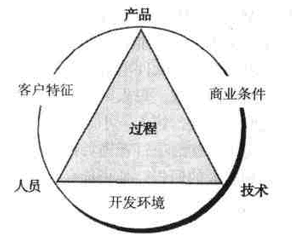
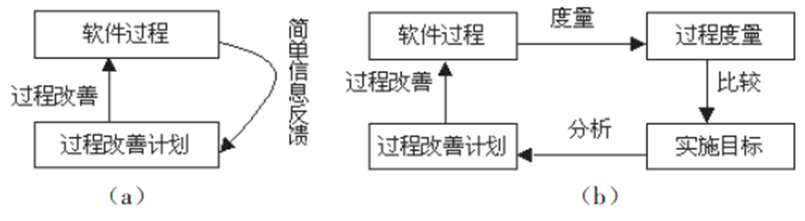
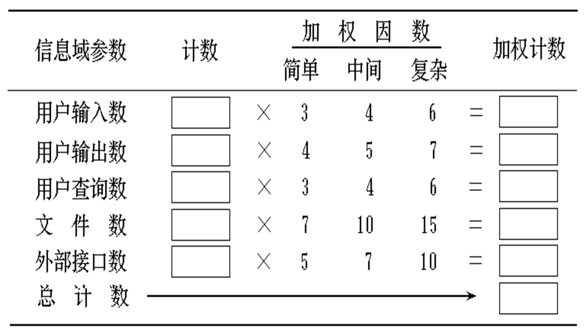
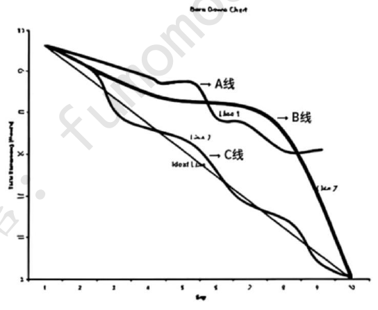

# 第 20 章 过程度量和项目度量

## 测量的作用（第 2–5 页）

软件开发在实施前、实施中和完成后都需要定量描述。项目在开发过程中采集数据，使进度、工作产品质量和过程表现可观察。**生产率度量**关注投入的工作量或时间能产生多少产出，**质量度量**关注工作产品的适用性。同一口径下积累的历史生产率和质量数据可以作为计划和估算的基线。

| 测量的理由 | 要回答的问题 |
| --- | --- |
| **刻画** | 当前的过程、产品、资源和环境怎样，未来可以用什么基线比较？ |
| **评价** | 相对于计划，当前项目处于什么状态？ |
| **预测** | 过程和产品之间有什么可建模的关系，可以据此预计什么结果？ |
| **改进** | 产品或过程哪里有不足，实施改进后效果怎样？ |

## 20.1 过程领域和项目领域中的度量（第 7–17、20 页）

### 过程度量、项目度量和产品度量

*课件第 3、7、17、20 页*

| 度量对象 | 用途 | 例子 |
| --- | --- | --- |
| **过程度量** | 根据多个项目积累的数据，评估过程的功效并持续改进。 | 对比采用新评审规程前后，同类项目的交付后缺陷率。 |
| **项目度量** | 支持当前项目的估算、质量控制、生产率评估和过程中的管理决策。 | 比较实际进度与计划，跟踪潜在风险，在问题产生更大影响前调整流程或任务，并判断团队能否控制工作产品的质量。 |
| **产品度量** | 描述和评价软件及其工作产品的特征。 | 代码规模、运行速度或缺陷密度。 |

课件给出的数据汇总关系是**产品度量 → 项目度量 → 组织过程度量**。例如，各模块的数据可在团队内汇总成项目数据，多个项目的数据可以进一步汇总，为组织改进过程提供依据。项目衡量生产率时，可根据创建的模型、文档页数、功能点或交付的源代码行数统计产出，再结合工作量或时间计算。

### 过程改进与度量反馈

*课件第 8–10、16 页*

**过程三角形**的三个顶点是人员、产品和技术。人员的技能和动力对质量及组织性能影响最大，产品复杂性和采用的技术方法也会影响结果。三者处于开发环境、商业条件和客户特征组成的环境中。例如，分析两次项目的缺陷率变化时，应同时查看产品难度、工具条件、交付期限及客户协作情况。

*课件第 8 页　软件质量和组织有效性的决定因素*

过程的功效可由结果**间接测量**。课件举出的数据有发布前发现的错误、交付后用户报告的缺陷、交付的工作产品、花费的工作量和时间，以及实际进展与计划的一致程度。

*课件第 9 页　从简单信息反馈到基于度量的过程改进*

图（a）根据简单反馈制定和执行改善计划。图（b）先测量过程并将所得指标与实施目标比较，再分析差距、制定改进计划、实施后重新度量。课件进一步介绍**统计软件过程改进（Statistical Software Process Improvement，SSPI）**，即用软件失效分析方法收集开发和使用过程中遇到的错误、缺陷信息，为过程改进提供更精确的依据。

### 私有数据、公用数据和使用规则

*课件第 11–15 页*

| 数据层次 | 数据及其用法 |
| --- | --- |
| **个人私有** | 按人统计的缺陷率、个人跟踪的模块缺陷率和开发中发现的错误数，供工程师本人分析和改进工作。 |
| **组内公用** | 多人负责的主要功能的缺陷报告、评审发现的错误、模块或函数的 LOC 和 FP，可在团队内用来协调工作和改善流程。 |
| **组织公用** | 汇总项目级的缺陷率、工作量、时间等数据，找出能改善组织过程性能的指标。 |

Humphrey 的**个人软件过程（PSP）** 强调在个人层面测量和跟踪工作。工程师可以根据自身的数据找到适合自己的方法，例如观察采用检查表后，自己在哪个阶段发现了更多错误。

度量目标与指标由开发者和团队共同设定。解释数据时要考虑组织背景和数据敏感性，定期给采集数据的人和团队反馈。异常指标用于定位和改善过程，个人数据用于自我改进。评价流程时要一同查看其他重要指标，例如对照交付量、缺陷和投入，避免用单个数字给个人评分或向团队施压。

## 20.2 软件测量（第 19–35 页）

### 直接测量与间接测量

*课件第 19 页*

| 类型 | 课件举例 |
| --- | --- |
| **直接测量** | 过程中的成本和工作量。产品的代码行数（LOC）、运行速度、存储容量、一定期间内报告的缺陷数。 |
| **间接测量** | 借助其他数据推导的产品功能、质量、复杂性、有效性、可靠性和可维护性等。 |

例如，统计报告的缺陷数属于直接测量。用缺陷数和规模计算缺陷密度，再用它评价正确性，属于用直接数据间接刻画质量。

### 面向规模的度量

*课件第 21–26 页*

面向规模的度量用软件规模来**规范化**不同项目的数据。课件以代码行数（Lines of Code，LOC）表示规模，**1 KLOC = 1,000 LOC**。工作量以人月（PM）计。工作量和成本都覆盖分析、设计、编码、测试等开发活动。

| 指标 | 计算 | 常用单位 |
| --- | --- | --- |
| **生产率** | KLOC ÷ 工作量 | KLOC/人月，也可用 LOC/人月 |
| **错误密度** | 错误数 ÷ KLOC | 错误数/KLOC |
| **缺陷密度** | 缺陷数 ÷ KLOC | 缺陷数/KLOC |
| **单位规模成本** | 成本 ÷ LOC 或 KLOC | 元/LOC、元/KLOC 等 |
| **文档密度** | 文档页数 ÷ KLOC | 页/KLOC |

第 21 页的项目样本把开发中发现的**错误**与发布后报告的**缺陷**分列。第 24 页用错误数/KLOC 描述质量，第 38 页用缺陷数/KLOC 衡量正确性。计算时保留统计时段和分母单位。还可根据需要计算每人月错误数、每人月代码行数及每页文档成本。比较项目时要对齐代码行的统计方式、错误和缺陷的定义、统计时间窗口及工作量范围。

LOC 容易统计，历史资料多，也是许多估算模型的输入。课件同时指出其局限。不同语言实现同一功能所需的代码行数可能差很多，同样的投入下，简洁的实现也可能因为产出行数较少而在 LOC 生产率上占劣势。采用非过程型语言时，代码行数较难代表工作量。分析和设计尚未完成时，预先估计 LOC 也有难度。

### 功能点与面向功能的度量

*课件第 27–31 页*

**功能点（Function Point，FP）** 由 Albrecht 提出，根据软件信息域的计数和复杂性评估，间接度量软件面向用户提供的功能规模。以 FP 规范化时，可以计算 FP/人月、缺陷数/FP 或成本/FP。

| 信息域参数 | 计数对象 |
| --- | --- |
| **用户输入数** | 应用接收的用户输入，例如通过表单提交业务数据。 |
| **用户输出数** | 应用提供给用户的输出信息，例如报表、屏幕输出及错误提示。 |
| **用户查询数** | 简单的联机输入和响应组合，例如输入编号查询一条记录。 |
| **文件数** | 应用管理的逻辑主文件，按逻辑数据集合计。 |
| **外部接口数** | 应用通过外部接口与其他设备或系统读写的信息。 |

*课件第 28 页　五类信息域参数的功能点加权表*

1. **按类别和复杂度计算加权计数。** 查表给每组计数乘以相应权值，将乘积相加得到**加权总计数**。例如，某一类中同时有简单和复杂项，就分别加权再加总。
2. **计算复杂性调整系数。** 对 14 个问题分别评分。复杂性校正值 Fᵢ 的取值为 0–5，依次表示没有影响、偶然的、适中的、普通的、重要的和极重要的。将 14 项分数相加得到 ΣFᵢ。
3. **求功能点。** **FP = 加权总计数 × (0.65 + 0.01 × ΣFᵢ)**。ΣFᵢ 的范围是 0–70，对应调整系数 0.65–1.35。

FP 的优势在于按功能计量，与程序设计语言无关。它是由约定的计数规则、权值和调整系数导出的规模值。复杂度类别和校正值的判定需要经验，带有主观性。对比项目时要统一信息域边界和判定方法。

### LOC 与 FP 之间的换算

*课件第 32 页*

**LOC/FP** 表示一种开发语言实现一个功能点所需的平均代码行数。第 32 页的参考值是汇编 337、C 162、C++ 66、Java 63、Oracle 30、SQL 40、Access 35、VB 47，单位都是 LOC/FP。它们是经验换算值，实际项目会因工具和开发方式而变。可用 **LOC ≈ FP × (LOC/FP)** 做粗估，也可用 **FP ≈ LOC ÷ (LOC/FP)** 反推已有软件的功能规模。换算时使用题设给出的语言和系数。

### 面向对象和面向用例的度量（第 33–35 页）

| 面向对象的度量 | 含义 |
| --- | --- |
| **场景脚本数量** | 场景脚本是一系列用户与系统交互的步骤，课件用「发起者、动作、参与者」描述。发起者请求服务，动作是请求的结果，参与者是满足请求的服务对象。 |
| **关键类数量** | 与具体业务直接相关、处于问题域核心的高度独立构件，通常较早能识别。 |
| **支持类数量** | 系统实现所需、与业务问题域无直接关系的类，例如 GUI 类、数据库访问类和计算类。定义支持类的工作贯穿项目。 |
| **每个关键类的平均支持类数量** | 可用历史比例根据关键类数粗估类的总数。课件给出的经验是 GUI 应用约有 2–3 个支持类对应 1 个关键类，非 GUI 应用约为 1–2 个。 |
| **子系统数量** | 子系统是一组共同实现某项用户可见功能的类。 |

**用例**承载用户可见的功能和特性，独立于编程语言。用例数量可以作为代码规模和测试用例数量的参考。用例可在不同抽象层级编写，拆分粒度会改变计数。例如，「下单」既能写成一个完整用例，也能拆成确认商品、填写地址和支付等用例。没有统一粒度时，单位用例的工作量不宜直接用于跨项目比较。

## 20.3 软件质量度量（第 37–49 页）

课件选取了**正确性、可维护性、完整性、可用性**四项质量特性，还用 DRE 评价质量保证及控制活动滤除缺陷的能力。

### 正确性

*课件第 38 页*

**正确性**是软件完成所需功能的程度。课件常用**每 KLOC 的缺陷数**作为指标。缺陷指经验证与需求不符的地方。评价已发布产品时，可在标准时间段内（例如发布后第一年）统计用户报告且得到确认的缺陷，再按规模规范化。

### 可维护性与 MTTC

*课件第 39–42 页*

**可维护性**是软件在修正错误、适应环境变化或按新需求扩充功能时容易被修改的程度。可用**平均变更时间（Mean Time to Change，MTTC）** 间接度量。它是多次变更的总耗时除以变更次数，单次耗时涵盖**分析变更需求、设计修改方案、实现、测试和发布**。比较同类变更时，MTTC 较低意味着变更通常更容易完成。

- **可理解性**。读代码和文档时理解结构、接口、功能、内部过程及运行方式的难易程度。
- **可测试性**。诊断和测试系统的难易程度。
- **可修改性**。修改软件系统的难易程度。

需求阶段标明可能扩充或变更的部分及受影响的接口。设计阶段关注模块化、功能独立和易修改性。编码阶段注重编码风格与内部说明。交付前的测试可指出需要预防性维护的部分。完成维护后，复审此次维护工作。制定质量目标与质量保证措施，选用便于维护的语言和工具，改进文档，都能支持这些实践。

### 完整性

*课件第 43–44 页*

**完整性**刻画软件抵御偶然或蓄意攻击的能力。课件讨论的对象包括程序、数据和文档。对某类攻击，**危险性**指在给定时间内发生的概率，**安全性**指发生后能被击退的概率。

**单类攻击的完整性度量 = 1 − 危险性 × (1 − 安全性)**。先求发生攻击后未能击退的概率，再乘以攻击发生的概率，最后从 1 中扣除。课件定义的系统完整性度量按攻击类型把这些单项得分相加。第 44 页的两个单类例子分别为 1 − 0.25 × (1 − 0.95) = 0.9875（约 0.99），以及 1 − 0.50 × (1 − 0.25) = 0.625（约 0.63）。

### 可用性

*课件第 45 页*

这里的**可用性（Usability）** 指用户学习和使用系统的容易程度。可观察用户学习时所需的技能、达到有效使用所需的时间、使用系统后生产率的净增值，以及用户的主观评价。例如，记录新用户学会提交报修单耗时多久，并采集他们对操作流程的满意度。 **往年复习资料第 19 页**

### 缺陷排除效率 DRE

*课件第 46–49 页*

**缺陷排除效率（Defect Removal Efficiency，DRE）** 衡量质量保证和控制活动滤除缺陷的能力。可以按整个项目计算，也可以按单个软件工程活动计算。

| 计算范围 | 计算式 | 取数规则 |
| --- | --- | --- |
| **项目整体** | **DRE = E ÷ (E + D)** | E 为交付前发现的错误数，D 为交付后发现的缺陷数。 |
| **活动 i** | **DREᵢ = Eᵢ ÷ (Eᵢ + Eᵢ₊₁)** | Eᵢ 为活动 i 中发现的错误数。Eᵢ₊₁ 只计活动 i+1 中发现且能追溯到活动 i 漏检的错误。 |

DRE 越接近 1，说明在已统计的问题中，越多在交付或进入下一活动之前被发现。整体 DRE 为 1 时，统计期内记录的交付后缺陷数为 0，且已有交付前错误可计入分母。阶段 DRE 的分母取决于错误的**追溯关系**。构造中发现、且能追溯到建模活动漏检的错误计入建模的漏检项。构造时新引入的错误归到构造活动。

## 自测题

### 作业五

#### 作业五第 2 题

什么是过程度量？软件项目常用哪些度量方式？什么是缺陷排除效率？

### 作业延伸（自编）

#### Scrum 冲刺中的项目度量与过程度量

以作业一第 5 题的 Scrum 部分为背景。某团队连续三次冲刺都在联调时返工。本次冲刺第 5 天结束时，计划剩余工作量为 24 小时，实际记录为 36 小时。组长还打算把每位成员发现的错误数公布并用于个人排名。

1. 用一项项目度量判断本次冲刺的情况，并提出具体的调整措施。
2. 要减少后续冲刺的联调返工，可以收集什么过程度量？怎样使用个人数据，并把改进做成可重复的反馈过程？

### 近年真题

#### 真题 1（2023 年 6 月卷，选择题第 8 题，2 分）

在一项目结束时，确定在建模活动中发现 30 个错误，在构造活动中发现 20 个可以追溯到建模活动中没有发现的错误。建模活动的 DRE 是（　）。

- A. 0.8
- B. 0.6
- C. 0.4
- D. 0.2

#### 真题 2（2023 年 6 月卷，综合题第 3 题，10 分）

燃尽图（Burn Down Chart）是在项目完成之前，对所需要完成工作的一种可视化表示，通常用于敏捷编程度量。燃尽图有一个 X 轴（时间）和一个 Y 轴（工作）。燃尽图的全称，应该是“总剩余时间的燃尽图”，即本次迭代中，所有故事（或拆分任务）的剩余时间总和，通常是随日期的变化而逐日递减的图，描述的是随着时间推移而剩余的工作数量。查看下图，并回答以下问题：

1. 燃尽图中 A、B、C 三条线，哪一条是较为理想的曲线？并解释原因。（3 分）
2. 为什么 A 线不是一条逐渐递减的曲线，在局部区域会上升？试分析原因。（2 分）
3. 作为曲线 B 的项目团队，在项目管理上，应该如何改进？（2 分）
4. 如果将燃尽图作为考核团队绩效的主要依据，是否合理？请说明你的看法。（3 分）

### 课件例题与本章应用练习

#### 练习 1　面向规模的度量（根据课件第 21–24 页改编）

假定下表三个项目采用相同的代码行和缺陷统计口径。工作量单位为人月，成本单位为千美元。

| 项目 | 代码行数（LOC） | 工作量 | 成本 | 文档页数 | 错误数 | 缺陷数 | 人员数 |
| --- | ---: | ---: | ---: | ---: | ---: | ---: | ---: |
| Alpha | 12,100 | 24 | 168 | 365 | 134 | 29 | 3 |
| Beta | 27,200 | 62 | 440 | 1,224 | 321 | 86 | 5 |
| Gamma | 20,200 | 43 | 314 | 1,050 | 256 | 64 | 6 |

1. 计算 Alpha 的生产率（KLOC/人月）、错误密度（错误数/KLOC）、成本（美元/LOC）、文档密度（页/KLOC）和缺陷密度（缺陷数/KLOC）。
2. 将三个项目按生产率从高到低、按缺陷密度从低到高排列。

#### 练习 2　功能点和代码行换算（自编）

某 Java 项目的信息域计数如下。14 项复杂性校正值的总和为 45。估计工作量为 20 人月，参考换算系数为 63 LOC/FP。

| 信息域参数 | 计数 | 复杂度 | 对应权值 |
| --- | ---: | --- | ---: |
| 用户输入 | 6 | 中间 | 4 |
| 用户输出 | 4 | 复杂 | 7 |
| 用户查询 | 5 | 简单 | 3 |
| 文件 | 2 | 中间 | 10 |
| 外部接口 | 3 | 简单 | 5 |

求加权总计数、调整后的功能点、估计代码行数（取整）及按功能点计算的生产率。

#### 练习 3　软件的四项质量特性（自编）

某软件的规模为 12 KLOC，发布后第一年确认了 18 个缺陷。三次同类变更从分析到发布分别耗时 8、10、12 小时。对某类攻击，危险性为 0.40，安全性为 0.80。团队还记录了新用户学会提交表单的用时和满意度。

说明这些数据分别衡量哪项质量特性。求出缺陷密度、MTTC、该类攻击的完整性度量值，并说明怎样理解用户数据。

#### 练习 4　整体 DRE 和活动 DRE（自编）

某项目交付前发现 120 个错误，交付后发现 30 个缺陷。其中，建模活动发现 24 个错误，紧随其后的构造活动发现 16 个错误，只有 8 个能追溯到建模活动的遗漏。求项目整体的 DRE 和建模活动的 DRE，并解释各自分母的含义。

---

## 答案与解析

### 作业五解析

#### 作业五第 2 题

**答案与解析**

1. **过程度量**根据软件过程的产出和执行情况间接评价过程的有效性，积累多个项目的数据以持续改进。课件给出的数据包括发布前发现的错误数、发布后用户报告的缺陷数、交付的工作产品、工作量、耗时，以及与进度计划的一致程度。
2. **项目度量**为当前项目的估算、进度控制、生产率和质量评估提供依据。可跟踪实际进度、工作量、风险和缺陷，并用**模型数量、文档页数、功能点、交付的源代码行数**等产出衡量生产率。课件的常见方法见下表。
3. **缺陷排除效率（DRE）** 衡量质量保证与控制活动滤除缺陷的能力。项目整体 **DRE = E ÷ (E + D)**，E 是交付前发现的错误数，D 是交付后发现的缺陷数。活动 **DREᵢ = Eᵢ ÷ (Eᵢ + Eᵢ₊₁)**，Eᵢ 是本活动发现数，Eᵢ₊₁ 只计下一活动发现、能追溯到本活动漏检的错误。DRE 越接近 1，已统计的错误中及早发现的比例越高。

| 度量方式 | 计量对象与例子 |
| --- | --- |
| **面向规模** | 以 LOC 或 KLOC 为基准，例如每千行错误数、每人月交付的代码行数。 |
| **面向功能** | 以功能点 FP 为基准，从输入、输出、查询、内部逻辑文件和外部接口等导出功能规模，例如 FP/人月。 |
| **面向对象** | 统计场景脚本、关键类、支持类、每个关键类的平均支持类数量或子系统数。 |
| **面向用例** | 用用例数量刻画用户可见功能。比较不同项目时，要检查用例的抽象层次和粒度。 |

按取数方式，成本、工作量、代码行数等可直接测量，功能、质量、复杂性等可由其他测量间接导出。

**考法、答题要点与易错点**　简答题先说用途和数据，再列度量方式及指标。DRE 计算先圈出统计范围。整体按交付前后取数，阶段按错误的追溯关系取数。例如建模发现 24 个错误，构造发现的 16 个中有 8 个属于建模的漏检项，建模 DRE 为 24 ÷ (24 + 8) = **0.75**。

**课件位置**　本章课件第 3–4、7、9–10、16–17、19–35、46–49 页。

**笔记位置**　[过程度量、项目度量和产品度量](#过程度量项目度量和产品度量) · [直接测量与间接测量](#直接测量与间接测量) · [面向规模的度量](#面向规模的度量) · [功能点与面向功能的度量](#功能点与面向功能的度量) · [面向对象和面向用例的度量](#面向对象和面向用例的度量第-3335-页) · [缺陷排除效率 DRE](#缺陷排除效率-dre)

### 作业延伸解析

#### Scrum 冲刺中的度量

**答案与解析**

1. **项目度量**可用第 5 天实际剩余工作量与计划的差。36 − 24 = 12 小时，表示当前尚待完成的工作比计划多 12 小时。团队应在每日例会上检查剩余工作估算、新增事项和阻塞。若联调开始过晚，可前置接口验证、拆分任务并明确负责人，之后每天按实际剩余量更新。
2. **过程度量**可在可比的冲刺和项目中统计联调返工工时占总工作量的比例，记录返工原因。用历史数据建立基线并设定改进目标，分析差距后调整评审或联调流程，再测量同一比例。个人错误数供本人改进。团队讨论功能层面的缺陷和共同流程，通过汇总数据定期反馈。

**考法、答题要点与易错点**　题目同时涉及当期项目纠偏和跨项目的过程改进。写清数据怎样采集、同什么比较、发现偏差后如何行动。12 小时是剩余工作量的差值。个人发现错误数的多少受任务难度和查错投入影响，应用时要保护个人数据并关注流程。

**课件位置**　本章课件第 7、9–17、20 页。第 03 章课件第 26–29 页。

**笔记位置**　[过程度量、项目度量和产品度量](#过程度量项目度量和产品度量) · [过程改进与度量反馈](#过程改进与度量反馈) · [私有数据、公用数据和使用规则](#私有数据公用数据和使用规则)

### 近年真题解析

#### 真题 1

**答案与解析**　选 **B. 0.6**。建模活动发现 30 个错误，另有 20 个建模时漏掉且在构造时发现。分母为 30 + 20 = 50，从而建模活动的 DRE = 30 ÷ 50 = 0.6。

**考法、答题要点与易错点**　识别题目问的是**建模活动的 DRE**。分子是本活动发现量，分母在此基础上加上后续发现且可追溯到该活动的漏检量。0.4 是漏检项在这批已发现错误中的比例。

**课件位置**　本章课件第 48–49 页。

**笔记位置**　[缺陷排除效率 DRE](#缺陷排除效率-dre)

#### 真题 2

**答案与解析**

1. **C 线较为理想。** C 线整体更接近理想参考线，剩余工作较持续地减少，并在迭代结束时降到零。
2. **A 线局部上升，表示记录的剩余工作量增加。** 可能是新增任务、发现缺陷需要返工，或团队掌握更多细节后调高了已有任务的剩余工时。
3. **B 线在中前段下降较慢，末段才集中下降。** 团队应在日常同步中及时确认阻塞并更新进度，把大任务拆成可尽早验证的小任务，适当前置依赖和高风险工作，发现与计划的偏差后及早调整。
4. **作为主要绩效依据不合理。** 燃尽图适合观察剩余工作和进度趋势，会受范围变化及估算更新影响。评价团队还要结合实际交付和验收的功能、缺陷、成果价值及协作等多方面证据。

**考法、答题要点与易错点**　读图时先认清纵轴是**剩余工作量**。选择理想曲线要同时看下降节奏和期末剩余量。对局部上升给出合理解释，对末期集中下降给出可执行的管理动作。回答绩效问题要写明指标的用途和应结合的证据。

**课件位置**　本章课件第 7、15、17 页。

**笔记位置**　[过程度量、项目度量和产品度量](#过程度量项目度量和产品度量) · [私有数据、公用数据和使用规则](#私有数据公用数据和使用规则)

### 课件例题与本章应用练习解析

#### 练习 1

**答案与解析**　Alpha 的 12,100 LOC 为 12.1 KLOC，成本 168 千美元为 168,000 美元。

| Alpha 的指标 | 代入 | 结果 |
| --- | --- | --- |
| 生产率 | 12.1 ÷ 24 | 0.5042 KLOC/人月 |
| 错误密度 | 134 ÷ 12.1 | 11.0744 个/KLOC |
| 成本 | 168,000 ÷ 12,100 | 13.8843 美元/LOC |
| 文档密度 | 365 ÷ 12.1 | 30.1653 页/KLOC |
| 缺陷密度 | 29 ÷ 12.1 | 2.3967 个/KLOC |

- **生产率从高到低**为 Alpha、Gamma、Beta。Gamma 为 20.2 ÷ 43 ≈ 0.4698，Beta 为 27.2 ÷ 62 ≈ 0.4387，单位均为 KLOC/人月。
- **缺陷密度从低到高**为 Alpha、Beta、Gamma。Beta 为 86 ÷ 27.2 ≈ 3.1618，Gamma 为 64 ÷ 20.2 ≈ 3.1683，单位均为个/KLOC。

**考法、答题要点与易错点**　按要求的结果单位选择 LOC 或 KLOC，并先换算原表成本。生产率的分母是工作量（人月）。错误密度取错误列，缺陷密度取缺陷列。Beta 与 Gamma 的缺陷密度很接近，应保留足够精度再排序。

**课件位置**　本章课件第 19、21–26 页。

**笔记位置**　[直接测量与间接测量](#直接测量与间接测量) · [面向规模的度量](#面向规模的度量)

#### 练习 2

**答案与解析**

1. 加权总计数 = 6 × 4 + 4 × 7 + 5 × 3 + 2 × 10 + 3 × 5 = **102**。
2. 调整系数 = 0.65 + 0.01 × 45 = 1.10，所以 FP = 102 × 1.10 = **112.2 FP**。
3. 预计代码行数为 112.2 × 63 = 7,068.6 LOC，取整为 **7,069 LOC**。
4. 生产率 = 112.2 ÷ 20 = **5.61 FP/人月**。

**考法、答题要点与易错点**　依次写出「按表加权」「算复杂性调整系数」「得到 FP」「按题意换算」。表中权值用于各信息域的计数，ΣFᵢ 用于整体调整。换算代码行时检查系数单位为 LOC/FP，生产率保留题目指定的 FP/人月。

**课件位置**　本章课件第 27–32 页。

**笔记位置**　[功能点与面向功能的度量](#功能点与面向功能的度量) · [LOC 与 FP 之间的换算](#loc-与-fp-之间的换算)

#### 练习 3

**答案与解析**

| 质量特性 | 结果及解释 |
| --- | --- |
| **正确性** | 首年缺陷密度 = 18 ÷ 12 = **1.5 个/KLOC**。统计期为发布后第一年。 |
| **可维护性** | MTTC = (8 + 10 + 12) ÷ 3 = **10 小时**，为一项同类变更从分析到发布的平均耗时。 |
| **完整性** | 本题给出单类攻击，完整性 = 1 − 0.40 × (1 − 0.80) = **0.92**。 |
| **可用性** | 新用户学会提交表单的时间反映学习成本，满意度反映用户对易用性的主观评价。 |

**考法、答题要点与易错点**　把数据对应到质量特性，再选公式。正确性带上统计窗口和规模单位，MTTC 取完整变更用时，完整性先计算 1 − 安全性，可用性说明数据如何描述学习和使用的难易程度。

**课件位置**　本章课件第 37–45 页。

**笔记位置**　[正确性](#正确性) · [可维护性与 MTTC](#可维护性与-mttc) · [完整性](#完整性) · [可用性](#可用性)

#### 练习 4

**答案与解析**　项目整体 DRE = 120 ÷ (120 + 30) = **0.80**，分母 150 包含交付前和交付后发现的全部问题。建模活动 DRE = 24 ÷ (24 + 8) = **0.75**，分母 32 由建模阶段发现的 24 个错误和构造阶段追溯出的 8 个建模漏检项构成。

**考法、答题要点与易错点**　先确定统计边界是交付前后还是相邻工程活动。题目若同时给出下一活动发现的错误总数和其中可追溯的数量，用于计算活动 DRE 的是可追溯数量。

**课件位置**　本章课件第 46–49 页。

**笔记位置**　[缺陷排除效率 DRE](#缺陷排除效率-dre)

题目来源　**作业五** · **作业一** · **2023-06-09 期末卷** · **第 20 章课件**
