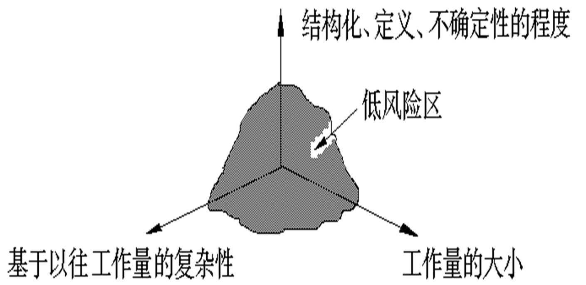
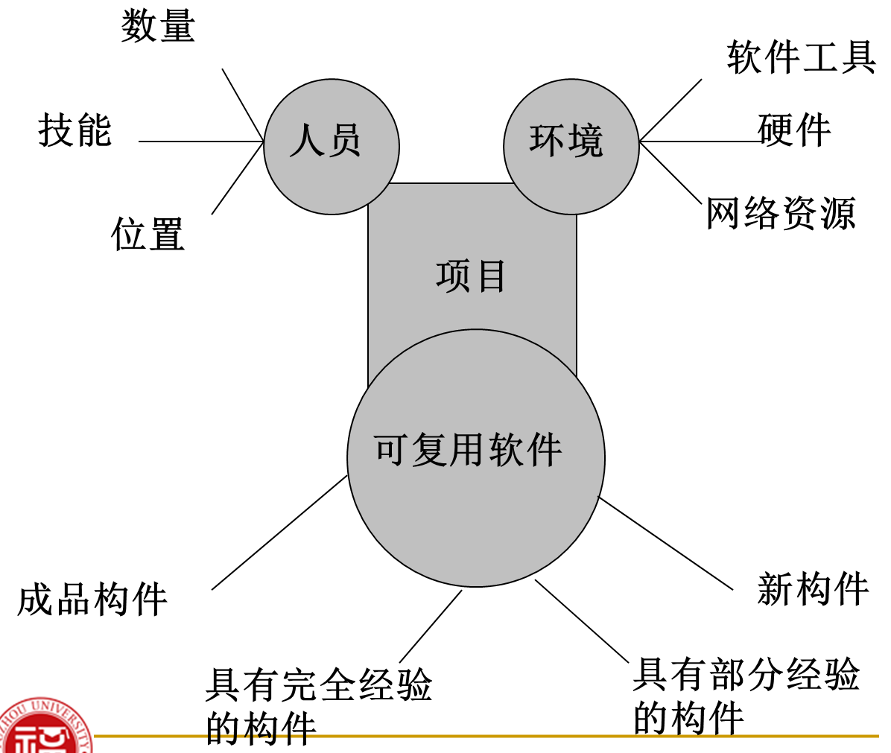
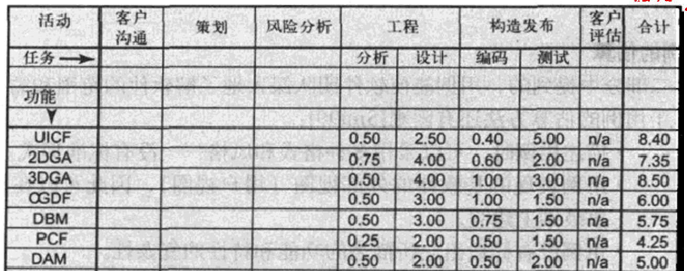
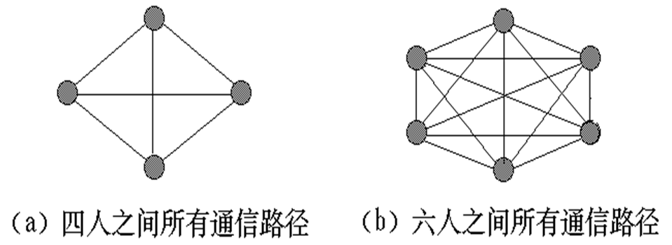

# 第 24 章 软件项目估算

## 24.1 对估算的观察（第 3–7 页）

**估算**是项目策划的第一项活动，为资源安排、成本和进度计划提供依据。估算通常要回答需要多少工作量、持续多久。工作量可用人月表示，工期按日历时间表示。过程度量和项目度量是估算的定量输入。对资源、成本和进度的认识越不充分，估算风险越高。

| 影响估算风险的因素 | 怎样影响估算 |
| --- | --- |
| **项目复杂性** | 与团队对问题和技术的熟悉程度有关。策划阶段缺少设计和代码，通常先借助类似项目或经验评估。 |
| **项目规模** | 系统越大，元素之间的依赖和协调工作越多。 |
| **结构化程度** | 需求越明确、功能越容易划分、信息结构越清楚，估算越容易细化。 |
| **历史信息的有效性** | 以口径一致、条件可比的历史数据为依据，可以减少估算的不确定性。 |

*课件第 4 页　规模、复杂性与项目定义对估算风险的影响*

范围尚不明确或需求经常变化时，成本与工期容易波动。迭代开发获得新需求或新数据后，应重新审查和修正估算。

## 项目计划过程

*24.2　课件第 9–11 页*

**项目策划**为合理估算资源、成本和进度提供框架。对关键估算给出有利和不利情形的范围，随后随着项目推进持续更新计划。

1. **规定项目范围**，明确交付目标与边界。
2. **确定可行性**，判断是否具备开发条件、项目是否值得投入。
3. **分析风险**，识别可能影响项目的事件。
4. **确定所需资源**，包括人员、可复用软件和开发环境。
5. **估算成本和工作量**，分解问题，采用规模、功能点、过程任务或用例等至少两种方法，并调和结果。
6. **制定进度计划**，建立任务集和任务网络，用进度计划工具排定时间表，规定跟踪机制。

## 24.3 软件范围和可行性（第 13–15 页）

### 软件范围

*课件第 13–14 页*

**软件范围**写清要交付的功能和特性、输入输出数据、呈现给用户的内容，以及性能、约束、外部接口和可靠性。正式估算前，应检查范围陈述或用例，必要时细化功能、数据和系统边界。

评估功能时同时考虑处理时间、响应时间、外部硬件、存储容量、成本和既有系统的限制。比如，同样是生成报表，批量生成和要求多人并发时即时生成，对设计、测试和资源的要求不同。

### 可行性

*课件第 15 页*

**可行性研究**评估项目能否实施、是否值得开发。课件要求从五方面判断。

| 方面 | 要确认的内容 |
| --- | --- |
| **技术** | 可用技术能否满足功能、性能及实现约束。 |
| **经济** | 开发成本与预期收益是否匹配，对其他产品或利润有何影响。 |
| **时间** | 能否按要求投入使用或进入市场。 |
| **资源** | 所需人员、硬件和其他资源能否按时获得。 |
| **法律** | 开发或使用系统涉及哪些许可、侵权和责任问题。 |

## 资源

*24.4　课件第 17–21 页*

三类主要资源是**人员、可复用的软件构件和开发环境**。对每类资源记录**资源描述、可用性、何时需要、使用多久**。开始使用的时点和持续时间共同构成资源的时间窗口。

*课件第 18 页　项目资源的三类及其内容*

- **人力资源**。先按软件范围确定所需技能、职位与专业。分布式团队还要明确成员所在位置。人员数量要结合已估算的工作量、任务时序与可用时间确定。
- **开发环境**。包括硬件、软件工具和网络资源，需与预计的开发、联调及测试时段匹配。
- **可复用软件资源**。基于构件的软件工程（CBSE）强调复用，在策划阶段就要调查已有资产和团队经验。

| 构件类别 | 识别依据 |
| --- | --- |
| **成品构件** | 可以从第三方或以往项目直接取得的现成软件。从第三方购买并经确认可用于本项目的商业成品构件称为 COTS。 |
| **具有完全经验的构件** | 以前项目有相似的规格、设计、代码或测试数据，当前团队熟悉其应用领域，修改风险较低。 |
| **具有部分经验的构件** | 以前项目有相关资产，仍需较多修改，当前团队经验有限，修改风险较大。 |
| **新构件** | 为满足当前项目特定需求，需要专门开发的构件。 |

## 24.5 软件项目估算（第 23–26 页）

人员、技术、环境和管理条件都能影响最终成本和工作量。估算应使用可解释的步骤，在可接受的风险下给出结果。

| 课件列出的做法 | 适用性 |
| --- | --- |
| **推迟估算** | 完成后能够得到实际值。立项和计划需要事先掌握大致投入，所以应在早期给出估算，并逐步修订。 |
| **参考已完成的类似项目** | 客户、业务、开发环境和交付条件与过去的项目足够接近时，可用历史经验做类比。 |
| **分解技术** | 将项目分成主要功能或软件工程活动，分别估算后汇总。 |
| **经验估算模型** | 根据历史项目建立函数关系，例如用 LOC 或 FP 推算工作量、成本或项目持续时间。 |

经验估算的通式为 **d = f(vᵢ)**。d 是待估结果，vᵢ 是选用的独立参数。分解估算与经验模型可以相互校验，历史数据的适用性直接影响两类方法的效果。

## 24.6 分解技术（第 28–50 页）

### 软件规模与四种规模估算方法（第 28–31 页）

**软件规模**是可量化的软件产出，可用代码行（LOC）直接表示，或用功能点（FP）间接表示。估算准确性取决于规模估得多准、规模到工作量和成本的转换是否可靠、计划能否反映团队能力，以及需求稳定性和开发环境。

| 方法 | 做法 |
| --- | --- |
| **模糊逻辑法** | 根据应用类型和历史经验先判断大致量级，再在初始范围内细化。 |
| **功能点法** | 估算软件的信息域特性，计算功能规模。 |
| **修改法** | 对复用已有软件的项目，估算复用、增加、修改、删除的内容量和类型。 |
| **标准构件法** | 统计屏幕、报表、模块、文件等标准构件出现的次数，用历史数据估算相应规模。 |

### 基于问题的估算与三点估算

*课件第 32–36 页*

1. 从软件范围陈述提取可独立估算的功能。
2. 估算各项的 LOC 或 FP，也可按类、对象、变更或受影响的业务过程计量。
3. 按团队规模、应用领域和复杂性，从同类项目选取生产率基线。用估算规模除以对应生产率得到工作量，再乘以相应的单位工作量成本。
4. 汇总各项的估算，再用其他方法交叉检查。

**三点估算**为同一个量给出乐观值 Sopt、最可能值 Sm、悲观值 Spess。用加权平均求期望值，课件赋予最可能值 4 倍权重。

**S = (Sopt + 4 × Sm + Spess) ÷ 6**

乐观值为低值，悲观值为高值。课件假定实际结果落在这个区间之外的概率很小。计算时三个输入要使用同一单位，输出沿用该单位。三点输入如果是 LOC 或 FP，得到的是预计规模，随后再用生产率换算成工作量。输入如果是人月，结果就是预计工作量。

### LOC 与 FP 估算实例

*课件第 34、37–40 页*

课件用一个**机械零件 CAD 系统**贯穿不同估算法。系统接收二维和三维几何数据，提供用户交互和设计分析，保存 CAD 数据，并控制显示、绘图和打印等外部设备。

- **基于 LOC**。把应用细分为可估算的功能和处理，如 CAD 的二维几何分析、三维几何分析和设备控制。逐项估算 LOC 后求和。工作量 = 总 LOC ÷ 同类项目生产率（LOC/人月）。劳动力成本 = 工作量 × 人月费率。
- **基于 FP**。以用户可见的输入、输出、查询、内部逻辑文件和外部接口为计数对象。划分目的是识别功能规模，粒度取决于系统边界和计数规则。在课件案例中，先用三点估算求各计数的期望，按类别与复杂度加权，再乘以 0.65 + 0.01 × ΣFᵢ 得到 FP。工作量 = FP ÷ 同类项目生产率（FP/人月）。

第 39 页的 14 项复杂性因子涉及备份和恢复、数据通信、分布式处理、关键性能、现有操作环境、联机数据输入、多屏幕输入切换、主文件联机更新、信息域值复杂度、内部处理复杂度、可复用代码、转换与安装、多次安装及易变更设计。逐项评 0–5 分。ΣFᵢ = 52 时，调整系数为 1.17。 **第 20 章 功能点与权值表**

### Delphi 方法（第 41 页）

相关专家各自依据经验给出估计，汇总后向专家反馈均值。专家根据反馈决定是否修订，再重新计算并反馈均值。多轮重复直到各专家都不再修改，以最后一轮的均值作为估算结果。

### 基于过程的估算

*课件第 42–43 页*

把项目范围内的功能与实现它们的**过程框架活动**放在一张矩阵中。继续分解活动中的任务，在相应单元格填入工作量。项目共有的沟通、策划、风险分析等工作也计入总量。

*课件第 43 页　按功能和过程任务估算工作量的明细*

按行可得到每个功能的工作量，按列可得到各项活动的投入。若各活动费率不同，**总成本 = Σ（任务工作量 × 对应费率）**。项目的分析、设计等活动可能由费率较高的人员执行，要按题设费率分别计算。第 43 页用统一费率计算，46 人月乘以每人月 8,000 美元得到 368,000 美元。

### 基于用例的估算

*课件第 44–48 页*

**用例**描述用户视图。其格式和抽象层级可变，单纯的用例计数难以表达复杂度和跨功能交互。大型系统的高层用例通常代表更多开发工作。估算前应统一编写粒度、确定子系统及软件类型、了解大致体系结构，再按层次取得可比的历史数据。课件方法采用每个层次至多 10 个用例、每个用例至多 30 个场景的约定。

该例先按历史上每个用例的平均 LOC 计算基本规模，再根据实际场景数与页数相对历史均值的变化做调整。

**估算 LOC = LOCavg × [N + ((sₐ ÷ sₕ − 1) + (pₐ ÷ pₕ − 1)) × n%]**

| 变量 | 含义 |
| --- | --- |
| **N，LOCavg** | 子系统的实际用例数、同类子系统每个用例的历史平均 LOC。 |
| **sₐ，sₕ** | 当前每个用例的场景数、同类子系统每个用例的历史平均场景数。 |
| **pₐ，pₕ** | 当前用例的平均页数、同类子系统用例的历史平均页数。 |
| **n%** | 根据当前项目设定的调整比例。原式中的 LOCadjust = LOCavg × n%。 |

实际场景数和页数都等于历史基线时，两个调整项都为 0，规模等于 `N × LOCavg`。比值大于 1 会增加对应调整项，小于 1 会减小它。多个子系统分别取基线并估算，再汇总规模，用历史生产率求工作量。

### 协调不同的估算方法

*课件第 49–50 页*

第 49 页对同一 CAD 项目用了 LOC、FP、过程和用例四种方法。可用「单项估算减去平均值，再除以平均值」比较各方法的相对偏差。确定计划值前，先对齐估算范围、单位与假定。课件重点检查两类差异来源。

1. 对**项目范围**的理解不充分或不一致，例如某种方法漏计了外部接口和数据迁移。
2. **生产率数据**不适用、过时或使用错误，例如把每人月功能点数用在代码行估算上。

查明差异后应补齐信息、更新基线并复算，再调和结果。

## 24.7 经验估算模型（第 52–62 页）

### 经验回归模型

*课件第 52–53 页*

经验模型通过对历史项目数据做**回归分析**建立。常用形式为 **E = A + B × (eᵥ)^C**。E 的单位是人月，A、B、C 是经验常数，eᵥ 表示采用的规模变量。

| 模型 | 课件公式 |
| --- | --- |
| **Walston–Felix** | E = 5.2 × KLOC^0.91 |
| **Bailey–Basili** | E = 5.5 + 0.73 × KLOC^1.16 |
| **Albrecht–Gaffney** | E = −91.4 + 0.355 × FP |
| **小型项目回归模型** | E = −12.88 + 0.405 × FP |

使用模型前核对适用的项目类型和规模单位。前两式以**千行代码（KLOC）** 代入，后两式以 **FP** 代入。

### COCOMO II 与对象点

*课件第 54–58 页*

COCOMO II 是层次化的估算模型。随着项目深入，采用的规模信息也会变化。

| 子模型 | 使用时机 | 课件采用的规模量 |
| --- | --- | --- |
| **应用组装模型** | 软件工程前期，能够识别屏幕、报表和构件。 | 对象点（OP，也称应用点） |
| **早期设计模型** | 需求已较稳定，基本软件体系结构已建立。 | 功能点（FP） |
| **体系结构后模型** | 进入软件构造，体系结构及实现信息更多。 | LOC 或 FP |

**对象点**是间接测量。对屏幕、报表按简单、中等或困难分类，统计第三代编程语言（3GL）构件，再将各类别的数量乘以对应权值求和。

| 对象类型 | 简单 | 中等 | 困难 |
| --- | ---: | ---: | ---: |
| 屏幕 | 1 | 2 | 3 |
| 报表 | 2 | 5 | 8 |

3GL 构件按每个 **10 对象点**计。屏幕和报表按复杂度取权值，再与构件得分相加（第 55–56 页）。算出 OP 后，若复用比例为 r%，则 **新对象点 NOP = OP × (1 − r%)**。用开发者经验与能力、开发环境成熟度与能力选择生产率 PROD。

| 能力与成熟度档次 | 非常低 | 低 | 正常 | 高 | 非常高 |
| --- | ---: | ---: | ---: | ---: | ---: |
| PROD（新对象点/人月） | 4 | 7 | 13 | 25 | 50 |

最后计算 **工作量 = NOP ÷ PROD**。复杂度决定屏幕和报表的权值，能力和环境成熟度决定生产率。

### 软件方程

*课件第 59–60 页*

**软件方程**是动态多变量经验模型，假定项目在整个生命周期内存在一定的工作量分布，用于描述规模、生产率、工期和工作量的关系。

**E = [LOC × B^(1/3) ÷ P]³ ÷ t⁴**

E 是工作量，t 是项目持续时间，时间和工作量单位要与模型参数校准一致。B 为**特殊技能因子**。课件示例取值为规模 5–15 KLOC 时 0.16，超过 70 KLOC 时 0.39。P 为**生产率参数**，反映过程及管理成熟度、工程实践、编程语言、开发环境、团队技能与经验、应用复杂性等。课件给出的参考 P 为实时嵌入式 2,000、电信及系统软件 10,000、商业应用 28,000。

课件案例采用两条简化式。**tmin = 8.14 × (LOC ÷ P)^0.43** 得到最短开发时间（月），用于 tmin > 6 个月的情形。**E = 180 × B × t³** 得到工作量（人月），用于 E ≥ 20 人月的情形，此式中的 t 按**年**代入。 [Pressman 教材的软件方程及计算实例](https://studylib.net/doc/28013383/5th-edition-roger-pressman-software-engineering)

### 通信路径与人均生产率

*课件第 61–62 页*

共同承担任务的人需要协调接口和依赖。若 n 人之间每两人都要直接沟通，共有 **n × (n − 1) ÷ 2 条通信路径**。每条路径对应一对成员。

*课件第 61 页　四人小组和六人小组的完全通信图*

例题中，先计算全组的潜在产出，再减掉所有路径的沟通开销，最后除以人数得到**人均生产率**。若每人单独年产出为 q，每条路径每年折合损失 c 行，则团队年产出 = n × q − 路径数 × c。

## 面向对象项目的估算

*24.8　课件第 64 页*

1. 先用工作量分解、FP 分析等常规方法获得参考估算。
2. 从需求模型建立并统计用例。
3. 从需求模型识别关键类，统计关键类数量。
4. 依据问题域和历史数据选支持类乘数。**支持类数量 = 关键类数量 × 乘数**。
5. **基于类的工作量 =（关键类数 + 支持类数）× 每类平均工作量**。
6. **基于用例的工作量 = 用例数 × 每用例平均工作量**，用它交叉检查类估算。两种工作量应换算为同一单位。 **第 20 章 关键类与支持类**

## 自测题

### 作业延伸（自编）

#### 从需求说明到范围、可行性与资源

以作业二第 1 题的需求过程与需求规格说明为背景。学校计划用 4 周开发社团活动报名系统。首版提供活动发布、学生报名、名单导出并对接统一身份认证。预计报名高峰有 200 人同时访问，三名成员参与开发，团队拟复用以往项目的名单导出模块。

1. 写出首版软件范围，给出一条可验证的响应时间目标。
2. 从五个方面说明可行性研究需要确认什么。
3. 列出三类项目资源，任选一个资源写出描述、可用性、何时需要及使用时间。

### 近年真题

#### 真题 1（三点估算，2023 年 6 月卷与 2024 年 12 月卷选择题第 10 题，2 分）

对于一个项目的工作量，给出的乐观、可能和悲观估计分别是 20，70，80 人月。基于三点估算，这个项目的工作量的人月数为（　）（取最近数）

- A. 57
- B. 64
- C. 74
- D. 70

#### 真题 2（2024 年 12 月卷，选择题第 6 题，2 分）

可行性研究的目的是（　）。

- A. 争取项目
- B. 项目是否值得开发
- C. 开发项目
- D. 规划项目

### 课件例题与本章应用练习

#### 练习 1　CAD 的 LOC 与 FP 估算（根据课件第 37–40 页改编）

拟开发一个机械零件 CAD 系统。分别用以下两组信息估算其工作量和劳动力成本。费率均为每人月 8,000 美元，中间计算保留精度。

1. **LOC 法。** 已知用户接口及控制设备 2,300 LOC、二维几何分析 5,300 LOC、数据库管理 3,350 LOC、计算机图形显示 4,950 LOC、外部设备控制 2,100 LOC、设计分析模块 8,400 LOC。三维几何分析的乐观、可能、悲观规模为 4,600、6,900、8,600 LOC。同类项目生产率为 620 LOC/人月。求三维几何分析的期望规模、项目总规模、工作量和成本。
2. **FP 法。** 用下表计算每类计数的三点期望值，再按权值求加权总计数。ΣFᵢ = 52，生产率为 6.5 FP/人月。求 FP、工作量和成本。

| 信息域 | 乐观值 | 可能值 | 悲观值 | 权值 |
| --- | ---: | ---: | ---: | ---: |
| 外部输入 | 20 | 24 | 30 | 4 |
| 外部输出 | 12 | 15 | 22 | 5 |
| 外部查询 | 16 | 22 | 28 | 4 |
| 内部逻辑文件 | 4 | 4 | 5 | 10 |
| 外部接口文件 | 2 | 2 | 3 | 7 |

#### 练习 2　基于过程和用例的估算（根据课件第 42–50 页改编）

1. CAD 例子中，用户接口及控制设备功能需要分析 0.50 人月、设计 2.50 人月、编码 0.40 人月和测试 5.00 人月。假设分析和设计按每人月 10,000 美元计，编码和测试按每人月 8,000 美元计。求该功能的工作量与成本。
2. 用例估算按下表进行。调整比例 n% = 30%，历史生产率为 620 LOC/人月。求各子系统组的 LOC、合计 LOC 及总工作量。

| 子系统组 | 实际用例数 | 实际场景数/例 | 历史场景数/例 | 实际页数/例 | 历史页数/例 | 历史 LOC/例 |
| --- | ---: | ---: | ---: | ---: | ---: | ---: | ---: |
| 用户界面 | 6 | 10 | 12 | 6 | 5 | 560 |
| 工程 | 10 | 20 | 16 | 8 | 8 | 3,100 |
| 基础设施 | 5 | 6 | 10 | 5 | 6 | 1,650 |

3. 整个 CAD 系统按过程法估算为 46 人月。这个结果与你按用例得到的结果相差较大，应怎样处理？

#### 练习 3　经验回归模型（课件第 53 页原题）

假设小张、小王和小李都是项目经理，被要求估计一个 50,000 行代码项目的工作量。

1. 小张选用 Walston–Felix 模型，则结果应是（　）人月。

   A. 185　B. 572　C. 620　D. 79634

2. 小王选用 Bailey–Basili 模型，则结果应是（　）人月。

   A. 74　B. 214　C. 1189　D. 1246

#### 练习 4　应用组装模型与 ATM 对象点（课件第 58 页例题及变式）

某困难复杂度的 ATM 软件包括 12 个屏幕、10 个报表和约 80 个软件构件。开发者能力与环境成熟度为正常档。用 COCOMO II 应用组装模型计算对象点和工作量，再求复用 25% 时的 NOP 和工作量。两种情形均另给出按整人月向上安排的数值。

题中困难屏幕、困难报表、3GL 构件的权值分别为 3、8、10，正常档生产率为 13 新对象点/人月。

#### 练习 5　软件方程与团队通信（根据课件第 60–62 页改编）

1. CAD 项目规模为 33,200 LOC，P = 12,000，B = 0.28。用软件方程的简化式求最短开发时间（月）和对应工作量（人月）。
2. 单人年产出为 5,000 行。多人两两通信时，每条路径每年折合损失 250 行。分别求 4 人小组和 10 人小组的通信路径数、团队年产出和人均生产率。

#### 练习 6　面向对象项目的估算（自编）

需求模型中识别出 8 个关键类和 18 个用例。支持类乘数为 2.5，每个类平均需要 2 人日，每个用例平均需要 3 人日。分别按类和用例估算工作量，并说明如何使用这两个结果。

---

## 答案与解析

### 作业延伸解析

#### 从需求说明到项目准备

**答案与解析**

1. **范围**包括活动发布、报名和名单导出。输入有活动信息及学生身份和报名信息，输出有报名回执和名单，外部接口是统一身份认证。性能目标可写为「在约定的 200 人同时访问测试负载下，95% 的报名请求在 2 秒内获得回执」。4 周是交付约束。
2. **可行性**包括验证身份接口和高峰负载能否满足目标（技术），比较开发、维护成本与减少人工统计的收益（经济），评估能否在活动报名开始前验收（时间），确认团队技能及测试环境是否可用（资源），核查构件授权及报名数据的使用责任（法律）。
3. 三类资源是开发和测试**人员**、可复用的名单导出**构件**和含身份测试接口的**开发环境**。例如，需用一套能模拟统一身份认证的测试环境，校方可从第 2 周提供，第 2 周联调时开始使用，持续至第 4 周验收。

**考法、答题要点与易错点**　软件范围同时写功能、数据、接口和性能约束。可行性按五类给出要验证的条件。列资源时应明确使用窗口，构件复用还要考虑适配工作。

**课件位置**　本章课件第 9–11、13–21 页。第 06 章课件第 18–21 页。

**笔记位置**　[项目计划过程](#项目计划过程) · [软件范围](#软件范围) · [可行性](#可行性) · [资源](#资源)

### 近年真题解析

#### 真题 1

**答案与解析**　选 **B. 64**。按课件三点估算，(20 + 4 × 70 + 80) ÷ 6 = 380 ÷ 6 ≈ **63.33 人月**，给出的选项中 64 与计算值最接近。

**考法、答题要点与易错点**　认清 70 是最可能值，系数为 4，权重之和为 6。保留中间结果，到选择时按题设比较选项与计算值的距离。

**课件位置**　本章课件第 31、35–36 页。

**笔记位置**　[基于问题的估算与三点估算](#基于问题的估算与三点估算)

#### 真题 2

**答案与解析**　选 **B. 项目是否值得开发**。可行性研究在投入主要资源前评估技术、经济、时间、资源和法律条件，提供是否可以开展项目、是否值得投入的依据。

**考法、答题要点与易错点**　抓住题目问的是可行性研究的**目的**。答简答题时，可先写「评估能否实施、是否值得开发」，再按五方面给出判断依据。进度规划则要安排具体任务和时间。

**课件位置**　本章课件第 10–11、15 页。

**笔记位置**　[项目计划过程](#项目计划过程) · [可行性](#可行性)

### 课件例题与本章应用练习解析

#### 练习 1

**答案与解析**

1. **LOC 法。** 三维几何分析规模 = (4,600 + 4 × 6,900 + 8,600) ÷ 6 = **6,800 LOC**。将它与另外六项相加，总规模 = **33,200 LOC**。工作量 = 33,200 ÷ 620 ≈ **53.55 人月**。按未提前取整的工作量乘 8,000，劳动力成本约为 **428,387 美元**。
2. **FP 法。** 各项三点期望值依次为 146/6、94/6、22、25/6、13/6。乘以对应权值后相加，加权总计数 = **320.5**。复杂性调整系数 = 0.65 + 0.01 × 52 = 1.17，因此 FP = 320.5 × 1.17 = **374.985 FP**（约 375 FP）。工作量 = 374.985 ÷ 6.5 = **57.69 人月**。成本 = 57.69 × 8,000 = **461,520 美元**。

**考法、答题要点与易错点**　分清规模的三点估算和规模到工作量的换算。FP 题先求各类信息域计数的期望，再乘权值，汇总后做复杂性调整。在求完工作量和成本前，保留中间精度。两种生产率的分子单位分别是 LOC 和 FP。

**课件位置**　本章课件第 32–40 页。

**笔记位置**　[三点估算](#基于问题的估算与三点估算) · [LOC 与 FP 估算实例](#loc-与-fp-估算实例)

#### 练习 2

**答案与解析**

1. 过程法中，该功能的工作量为 0.50 + 2.50 + 0.40 + 5.00 = **8.40 人月**。劳动力成本 = (0.50 + 2.50) × 10,000 + (0.40 + 5.00) × 8,000 = **73,200 美元**。
2. 用户界面组的 LOC = 560 × [6 + ((10 ÷ 12 − 1) + (6 ÷ 5 − 1)) × 30%] = **3,365.6**。工程组代入历史平均 3,100 LOC/用例得到 **31,232.5**，基础设施组代入 1,650 LOC/用例得到 **7,969.5**。相加为 **42,567.6 LOC**，约 42,568 LOC。工作量 = 42,567.6 ÷ 620 ≈ **68.66 人月**。
3. 核对哪一方遗漏或扩大了功能、接口和过程活动，再检查用例拆分粒度、历史 LOC/例和生产率是否适合当前项目。统一估算口径后复算，再根据证据调和计划值。

**考法、答题要点与易错点**　过程估算按任务工作量和对应费率分别计算。用例估算按子系统选择历史基线，把场景和页数的相对变化同时纳入调整，汇总后再取整。差距较大时要给出检查和复算步骤。

**课件位置**　本章课件第 42–50 页。

**笔记位置**　[基于过程的估算](#基于过程的估算) · [基于用例的估算](#基于用例的估算) · [协调不同的估算方法](#协调不同的估算方法)

#### 练习 3

**答案与解析**　50,000 LOC = **50 KLOC**。Walston–Felix 的计算结果为 5.2 × 50^0.91 ≈ **182.84 人月**，选最接近的 **A. 185**。Bailey–Basili 的计算结果为 5.5 + 0.73 × 50^1.16 ≈ **73.75 人月**，选 **A. 74**。

**考法、答题要点与易错点**　先换算 KLOC，核对模型系数和指数，再计算。Bailey–Basili 还要加上常数 5.5。选择题按选项取近似值。

**课件位置**　本章课件第 52–53 页。

**笔记位置**　[经验回归模型](#经验回归模型)

#### 练习 4

**答案与解析**　OP = 12 × 3 + 10 × 8 + 80 × 10 = **916**。无复用时 NOP = 916，工作量 = 916 ÷ 13 ≈ **70.46 人月**，向上安排 **71 人月**。复用 25% 时 NOP = 916 × 0.75 = **687**，工作量 = 687 ÷ 13 ≈ **52.85 人月**，向上安排 **53 人月**。

**考法、答题要点与易错点**　先按屏幕、报表和构件的权值求 OP，再按待开发比例求 NOP，最后除以 PROD。题给的困难档用来确定对象权值，正常档用来确定生产率，分别查对应表。

**课件位置**　本章课件第 54–58 页。

**笔记位置**　[COCOMO II 与对象点](#cocomo-ii-与对象点)

#### 练习 5

**答案与解析**

1. tmin = 8.14 × (33,200 ÷ 12,000)^0.43 ≈ **12.61 个月**，折合约 1.051 年。E = 180 × 0.28 × (tmin ÷ 12)^3 ≈ **58.46 人月**，计划量级约为 58 人月。两式结果满足课件的应用条件。
2. 4 人小组有 4 × 3 ÷ 2 = **6 条**通信路径，团队年产出 = 4 × 5,000 − 6 × 250 = **18,500 行**，人均为 **4,625 行/人年**。10 人小组有 **45 条**通信路径，团队年产出 = 10 × 5,000 − 45 × 250 = **38,750 行**，人均为 **3,875 行/人年**。

**考法、答题要点与易错点**　最短开发时间公式中，先计算 LOC ÷ P，再对商取 0.43 次幂。代入工作量简化式之前把工期换成年。通信题中的 n(n − 1)/2 按成员对计数，路径总开销从全组潜在产出中扣除，最后计算人均值。

**课件位置**　本章课件第 59–62 页。

**笔记位置**　[软件方程](#软件方程) · [通信路径与人均生产率](#通信路径与人均生产率)

#### 练习 6

**答案与解析**　支持类为 8 × 2.5 = **20 个**，类总数为 28，按类估算为 28 × 2 = **56 人日**。按用例估算为 18 × 3 = **54 人日**。对齐开发范围和历史口径后，两者可以相互校验。需要进一步细化时，可检查是否遗漏支持类或把某些复杂用例合并计数。

**考法、答题要点与易错点**　先用关键类数和乘数求支持类，工作量按关键类与支持类的总数计算。每类和每用例的平均工作量要先统一单位，再比较结果。

**课件位置**　本章课件第 64 页。第 20 章课件第 33–35 页。

**笔记位置**　[面向对象项目的估算](#面向对象项目的估算)

题目来源　**作业二** · **2023-06-09 期末卷** · **2024-12-27 期末卷** · **第 24 章课件**
