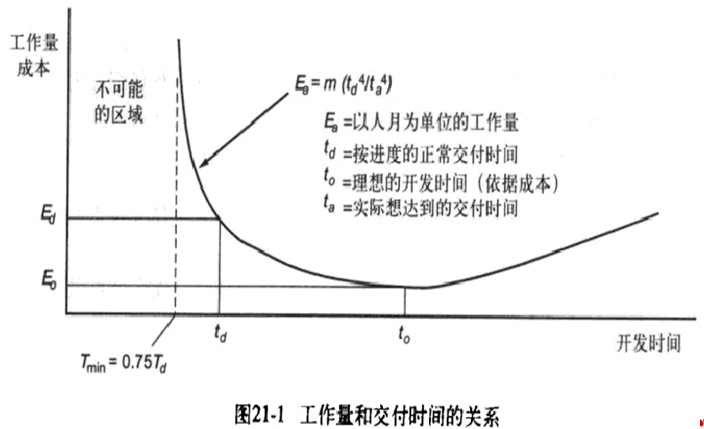
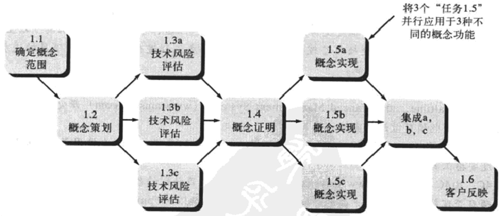
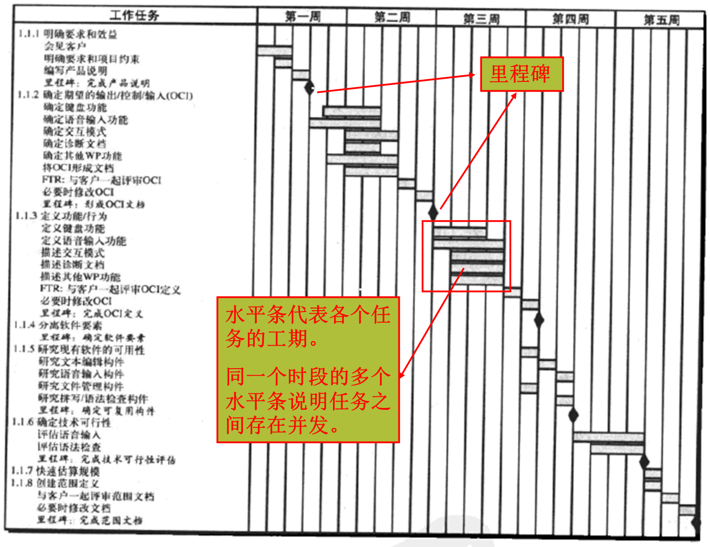
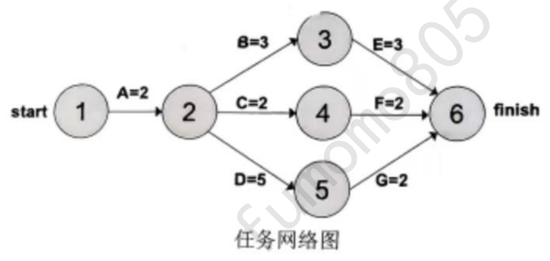
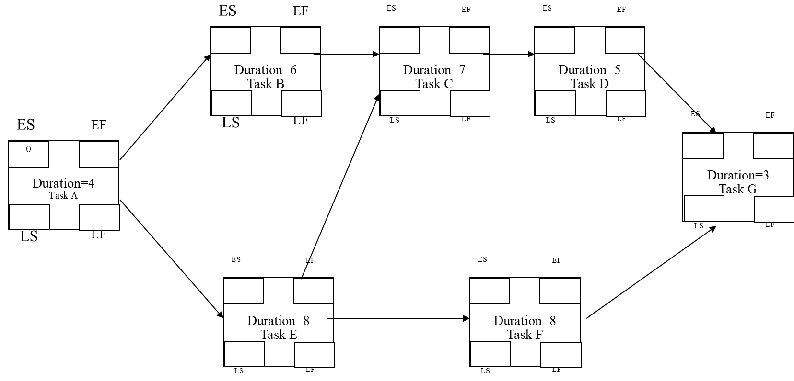
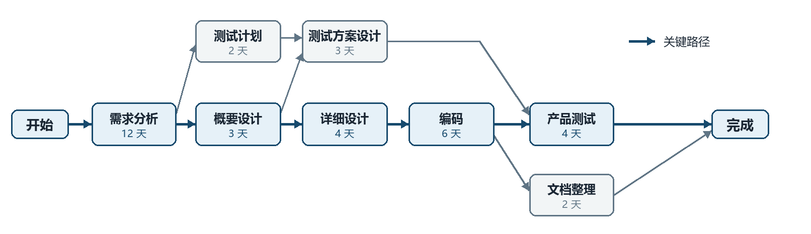
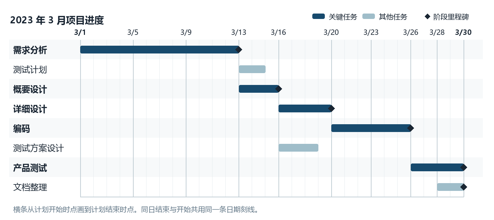

# 第 25 章 项目进度安排

页码沿用本份 PPT 页脚。复习时按「确定任务和依赖 → 算最早、最晚时点 → 画进度表 → 跟踪偏差」理解全章。计算题重点是关键路径、总浮动与自由浮动、挣值分析。 **第25章.ppt** · [自测题](#自测题)

## 25.1 基本概念（第 2–10 页）

### 进度安排的输入与延期原因（第 2–7 页）

编制进度计划前，要选好过程模型，列出工程任务，估算工作量和人员，明确交付期限，并分析风险。课件开头举出一个项目长期停在「估计完成 90%」的例子。实际进度要用已完成的任务、可检查的工作产品和通过评审的里程碑来判断。

课件列出的主要延期原因包括以下八项。

1. 外部确定的交付期限不切实际。
2. 需求发生变化，原进度计划没有为变更作安排。
3. 工作量或资源估计不足。
4. 项目开始时对风险考虑不充分。
5. 出现预先难以估计的技术难题。
6. 出现预先难以估计的人员问题。
7. 团队交流不畅。
8. 管理者没有及时发现进度落后，或未及时采取措施。

### 处理不切实际的交付期限（第 7–10 页）

当乐观估算也支持不了原期限时，项目经理应把估算依据和可行方案提交给相关方共同决策。

1. 用历史项目数据和当前进展做详细复估，得到新的工作量和工期。
2. 拟定**增量开发**方案，优先交付核心功能，其余纳入后续增量。
3. 向客户说明复估依据、原期限所需的生产率提升幅度，以及范围、资源和质量的约束。
4. 提交可选计划，协商首版范围、预算与交付时间。若考虑增加资源，需评估其培训、协调和质量保障所需的时间。

## 25.2 项目进度安排概述（第 12–22 页）

### 进度表与七条基本原则（第 12–16 页）

**软件项目进度安排（Software Project Scheduling）**把工作量分配给具体的软件工程任务，并明确先后关系及计划开始、完成时点。早期用**宏观进度表**标识主要框架活动，随后细化为可直接执行、分配和跟踪的**详细进度表**。

课件讨论两种排程情形。最终发布日期固定时，要在给定时间框架内分配工作，并检查计划是否可行。发布日期可协商时，可先分析任务和资源，再确定能有效利用资源的日期。

| 指导原则 | 要求 |
| --- | --- |
| **划分** | 同时分解产品和过程，形成可以管理的活动、动作和任务。 |
| **相互依赖性** | 确定任务的先后约束及可以并行的部分。 |
| **时间分配** | 分配工作量，确定每项任务的开始、完成日期。 |
| **工作量确认** | 检查各时段计划分配的人员是否超过团队可用人数。 |
| **确定责任** | 为每项任务指定负责人。 |
| **明确结果** | 明确任务的输出，例如模块设计文档、可运行软件等工作产品。 |
| **确定里程碑** | 把任务或任务组和里程碑关联。相关工作产品通过质量评审并被认可时，达成里程碑。 |

### 人员、工作量与开发时间（第 17–21 页）

项目后期加入人员要付出**培训和沟通**成本。原成员需花时间指导新成员，团队还需增加接口协调和信息同步。进度有一定弹性，同一范围下压缩工期往往会增加所需投入，适度延长日期有时能降低成本。

*课件第 18 页　工作量与交付时间的关系*

图中 t_d 为正常交付工期，t_a 为目标交付工期，t_o 为按成本考虑的理想工期。图示压缩段中，目标工期越短，所需工作量增长越快。图中用 t_min = 0.75 × t_d 示意压缩下限。

课件的软件方程写出源代码行数 L、生产率参数 P、开发工作量 E 和开发时间 t 的关系。

- **L = P × E^(1/3) × t^(4/3)**
- **E = L³ ÷ (P³ × t⁴)**

固定规模和生产率时，比较两个工期方案可用 **E₂/E₁ = (t₁/t₂)⁴**。计算时要对齐模型的时间与工作量单位。第 19 页按月和人月说明基本关系，生产率参数示例范围为 2,000–12,000。第 20–21 页以年和人年讨论方案。 **第 24 章 软件方程**

### 工作量分配（第 22 页）

**40–20–40** 是一种分配指导原则，即前期分析和设计约 40%，编码约 20%，后期测试约 40%。课件还给出分项范围，实际应结合项目特点确定。

| 活动 | 课件给出的典型比例 |
| --- | --- |
| 项目计划 | 很少超过 2%–3% |
| 客户沟通与需求分析 | 约 10%–25% |
| 软件设计 | 约 20%–25% |
| 编码 | 约 15%–20% |
| 测试与调试 | 约 30%–40% |

## 25.3 为软件项目定义任务集（第 24–28 页）

### 项目类型与任务集选择（第 24–25 页）

根据项目类型和所需的严格程度，决定任务集包含哪些工作、交付物和评审。

| 项目类型 | 主要目标 |
| --- | --- |
| **概念开发项目** | 探索新业务或新技术的应用，重点验证可行性。 |
| **新应用系统开发项目** | 针对特定客户需求开发系统。 |
| **应用系统增强项目** | 改变已有软件的用户可见功能、性能或界面。 |
| **应用系统维护项目** | 对已有软件纠错、修改或扩展，课件所举情形中用户通常不会立刻察觉。 |
| **再工程项目** | 部分或全部重建已有系统。 |

选择任务集还要考虑规模、潜在用户数量、关键性、应用寿命、需求稳定性、客户与开发者沟通难度、技术成熟度、性能约束、是否嵌入式、人员配置及再工程因素。

### 概念开发与任务求精（第 26–28 页）

概念开发由六个动作构成。先确定**概念范围**，做**初步概念策划**，明确组织需要的能力，再做**技术风险评估**。以**概念证明**验证技术能否在目标环境工作，接着做**概念实现**，形成客户可评审的成果。最后获取**客户反馈**，明确后续应用的目标。

做详细计划时，把每个动作再拆成任务。例如，「确定概念范围」要明确需求、效益和潜在客户，确定输入与输出，定义主要功能和行为，识别需实现的技术要素，调查可用软件，确定技术可行性，快速估算规模，编制范围定义。细化输入与输出时，还可规定**技术评审（TR）**、编制输入输出清单、与客户评审并按反馈修改等任务。

## 25.4 定义任务网络（第 30–31 页）

**任务网络**也称活动网络，用图形表示项目任务的流程和依赖。分支上的任务可以并行时，仍需协调其输出，保证各工作产品在后继任务使用前完成。一个后继有多个前置时，要等所有相关依赖满足。

*课件第 30 页　概念开发项目的分支、汇合与依赖*

画图和读图时先确认图的表示法。**PDM 节点式网络**把任务与历时写在节点中，用箭头表示关系。**箭线式网络**把任务及历时写在线上，节点表示事件。枚举路径时，从项目起点顺箭头走到终点，遇到分支分别列出。

## 25.5 进度安排（第 33–56 页）

### 关键路径法与时间参数（第 33–43 页）

**关键路径法（Critical Path Method，CPM）**根据确定的任务历时和网络关系求各任务的最早、最晚时点及浮动时间。关键路径是网络中**工期最长**的完整路径，其长度决定现有依赖约束下项目**最早**能在何时完成。以最早完工时点逆推时，关键路径上的任务总浮动为 0。关键任务的延迟会直接威胁总工期，可以有多条同长的关键路径，关键路径也可能随进度变化。

| 参数 | 含义 |
| --- | --- |
| **ES** | 任务最早开始时间 |
| **EF** | 任务最早完成时间 |
| **LS** | 任务最晚开始时间 |
| **LF** | 任务最晚完成时间 |

图上直接比较路径时，沿每条完整路径累加历时，带结束到开始的时间间隔时计入间隔。第 34、49 页的节点表把 ES、EF 放在上方，把 LS、LF 放在下方。

### 正推法、逆推法与浮动时间（第 34–39、44–50 页）

以下使用课件的**结束到开始（FS）**关系。A 完成后还要等 3 天才能开工 B，则 A 到 B 的**滞后（Lag）**为 +3。若允许 B 在 A 完成前 2 天开工，则**超前（Lead）**可在公式中记为 Lag = −2。

1. **正推求 ES 和 EF。** 从项目开始时点出发，无前置任务以该时点为 ES。各任务 **EF = ES + 历时**。遇到多个前置，**ES = max（各前置的 EF + 对应 Lag）**，取最大值以满足全部约束。
2. **逆推求 LF 和 LS。** 以项目最早完工时点作为结束节点的 LF，沿箭头逆向计算。各任务 **LS = LF − 历时**。遇到多个后置，**LF = min（各后置的 LS − 对应 Lag）**，取最小值以保留每个后继的最晚开工时间。
3. **总浮动 TF** 是在项目最早完工日期不变的条件下，本任务可延迟的时间。**TF = LS − ES = LF − EF**。
4. **自由浮动 FF** 是在各直接后继的最早开始时间不变的条件下，本任务可延迟的时间。**FF = min（各后置的 ES − 本任务 EF − 对应 Lag）**。无后续任务时可把同一个零历时项目结束节点作为后继。

第 39 页有两条并行分支。A 历时 100 天，另一条由 B（10 天）、滞后 5 天和 C（5 天）构成。B 的 EF 为 10，C 的 ES 为 15，所以 **FF(B) = 15 − 10 − 5 = 0**。以第 100 天作为完工时点逆推，C 的 LS 为 95，B 的 LF 为 90、LS 为 80，所以 **TF(B) = 80**。两类浮动对应的约束不同。

### 甘特图和项目表（第 51–54 页）

**时序图**也叫**甘特图（Gantt Chart）**。纵向列任务，横向标日期或周次。水平条的起止位置和长度表示计划开始、完成与工期，横条在时间轴上重叠表示并行。**里程碑**是可检查的完成时点，通常用菱形标记。排程可按整个项目、功能或人员分别显示。

*课件第 52 页　甘特图中的任务横条、并发与里程碑*

**项目表**逐项列出任务的计划和实际开始、完成日期，还可记录人员分配、工作量与备注。任务网络便于检查依赖和关键路径，甘特图便于读出日历安排，项目表提供可核对的计划及实际记录。

### 进度跟踪与控制（第 55–56 页）

用进度表跟踪任务、工作产品和里程碑。课件列出六种方式。

1. 定期开项目状态会，由成员报告进度与问题。
2. 评估软件过程中的评审结果。
3. 核实里程碑是否按期完成。
4. 用项目表比较实际与计划的任务日期。
5. 与开发者交流，了解实际进展及潜在问题。
6. 用挣值分析定量判断进度。

发现偏差后先定位原因，再根据情况调配资源、处理阻塞或重新安排进度。判断工作是否完成时应结合预算、质量评审和里程碑结果。

## 25.6 挣值分析（第 58–62 页）

### 三个成本量与总预算（第 58–59、61 页）

**挣值分析（Earned Value Analysis）**在同一检查时点比较计划工作量、实际完成量和实际支出，用预算成本或预算工作量作统一尺度。课件例题以人日为单位。

| 指标 | 含义 | 取数方法 |
| --- | --- | --- |
| **BCWS（计划值，PV）** | 计划完成工作的预算成本 | 截至该时点按计划应完成的工作的预算之和。 |
| **BCWP（挣值，EV）** | 实际完成工作的预算成本 | 截至该时点实际完成的工作，按其**原预算**计价。 |
| **ACWP（实际成本，AC）** | 实际完成工作的实际成本 | 截至该时点实际发生的工作成本，用同一范围和口径统计。 |
| **BAC（完工预算）** | 全部项目工作的预算总额 | 将项目计划中所有任务的预算相加。 |

### 评价进度和成本（第 60–62 页）

| 指标 | 公式 | 判断规则 |
| --- | --- | --- |
| **SPI（进度执行指标）** | BCWP ÷ BCWS | 小于 1 表示落后，等于 1 表示符合计划，大于 1 表示超前。 |
| **SV（进度偏差）** | BCWP − BCWS | 负值表示落后，正值表示超前。差额采用题设的预算价值单位。 |
| **CPI（成本执行指标）** | BCWP ÷ ACWP | 小于 1 表示成本超支，等于 1 表示符合同等工作量的预算，大于 1 表示节约。 |
| **CV（成本偏差）** | BCWP − ACWP | 负值表示实际成本超过已完成工作的预算，正值表示成本节约。 |
| **计划完成百分比** | BCWS ÷ BAC | 截至当前本应完成的预算份额。 |
| **实际完成百分比** | BCWP ÷ BAC | 截至当前已完成的预算份额。 |

计算时先找**已完成工作按预算计的值**。它是 SPI 和 CPI 的共同分子。SV 表示按预算计的进度差，若要判断完工日期的影响，还应查看相关任务和关键路径。

## 自测题

### 作业延伸（自编）

#### 从框架活动到可排程的任务集

以作业一第 3 题中的框架活动为背景。一个课程团队想验证校园活动报名系统能否接入学校现有的统一身份认证接口。验证可行后，要把身份认证和报名流程集成为一个可交给校方评审的演示。两名成员分别熟悉接口开发和业务建模。

1. 判定项目类型，列出适合该项目的主要任务或动作。
2. 将「确定概念范围」细化成至少三项任务，其中一项涉及评审。
3. 指出哪些工作可并行、哪些要等前置工作完成，并给出一个里程碑和达成条件。

### 近年真题

#### 真题 1（2023 年 6 月卷，简答题第 3 题，10 分）

请根据下面的任务安排表，画出任务网络图、甘特图、标识关键路径和阶段里程碑位置。

| 任务名称 | 起始日期 | 结束日期 |
| --- | --- | --- |
| 需求分析 | 2023.3.1 | 2023.3.13 |
| 测试计划 | 2023.3.13 | 2023.3.15 |
| 概要设计 | 2023.3.13 | 2023.3.16 |
| 详细设计 | 2023.3.16 | 2023.3.20 |
| 编码 | 2023.3.20 | 2023.3.26 |
| 测试方案设计 | 2023.3.16 | 2023.3.19 |
| 产品测试 | 2023.3.26 | 2023.3.30 |
| 文档整理 | 2023.3.28 | 2023.3.30 |

#### 真题 2（2024 年 12 月卷，综合题第 1 题，10 分）

在管理软件项目时，任务网络是项目任务流的图形表示。任务网络常用作将任务顺序和依赖关系输入到自动化项目调度工具中。对于以下任务网络，请回答以下问题：

1. 以下任务网络图上有多少条路径，并列出这些路径？（4 分）
2. 每条路径有多长？（3 分）
3. 哪条是关键路径？（3 分）

### 课件例题与本章应用练习

#### 练习 1　工期压缩与项目交付（根据课件第 8–10、17–20 页改编）

1. 你所负责的项目要开发一个实时控制器，客户要求 9 个月内交付。在现有人员条件下，细致估算和风险分析得到约 14 个月。作为项目经理，你会怎样应对？请给出可与客户讨论的安排。
2. 在软件方程的适用范围内，假定规模和生产率不变，某项目的工期从 10 个月缩到 8 个月。按课件的关系式，预计工作量为调整前的多少倍？

#### 练习 2　确定关键路径和浮动时间（课件第 48–49 页课堂练习）

作为项目经理，你需要为软件项目安排进度。任务分解得到 A、B、C、D、E、F、G，各任务之间没有滞后和超前。任务工期已标在下方 PDM 网络图中，项目第 0 天开始。

计算每个任务的最早开始、最晚开始、最早完成和最晚完成时点，确定关键路径和长度，并计算 F 的自由浮动和总浮动。

#### 练习 3　滞后、超前与浮动（自编）

项目第 0 天开始。任务 A 历时 10 天，任务 B 历时 4 天，两者可以从项目开始时同时进行。C 历时 3 天，应在 B 完成后再等 2 天才能开始。A、C 均完成时项目才算完成。

1. 求项目最早完工时间，B、C 的 ES、EF、LS、LF，并求 B 的总浮动和自由浮动。
2. 若改为 C 最多可在 B 完成前 1 天开始，C 的最早开始时间是多少？

#### 练习 4　挣值分析（根据课件第 62 页改编及自编变式）

1. 某项目的完工预算为 582 人日。检查点计划应完成的工作预算为 155.5 人日，实际完成的工作按预算计为 125.5 人日，完成这些工作的实际成本为 127.5 人日。求 SPI、SV、CPI、CV 和计划、实际完成百分比，判断进度及成本状态。
2. 另一个小项目有 A、B、C 三项任务，其预算分别为 30、50、20 人日。检查点按计划应完成 A、B，实际上只完成了 A，实际花费 40 人日，其余任务尚未开工。求 BAC、BCWS、BCWP 和 ACWP。

#### 练习 5　进度安排选择题（课件第 63–64 页原题）

1. 软件计划是软件开发的早期和重要阶段，此阶段要求交互和配合的是（　）。

   A. 设计人员和用户　B. 分析人员和用户　C. 分析人员和设计人员　D. 编码人员和用户

2. 在软件工程项目中，不随参与人数的增加而使生产率成比例增加的主要原因是（　）。

   A. 工作阶段的等待时间　B. 产生原型的复杂性　C. 参与人员所需电脑数　D. 参与人员之间的通信困难

3. 编写程序的工作量通常占用软件开发总工作量的（　）。

   A. 80%　B. 60%　C. 40%　D. 20%

4. 描述软件项目进度安排的甘特图能够表示（　）。

   A. 多个任务之间的复杂关系　B. 任务之间的相互依赖制约关系　C. 哪些任务是关键任务　D. 子任务之间的并行和串行关系

5. 可行性研究要进行的需求分析和设计应是（　）。

   A. 详细的　B. 全面的　C. 简化、压缩的　D. 彻底的

---

## 答案与解析

### 作业延伸解析

#### 从框架活动到可排程的任务集

**答案与解析**

1. 这是**概念开发项目**。可安排确定概念范围、制定初步计划、评估身份认证接口的技术风险、用原型做概念证明、集成演示并获取校方反馈。
2. 范围动作可拆成确认报名目标和用户、记录所需的身份输入及报名结果、明确两部分的接口，再让校方与团队评审并确认范围说明。
3. 范围初步确定后，两人可并行做接口可行性试验和报名流程建模。集成演示要等接口试验和流程模型都具备用于集成的条件。里程碑可设为「概念验证通过」，例如演示完成身份认证和一次报名，并经客户评审确认达到预定行为。

**考法、答题要点与易错点**　从项目目的判断类型，再把宏观动作拆成有负责人和工作产品的任务。判定并行要看输入依赖和实际可用人员。写里程碑时给出可核查的达成条件。

**复习位置**　本章课件第 15–16、24–31 页。第 02 章课件第 3、10–11 页。 [进度表与七条基本原则](#进度表与七条基本原则第-1216-页) · [概念开发与任务求精](#概念开发与任务求精第-2628-页) · [定义任务网络](#254-定义任务网络第-3031-页) · **第 02 章 明确任务集**

### 近年真题解析

#### 真题 1

**答案与解析**　题表列出的是计划日期。这里用以下前置关系画零滞后的任务网络。把同日的结束与开始视为同一时点，历时按日期差计算。

- 需求分析完成后，测试计划和概要设计可以并行。详细设计依赖概要设计，测试方案设计依赖测试计划及概要设计。
- 编码依赖详细设计。产品测试等编码和测试方案设计都完成后开始。文档整理依赖编码完成。产品测试和文档整理都结束后，项目完成。

**关键路径**为**需求分析 → 概要设计 → 详细设计 → 编码 → 产品测试**，历时 12 + 3 + 4 + 6 + 4 = **29 天**，从 3 月 1 日到 3 月 30 日。按上述依赖，文档整理最早可在编码完成的 3 月 26 日开始，有 2 天总浮动。原题将它计划在 3 月 28 日开始，与产品测试同日结束。

| 日期 | 阶段里程碑位置 |
| --- | --- |
| 3 月 13 日 | 需求分析完成 |
| 3 月 16 日 | 概要设计完成 |
| 3 月 20 日 | 详细设计完成 |
| 3 月 26 日 | 编码完成 |
| 3 月 30 日 | 产品测试完成、文档整理完成 |

**考法、答题要点与易错点**　网络图考依赖，甘特图考计划日期。按工作产品的依赖确定箭头，画齐并行分支和汇合。按原表日期画横条，在各阶段完成处标菱形。判定关键路径时比较依赖约束下的路径历时和各任务的总浮动。

**复习位置**　本章课件第 16、30–31、33–43、51–54 页。 [进度表与七条基本原则](#进度表与七条基本原则第-1216-页) · [定义任务网络](#254-定义任务网络第-3031-页) · [关键路径法与时间参数](#关键路径法与时间参数第-3343-页) · [甘特图和项目表](#甘特图和项目表第-5154-页)

#### 真题 2

**答案与解析**　共有 **3 条**由起点 1 通往终点 6 的路径。每条路径都先通过 A，然后从节点 2 分支。

| 节点路径 | 活动序列 | 长度 |
| --- | --- | ---: |
| 1 → 2 → 3 → 6 | A → B → E | 2 + 3 + 3 = **8** |
| 1 → 2 → 4 → 6 | A → C → F | 2 + 2 + 2 = **6** |
| 1 → 2 → 5 → 6 | A → D → G | 2 + 5 + 2 = **9** |

长度最长的是 **1 → 2 → 5 → 6（A → D → G）**，因此它是关键路径，最短项目工期为 **9 个时间单位**。

**考法、答题要点与易错点**　先沿箭头枚举起点到终点的所有完整路径，再逐段相加。每条路径都要计入公用的活动 A。节点编号用于标识事件，工期用箭头标注的历时计算。

**复习位置**　本章课件第 30–31、33、40–43 页。 [定义任务网络](#254-定义任务网络第-3031-页) · [关键路径法与时间参数](#关键路径法与时间参数第-3343-页)

### 课件例题与本章应用练习解析

#### 练习 1

**答案与解析**

1. 根据历史生产率、范围和风险复核估算，向客户说明 14 个月的依据及压缩到 9 个月所需的条件。可以提出增量计划，在 9 个月内交付经验证的核心功能，其余功能安排在后续版本。也可以协商资源和期限，同时核查额外人力何时能独立工作、是否有可并行任务，以及质量检查能否按期完成，再共同确认可兑现的计划。
2. 在给定条件下，工作量比为 **(10 ÷ 8)⁴ ≈ 2.44**。两个方案的工期用相同单位计算。

**考法、答题要点与易错点**　情境题要写出复估依据、与客户的沟通内容和可实施的增量安排。分析加人方案时要考虑培训和沟通成本。软件方程的比例关系中，工期比按「调整前 ÷ 调整后」取四次方。

**复习位置**　本章课件第 7–10、17–21 页。 [处理不切实际的交付期限](#处理不切实际的交付期限第-710-页) · [人员、工作量与开发时间](#人员工作量与开发时间第-1721-页)

#### 练习 2

**答案与解析**　按第 0 天开始正推。C 要等 B 和 E，其 ES = max(10, 12) = 12。G 要等 D 和 F，其 ES = max(24, 20) = 24，EF = 27。从 27 逆推。E 的两个后继 C 和 F 的 LS 分别为 12、16，所以 E 的 LF 取 12。

| 任务 | 历时（天） | ES | EF | LS | LF | TF |
| --- | ---: | ---: | ---: | ---: | ---: | ---: |
| A | 4 | 0 | 4 | 0 | 4 | 0 |
| B | 6 | 4 | 10 | 6 | 12 | 2 |
| C | 7 | 12 | 19 | 12 | 19 | 0 |
| D | 5 | 19 | 24 | 19 | 24 | 0 |
| E | 8 | 4 | 12 | 4 | 12 | 0 |
| F | 8 | 12 | 20 | 16 | 24 | 4 |
| G | 3 | 24 | 27 | 24 | 27 | 0 |

**关键路径为 A → E → C → D → G，长 27 天**。F 的自由浮动 **FF = ES(G) − EF(F) = 24 − 20 = 4 天**，总浮动 **TF = LS(F) − ES(F) = 16 − 12 = 4 天**。

**考法、答题要点与易错点**　正推遇汇合取最大前置完工时点，逆推遇分支取最小后置开工时点。按箭头连接总浮动为 0 的任务，从起点一直写到终点。F 的两个浮动在本题恰好相同，应分别列式。

**复习位置**　本章课件第 33–35、40、44–50 页。 [关键路径法与时间参数](#关键路径法与时间参数第-3343-页) · [正推法、逆推法与浮动时间](#正推法逆推法与浮动时间第-34394450-页)

#### 练习 3

**答案与解析**

1. A 的 EF 为 10。B 的 ES = 0、EF = 4，C 的 ES = 4 + 2 = 6、EF = 9。项目最早第 **10 天**完成。C 的 LF = 10、LS = 7。B 的 LF = 7 − 2 = 5，LS = 1。B 的总浮动 **TF = 1 − 0 = 1 天**，自由浮动 **FF = 6 − 4 − 2 = 0 天**。
2. 超前 1 天用 Lag = −1 代入。C 的 ES = 4 − 1 = **第 3 天**。

**考法、答题要点与易错点**　滞后在正推时加在前置 EF 上，在逆推时从后继 LS 中扣掉。求自由浮动时要保留这个间隔。B 一延迟就会改变 C 的最早开工，整个 B–C 分支仍有 1 天完工余量。

**复习位置**　本章课件第 34–39、44、46 页。 [正推法、逆推法与浮动时间](#正推法逆推法与浮动时间第-34394450-页)

#### 练习 4

**答案与解析**　第一小题中，BAC = 582，BCWS = 155.5，BCWP = 125.5，ACWP = 127.5，单位为人日。

| 指标 | 代入与结果 |
| --- | --- |
| SPI | 125.5 ÷ 155.5 ≈ **0.81** |
| SV | 125.5 − 155.5 = **−30 人日** |
| CPI | 125.5 ÷ 127.5 ≈ **0.98** |
| CV | 125.5 − 127.5 = **−2 人日** |
| 计划完成百分比 | 155.5 ÷ 582 ≈ **26.7%** |
| 实际完成百分比 | 125.5 ÷ 582 ≈ **21.6%** |

SPI 小于 1，进度**落后于计划**。CPI 小于 1，完成同样工作花费的成本**高于预算**。

第二小题中，**BAC = 30 + 50 + 20 = 100**。截至检查点计划完成 A、B，**BCWS = 30 + 50 = 80**。实际只完成 A，所以 **BCWP = 30**，取 A 的预算，**ACWP = 40**，取实际开支。单位均为人日。

**考法、答题要点与易错点**　先确定截至时点，再按计划完成量、实际完成量、实际成本分别取数。实际完成量要用预算口径计价。算比值时分别除以 BCWS 与 ACWP，求两种完成百分比时都除以 BAC。

**复习位置**　本章课件第 58–62 页。 [三个成本量与总预算](#三个成本量与总预算第-585961-页) · [评价进度和成本](#评价进度和成本第-6062-页)

#### 练习 5

| 小题 | 答案与解析 | 考法、答题要点与易错点 | 复习位置 |
| --- | --- | --- | --- |
| 1 | **B. 分析人员和用户**。项目早期由分析人员与用户确认目标、范围和限制。 | 抓住「开发早期」和「交互配合」。 | 课件第 24–28、63 页。 [概念开发与任务求精](#概念开发与任务求精第-2628-页) |
| 2 | **D. 参与人员之间的通信困难**。加入人员会增加培训和接口协调工作。 | 能说清人多时沟通开销如何增长。 | 课件第 17、63 页。 [人员、工作量与开发时间](#人员工作量与开发时间第-1721-页) |
| 3 | **D. 20%**。按 40–20–40 指导原则，编码对应中间一段。 | 题干问编码用的工作量。前期分析和设计、后期测试各约 40%。 | 课件第 22、63 页。 [工作量分配](#工作量分配第-22-页) |
| 4 | **D. 子任务之间的并行和串行关系**。横条在同一时段重叠时可以读出并行安排，先后排列时可以读出计划顺序。 | 读日期、横条和菱形。复杂的依赖及关键路径用任务网络分析。 | 课件第 30–31、51–52、64 页。 [甘特图和项目表](#甘特图和项目表第-5154-页) |
| 5 | **C. 简化、压缩的**。可行性研究需要足以判断技术和投入是否可行的初步需求与设计。 | 区分可行性阶段的评估目的和后续设计阶段的细化工作。 | 本章课件第 64 页。 **第 24 章 可行性** |

题目来源　**作业一** · **2023-06-09 期末卷** · **2024-12-27 期末卷** · **第 25 章课件**
