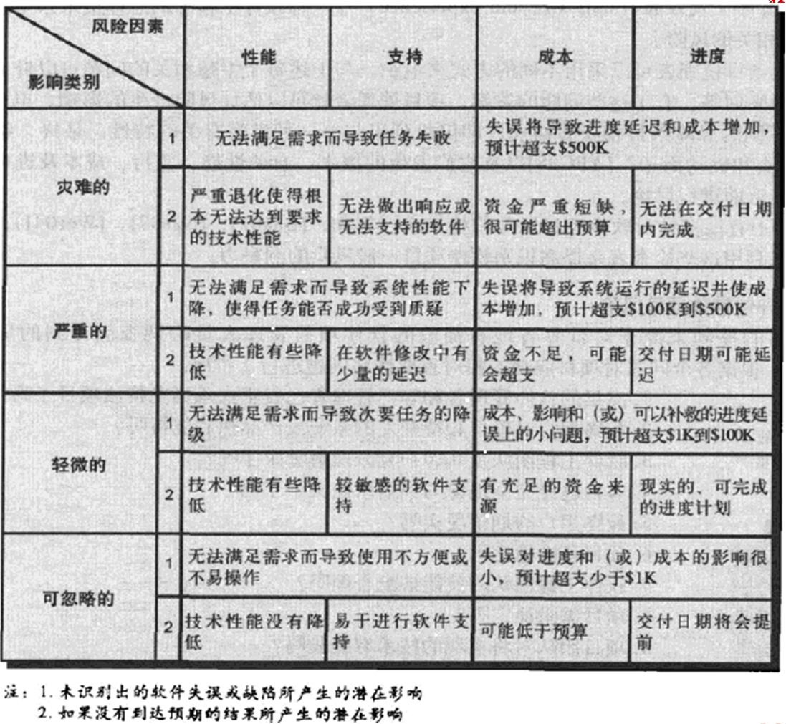
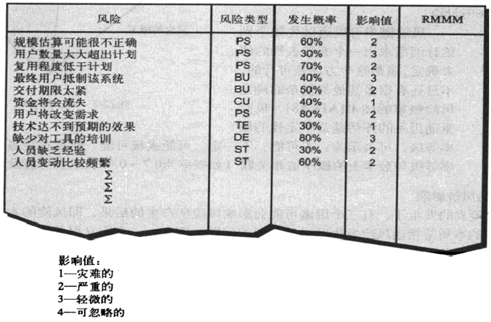
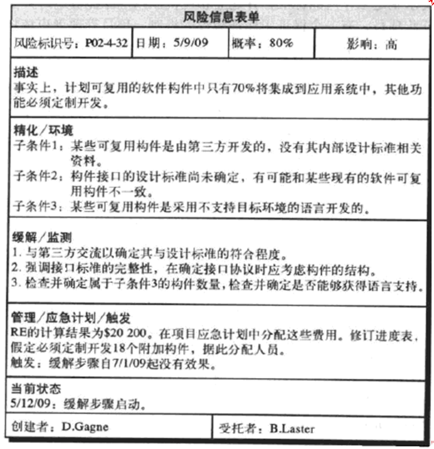

# 第 26 章 风险管理

## 被动风险策略和主动风险策略

*26.1　课件第 2–6 页*

| 策略 | 怎样管理风险 |
| --- | --- |
| **被动风险策略** | 项目运行中观察风险，等风险发生后才调配资源解决。课件所举做法包括为预期的救火安排额外资源、出问题后采取纠正措施，失去控制时进入危机管理。 |
| **主动风险策略** | 在技术工作开始前识别潜在风险，估计发生概率和影响，按重要性排序并制订计划。优先回避或降低风险，为不能回避的风险事先准备应急措施，使团队在触发时可以有序响应。 |

**主动策略**包含事前分析与准备，也包含风险发生后执行已约定的应急方案。

## 26.2 软件风险（第 8–13 页）

### 风险的两个特性（第 8 页）

**软件风险**是可能发生、会产生负面后果的事件，具有两个特性。

1. **不确定性**。事件可能发生，也可能不发生，发生的可能性用**风险概率**表示。若概率为 1，按确定会发生的问题安排处理。
2. **损失**。事件发生会带来不希望出现的后果，其损害程度是**风险影响**。

**风险分析**要评估不确定性和损失程度。**风险控制**是为降低或消除风险而采取的行动。

### 软件风险的分类

*课件第 9–10 页*

| 按主要威胁对象分类 | 影响及常见来源 |
| --- | --- |
| **项目风险** | 威胁项目计划。涉及预算、进度、人员、资源、利益相关方、需求，以及项目规模、复杂度和结构的不确定性。 |
| **技术风险** | 威胁软件质量和按时交付。涉及设计、实现、接口、验证和维护，也可能源于规格歧义、技术过时或采用尚未验证的新技术。 |
| **商业风险** | 威胁产品的生存能力。包括**市场风险**（产品无人需要）、**策略风险**（与公司战略不符）、**销售风险**（销售团队不知如何推广）、**管理风险**（失去高层支持）、**预算风险**（经费或人员承诺得不到保障）。 |

分类取决于**直接受威胁的目标**。经费已落实但开发费用可能超支，主要威胁项目预算。投资方可能撤资，主要威胁项目能否继续，属于商业预算风险。

| 按事前识别的依据分类 | 识别方式与例子 |
| --- | --- |
| **已知风险** | 仔细检查当前项目计划、商业与技术环境或其他可靠信息即可发现。例如交付期限不现实、需求或范围缺少文档、开发环境差。 |
| **可预测风险** | 从过往类似项目的经验中推断。例如人员变动、客户沟通不足、维护工作占用开发人员。 |
| **不可预测风险** | 事先很难识别，可能随项目推进才暴露。 |

同一事件可以按不同维度各归一类。例如，依据历史经验预判人员流动，这条风险按威胁对象属于项目风险，按识别依据属于可预测风险。

### 风险管理的原则与作用（第 11–13 页）

1. **保持全面观点**。在整个系统和商业环境中分析风险和业务目标。
2. **采用长远观点**。考虑未来可能发生的风险，事先制定应急计划。
3. **鼓励广泛交流**。鼓励利益相关者和用户通过正式或非正式渠道提出风险线索。
4. **结合**。将风险管理嵌入软件过程、计划和评审。
5. **强调持续的过程**。随信息增加更新已有风险、补充新风险。
6. **开发共享的产品**。让利益相关者基于同版本的软件产品识别和评估风险。
7. **鼓励协同工作**。汇集利益相关者的智慧、技能和知识。

课件归纳了四个作用。**提高项目成功率、使团队在风险发生时能及时响应、增强团队健壮性、帮助项目经理抓住重点。**

## 26.3 风险识别（第 15–25 页）

### 一般风险与产品特定风险

*课件第 15 页*

**风险识别**是系统地找出威胁项目估算、进度和资源分配等计划的事件。识别已知与可预测风险后，团队可先考虑回避，必要时加以控制。

- **一般风险**可能出现在各类软件项目中，例如人员流动、进度估计不足。
- **产品特定风险**取决于当前项目的技术、人员和环境。例如，某旧构件可能不兼容本项目的目标运行环境。识别这类风险时，检查**项目计划和软件范围说明**，向熟悉现状的人员了解细节。

### 风险条目检查表

*课件第 16–22 页*

| 检查维度 | 核查重点 |
| --- | --- |
| **产品规模** | 规模估算的依据和可信程度。是否统计程序、文件或事务数，规模与历史均值的差异，数据库规模，交付前后的需求变更及复用比例。 |
| **商业影响** | 市场或管理层提出的约束，例如交付窗口、市场接受度和资源承诺。 |
| **客户特性** | 是否有合作经历，客户能否明确并记录需求，是否参加需求收集会议和评审，沟通是否顺畅，是否熟悉业务和软件过程。 |
| **过程定义** | 项目是否有成文且获团队认可的过程，是否进行正式技术评审、使用规格说明和编码规范、收集质量度量。 |
| **开发环境** | 项目管理、分析设计、编译或代码生成、配置管理工具是否可用，培训、联机帮助及文档是否充足。 |
| **开发技术** | 技术对团队是否陌生，外部软硬件接口是否验证，是否要开发全新的构件、使用非传统方法或满足很严的性能约束。 |
| **人员才干及经验** | 人数是否够、技能是否匹配，成员能否持续参与，期望是否合理，是否经过培训，人员流动时工作能否接续。 |

### 风险因素、驱动因子与影响等级

*课件第 23–25 页*

**风险驱动因子**是能改变项目不确定性程度的事物，例如未识别的软件错误、成员变动或尚未验证的接口。识别驱动因子后，要判断它影响哪一类风险因素。

| 风险因素 | 关注的问题 |
| --- | --- |
| **性能风险** | 产品能否满足需求并适合预定用途。 |
| **成本风险** | 能否维持项目预算。 |
| **支持风险** | 软件能否方便地纠错、修改和升级。 |
| **进度风险** | 能否按计划推进并按时交付。 |

课件将影响程度从重到轻分为**灾难的、严重的、轻微的、可忽略的**。第 25 页的矩阵分别从性能、支持、成本、进度四方面考察影响。表中每个等级的两行分别讨论漏检错误或缺陷的后果，以及未达到预期效果的后果。例如，进度方面的灾难影响是无法在要求日期内交付，严重影响是交付日期可能延迟。成本阈值由项目自己的预算和容忍度确定。

*课件第 25 页　按风险因素和影响类别评估后果*

## 26.4 风险预测（第 27–32 页）

### 风险预测的四个步骤

*课件第 27–28 页*

**风险预测**又称**风险估计**。它评估每项已识别风险的**发生概率**和**发生后的后果**，为确定风险优先级提供依据。课件给出四步。

1. **建立尺度，反映风险发生的可能性。** 根据证据用概率、百分比或描述性等级表达发生可能性。
2. **描述风险产生的后果。** 写清事件一旦发生，会出现什么结果。
3. **估算对项目及产品的影响。** 定性判断影响涉及的范围和严重程度，例如可能导致严重的进度延误。
4. **标明预测的整体精确度。** 说明估算依据和假设，尽可能用区间或估计误差表达精度，避免把估计值理解成精确测量值。

例如，一个构件接口尚未验证。**后果**是集成可能失败并返工，**影响**是返工可能延迟一个里程碑，**精度依据**是现有接口文档和小规模联调结果。

### 建立和维护风险表

*课件第 29–30、32 页*

**风险表**记录**风险描述、风险类型、发生概率、影响值、RMMM**。前四列记录识别和预测结果，RMMM 列记录或指向这条风险的应对措施。第 29 页用 **1 灾难、2 严重、3 轻微、4 可忽略** 表示影响值，数字越小，影响越严重。

*课件第 29 页　风险表样例及影响值编码*

先按**概率和影响**排序，把高概率、高影响的项放在前面。管理者在初排后确定一条**中截线**，优先进一步分析线上条目，对线下条目复评并进行第二次排序。课件建议优先关注影响高且有中到高概率的项，以及影响较低但发生概率高的项。随后定期复查，按新信息新增风险、移除已失去影响的风险，或调整概率、影响及相对顺序。

### 风险显露度 RE

*课件第 31–32 页*

**风险显露度（Risk Exposure，RE） = P × C**。

- **P** 是风险事件发生的概率，代入时将百分数换成小数。
- **C** 是该风险发生时带来的项目成本。可先求额外工作量，再按单位成本换算。
- **RE** 是按概率折算的期望损失，单位与 C 相同。风险表中的影响等级用于定性排序，计算金额显露度时用风险发生时的成本金额。

以复用风险为例，先根据计划复用数量和实际可复用比例求出需要定制的数量，再算定制的成本 C，最后乘以「出现这种复用不足情形」的概率 P。

## 风险求精

*26.5　课件第 34–35 页*

**风险求精**也称风险细化。项目早期的风险描述通常较笼统，随着信息增多，可把风险拆成更具体、便于验证和管理的子条件。

课件使用**条件—转化—结果（Condition–Transition–Consequence，CTC）** 格式。句式是「给定某个条件，则可能导致某个结果」。例如，计划复用的构件要满足目标设计标准，部分构件的符合程度仍待验证，因此实际可集成数量可能低于计划，需要增加定制开发。

还可以细化为第三方构件的设计资料不足、目标接口标准尚未确定、构件语言不兼容目标环境等子条件。它们都可能降低复用比例。分别检查第三方的设计资料、目标接口标准和运行环境的语言支持，就能把同一个笼统的复用风险转成可监测、可落实到责任人的事项。

## 风险缓解、监测和管理

*26.6　课件第 37–40 页*

| 工作 | 时机与要点 |
| --- | --- |
| **缓解（Mitigation）** | 风险发生前设法回避风险，降低发生概率或减少潜在损失。 |
| **监测（Monitoring）** | 在项目过程中跟踪能表明风险升高或降低的信号，以及缓解措施的效果。 |
| **管理（Management）与应急计划** | 事先写好应对方案，缓解未能阻止风险且风险已发生时，按触发条件实施计划。 |

课件用**频繁人员变动**说明这三项工作。

- **缓解**。与成员沟通，了解工作条件、报酬、外部机会等变动原因，尽早处理可控因素。为关键岗位指定后备，让知识在团队中共享。制定工作产品标准，及时更新模型和文档，安排多人参与评审，保证有人能接续工作。
- **监测**。观察成员对项目压力的态度、团队凝聚力与协作关系、报酬和利益方面的问题，以及内部调动和外部工作机会。检查文档、结对和后备人员安排是否真正有效。
- **管理**。人员退出时安排交接，由后备人员接任，依靠已经整理的文档和团队共享的知识恢复工作，按需要调整人员和进度。

课件的 **80–20 法则**是资源分配的经验。大约 20% 的已识别风险可能带来约 80% 的项目失败威胁。利用早期排序和风险显露度找出重点，把更多管理资源投入这些风险。

## RMMM 计划

*26.7　课件第 42–44 页*

**RMMM（Risk Mitigation, Monitoring and Management）计划**把风险分析和应对工作文档化，可以作为项目计划的一部分。针对一项风险，计划应写明如何提前降低风险、观察哪些信号、何时触发以及触发后如何处理。

也可以用**风险信息表单（Risk Information Sheet，RIS）** 逐项记录风险。课件样表包括**标识号、日期、概率、影响、描述、精化或环境、缓解和监测、管理与应急触发、当前状态、创建者和受托人**。用数据库维护表单可以按优先级排序、查找并更新状态。以复用风险为例，可把约定日期前仍未完成兼容性验证设为应急触发条件，随后按计划安排定制开发的人力和工期。

*课件第 43 页　将一项风险的评估和措施记入 RIS*

风险监测有三个主要目的。**判断预测的风险是否实际发生，确认缓解步骤得到实施，收集后续风险分析所需的信息。** 项目问题可能由多项风险共同引起，监测还要追溯问题的来源。

## 自测题

### 作业五

#### 作业五第 4 题（风险管理）

什么是风险管理？什么是风险缓解、监测和管理？什么是风险暴露度（风险显露度）？

### 作业延伸（自编）

#### 从过程模型选型到主动管理风险

以作业一第 4 题的过程模型选型为背景。一所高校计划替换大型教务平台，团队尚未验证历史数据迁移和旧接口的兼容性。开学上线时间已定，一名熟悉旧系统的开发人员又可能被调到其他项目。

选一种适合的过程模型并说明理由。列出两项主要风险，标注项目、技术或商业类别。说明团队在第一轮中怎样主动识别、评价和处理这些风险。

### 近年真题

#### 真题 1（2024 年 12 月卷，简答题第 3 题，8 分）

什么是风险预测？风险预测包含哪些活动步骤？

#### 真题 2（2023 年 6 月卷选择题第 2 题、2024 年 12 月卷选择题第 7 题，2 分）

螺旋模型主要针对（　）。

- A. 需求不明确的项目
- B. 风险较高的大型系统
- C. 完成时间要求紧迫的项目
- D. 风险较低的小型系统

### 本章应用练习

#### 练习 1　分类、检查条目和风险驱动因子（自编）

某审批系统有三条风险线索。

1. 核对当前计划时发现，关键测试环境预计比开始联调晚一周，可能使联调延期。
2. 根据当前设计资料，供应商的新接口尚未验证能否满足目标环境的响应时间要求，峰值查询可能超时。
3. 以往同类项目在资助方调换业务重点时曾失去支持，团队据此担心本项目也会失去资助。

分别按主要威胁对象和事前识别依据分类。为第 2 项写出风险驱动因子、受影响的风险因素和一项检查表核查内容，并说明它为什么依赖对本产品的了解。

#### 练习 2　复用构件的风险显露度和风险排序（根据课件第 29–32 页改编）

风险 A 有 80% 的概率发生。该风险发生时，原计划复用的 60 个构件中只有 70% 能集成，其余必须定制开发。每个构件平均需要 100 LOC，每 LOC 的开发成本为 14 美元。风险 B 是测试环境到位太晚，发生概率为 30%，发生时预计增加 30,000 美元成本。

1. 求风险 A 发生时需定制的构件数、代码行数、追加成本 C，并求两项风险的 RE。
2. 按 RE 给出初步排序，写出风险表的五列。若经验证后 A 的发生概率降为 30%，其发生时的追加成本不变，怎样更新表和排序？中截线下的风险如何处理？

#### 练习 3　用 CTC 求精（根据课件第 34–35 页改编）

团队准备复用一批报表插件。部分第三方插件缺少设计资料，统一接口标准仍未定稿，还有一些旧插件使用目标环境尚不支持的语言。团队担心实际可集成的插件比计划少。

用 CTC 格式写出总风险，列出三个子条件，并为每个子条件写出一项可执行的验证或缓解办法。

#### 练习 4　人员变动的 RMMM 和 RIS（根据课件第 37–44 页改编）

距离联调还有四周。团队内部预计，唯一熟悉排班模块的开发人员有 60% 的可能被调到其他项目。若调离，排班模块可能无法按期交付，团队定为严重影响。

为这项风险写一条 RIS 记录，包括风险描述、评估、缓解、监测、应急措施及触发条件、负责人和当前状态。说明持续监测这项风险要达到哪些目的。

---

## 答案与解析

### 作业五解析

#### 作业五第 4 题（风险管理）

**答案与解析**　**软件风险管理**是贯穿项目的工作。识别可能给项目或产品造成损失的不确定事件，估计其发生概率和影响，排定优先级，并为重点风险拟定缓解措施、监测安排和应急计划。随着项目条件变化，要复查风险并更新应对计划。

| RMMM 的三项工作 | 含义 | 以关键人员可能离开为例 |
| --- | --- | --- |
| **风险缓解** | 风险发生前采取措施，尽量规避风险，或降低发生概率、减轻后果。 | 提前指定后备人员，安排共同评审，及时记录关键设计。 |
| **风险监测** | 跟踪能表明风险升高或降低的信号，并检查缓解措施是否落实、是否有效。 | 持续了解团队压力、人员调动迹象，并查看后备人员是否已能独立接手。 |
| **风险管理（应急处置）** | 风险发生、达到应急条件时，实施预先定好的应急方案。 | 人员确认离开后安排交接，由后备人员接任，必要时重新分配资源和调整进度。 |

**风险显露度（也称风险暴露度，RE）** 是风险事件的期望损失。**RE = P × C**，P 为事件发生的概率，C 为事件发生时的项目成本。课件第 31 页中，预计复用的 60 个构件若只能复用 70%，需新做 18 个。按每个 100 LOC、每 LOC 14 美元，C = 25,200 美元。该情形概率 P = 0.80，故 **RE = 20,160 美元**，按百美元约为 20,200 美元。

**考法、答题要点与易错点**　总称「风险管理」包括识别、预测、缓解、监测及应急。RMMM 中的第三项专指风险发生后的应对。应用题按「发生前采取什么行动、平时观测什么、触发后执行什么」写。计算 RE 时用事件的发生概率乘以事件发生时的损失。定性风险表中的影响等级用于排序，算金额显露度时要有对应成本。

**课件位置**　本章课件第 2–6、8、15、27–32、37–44 页。

**笔记位置**　[被动风险策略和主动风险策略](#被动风险策略和主动风险策略) · [风险预测的四个步骤](#风险预测的四个步骤) · [风险缓解、监测和管理](#风险缓解监测和管理) · [风险显露度 RE](#风险显露度-re) · [RMMM 计划](#rmmm-计划)

### 作业延伸解析

#### 从过程模型选型到主动管理风险

**答案与解析**

1. 可选**螺旋模型**。这是大型系统改造，数据、接口和人员均有较高不确定性。螺旋模型以风险驱动，每一轮都安排风险分析和降低风险的验证工作。
2. 迁移或接口不兼容会使数据和服务达不到质量要求，主要属于**技术风险**。熟悉旧平台的成员可能被调离，影响人员安排和上线计划，主要属于**项目风险**。
3. 第一轮明确核心业务范围和可接受的迁移结果，与客户和技术人员确认风险，估计发生概率与后果并排序。对迁移和兼容性做小规模验证，核对数据完整性和关键流程。对人员风险安排结对、文档及后备。记录验证结果和继续推进的条件，同时准备迁移受阻时的应急安排。

**考法、答题要点与易错点**　选型理由要扣住「规模大、风险高」，写出第一轮要验证的具体不确定性。主动策略的得分点是事前识别、评价、排序和准备应对。给风险分类时说明它直接威胁什么。

**课件位置**　本章课件第 5–6、9、15–16、27–28 页。第 02 章课件第 36–40、68–70 页。

**笔记位置**　[主动风险策略](#被动风险策略和主动风险策略) · [软件风险的分类](#软件风险的分类) · [风险预测的四个步骤](#风险预测的四个步骤)

### 近年真题解析

#### 真题 1

**答案与解析**　**风险预测又称风险估计**，指对已识别的风险评估其发生的可能性和发生后的后果，为风险排序和分配管理资源提供依据。包括四项活动。

1. **建立反映风险发生可能性的尺度**，例如确定以百分比表示概率。
2. **描述风险发生后产生的后果**，明确事件会造成哪些问题。
3. **估算风险对项目及产品的影响**，用定性等级等方式判断后果的严重程度。
4. **标明预测的整体精确度**，说明估计的依据、假设和精度，防止误解。

**考法、答题要点与易错点**　先给定义，写到「概率」和「后果」两个方面，再按课件顺序分四点展开。把描述后果和判断严重度分开，最后写明预测的精确度。

**课件位置**　本章课件第 27–28 页。

**笔记位置**　[风险预测的四个步骤](#风险预测的四个步骤)

#### 真题 2

**答案与解析**　选 **B. 风险较高的大型系统**。螺旋模型的每一轮都会分析风险，并可通过原型或其他验证逐步降低风险，适合风险多、影响大的复杂项目。

**考法、答题要点与易错点**　识别螺旋模型的关键表述是「风险驱动」。答适用场景时要同时写出规模和风险程度。理由落到每一轮怎样评价和降低风险。

**课件位置**　本章课件第 6、27–28 页。第 02 章课件第 36–40、68–70 页。

**笔记位置**　[主动风险策略](#被动风险策略和主动风险策略) · [风险预测的四个步骤](#风险预测的四个步骤)

### 本章应用练习解析

#### 练习 1

**答案与解析**

| 线索 | 主要威胁对象 | 识别依据 |
| --- | --- | --- |
| 1 | **项目风险**。环境无法及时到位会威胁联调进度。 | **已知风险**，可通过核对当前计划发现。 |
| 2 | **技术风险**。接口能力可能无法达到软件性能要求。 | **已知风险**，可从当前设计和未验证的接口发现。 |
| 3 | **商业风险**中的管理风险。资助方改变重点并撤回支持，会威胁项目及产品的生存。 | **可预测风险**，由以往类似项目经验推断。 |

第 2 项的**风险驱动因子**是供应商的新接口尚未验证，受影响的风险因素是**性能风险**。检查表可用「开发技术」维度核查接口验证记录和性能约束。判断能否满足响应要求需要结合本产品的部署环境、接口规格与峰值负载，因此属于**产品特定风险**。

**考法、答题要点与易错点**　分别回答「威胁什么目标」「从哪里识别出来」。第 2 项的接口验证缺口是驱动因子，可能达不到性能要求是受影响的风险因素。情境题给出分类时同时写依据。

**课件位置**　本章课件第 9–10、15–16、20、23–25 页。

**笔记位置**　[软件风险的分类](#软件风险的分类) · [一般风险与产品特定风险](#一般风险与产品特定风险) · [风险条目检查表](#风险条目检查表) · [风险因素、驱动因子与影响等级](#风险因素驱动因子与影响等级)

#### 练习 2

**答案与解析**

1. 风险 A 发生时，需定制 **60 × (1 − 70%) = 18 个**构件，即 18 × 100 = **1,800 LOC**。追加成本 C = 1,800 × 14 = **25,200 美元**。RE(A) = 0.80 × 25,200 = **20,160 美元**（按百美元近似为 20,200 美元）。RE(B) = 0.30 × 30,000 = **9,000 美元**。
2. 按初始 RE 排序，A 在 B 前。风险表包括风险描述、风险类型、发生概率、影响值和 RMMM。验证后将 A 的发生概率更新为 30%，对应 RE(A) = 0.30 × 25,200 = **7,560 美元**，按 RE 重排时 B 在 A 前。中截线下的条目继续复评、重新排序，结合影响等级和项目需要调整关注程度。

**考法、答题要点与易错点**　70% 是风险发生时的构件可复用比例，80% 是这个风险事件的发生概率。先求风险发生时增加的成本 C，再用 P 加权得到 RE。新信息可能改变概率、影响和风险的顺序。

**课件位置**　本章课件第 29–32 页。

**笔记位置**　[建立和维护风险表](#建立和维护风险表) · [风险显露度 RE](#风险显露度-re)

#### 练习 3

**答案与解析**　总风险可写为「给定部分拟复用插件可能达不到项目的设计或环境要求，则实际集成比例可能低于计划，需要增加定制开发」。

| 子条件 | 验证或缓解办法 |
| --- | --- |
| 第三方插件缺少设计资料。 | 向供应方索取接口和约束说明，在项目测试环境以样例验证其符合程度。 |
| 统一接口标准仍未定稿，可能与现有插件不一致。 | 尽早评审并确定接口标准，用代表性插件做试集成，估算适配工作。 |
| 部分旧插件使用目标环境尚不支持的语言。 | 盘点受影响插件和语言依赖，试验目标环境的支持情况，并评估替换选项。 |

**考法、答题要点与易错点**　先用完整句式写条件和可能后果，再拆出可分别核实的原因。细化的价值在于让负责的人知道具体要检查什么、怎样降低风险。

**课件位置**　本章课件第 34–35、43 页。

**笔记位置**　[风险求精](#风险求精) · [RMMM 计划](#rmmm-计划)

#### 练习 4

**答案与解析**

| RIS 字段 | 示例记录 |
| --- | --- |
| **标识号与登记时间** | R-01，联调前四周登记。 |
| **风险、概率及影响** | 人员变动。若熟悉排班模块的开发人员在联调前调离，模块可能延误。概率 60%，影响值 2（严重）。 |
| **精化或环境** | 关键知识集中在一人，联调需要模块说明、测试数据和已通过验证的构建结果。 |
| **缓解** | 指定后备人员，安排两人结对维护和互相评审，及时更新开发及测试文档，由后备人员提前独立完成一次构建和交接演练。 |
| **监测** | 每周核对调动安排、交接清单进度和后备人员独立接手的能力，记录缓解措施是否落实。 |
| **触发与管理** | 确认调动在联调前生效时，安排正式交接和未完事项说明，由后备人员接任。根据剩余工作重新调配人员和联调安排。 |
| **责任与状态** | 项目经理跟踪风险，模块负责人和指定后备执行缓解。示例状态为「已登记，后备已指定，交接演练待进行」。 |

持续监测是为了判断人员变动是否真的发生，确认结对、文档和后备措施已执行，留下以后评估类似风险的数据。若联调延误，还要追踪人员变动和其他可能共同导致延误的原因。

**考法、答题要点与易错点**　按时间和目的写三类措施。结对、整理文档和准备后备属于缓解。定期检查信号及措施效果属于监测。到达触发条件后执行交接和重排属于管理。RIS 还应给出清楚的触发条件、责任与状态。

**课件位置**　本章课件第 37–40、42–44 页。

**笔记位置**　[风险缓解、监测和管理](#风险缓解监测和管理) · [RMMM 计划](#rmmm-计划)

题目来源　**作业五** · **作业一** · **2023-06-09 期末卷** · **2024-12-27 期末卷** · **第 26 章课件**
