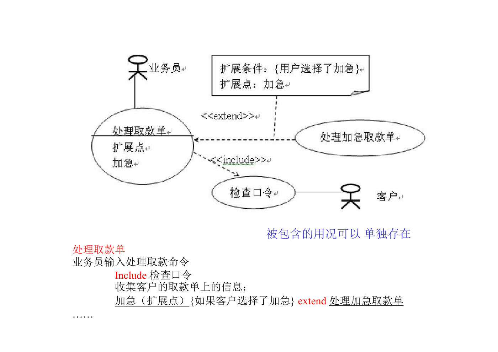

# 第5章 用况图

对应 **第5章 用况图.pdf**，页码按 PDF 阅读器计。练习题见案例分析 2、4、5 的第 2 页。

## 1. 从系统边界确定参与者（第 1–11 页）

用况建模把待开发系统当作黑箱，通过边界两侧的请求和响应，说明系统提供哪些用户可观察的功能。边界是系统成分与外部事物的分界线，划分依据是**当前系统责任**。

| 现实事物与系统的关系 | 判断示例 |
| --- | --- |
| 抽象为内部成分 | 商品作为销售系统内的类或对象 |
| 在边界外直接交互 | 收款员、传感器或与本系统协作的外系统 |
| 外部角色和内部描述同时存在 | 真人收款员是参与者，系统里的收款员账号是内部对象 |
| 与系统责任无关 | 若保安与销售系统无交互，图上省去 |

- **参与者（actor）**是一组高内聚的外部交互角色，以小人符号表示。同一人可以扮演不同角色，一个角色也可有多个实例。参与者可以请求服务、接收响应，也可按系统要求采取行动。
- 识别三类来源。人员看有谁直接使用或直接为系统服务。设备看有谁直接供给信息或受控，普通键盘、鼠标、屏幕通常归为界面设施。外系统看开发责任和交互边界，上级系统、子系统和其他协作应用都可能是外部角色。
- 特殊参与者继承一般参与者的交互，也可增加自己的交互。**实线空心三角指向一般参与者**。

## 2. 用况、场景与书写粒度（第 12–18、28–31 页）

- **用况（use case，也称用例）**描述参与者使用一项系统功能时与系统的交互序列。图上用椭圆表示，通常用动宾短语命名，例如「生成订单」。陈述双方各做什么，按顺序交替写清一方的一件事。
- 一个用况要实现一项相对完整的任务，执行后有可观察的结果。分析层用况记录外部可见输入、应答和分支，内部数据结构和实现算法留待设计。跨时间、由不同角色独立完成的任务可分别建模。
- **场景**是用况的一次具体执行路径。「验证用户」的正常 PIN 和连续输入错误是不同场景。用况规约可写基本流和可选流，步骤多时用序号、条件和循环表达。
- **捕获方法**。按角色列任务、读写与目标。按功能核对题干每条要求及异常处理。也可以先角色扮演出若干具体场景，再抽象共同用况。
- 参与者与用况之间画**实线关联**，这是两者间的关系。常规手绘用无箭头实线。同一用况可与多个参与者交互。

## 3. 用况之间的三种关系（第 19–27 页）

| 关系 | 何时画 | 线型和箭头 |
| --- | --- | --- |
| 包含 `«include»` | 基用况执行到指定位置时显式调用的公共行为，例如每次交易都要校验口令 | 开口虚线箭头，基用况指向被包含用况 |
| 扩展 `«extend»` | 基用况可独立完成，到扩展点且条件成立时插入一段额外行为，例如勾选加急后处理加急 | 开口虚线箭头，扩展用况指向基用况 |
| 泛化 | 两个用况是同一目标的特化，子用况继承父用况行为和含义 | 实线空心三角，子用况指向父用况 |

- **扩展点**属于基用况。可列在椭圆内的扩展点分栏，或用注解标出位置与条件。插入行为结束后继续基用况，条件为假时跳过扩展。一个扩展可以服务多个基用况，一个基用况可以有多个扩展。
- 包含可把多处重复事件流集中维护。第 27 页展示「检查口令」既被复用又可直接有参与者的情况。能直接使用与是否被其他用况包含是两回事。
- 公共步骤多次出现时考虑提取。主流程或分支太复杂时考虑拆分。单纯的先后顺序写在规约或行为图中。

## 4. 登录题的四种画法（第 36–40 页）

| 课件方案 | 表达的含义 | 复习判断 |
| --- | --- | --- |
| 登录包含选课和查看学分 | 把登录画成后续业务的调用者 | 会把按选择才执行的业务画成必经步骤。新增业务还要改登录 |
| 选课、查看学分各自包含登录 | 每个业务运行时都执行身份验证 | 适合题目明确要求每次业务验证的情况 |
| 选课、查看学分扩展登录 | 登录内有两个扩展点，据选择条件插入 | 能表达条件，但登录用况仍掌握后续业务流程 |
| 登录、选课、查看学分各为独立用况 | 登录一次，业务以登录成功为前置条件 | 适合登录会话内可连续使用多项功能的情况 |

## 5. 画图顺序与案例勘误

1. 给矩形边界写系统名，在外面列角色，在里面列各角色的完整业务目标。
2. 为直接参与的目标画实线。看题干是否有共用必经步骤、条件增量或特化，逐边检查关键字、箭尾和箭头。
3. 逐条划掉已覆盖的要求。共用子用况可经包含关系间接关联到角色，仍须核对它在何处被调用。图可用折角注解补充约束。用况可继续导出测试场景、界面交互和 OOA 的对象线索。

| 题目 | 参考答案需要核对或修正的地方 |
| --- | --- |
| **案例分析 2 第 2 页** 图书管理 | 参考图遗漏读者直接「浏览图书信息」和图书管理员直接「查询读者信息、查询图书信息」的入口，补上相应实线。借书、还书由图书管理员代操作，读者若只线下递证和交书，系统交互线接管理员即可。录入图书或读者是否需要检查重复，题干未规定，勿把所有录入硬标为包含查询。个人资料与借阅情况若可分别查看，画两个独立用况。 |
| **案例分析 4 第 2 页** 网上订餐 | 顾客和送餐员共用「注册」和「登录」，系统管理员只有登录要求。参考图把确认订单和分配送餐员合写为「订单管理」，展开图时补出这两项。菜品和顾客的增、删、改也可按题目要求的细度展开。 |
| **案例分析 5 第 2 页** 在线选课 | 参考图的虚线漏标 `«include»`，图注也指出这一点。若按该题参考方案将「登录验证」作为各业务的必经步骤，统一由业务椭圆指向验证，并逐线标注关键字。若明确采用先登录再使用的会话模型，业务规约可写前置条件。学生侧含选课、查询选课、取消选课和查询个人基本信息。管理员侧含课程增改删、约束设置、汇总及用户增改删。 |

第 41 页的自动售货机题可独立练一遍。系统边界外的角色是购买者、供货员、取款员，各连「购买商品」「补货」「收取现金」，再按题干补交互流程。
