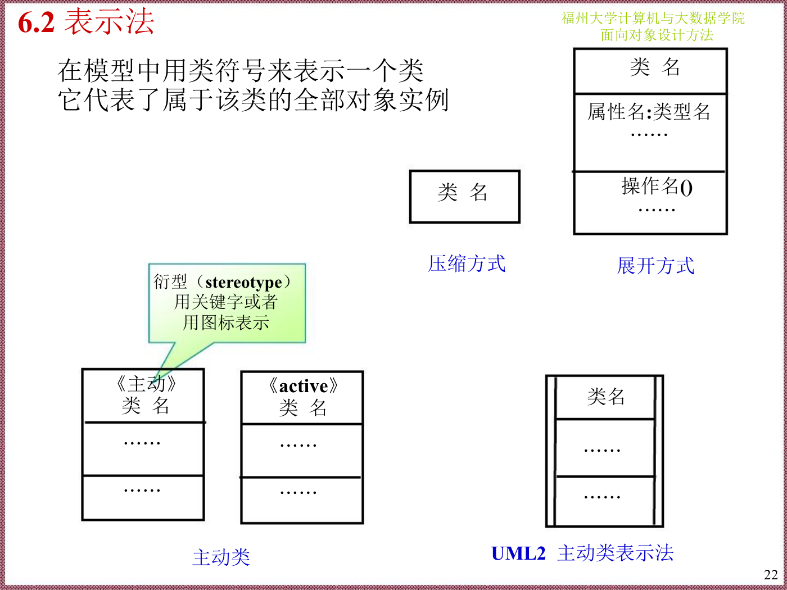

# 第6章 发现对象、定义对象

对应 **第6章 发现对象、定义对象.pdf**，页码按 PDF 阅读器计。画分析类图时，本章负责定类，第 7 章分配特征，第 8 章连关系。

## 1. 对象、类与抽象层次（第 1–6 页）

- **对象**是系统中描述一个具体事物的实体，有属性和对这些属性施加的操作。**类**给一组具有共同属性和操作的对象提供统一的抽象描述，由类名、属性、操作构成。对象是类的实例。特殊类的实例在逻辑上也是一般类的实例。
- **抽象类**不直接创建实例。**主动对象**至少有一个操作无需接收消息即可执行，它所属的类为主动类。**被动对象**的每个操作都由消息驱动。
- 「类」在语句中可以代表全部实例的集合，也可以代表任意一个实例。例「每辆汽车恰有一台发动机」的多重性针对一辆汽车和一台发动机分别读。
- **归纳**用具体事物认识对象，再从共同特征提炼类。**演绎**用类定义或创建各个对象，在规约中说明实例，编程时静态声明或运行时动态创建。
- 在类层建立基本模型，原因包括一类能覆盖所有实例、个例不足以说明普遍规律、便于在概念层表达并与 OOPL 对应、减少混用抽象层次。
- **类框**。压缩式只写类名，展开式为类名、属性、操作三格。衍型可用关键字或图标。课件写法用 `«active»` 或 `«主动»` 标示主动类，UML2 图形写法在类框左右内侧加竖线。

## 2. 如何发现候选对象（第 7–10 页）

先调查问题域。现场观察和访谈、向领域专家请教、阅读业务资料、查看同类旧系统都有助于找对概念。以**系统责任**筛选对象与特征。同为「书」，按册借阅的图书馆可用一册为一个实例，按种经营的书店可用一种书为一个实例。

| 搜索来源 | 复习线索 |
| --- | --- |
| 人员、组织 | 系统记录其信息，或它在业务中有需要表现的行为 |
| 物品、设备 | 被管理的物品，供系统采集信息或受其控制的设备 |
| 抽象事物、事件 | 课程、计划、账户等。借阅、付款、选课等事件若需要长期保留，可做记录类 |
| 文件 | 报表、档案、证件、票据、合同、订单。检查它是基础信息、已有对象的重复描述，还是若干事物的信息汇总 |
| 结构和其他 | 从已有模型的关系反推遗漏的整体、部分或联系记录 |

再从两个方向补漏。**系统边界**看人员、设备、外系统的交互由哪个内部对象处理。**系统责任**逐条划掉已有对象承接的功能，余下的任务促使补充对象或操作。直接使用系统的「学生」是参与者，系统存储的学生信息由「学生」类承接。

## 3. 筛选、调整与命名（第 11–15 页）

1. 一个候选若既无有用信息又无有用行为，删去。
2. 只有一个属性或一个操作时，考虑并入已有类。若它在题目里有独立身份、生命周期或关联则保留。课件的「班主任」若只保存姓名，可并为班级属性。仅提供转换操作的格式转换器可按责任合并。
3. 与 GUI、数据库、硬件和操作系统选择直接相关的实现对象，课件安排在 OOD 阶段考虑。
4. 如果特征只适用于一部分实例，划分特殊类。特征相同考虑合并，特征相似考虑抽出一般类，同一对象的重复描述应去重。
5. 类名用领域里常用的名词或带定语的名词，体现一个实例，适用于全部实例及子类，可中英双命名。「课程列表」若承担维护和汇总，其单个列表本身就是一个对象。

## 4. 从分析题干找类

- **案例分析 2 第 3 页**。图书系统的读者、图书、借阅记录应分别有自己的信息。「一次借或预约」形成一条记录，可用记录连接读者与图书。图书管理员和系统管理员有共性时抽出管理员一般类。
- **案例分析 4 第 3 页**。顾客、系统管理员、送餐员可抽出用户共性。菜品与订单项分开，订单项保存一次选择的数量等信息。同一道菜可出现在不同订单项中。购物车与订单对应题干里的提交前和提交后的对象职责。
- **案例分析 5 第 3 页**。一次选课会新增记录，退选会按学生和课程删除记录，并更新课程人数。由此识别学生、教务管理员、课程、选课记录及必要的管理列表。给记录分配对两端各一个的联系，详见 **第 8 章**。
