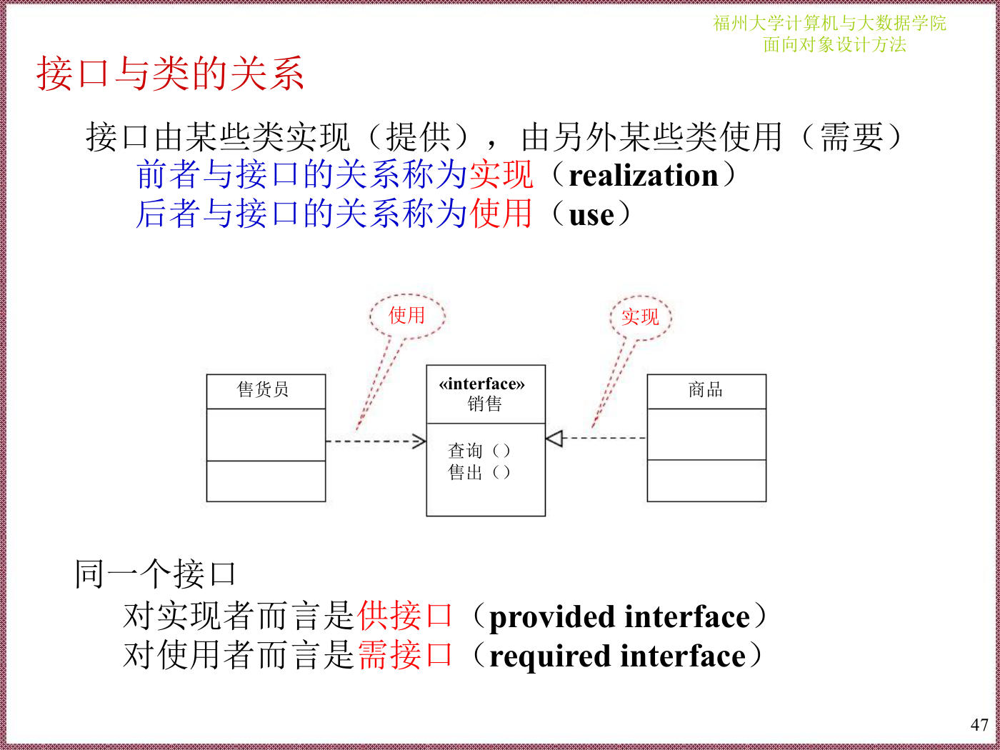
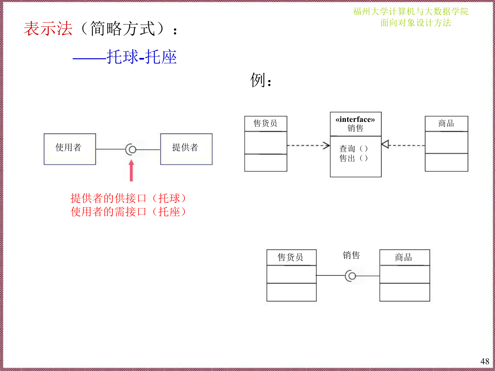

# 第7章 定义对象的属性和操作

对应 **第7章 定义对象的属性和操作.pdf**，页码按 PDF 阅读器计。

## 1. 属性与操作的基本表示（第 1–3 页）

| 概念 | 选择题辨析 |
| --- | --- |
| 属性 | 描述静态特征的数据项。实例属性随对象而定，例如仪表编号、实测精度。类属性由该类共享，例如课件仪表例中的额定指标。类级成员在 UML 中可用下划线标示。 |
| 操作 | 描述动态行为的动作序列。课件把方法、服务列为近义词。操作也可通过签名声明，具体方法体给出实现。 |
| 主动与被动操作 | 被动操作收到消息才执行，例如普通函数或过程。主动操作可主动执行，例如课件用进程、线程说明的操作。一个类可以同时有主动和被动操作。 |

分析级按 `属性名: 类型`、`操作名()` 写到能看懂。实现级可加 `属性名: 类型 = 初始值`、`操作名(参数: 类型): 返回类型`。课件用 `«主动»` 标注主动操作，主动类的外框见 **第 6 章**。

## 2. 定义属性（第 4–5 页）

- **找候选**。从常识、问题域、系统责任、需保存的信息、操作所需参数、对象状态、关联和聚合所需的信息出发。例如库存量用于库存管理，采样间隔支撑采样操作。
- **筛选**。每项特征要符合当前系统目标，描述该类对象自身，适合该类的全部实例。可以继承的直接沿用。可从已有信息推导的先考虑计算所得，后续再评估存储性能。规范化、实现级对象标识和性能细节留到 OOD，题干明确的业务编号可直接进 OOA。
- **命名和定位**。用领域术语与名词。课程的任课教师、汽车的发动机可以提示跨类关系，已有关系线表达同一语义时避免在分析图中重复抄进属性栏。

## 3. 定义操作和安排职责（第 6–11 页）

- 课件区分系统行为（通用创建、删除、复制、转存）、封装附带的读写行为、对象自身的领域行为。前两类通用操作可在 OOA 图中省略。题目明确的「取消选课」「删除图书」等业务行为需要建模。
- 四条发现线索是系统责任、现实事物的行为、引起状态变更的操作、沿操作执行路线逐步模拟。筛掉无助于责任的操作。每项操作完成一个单一、完整的目标，过大就拆，零碎且共同完成一目标时可合并。
- 识别主动行为时看该行为由事物自行呈现还是由消息引起，也可从参与者直接交互和操作路线反向追踪。分析对象的复杂操作可用流程图或活动图说明。流程图有动作框、转接、条件判断和入口出口。
- 操作用动词或动宾短语。给能承担职责的类安排操作。在一般类中定义前，核对是否适合每个特殊类。课件例中「售货员.售货()」协调交易，调用「商品.售出()」处理商品侧的变化。同一业务可涉及多个对象的不同操作。

## 4. 接口（第 12–17 页）

接口（interface）是声明一组紧密相关的公共特征和职责的类目，相当于合约。一个类可实现多个接口，一个接口可有多个实现者。课程的接口例以一组操作签名说明，签名含操作名、参数及参数类型、可选返回类型；接口声明不实例化。实现类负责履约，使用者按声明调度，由此可更换实现或组装构件。

| 考点 | 画法 |
| --- | --- |
| 详细表示 | 写 `«interface»`、接口名和操作签名 |
| 类实现接口 | 虚线空心三角，从实现类指向接口 |
| 类使用接口 | 虚线开口箭头，从使用类指向接口，可标 `«use»` |
| 简略表示 | 实现类的**供接口**是托球（小圆），使用类的**需接口**是托座（开口半圆） |

## 5. 案例类图核对

- **案例分析 4 第 3 页**。抽象「用户」放各角色通用的登录、退出。顾客注册、个人信息管理和送餐员注册各按题干分配。订单类应能修改、取消或删除订单、添加备注和更新配送状态，系统管理员有分配操作。参考图把订单项的菜品、订单、购物车 ID 与对象关联并列，分析图可用关系线表达引用，进入数据设计再选择外键。
- **案例分析 5 第 3 页**。参考图把三个无对象的管理员操作写为「添加」「修改」「删除」。可以保留为协调动作，但需用明确名称／参数或列表类操作落实是课程维护还是学生维护，并补出选课约束设置。学生个人查询可放学生类，共有的 ID、姓名、密码和登录／退出可上提到用户类。选课或退选由学生侧发起，选课记录负责保存、查找或删除记录，课程负责更新可选和已选人数。
