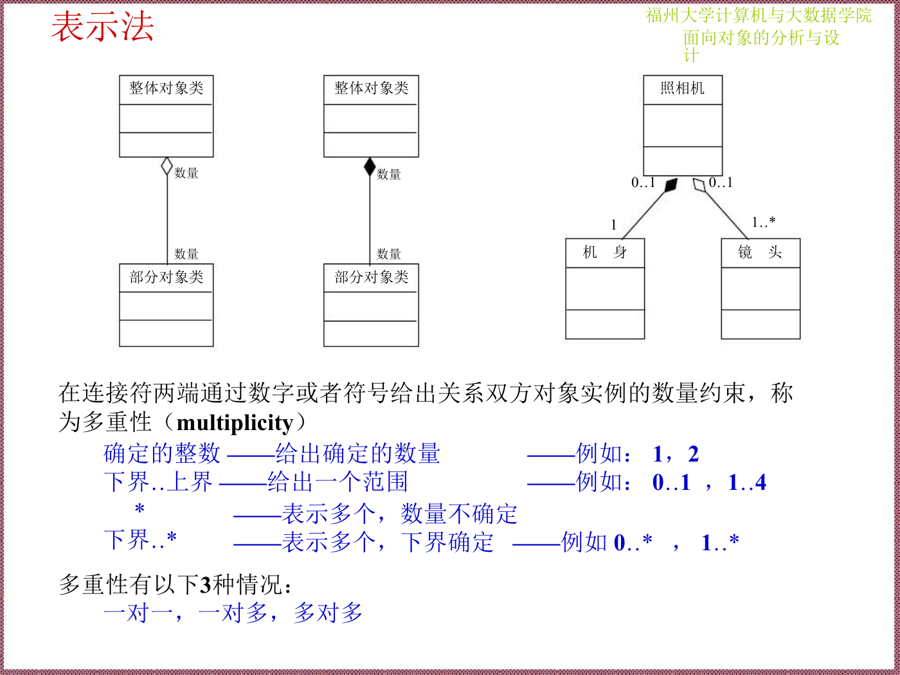
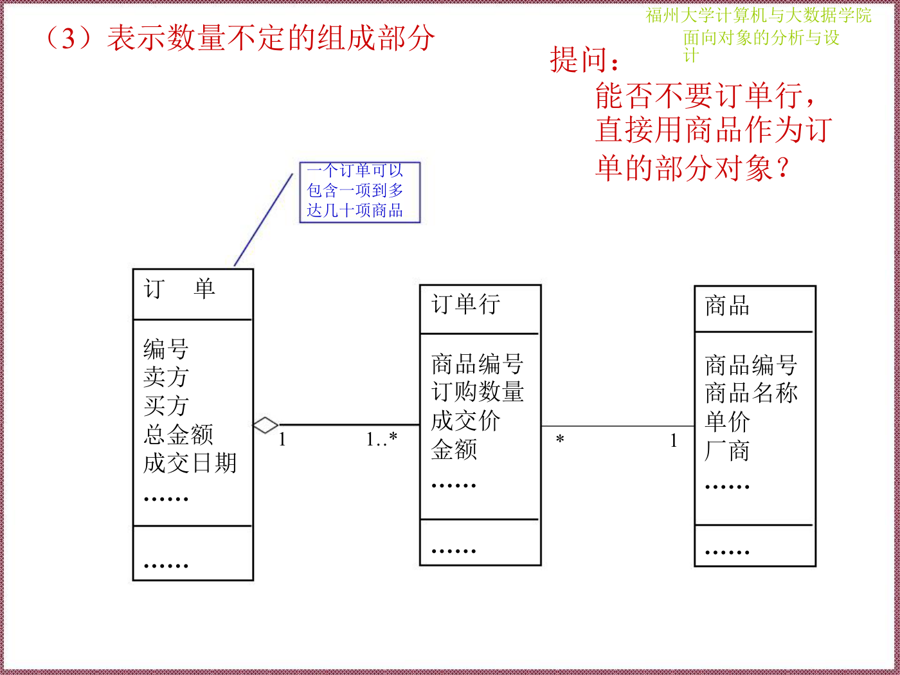
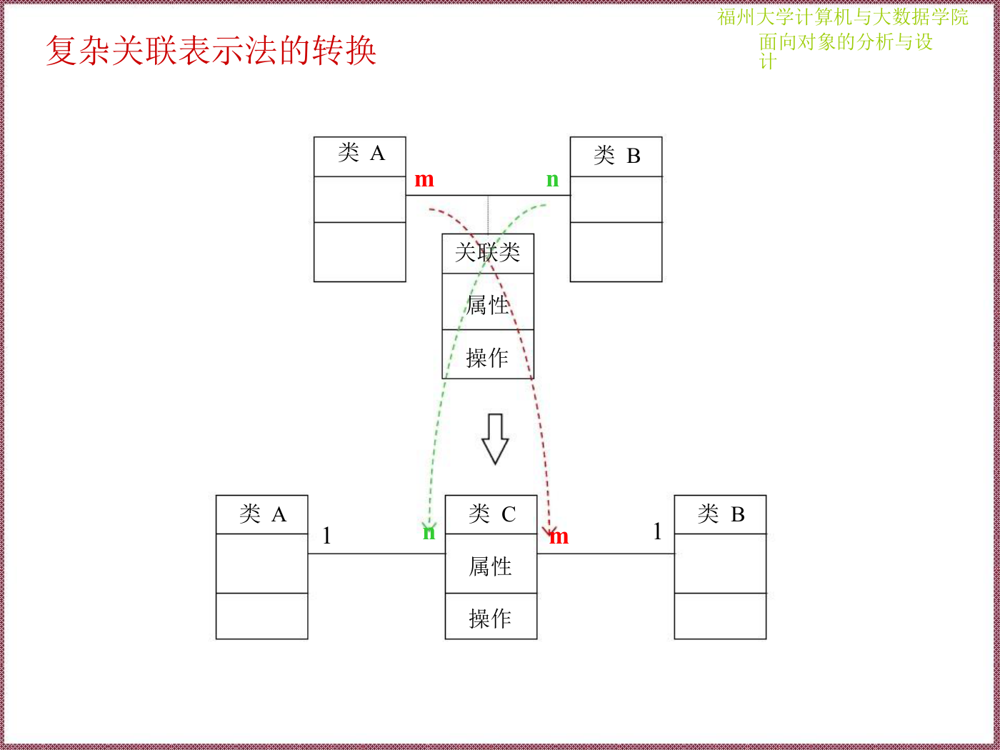

# 第8章 定义对象间的关系

对应 **第8章 定义对象间的关系.pdf**，页码按 PDF 阅读器计。考试类图的线型、箭头、多重性和中间类主要在本章。

## 1. 先决定关系含义（第 1–3、12–13、21–22、38–45 页）

| 关系 | 判断句 | 画法 |
| --- | --- | --- |
| 一般–特殊／泛化 | A 是一种 B，A 的任意实例在逻辑上也是 B 的实例 | 实线空心三角，从特殊类指向一般类。多个特殊类可共用箭头 |
| 整体–部分／聚合 | B 是 A 的一个组成部分，具有共享或独立的可能 | 实线空心菱形，放在**整体端** |
| 整体–部分／组合 | B 被 A 强拥有；同一时刻一个 B 至多属于一个组合整体。在整体结束时仍附属的部分随之销毁 | 实线实心菱形，放在**整体端**。部分可依业务规则先脱离整体 |
| 关联 | A 与 B 的实例之间有持久或有业务意义的联系，需要查询、保存或使用 | 实线，可在两端标角色与多重性。导航箭头指向可被访问的一端 |
| 消息 | A 的一次操作向 B 请求服务或传送信息 | 交互图沿发送方到接收方画箭头。课程在类图可借虚线依赖标 `«call»`／`«send»` |
| 依赖 | 客户的定义或运行依赖服务者 | 虚线开口箭头，依赖者指向被依赖者，宜说明依赖原因 |

## 2. 一般–特殊结构（第 2–11 页）

- **继承**强调特殊类获得一般类特征。**泛化**是 UML 关系名。**分类**强调分层，一般类与特殊类是相对的。找类层次时从领域分类、常识、属性和操作共同点、系统责任、领域复用入手。
- 提取适用于所有子类的共同成员。新增子类需有实际特化。课件用「汽车和飞机同为运输工具」说明共同特征宜上移，飞机特有飞行高度和自动导航留在飞机。
- 三种简化办法。去掉没有特殊性的子类。只反映值差异的子类可改为属性，如性别、国籍。去掉用途单一的中间一般类以缩浅层次。一般类有多个子类、需要直接创建实例或支持复用时有保留理由。
- **多继承**指特殊类有多个一般类。菱形路径可能重复带来共同祖先，也可能从两个父类获得同名冲突特征。课件例「在职研究生」分别继承研究生、教职工，两者的「专业」可能含义不同。
- **多态**是同一命名在不同特殊类里有不同语义。课程以不同顶点数据结构和 `绘图()` 行为为例。课件图上 `*` 表示重定义，`×` 表示拒绝继承。这是课程的成员标记，出现于属性或操作旁。关联端的 `*` 表示多重性。

## 3. 整体–部分与多重性（第 12–20 页）

整体–部分关系在**类层定义**，描述实例间的构成。多条关系连成整体–部分结构。六个寻找方向是物理零件、组织下级、团体成员、空间包容、抽象构成、对象的某个方面（如人员与履历）。从问题域、系统责任、部分是否有值得独立管理的特征和真实构成关系四个方面筛选。

读多重性时**先固定对面一个实例**。例如 `照相机 0..1 ◆── 1 机身` 表示一个相机有一个机身，一个机身最多属于一个相机。常用 `1`、`2`、`0..1`、`1..4`、`*`（即 `0..*`）和 `1..*`。`0` 表示可无，`*` 表示上界不定。两端分别读，不能从一端数字推断另一端。

| 用法 | 如何处理 |
| --- | --- |
| 简化复杂对象 | 飞机的发动机和驾驶室各自组织相关数据、行为 |
| 支持复用 | 机床、起重机、送料车使用同一电动机类。类的复用与同一个具体电动机实例是否共享是两个判断 |
| 容纳不定数量的部分 | 订单包含多条订单行，每条订单行引用一个商品。数量、成交价由订单行保存 |
| 表达动态身份 | 人员保留稳定身份，营业员／会计师／经理身份做可增减的部分对象，避免靠删除并重建人员改变分类 |
| 继承与聚合并用 | 冷藏车是一种汽车且有制冷设备，可画冷藏车到汽车的继承、冷藏车到制冷设备的整体–部分 |

## 4. 关联、链与复杂关联（第 21–37 页）

**关联**是类的实例集合笛卡尔积的一个子集。二元关联的实例是有序对，n 元关联的实例是 n 元组，称为**链（link）**。关联对链就像类对对象。二元关联可在两端写角色和数量，中间写名称。端点导航箭头表示访问方向。类与自身也能关联，例如城市间航线。角色可区分同一个类在不同端扮演的作用。

| 题干线索 | 画图和实现 |
| --- | --- |
| 一对一／一对多 | 在需要引用的一端持有指针或对象标识。数据库一对多时在**多方**放引用一方主键的外键 |
| 多对多 | 引入中间类，每条中间记录各连两端一个对象。映成表时中间表持有两个外键 |
| 联系上还有自己的属性或行为 | 可用关联类（类框用虚线连到关联线中点）。教材偏向用普通类表达真实事物，例如「毕业论文」保存题目、答辩时间、成绩，再连教师和学生 |
| 三元及以上关联 | 菱形连各参与类。可以新增一个对象类代表整个 n 元组，拆为多条二元关联，便于确定多重性与实现 |
| 同一个类多次出现 | 两个学生是合作者可画学生自关联。若还要保存设备和题目，增「实习」类，每组对应两名学生、一台设备和一个题目。两名同角色学生可在学生端标 `2`，角色不同时分别连线 |

先问实际业务是否需要这项联系，是否需保存、查询、维护，再确定它的名称、角色和多重性。最后**定位关系**。例如系统管理员操作各类计算机时连一般类「计算机」，普通用户若只能使用客户机则连特殊类「客户机」。

## 5. 消息与依赖（第 38–45 页）

- 消息狭义是服务请求，广义是两个对象一次交互所传送的信息，包括控制和数据。发送者与接收者遵循共同语法与语义。消息把封装后的对象行为串起来。
- 按课件顺序系统模型，一个流中通常是同步调用，发送者等待，服务由唯一接收者处理。并发系统的流内仍可同步调用，跨流可同步或异步，可发数据、通知、信号，接收者可能创建控制流、立即或延迟响应，消息可定向或广播。
- 模型依次考虑消息是否存在、在流内还是跨流、起讫操作、同步或异步、发送者是否等待。课件在类图用 `«call»` 标流内调用、`«send»` 标跨流发送。两者借用依赖虚线。顺序图同步用实线实心头，异步用实线开口，返回用虚线开口。
- 一般依赖可表达客户／服务者。泛化、聚合、关联等本身已有明确含义，同时画一根泛依赖会重复表达。操作临时传入对象后发消息可以是依赖，持有对象且需长期管理其联系时再画关联。

## 6. 三道分析类图的落笔稿

| 案例 | 关系和勘误 |
| --- | --- |
| **案例分析 2 第 3 页** 图书管理 | `读者 1 ─ 0..* 借阅记录` 和 `图书 1 ─ 0..* 借阅记录`。记录有预约或已借状态。两个管理员特化「管理员」，把题干规定且参考图漏掉的**密码**补到一般类，并把查询、借还、预约审核、列表维护等责任落实到相应类和操作；可用依赖说明管理员使用列表或业务操作。图书、读者列表的菱形在各自列表端，部分端写 `0..*`。借阅记录关联到读者和图书，参考图里的「图书列表编号」可省去。若把库存数定义在图书类上，录入、注销要能分别更新库存。第 3 页明确要求从当前借阅记录删除，仍可在行为题另登记归还历史，以满足第 5–7 页的题干。 |
| **案例分析 4 第 3 页** 网上订餐 | 菜单汇集菜品、顾客列表汇集顾客，菱形在集合端。顾客对应多张订单，每张订单一位顾客。一条订单项对应一种菜品，同一菜品可出现于多条订单项。参考图让订单项**始终同时**属于一张订单和一个购物车，无法表达提交前。可把订单端与购物车端均标 `0..1`，加「提交前归购物车，提交后归订单」规则，订单包含 `1..*` 条订单项。另一种建模是提交时从购物车项生成独立订单项。送餐员可关联多张订单，一张订单分配前允许没有送餐员，分配后至多一个。 |
| **案例分析 5 第 3 页** 在线选课 | 画 `学生 1 ─ 0..* 选课记录 0..* ─ 1 课程`，每条记录只对应一名学生和一门课程。学生和教务管理员继承「用户」。列表和所属项可以画聚合。参考图缺少「设置选课约束」和课程人数更新的明确落点，补入课程或列表的操作。已选人数、限选人数和可选人数各有业务含义，若可选人数由前两项计算可标为派生属性并注明规则。 |

作图后逐条口读关系。例如「一名学生能有零到多条记录，每条记录只属于一名学生」，能同时复核线两端。
