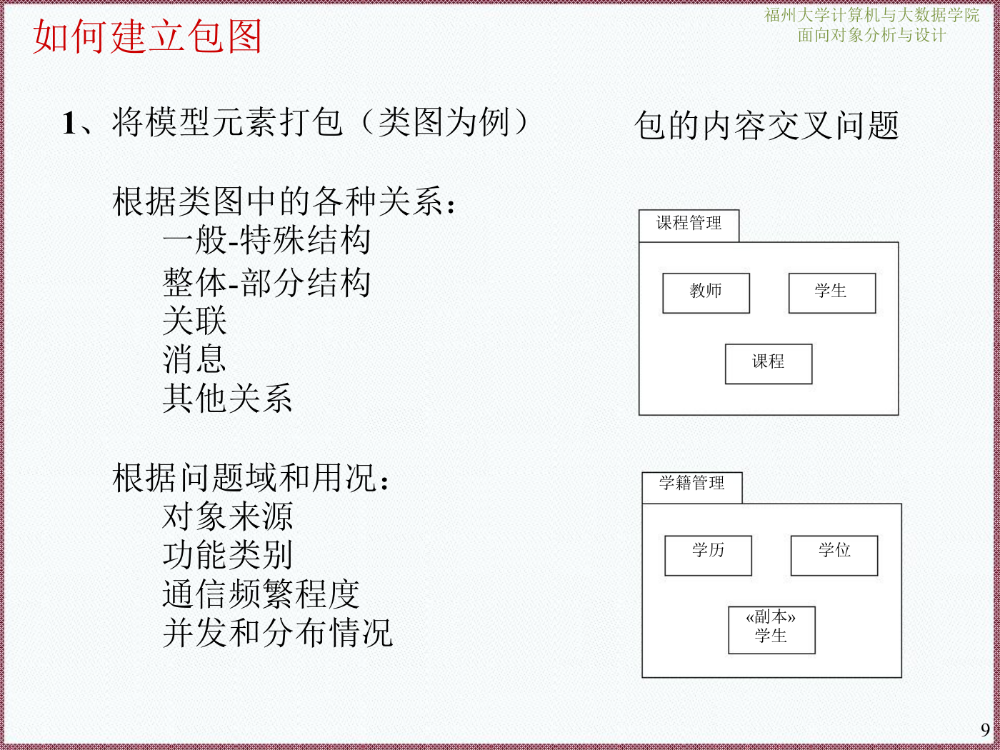
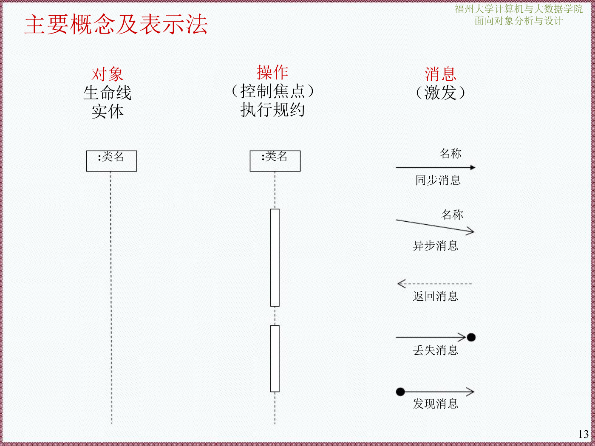
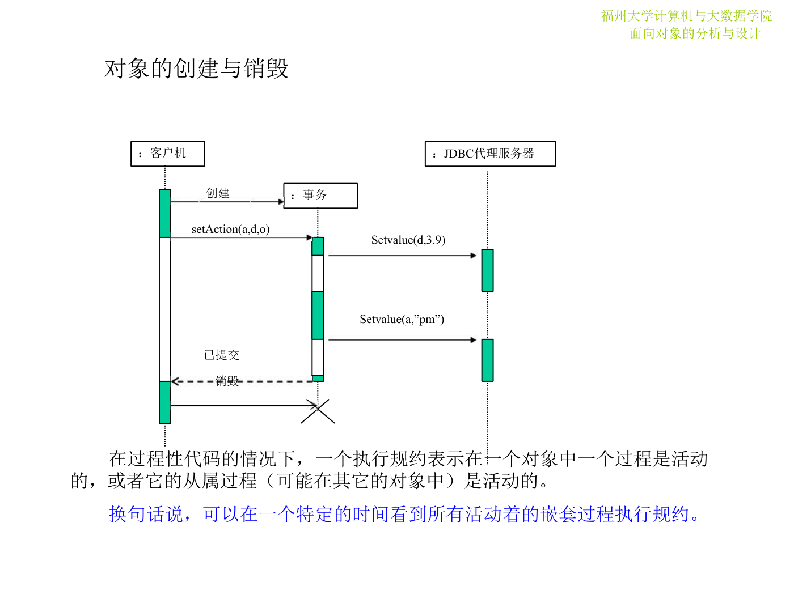
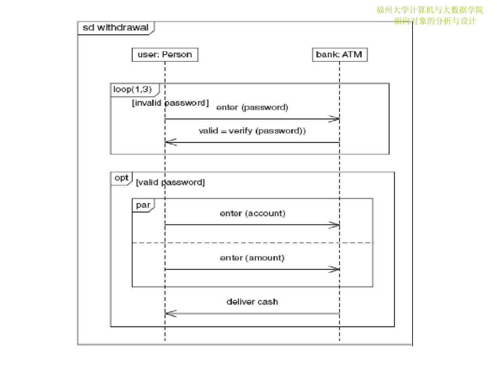
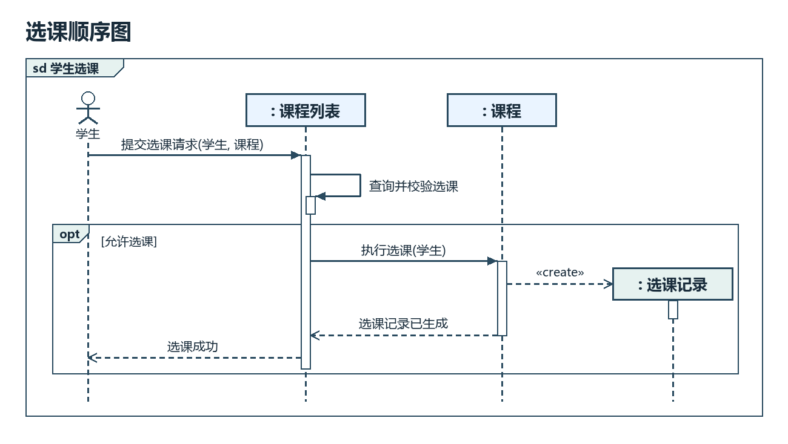

# 第9章 UML 中的几种其他图 (a)

对应 **第9章 UML中的几种其他图(a).pdf**.pdf>)，页码按 PDF 阅读器计。本份涵盖包图与顺序图，也叫时序图。

## 1. 基本模型和辅助模型（第 1–3 页）

课程以**类图**为基本模型，表达对象、特征、关系三层。**用况图**反映需求。包图表达组织，顺序图、活动图等补充特定视角，文字规约补精确细节。历史上，OMT 同时采用对象、动态、功能模型，OOSE 为需求、健壮性、设计提供不同模型，Booch 和 Coad/Yourdon 以 OO 模型为核心，并由其他图说明细节。UML1 的 9 种图与课件的 UML2 13 图见 **第 1–4 章**。

## 2. 包图（第 4–10 页）

**包（package）**把有内在联系的模型元素组织成较大单位。它可包含类或其他模型元素，也可嵌套。包是命名空间，跨包可用 `包名::元素名`。符号像带标签的文件夹。压缩式只给名字，展开式在大框内列内容，名字移到标签处。

| 关系 | 含义及画法 |
| --- | --- |
| `«import»` 引入 | 从引入者指向被引入包的虚线箭头，引入的可见元素在源包中可直接引用，公开引入可对外继续可见 |
| `«access»` 访问 | 同方向的虚线箭头。属于私有引入，源包可用，应保持对外私有 |
| `«merge»` 合并 | 从接收定义的源包指向被合并包。目标包的元素定义并入源包，同名元素按合并规则处理。课件以 UML 自身定义为常见场合 |

按领域、一般–特殊结构、整体–部分结构、关联、消息频率、功能或并发分布打包。包用根类、整体对象、领域事物或功能命名。低层包紧密相关时可共同纳入上层包。课件用 **7±2** 作为控制单层认知负担的启发，允许按需求调整。减少没有组织价值的单元素嵌套，并审查包间的交叉和引用路径。

**设计练习**。案例分析 3 第 8 页要将系统拆到两个处理机并画包图。按题中两个功能画「课程管理」包含教师、学生、课程，「学籍管理」包含学历、学位和标注 `«副本»` 的学生。图表达这份课件采用的**复制策略**，避免画成同一元素被两个包同时拥有。若采用一处定义、跨包调用的方案，应说明调用方向，不把只声明包依赖当成数据复制。题目要求包图，两个处理机可用标注交代，结点与制品的部署另见第 9 章 (b)。**案例分析 3 第 8 页**

## 3. 顺序图的坐标和符号（第 11–23 页）

顺序图（sequence diagram）表现一项功能中参与者和对象如何随时间传递消息。纵向通常由上到下，横向排不同参与者或对象，左右顺序只有排版意义。普通图用相对时间先后，实时系统可明确量化时间。

| 元素 | 画法和判读 |
| --- | --- |
| 参与者、对象、生命线 | 角色画小人或带名字的头。对象框写 `对象名:类名` 或 `:类名`，向下垂直虚线表示其存在期 |
| 执行规约／激活条 | 生命线上窄长矩形，顶端对准收到调用处，底端对准返回或执行结束处。自调用可把第二个激活条略向右叠放 |
| 同步调用 | 实线实心三角箭头，发送者等被调用者完成。调用者在等待内层调用时，外层激活仍可持续 |
| 异步消息 | 实线开口箭头，发送者发出后继续。异步的后续回报可建模为另一条异步消息 |
| 同步返回 | 虚线开口箭头，方向回调用方。常规返回可省，题目关心成功信息或返回数据时写清 |
| 自消息 | 从本生命线经折回箭头到本生命线。调用、检查或递归由同一对象内部执行 |
| 丢失、发现消息 | 丢失消息从已知发送方去黑点。发现消息从黑点到已知接收方 |
| 创建、销毁 | 新对象在创建发生的高度画头，创建箭头落在对象头上，生命线自此开始。销毁时结束于 `×`，箭头落于销毁处 |

消息从发送者指向接收者，标操作／信号名及必要参数。一般把箭头画水平。若需说明传输时差，课件给出三种方式：用时间差约束、显式标出时间度量、用向下倾斜的消息线。电话例可用 `{b.receiveTime - a.sendTime < 1分钟}` 表示两项事件间的时间限制。旧式写法也会画同一点出发的带 `[条件]` 的分支或 `*[条件]` 表示重复。优先用下面的结构表达复杂控制。

## 4. 组合片段与交互引用（第 24–28 页）

外框标签可写 `sd 场景名`，左上角为切角标签。组合片段也有外框和左上角操作符。多个操作数用水平虚线隔开，条件放在相应区域顶部并使用方括号。

| 标签 | 阅读方法 |
| --- | --- |
| `opt` | 一个可选区，`[条件]` 为真才执行 |
| `alt` | 互斥选择，最多执行一个区。可用 `[else]`，它在其他条件均为假时执行。多个守卫同时为真会使选择不确定 |
| `par` | 各操作数并发，可交错但保持每区内部顺序。所有区完成后并行片段结束 |
| `loop` | 条件或次数控制重复。每次迭代前检查守卫，区域顶可标最少和最多次数，如图中的 `loop(1,3)` |
| `ref` | 引用已有交互，例如把「获取密码」作为另一个顺序图。它属于交互使用 |

## 5. 从题干画顺序图（第 29–30 页）

1. 一图对应一项交互目标。题干有「选课／添加课程」两项时可画两个顺序图。
2. 从参与者找到直接处理请求的对象，再把被调用的领域对象补进去。已有对象的头在顶端，新建记录或订单的头下移。
3. 沿题干的句子排列调用、返回、创建与分支。逐个核对消息名是否表现接收方的责任，条件是否覆盖题干，最后返回何种可观察结果。
4. 用类图交叉检查操作归属。单纯的调用也可通过参数或临时引用实现，图中的消息无须都对应长期关联。

### 图书管理的借书与还书

- **案例分析 2 第 5 页** 借书参考图只画一次扫描并顺利借出的路径。修正时先由管理员发起并查询借阅资格，用 `alt [符合]`／`[else]`。成功区内 `loop [仍有待扫的书且额度未满]`，依次扫标识、查询并展示书名和作者。循环后登记完整借阅信息、发送给库存系统更新、告知完成。资格不符走退出路径，没有生成记录或改库存。题干覆盖柜台业务时，读者提交和收回证件也可以标在角色交互上。
- 还书参考图写「删除借阅记录」，题干要求**记录完整归还信息**。改为核验原借阅、循环扫码和显示图书、按借阅关联登记归还或将记录标为已还，通知库存系统，归还证件。题干未指定的失败策略可留在场景说明。

### 网上订餐与在线选课

- **案例分析 4 第 5 页** 顾客查询菜单 → 菜单获取菜品详情 → 顾客向购物车加菜 → 购物车根据菜品信息创建订单项并把订单项纳入购物车 → 顾客提交购物车 → 创建订单。参考图的「加入购物车」箭头落到菜品，且缺少把生成的订单项纳入购物车的消息。若让菜品负责建项，仍需把结果传给购物车。新建订单项、订单的生命线都从创建处开始。提交可把所选订单项交给订单，不能只出现空订单对象。
- **案例分析 5 第 5 页** 选课参考图把发起者印成教务管理员，图上的手写批注已改成学生。两个参考顺序图把「验证」后续画成顺利执行的线性消息，选课图还把新建的「选课记录」简写成「选课」。修正时明确对象类型，创建消息指向对象头，成功结果经课程列表回到学生。给成功段加 `opt [可选]` 或 `opt [可添加]`。如果建模了可以观察到的失败回应，可改用 `alt` 并画失败分支。选课由学生提交课程，验证后让课程执行选课并创建选课记录，最后向学生返回成功。添加课程由教务管理员提交资料，验证后创建课程、向课程列表登记，再返回成功。

