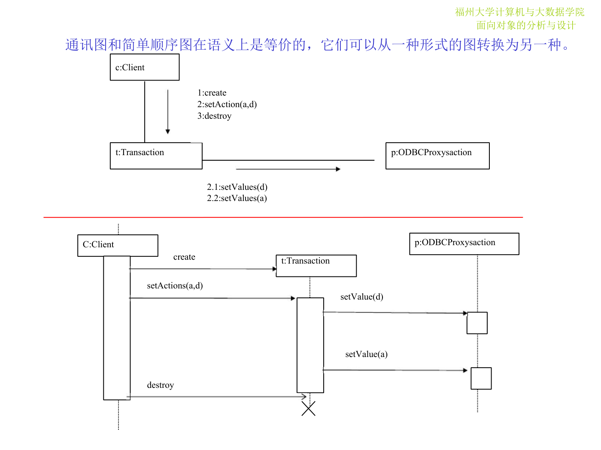
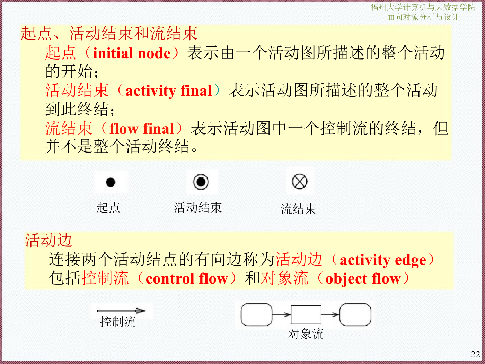
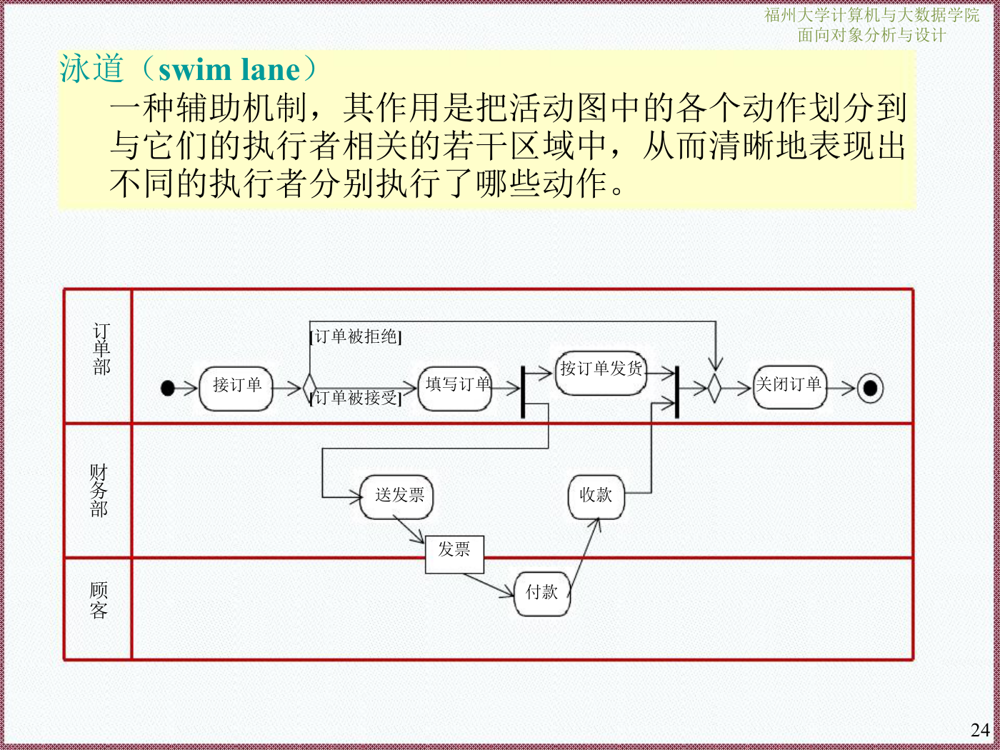
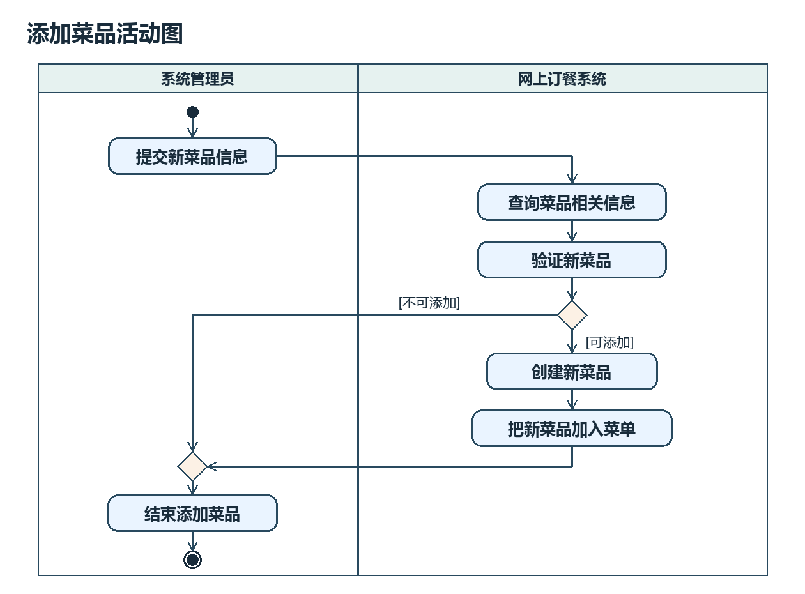
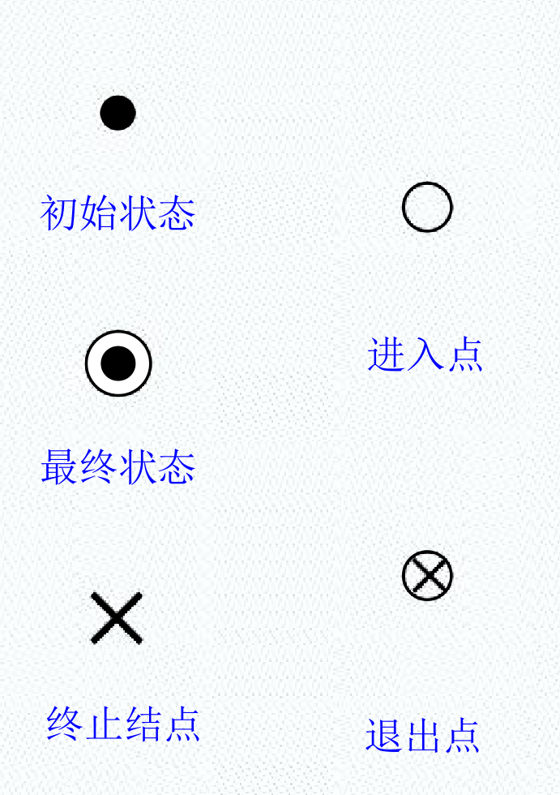
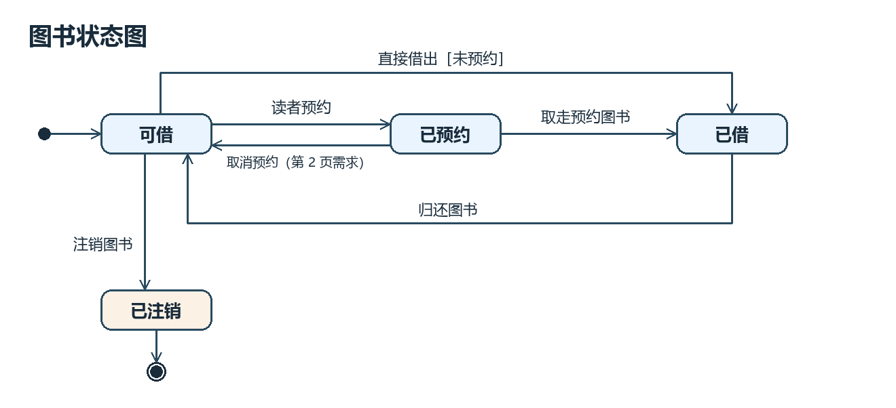
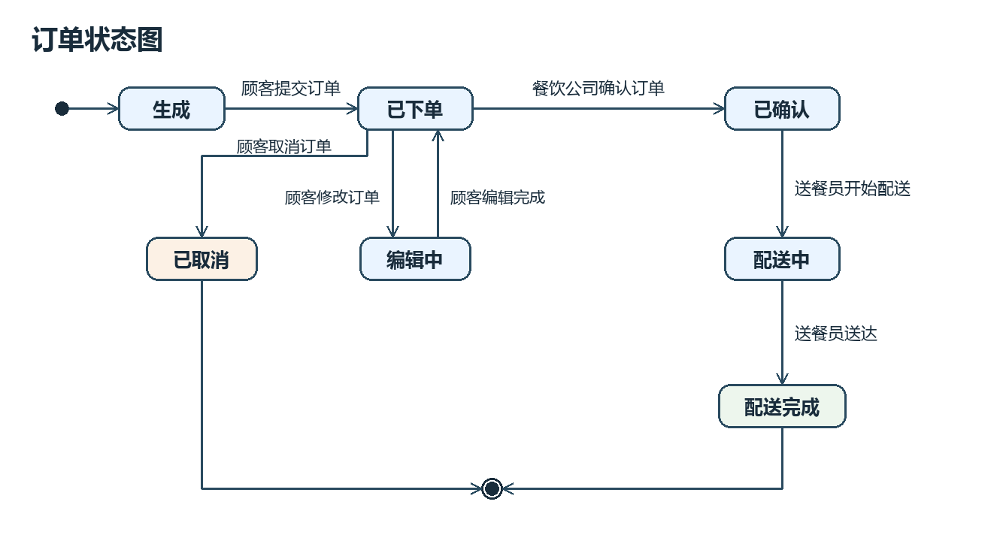
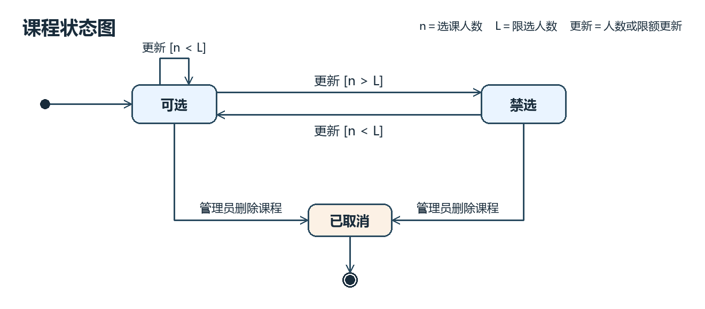
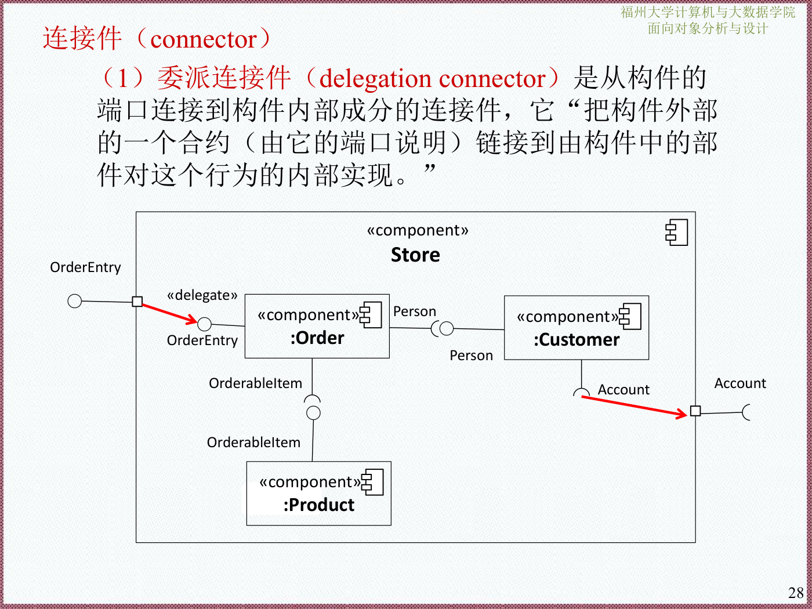
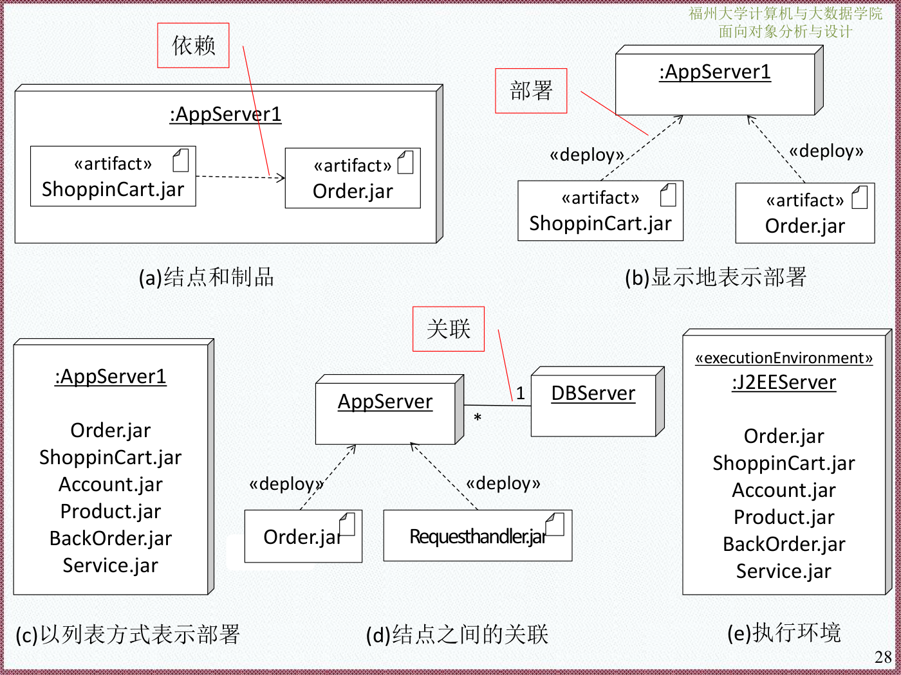

# 第9章 UML 中的几种其他图 (b)

对应 **第9章 UML中的几种其他图(b).pdf**.pdf>)，页码按 PDF 阅读器计。通信图、活动图、状态机图可用案例分析 2、4、5 的同类型题练习。

## 1. 通信图／通讯图（第 1–3 页）

通信图是 UML2 的四种交互图之一，UML1 称协作图。图关注**谁与谁通信**。对象和角色可横向散布，画出通信链路。消息沿链路用短箭头指示方向，标 `顺序号: 消息(参数)`。同一条链路可承载多个不同方向的消息。主层可用 `1, 2, 3`，处理第 2 条时内部再发的消息可用 `2.1, 2.2`。有条件或重复的消息可在序号附近标守卫或迭代约束。

**与顺序图互换**。先抄参与对象和消息方向，再把顺序图的从上到下改成消息号，合并同一对对象的链路。课件说的是**简单顺序图**，即没有组合片段、交互使用等结构，并且没有消息超越问题。复杂组合片段中的条件、并行和时间约束须额外说明。通信链路表示本次交互有沟通路径，在类层可能由关联支撑，也可由依赖或临时引用实现。

| 案例 | 修正后要表达的消息 |
| --- | --- |
| **案例分析 2 第 6 页** 借／还书 | 按第 5 页的分支与循环给消息加条件和顺序号。借书只有资格通过才循环录入，达额度或录完就停止。还书循环录完所有归还图书，再登记归还信息并通知库存系统。参考图只扫一次，也把登记归还写成删除借阅记录，补上题干要求的记录与库存通知。 |
| **案例分析 4 第 6 页** 顾客订餐 | 先查看菜单、查询具体菜品、取详情，再将菜品加入购物车、创建订单项并纳入购物车，最后提交购物车、创建订单。图上第 4 条「加入购物车」应交给购物车或由菜品明确转发至购物车。第 5 条生成记录之后还要体现纳入动作。 |
| **案例分析 5 第 6 页** 选课／添加课程 | 参考答案把后续都画成无条件消息。选课执行、创建记录、成功信息只在 `[可选]` 时发生，新课程创建、插入、返回成功只在 `[可添加]` 时发生。两个图各从 1 编号，按调用嵌套给子消息编号。 |

## 2. 活动图（第 4–11 页）

活动图由**结点和边**组成，描述一个操作、跨对象功能或带人工参与的业务流程。动作是活动中当作原子单位的步骤，用圆角矩形写动词短语。整个活动由这些动作和流构成。课件对需要展开内部细节的动作提到 UML1 的「子活动」与 UML2 的「调用行为」动作。UML2 把活动图作为独立的行为图。

| 符号 | 进入／出去及含义 |
| --- | --- |
| 起点（●） | 从实心圆发出控制流，启动活动 |
| 活动结束（靶心） | 到达时终结整个活动，包括其余仍在运行的流 |
| 流结束（圈内 ×） | 只终止当前这条流，其余并行流可继续 |
| 判断（菱形） | 一进多出，按 `[条件]` 或 `[else]` 选择。分支条件应互斥、覆盖相关情况 |
| 合并（菱形） | 多进一出，接纳任一互斥分支返回，无同步等待 |
| 分岔（粗横／竖杠） | 一进多出，每个输出分支可并发执行 |
| 汇合（粗横／竖杠） | 多进一出，典型情形是各路均到达后同步继续 |
| 控制流、对象流 | 控制流交接执行顺序。传递的数据经对象结点（普通矩形）表明，例如把「发票」传给付款动作。两者都是有向活动边 |
| 泳道 | 按执行者划分动作，可以按角色、系统或部门画。跨泳道箭头表示控制或数据交给另一方 |

判断、合并可以画成一个组合菱形。汇合、分岔也可合用粗杠。普通题要等待所有并发任务时，从分岔出去的各路对应回到汇合。单支完成后直接结束时可用流结束。互斥路径用合并接回，误用汇合会要求同时等待走不到的分支。

### 活动题的案例勘误

- **案例分析 2 第 7 页**。读者、管理员、系统三泳道。参考图的扫描只进行一次。借书应在查显后按「还有待借书且未超额」返回继续扫，满足退出条件后记录借阅、发送库存更新，管理员还证交书，读者离开。资格不符合直接走离开路径。归还同样需回到扫码直到录完，再**登记归还**并更新库存、归还证件。动作「验证读者信息」可拆成管理员扫描、系统检索和校验两个职责。
- **案例分析 4 第 7 页**。订餐图画顾客与系统泳道，生成订单后补出题干明确的**保存到数据库**，可写在同一动作或单独写。添加菜品图画管理员与系统泳道，参考图把失败线从「验证」动作框引出并绕过管理员的结束动作。修正时由同一个菱形引出 `[可添加]` 和 `[不可添加]`，成功时创建并加入菜单，两路汇到合并菱形，再走管理员「结束添加菜品」。起点和活动结束分别画实心圆、黑色靶心。
- **案例分析 5 第 7 页**。分别画学生／系统、教务管理员／系统。选课成功区除了生成记录，还应按题干返回选课成功。添加课程成功区应体现创建新课程、加入课程列表、返回成功。校验不通过走结束路径，保留 `[不可选]` 或 `[不可添加]` 边。若画出题干第 ④ 步的共同结束动作，先合并成功和失败路径再进入该动作。

## 3. 状态机图（第 12–22 页）

状态机图又叫状态图或 STD，描述一个对象或少数相关对象在生命期内有哪些状态，为什么、何时、如何转换。状态用圆角矩形，展开时下半格可写 `entry / 行为`、`do / 行为`、`exit / 行为`。状态代表稳定的行为规则。容量 1000 的栈按「空、部分占用、满」划分即可，每个状态下允许的压入、弹出行为一致。

| 课件图形 | 名称与含义 |
| --- | --- |
| ● 实心圆 | 初始伪状态。进入区域后选择初始状态。初始线通常无触发器、无守卫，可带效果 |
| 靶心 | 最终状态，表示所在区域完成。课件和伪状态并列展示，正式术语是 FinalState |
| × 独立叉 | 终止伪状态（terminate），立即终止整个状态机的执行 |
| ○ 空心小圆 | 进入点（entry point），提供进入组合状态或子状态机的指定入口 |
| 圈内 × | 退出点（exit point），提供离开组合状态或子状态机的指定出口。出现在活动图时读作流结束 |
| 带子状态的大圆角框 | 组合状态，可展开所含子状态或压缩。简单状态内部没有子状态 |
| `状态名: 子状态机名` | 子状态机状态，把另一个状态机作为一个可复用的状态单元 |

- **转移标签**写成 `触发器(参数) [监护约束] / 效果`。一条转移可列多个触发器。参数可有类型，用在条件和效果中。事件发生时才检查守卫，守卫是真才可走该边。没有其他转移消费、也没有延迟处理时，该事件可被丢弃。给守卫加方括号，动作放斜线后。
- **自转移**由某状态出发再返回同一状态，外部自转移会退出再进入。内部转移写在状态内部，不执行出入状态的行为。
- 第 20 页电话例用组合状态组织忙、振铃、通话等阶段，`after(15 sec)` 可触发超时。识别出状态差异后，可反推类的状态属性及引发变更的操作。动作流程与状态生命周期分别用对应的图验证。

### 三道案例状态图

**图书**。初始到可借。可借在「预约图书」下到预约，在「借出图书」下到已借。预约在「取走预约图书」下到已借，已借在「归还图书」下回可借。可借在「系统管理员注销图书」下到注销。第 4 页正文误写「在线选课系统」，建模对象仍是图书。参考图额外有「预约 → 可借」的取消预约边，来源可追溯到同案例第 2 页需求。只按第 4 页答题时可省，综合案例时注明依据。若注销意味着本模型所跟踪的生命周期结束，再接最终状态。**案例分析 2 第 4 页**

**订单**。题干第 4 条是**已下单**经「顾客取消订单」到取消，参考图误接在生成。订单创建后进入生成，提交后进入已下单，编辑开始和编辑完成形成往返。确认、开始配送、配送完成依次前进。图假定取消或配送完成即为本题跟踪终点。**案例分析 4 第 4 页**

**课程**。参考图印刷的两条可选／禁选转移方向需按题干修正。令 `n` 为选课人数，`L` 为限选人数。人数或限额更新时，`[n > L]` 从可选到禁选，`[n < L]` 从禁选回可选，也可使可选自转移。等于时的额外规则题干未给出，照抄题意的严格不等式。删除课程未限制来源，修正版从可选和禁选都可到取消，初始伪状态直接指向可选。**案例分析 5 第 4 页**

## 4. 构件图（第 23–30 页）

构件封装内部，是在满足相同接口的前提下可替换的模块。可复用构件按相应约定设计，便于在多个系统使用。构件图说明构件组织和关系，支持按构件实现与发布。UML2 扩充了接口、端口、内部结构、连接件等表达。

| 元素 | 识图要点 |
| --- | --- |
| 构件 | 矩形可标 `«component»` 或构件小图标。压缩式给名字与外部接口。黑箱分栏只展示对外接口，白箱可列接口、实现类、制品，展开可直接画内部部件 |
| 端口 | 构件边界上的小方块，外向匹配供／需接口，内向连接实现部件 |
| 供接口、需接口 | 供接口画托球，是构件实现的接口。需接口画托座，是构件使用的接口。详式的实现是虚线空心三角，使用是虚线开口箭头 |
| 构件实现 | 由类到构件的实现关系，或在构件框内画实现类及其关系 |
| 一般依赖 | 依赖者以虚线开口箭头指向被依赖构件 |
| 委派连接件 | 从构件边界端口接到内部部件，将对外承诺交由内部实现，可标 `«delegate»` |
| 组装连接件 | 不同构件之间匹配供／需接口，托球接入托座 |

## 5. 部署图与随附的模型规约（第 31–43 页）

UML2 部署图表达**运行时结点上放哪些制品**。UML1 定义曾按结点上的构件、进程和对象描述。结点可为物理设备或执行环境，通常画立体框。执行环境可标 `«executionEnvironment»`，如应用服务器。制品是物理交付或使用的信息块，可标 `«artifact»`，如源文件、JAR、数据库表、安装文档。结点间画通信关联，制品间可有依赖。

课件第 33 页画了三种部署形式。将制品框嵌进结点、在结点里列制品名，或以标 `«deploy»` 的虚线显式表达。该页的显式示意由制品指向宿主结点。可用嵌入或列表方式直接写清部署位置。

第 34–43 页重复了第 10 章。模型规约补充模型图的细节，类规约包含总体、属性、操作、实例说明，其他模型图按用途补规约。详细字段见 **第 10 章**。
